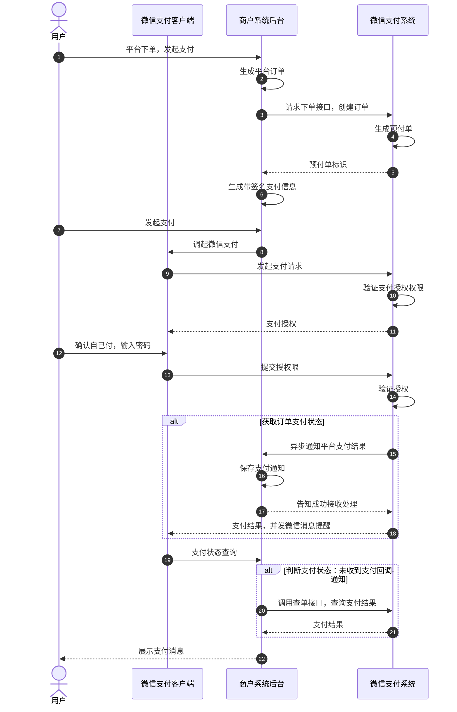

>更新时间：2026.10.22

业务流程时序图

图7.9 微信内网页支付时序图

商户系统和微信支付系统主要交互：

1.商户server调用统一下单接口请求订单，api参见公共api【[统一下单API](https://pay.weixin.qq.com/doc/v2/partner/4011936644.md)】

2.商户前端可通过【[JSAPI调起支付API](https://pay.weixin.qq.com/doc/v2/partner/4011936643.md)】调起微信支付，发起支付请求。

3.商户server接收支付通知，api参见公共api【[支付结果通知API](https://pay.weixin.qq.com/doc/v2/partner/4011936650.md)】

4.商户server查询支付结果，api参见公共api【[查询订单API](https://pay.weixin.qq.com/doc/v2/partner/4011936645.md)】（查单实现可参考：[支付回调和查单实现指引](https://pay.weixin.qq.com/doc/v2/partner/4011984698.md)）