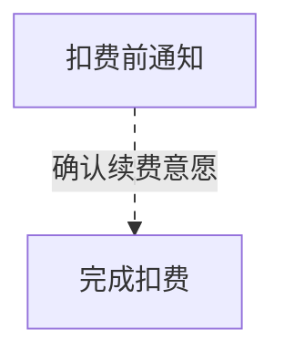

>更新时间：2026.10.21

## 扣费前通知说明

由于周期扣费的服务特点为“基于规则而非用户行为触发”，因此扣费前，需要为用户下发扣费前通知，确保用户的支付意愿。

下发扣费前通知后，在约定时间内：

- 若用户拒绝续费，可关闭扣费服务

- 若用户接受续费，则无需额外操作

注意：目前支持通知后24小时自动扣费、或提前使用独立的通知接口两种模式。（支付中签约：pay/contractorder是独立接口，以下扣款规则只适用于申请扣款接口：pay/pappayapply，两种模式只能二选一）

| 通知方式 | 特点 | 详细说明 | 注意事项 | 相关接口说明 |
| --- | --- | --- | --- | --- |
| 通知后24小时扣费 | 不需要额外接入通知接口 | 商户发起扣费请求后，会立刻为用户下发扣费前通知，然后在24小时后自动完成扣费（如果用户为首次签约｛包含解约后重新签约｝，从用户签约成功时间开始算，商户在12小时内发起的扣款，会被立即执行，无延迟。商户超过12小时以后发起的扣款，都按24小时后自动完成扣费执行） | 请求扣费后，微信支付会返回受理成功，订单会在24小时内持续处在处理中的状态，在订单状态没有变为成功或失败之前，请勿重复发起扣费，避免频率限制。 | 商户只需调用【申请扣款】接口 |
| 预扣费通知 | 使用单独的“预扣费通知”下发消息，扣费逻辑无需理解通知的规则 | 商户在扣款前请求独立的通知接口为用户下发通知后，在扣款日可正常发起扣费（如果用户为首次签约｛包含解约后重新签约｝，从用户签约成功时间开始算，商户在12小时内可直接调用【申请扣款】接口，扣费会被立即执行，无延迟。若12小时内已成功调用【预扣费通知】接口或超过12小时以后发起扣款，则都需按【预扣费通知】流程执行） | 无需修改扣费流程，仅需根据事先判断的扣费时间，提前请求下发预扣费通知，下发成功后，可正常扣费 | 商户必须先调用【预扣费通知API】接口后调用【申请扣款】接口 |

## 预扣费通知示例

扣费成功的示例

商户处理流程

1. 商户在1号调用预扣费通知。

2. 2号为扣费等待期，商户不可扣费，用户可随时关闭。

3. 3～9号共7天为可扣费期

- 扣费期内仅在每天7:00～22:00期间可以发起扣费

- 扣费期内可多次尝试扣费

- 扣费期内实时扣费

- 扣费失败用户无感知

- 扣费成功后用户可收到扣费凭证，扣费成功后，当前周期提前结束

用户感知

商户调用[预扣费通知](https://pay.weixin.qq.com/doc/v2/partner/4011988373.md)时，用户会收到如下模板消息

