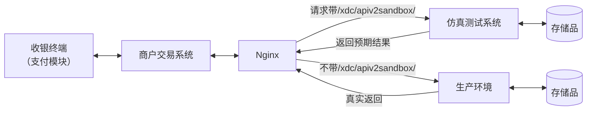
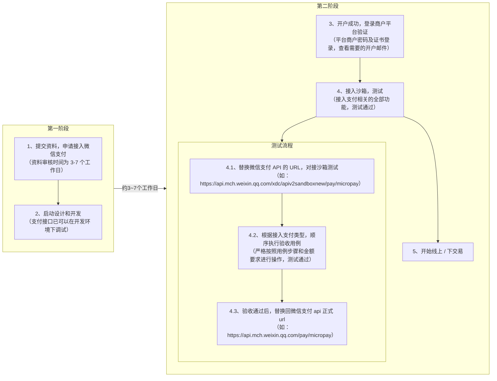

>更新时间：2025.03.21

## 阅读对象

本文阅读对象为：商户自有系统（包括但不限于：在线购物平台、人工收银系统、自动化智能收银系统、APP应用等）负责微信支付功能测试的测试及开发人员。

## 测试说明

### 一、概述

为保证商户接入质量，提升交易安全及用户体验，微信支付的合作服务商在正式上线交易前，建议先根据本文指引完成正常与异常情况的测试。

### 二、仿真测试系统

为降低商户测试门槛，微信支付团队开发了一套独立的仿真测试系统。该系统分为两种用例类型：支付成功用例与支付异常用例。支付成功用例根据测试用例金额的不同返回不同的响应报文，支付异常用例的识别将通过 Http Header 中添加异常头 Wechatpay-Negative-Test: {用例名} 识别。沙箱系统将通过识别用例名返回对应的异常信息。

图1 微信支付仿真测试系统

图1为微信支付仿真测试系统（后简称仿真系统）的简化原理图。仿真系统的API协议与正式API完全相同（[API接口文档](https://pay.weixin.qq.com/doc/v2/merchant/4011936530.md)）。商户开发者只需将正式API的调用URL增加一层 xdc/apiv2sandbox 路径，即可对接到仿真系统。

例如，付款码支付URL：https://api.mch.weixin.qq.com/pay/micropay

变更为：https://api.mch.weixin.qq.com/xdc/apiv2sandbox/pay/micropay。

注意：

目前只支持[付款码支付成功用例.docx](https://gtimg.wechatpay.cn/resource/xres/mmpaydoc/static/attachment/0352bc9cab5292c1262cc6c1ffd3fc21/付款码支付成功用例.docx)与[付款码支付异常用例.docx](https://gtimg.wechatpay.cn/resource/xres/mmpaydoc/static/attachment/1875b3a6d006115eedc63f3db6d8f153/付款码支付异常用例.docx)中的接口调用，下单接口：https://api.mch.weixin.qq.com/pay/unifiedorder 等目前暂不支持使用

仿真系统与生产环境完全独立，包括存储层。商户在仿真系统所做的所有交易（如下单、支付、查询）均为无资金流的假数据，即：用户无需真实扣款，商户也不会有资金入账。代金券同理，沙箱环境中无需商户真实制券与发券，亦不会出现真实扣券情况。测试仿真测试系统的API验签密钥需从API获取:

获取验签秘钥API：

|     |     |
| --- | --- |
| 请求Url | https://api.mch.weixin.qq.com/xdc/apiv2getsignkey/sign/getsignkey |
| 是否需要证书 | 否 |
| 请求方式 | POST |

请求参数：

|     |     |     |     |     |     |
| --- | --- | --- | --- | --- | --- |
| 字段名 | 字段 | 必填 | 示例值 | 类型 | 说明 |
| 商户号 | mch\_id | 是 | 1305638280 | String(32) | 微信支付分配的微信商户号 |
| 随机字符串 | nonce\_str | 是 | 5K8264ILTKCH16CQ2502SI8ZNMTM67VS | String(32) | 随机字符串，不长于32位 |
| 签名 | sign | 是 | 5K8264ILTKCH16CQ2502SI8ZNMTM67VS | String(32) | 签名值 |

返回参数：

|     |     |     |     |     |     |
| --- | --- | --- | --- | --- | --- |
| 字段名 | 字段 | 必填 | 示例值 | 类型 | 说明 |
| 返回状态码 | return\_code | 是 | SUCCESS | String(16) | SUCCESS/FAIL 此字段是通信标识，非交易标识 |
| 返回信息 | return\_msg | 否 | 签名失败 | String(128) | 返回信息，如非空，为错误原因 ，签名失败 ，参数格式校验错误 |

以下字段在return\_code 为SUCCESS的时有返回。

|     |     |     |     |     |     |
| --- | --- | --- | --- | --- | --- |
| 字段名 | 字段 | 必填 | 示例值 | 类型 | 说明 |
| 商户号 | mch\_id | 是 | 1305638280 | String(32) | 微信支付分配的微信商户号 |
| 沙箱密钥 | sandbox\_signkey | 否 | 013467007045764 | String(32) | 返回的沙箱密钥 |

商户接入仿真系统的交互流程示例：

1. 商户发起付款码支付请求，使用POST方式调用 https://api.mch.weixin.qq.com/xdc/apiv2sandbox/pay/micropay

2. 带xdc/apiv2sandbox的https请求会被nginx路由到仿真系统。仿真系统根据对应用例返回预期报文给商户。同时，落地该笔请求数据；

3. 商户发起查单，调用 https://api.mch.weixin.qq.com/xdc/apiv2sandbox/pay/orderquery，带上微信订单号（transaction\_id）或商户内部单号（out\_trade\_no）；

4. 仿真系统收到查单请求后，根据单号及金额返回预期的查单结果给商户

### 三、测试流程

图2 商户接入测试流程

如图2，商户在收到微信支付审核通过的邮件后，即可用邮件中提供的开发者信息，启动测试测试工作。测试开始后，测试负责人可按照下表步骤操作：

| 步骤 | 准备项 | 说明 |
| --- | --- | --- |
| 1 | 商户通过审核，收到审核通过的邮件。 邮件中包含了商户的MCHID、APPID及密码等开发者信息。 | / |
| 2 | 测试硬件全部到位，且被测的APP已被成功安装在硬件。 | 1、付款码支付：被测app已被安装至收银台平板，机具或扫码枪功能正常 |
| 3 | 按照本文下方测试用例进行测试 | / |
| 4 | 修改代码或配置中所有微信支付api的链接，对接仿真系统。 | 例如：付款码支付现网的api https://api.mch.weixin.qq.com/pay/micropay 变更为： https://api.mch.weixin.qq.com/xdc/apiv2sandbox/pay/micropay |
| 5 | 严格按照用例的顺序、金额执行用例，确保用例的检查点完全符合预期。 | / |

## 测试用例

请根据您需要开通的功能来选择相应的测试用例进行测试：

◆ [付款码支付-成功用例.docx](https://gtimg.wechatpay.cn/resource/xres/mmpaydoc/static/attachment/0352bc9cab5292c1262cc6c1ffd3fc21/付款码支付-成功用例.docx)

◆ [付款码支付-异常用例.docx](https://gtimg.wechatpay.cn/resource/xres/mmpaydoc/static/attachment/1875b3a6d006115eedc63f3db6d8f153/付款码支付-异常用例.docx)