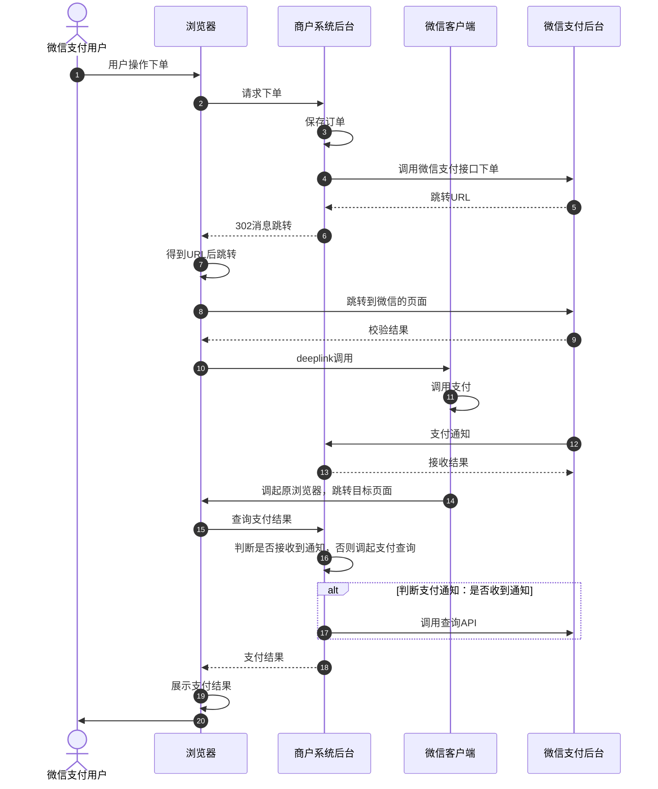

>更新时间：2026.06.10

## 接口流程图



## 安全标准规范流程图

```mermaid
sequenceDiagram
  autonumber
  actor p0 as 用户
  participant p1 as 商户H5前端
  participant p2 as 商户后端
  participant p3 as 微信支付系统
  p0->>p1: 用户操作下单
  p1->>p2: 请求下单
  alt 浏览器 preflight 请求
    p1->>p2: options请求
    p2->>p2: 判断Origin头部是否合法
    Note over p0: OPTIONS /api HTTP/1.1
Access-control-request-headers: x-A,x-B
Access-control-request-method: POST
Origin: https://api.third.com
Referer: https://api.third.com/
    alt 判断Origin头部是否合法：是
      p2-->>p1: ：options请求正常响应
      Note over p2: HTTP/1.1 200 OK
Access-control-allow-credentials: true
Access-control-allow-headers: x-A,x-B
Access-control-allow-methods: POST, GET
Access-control-allow-origin: https://api.third.com
    else 否
      p2-->>p1: ：options请求异常响应
    end
    Note over p0: HTTP/1.1 403 Forbidden
（no access-control-allow header）

报错信息
  end
  p1->>p2: get/post请求
  p2->>p2: 判断Origin头部是否合法
  Note over p2: GET /api HTTP/1.1
Host: api.shanghu.com
Referer: https://api.third.com/1/2.html
Origin: https://api.third.com
Cookie: shanghu_uid=xxx;...
  p2->>p2: 判断Cookie是否关联到商户站点已注册用户
  alt api.third.com合法且用户登录态有效：是
    p2->>p2: 保存订单
    p2->>p3: 用微信支付接口下单
    p3-->>p2: 跳转URL
    p2-->>p1: ：请求下单正常响应
  else 否
    Note over p2: Access-Control-Allow-Origin: https://api.third.com
Access-Control-Allow-Credentials: true
    p2-->>p1: ：请求下单异常响应
  end
  Note over p2: HTTP/1.1 403 Forbidden
（no access-control-allow header）

报错信息
```

1、 用户向商户系统后台请求下单，商户后台必须做好安全校验

- 当跨域请求不是[简单请求](https://developer.mozilla.org/zh-CN/docs/Web/HTTP/CORS#%E7%AE%80%E5%8D%95%E8%AF%B7%E6%B1%82)时，浏览器会发起Options[预检请求](https://developer.mozilla.org/zh-CN/docs/Web/HTTP/CORS#%E9%A2%84%E6%A3%80%E8%AF%B7%E6%B1%82)，此时商户后台需要支持Options请求且校验Origin头部，如果不在允许的白名单列表内，则返回403且不返回 `Access-Control-Allow-*` 相关头部

- 针对GET/POST的跨域下单请求，商户后台需要校验Origin头部是否合法且用户Cookie是否完备（若用户未登陆则先引导登陆商户站点），否则返回403且不返回 `Access-Control-Allow-*` 相关头部


2、由商户后台向微信支付发起下单请求（[调用统一下单接口](https://pay.weixin.qq.com/doc/v2/merchant/4011937163.md)）注：交易类型trade\_type=MWEB

3、统一下单接口返回支付相关参数给商户后台，如支付跳转url（参数名“mweb\_url”），商户通过mweb\_url调起微信支付中间页

4、中间页进行H5权限的校验，安全性检查（此处常见错误请见下文）

5、如支付成功，商户后台会接收到微信侧的异步通知

6、用户在微信支付收银台完成支付或取消支付,返回商户页面（默认为返回支付发起页面）

7、商户在展示页面，引导用户主动发起支付结果的查询

8,、商户后台判断是否接收到微信侧的支付结果通知，如没有，后台调用我们的[订单查询接口](https://pay.weixin.qq.com/doc/v2/merchant/4011937309.md)确认订单状态（查单实现可参考：[支付回调和查单实现指引](https://pay.weixin.qq.com/doc/v2/merchant/4011984682.md)）

9、展示最终的订单支付结果给用户

注意：

- 商户需按照安全规范进行接入，若因未遵循规范接入而出现安全问题，财付通将根据《[微信支付服务协议](https://pay.weixin.qq.com/index.php/public/apply_sign/protocol)》条款处理

- 以上图示，仅为示例，只供参考。请商户自行确认是否实现了跨越访问白名单限制和用户登录态校验。