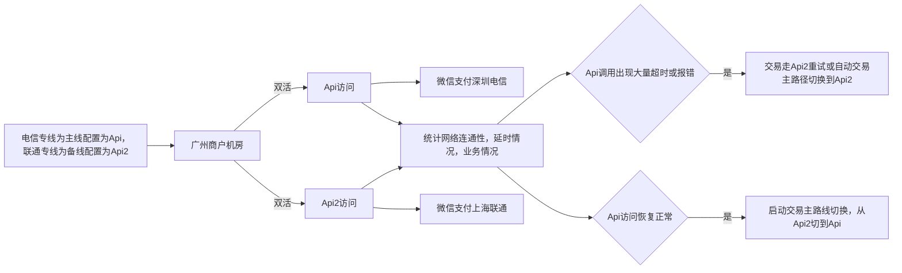
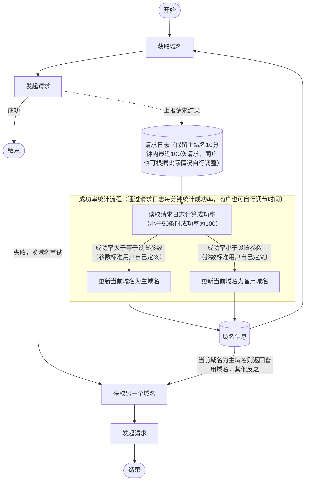
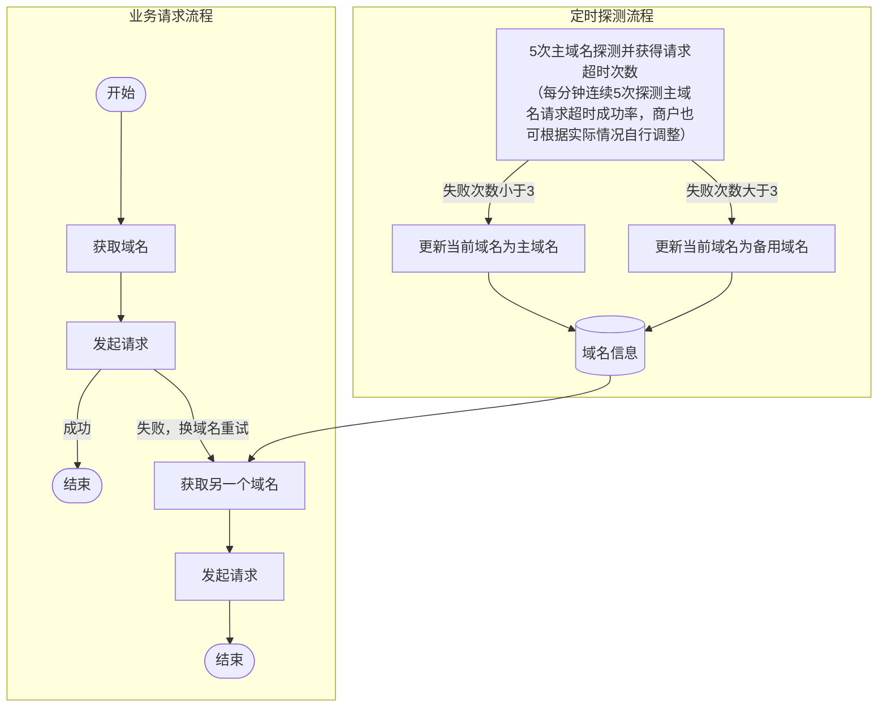
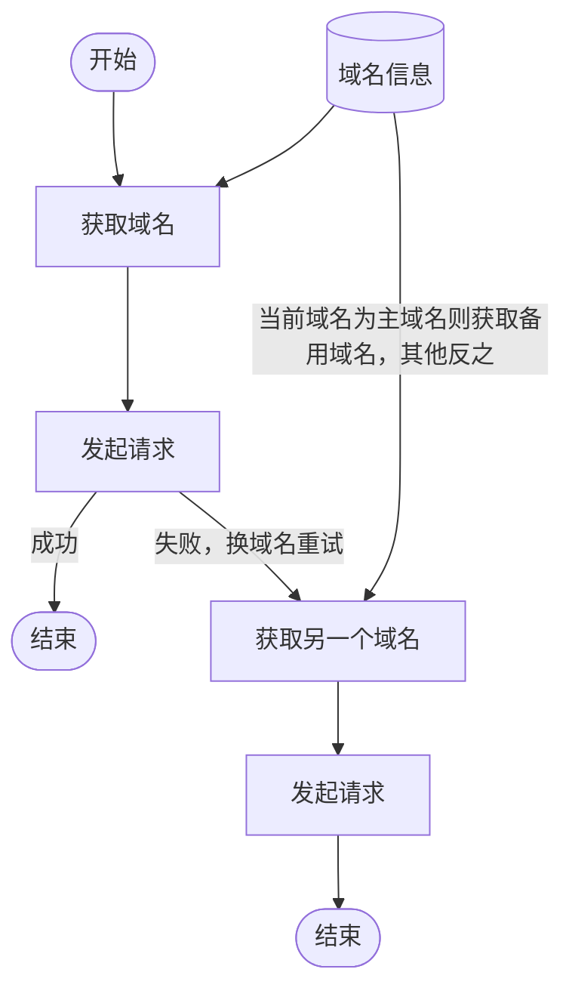
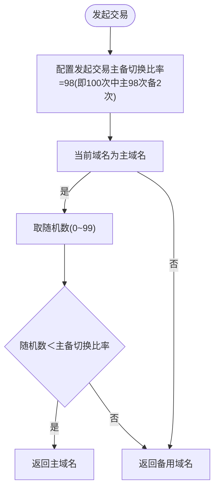

>更新时间：2025.03.21

本指引供商户升级商户支付系统参考，商户应当根据商户系统的实际情况采取相应的升级操作，并对商户支付系统的安全性负责。

## 简介

什么是冗灾？异地灾备的重要性？

当光缆被挖断、机房出现异常，或因不可抗拒原因（如地质灾害）等造成正常路径上业务不可用，通过备份路径和措施来保证业务继续正常进行。

## 商户实现跨城冗灾整体流程

## 专线商户方案

方案A：多专线异地机房实现跨城冗灾

|  | 商户侧要求 | 微信支付 |
| --- | --- | --- |
| 专线 | 两条异地专线 1、如果已拉单专线，需要补一条异地专线(商户侧发起) 2、如果已有两条同城专线，需要将其中一条改到异地机房（商户侧发起） | 提供四个专线接入点： 上海电信 上海联通 深圳电信 深圳联通 |
| 机房 | 无要求 | 上海 深圳 |
| 冗灾规则 | 专线双活、业务双活（专线同时跑交易） 支持专线、机房异常、跨城冗灾 | 每个中心独立业务部署 |
| 冗灾触发机制 | 可按实际情况按以下方案实现： 1. 方案1：统计每条专线的连接耗时、丢包率、业务成功率；出现异常情况可自动切换到最优链路     2. 方案2：统计接口（例如：下单API）成功率，失败率升高自动启动冗灾，比如失败率降到50%，     3. 方案3：定时探测（例如：查单API），连续3次探测失败（连接超时，响应超时，HTTP状态码：5xx表示服务器错误）自动启动冗灾     注意：专线回调类API有主备区分，切换路径后，回调域名也应该换到对应域名 | - |
| 正常回切机制 | 有探测机制，能自动恢复双活 | - |

跨城冗灾需支持的范围：微信支付 和 公众平台 业务微信支付域名：api.mch.weixin.qq.com（主域名）； api2.mch.weixin.qq.com（备域名）

公众平台域名：api.weixin.qq.com（主域名）； api2.weixin.qq.com（备域名）

公众平台资源域名： res.wx.qq.com（主域名） ；res2.wx.qq.com（备域名）

以广州专线商户为例，说明冗灾流程

专线应开通公众平台访问策略，公众号支付有涉及到公众平台授权接口调用。

方案B：同城专线+公网灾备实现跨城冗灾

正常使用专线方案运行，应具备自动切换到公网的条件（定时探测公网可用性）和实现公网冗灾的逻辑。

## 公网商户方案

|     |     |     |
| --- | --- | --- |
|  | 商户侧要求 | 微信支付 |
| 机房和运营商 | - | 商户侧DNS就近解析，微信支付提供六个接入点： 上海电信、深圳电信、天津电信 上海联通、深圳联通、天津联通 |
| 冗灾规则 | 要求：双活，发生故障能主备切换，恢复后能回切 1、主域名是主通道， 备用域名（跨城解析域名）可以采用1%以内的流量做验证 2、遇到主域名异常要能将主要通道自动切换到备用域名（跨城解析域名）访问 3、当主域名恢复正常后，主要通道要从备用域名（跨城解析域名）回切访问 | 主域名：同运营商就近解析； 备域名：同运营商跨城解析； 网络延时对比：主域名小于备域名 |

跨城冗灾方案说明：

正常使用主域名调用，备域名需有流量，保证业务能实时切换。当域名出现请求超时、读写超时，自动换备域名重试。

交易主链路和交易备链路做好动态流量分配，保证遇到异常能够自动切换。例如可以统计主备域名的连接耗时、丢包率、业务失败率，出现异常情况（例如5秒钟内统计业务失败率超过50%）可自动切换到最优链路。

|     |     |     |     |     |
| --- | --- | --- | --- | --- |
| 方案名称 | 适用商户 | 优点 | 缺点 | 补充说明 |
| 方案一：统计主域名实际请求成功率，实现主备域名实时切换策略 | 交易量大 | 1、基于实际业务请求结果数据，冗灾切换准确率高 2、配合高频率统计计算，能够达到出现故障时在更短的时间内做出切换 | 1、和业务耦合深，需要上报每次请求结果 2、交易量小的商户，用于冗灾统计的数据少，很难达到理想的冗灾效果 | 增加重试逻辑：访问一个域名失败之后，可以换一个域名进行重试，从而提升单次业务请求成功率 |
| 方案二：定时探测主域名连通性，实现主备域名实时切换策略 | 1、交易量较少 2、不希望对现有业务做过多改造 | 1、业务流程改动少，使用方式简单 2、生效的时间固定，和交易量无关 | 1、交易量大的商户，探测周期过长的话，一旦出故障，影响笔数大 2、冗灾切换时效性低 | 增加重试逻辑：访问一个域名失败之后，可以换一个域名进行重试，从而提升单次业务请求成功率 |

微信支付提供两个自动切换方案供商户自行选择，需实现双活、流量分配、域名实时切换。

方案一：统计主域名实际请求成功率，实现主备域名实时切换策略

【备注说明】

主域名：api.mch.weixin.qq.com, api.weixin.qq.com

备用域名：api2.mch.weixin.qq.com, api2.weixin.qq.com

【方案流程图】

【业务请求流程】

1、准备好全局存储空间（比如配置文件、内存空间等）存放“域名信息”、“日志信息”并进行初始化；

2、发起业务请求之前，从域名信息库里面获取域名；

3、使用当前域名发起请求，成功，则上报成功结果并且流程结束；

4、使用当前域名发起请求，失败（连接超时、读写超时），则上报失败结果并且获取另一个域名进行重试，流程结束；

5、因业务问题导致失败，商户侧根据自身逻辑处理；

6、第3步和第4步中上报的请求结果存储规则：保留主域名10分钟内最近100次请求，商户也可根据实际情况自行调整。

【成功率统计流程】

1、定义主域名最小可用率，比如90%(具体数值商户可根据实际业务情况进行设定)；

2、启动定时探测器，取【业务请求流程】中的请求结果数据，对其进行汇总统计，计算成功率，每分钟一次（计算频率商户可根据实际业务情况进行设定）；

3、当主域名请求成功率大于等于最小可用率时更新当前域名为主域名；

4、当主域名请求成功率小于最小可用率时更新当前域名为备用域名。

方案二：定时探测主域名连通性，实现主备域名实时切换策略

【备注说明】

主域名：api.mch.weixin.qq.com, api.weixin.qq.com

备用域名：api2.mch.weixin.qq.com, api2.weixin.qq.com

【方案流程图】

【业务请求流程】

1、准备好全局存储空间（比如配置文件、内存空间等）存放“域名信息”并进行初始化；

2、发起交易前，从“域名信息”中获取当前域名；

3、使用当前域名发起请求，成功，则流程结束；

4、使用当前域名发起请求，失败（连接超时、读写超时），获取另一个域名进行重试，流程结束；

5、因业务问题导致失败，商户侧根据自身逻辑处理；

【定时探测流程】

1、启动定时探测器，每分钟一次进行主域名探测（探测频率商户可根据业务实际情况自行设定）；

2、连续探测主域名5次，失败（连接超时）次数小于3次，更新域名信息为主域名，失败（连接超时）次数大于等于3次，更新域名信息为备用域名；

3、探测方式可用curl、telnet等方式发起。

失败重试策略

【备注说明】

主域名：api.mch.weixin.qq.com, api.weixin.qq.com

备用域名：api2.mch.weixin.qq.com, api2.weixin.qq.com

【方案流程图】

【业务请求流程】

1、发起交易前，从“域名信息”中获取当前域名；

2、使用当前域名发起请求，成功，则流程结束；

3、使用当前域名发起请求，失败（连接超时、读写超时），获取另一个域名进行重试，流程结束；

4、因业务问题导致失败，商户侧根据自身逻辑处理；

实现双活的流量分配策略

【备注说明】

主域名：api.mch.weixin.qq.com, api.weixin.qq.com

备用域名：api2.mch.weixin.qq.com, api2.weixin.qq.com

【方案流程图】

【双活域名流量分配策略】

1、发起交易前需配置主备切换比率，值范围在0~99之间（具体数值商户可根据实际业务情况进行设定）；

2、当前域名是主域名的情况下，要进行流量分配。流量分配规则：先获取0~99的随机数，当随机数<主备切换比率则使用主域名发起交易，随机数>=主备切换比率则使用备用域名发起交易；

3、当前域名是备用域名的情况下，直接用备用域名发起请求。

## 验证

1、已升级支持跨城冗灾，商户自行验证

方案1：通过人工配置错误HOST模拟灾情

方案2：通过机房断专线的方式模拟

## 升级说明

1、微信支付侧实现跨城冗灾，为什么还需要商户配合？

当某个城市内的机房都不可用，微信支付侧会进行灾备处理，通过另外一个城市提供支付服务。商户侧需要通过主备域名切换的方式，访问微信支付正常服务，减小故障带来的影响。

2、涉及哪些API

微信支付API

公众平台后台API和前台JS资源

## 微信支付回调通知商户

1. 商户侧与微信支付约定私有的回调域名，形如

`xxxx.wxpay.local`，xxxx替换为商户名称简写，具体有以下两种方案可选：

随机模式： `xxxx.wxpay.local` 为随机回调域名，微信支付侧会将该域名在配置文件中定义为全部回调IP，随机选择和重试；

主备模式： `s.xxxx.wxpay.local` 顺序模式，是将电信IP作为主回调IP的回调域名，此时联通IP作为备用；

`r.xxxx.wxpay.local` 逆序模式，是将联通IP作为主回调IP的回调域名，此时电信IP作为备用；

1. 商户可以只用随机模式的私有回调域名，如果想要更好控制专线选择，可以在需要切换时使用主备模式，微信支付侧回调程序根据商户侧提供的私有回调域名自动适配回调IP。

2. 走专线还是走公网? 商户传的私有回调地址就走专线回调，其他回调地址类型走公网回调

## 专线冗灾演练

1. 双方约定时间定期或者不定期演练专线冗灾自动切换

2. 商户侧排查所有专线策略是否都通

3. 微信支付侧排查专线回调策略是否都通

4. 商户侧通过调整防火墙策略等方式断开其中一条专线，验证观察业务是否能自动切换至另一条线路，且切换过程中业务无损失

5. 恢复后再断开验证另一条专线

6. 如果商户侧能实现两条专线都不通自动走公网调用的话，可以再验证两条专线都断开的情况下，是否如预期走公网调用和走公网回调

7. 如遇故障影响业务，请优先回退，之后再排查原因。

## QA

见[社区QA](https://developers.weixin.qq.com/community/pay/doc/000ae006fe0b38c83468b256651008)