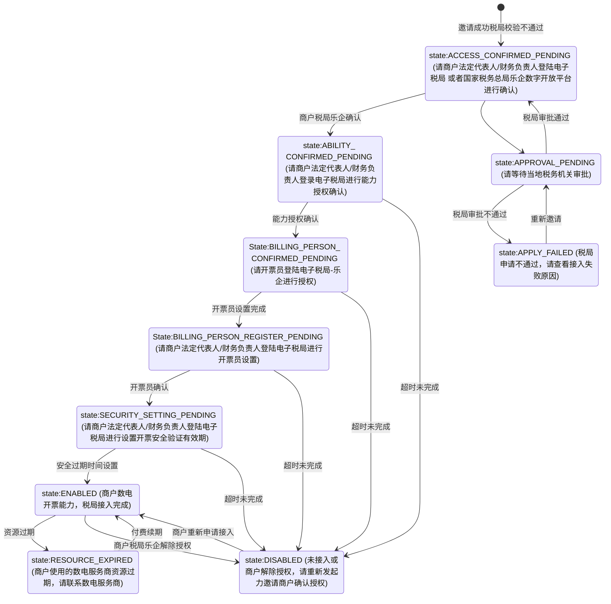
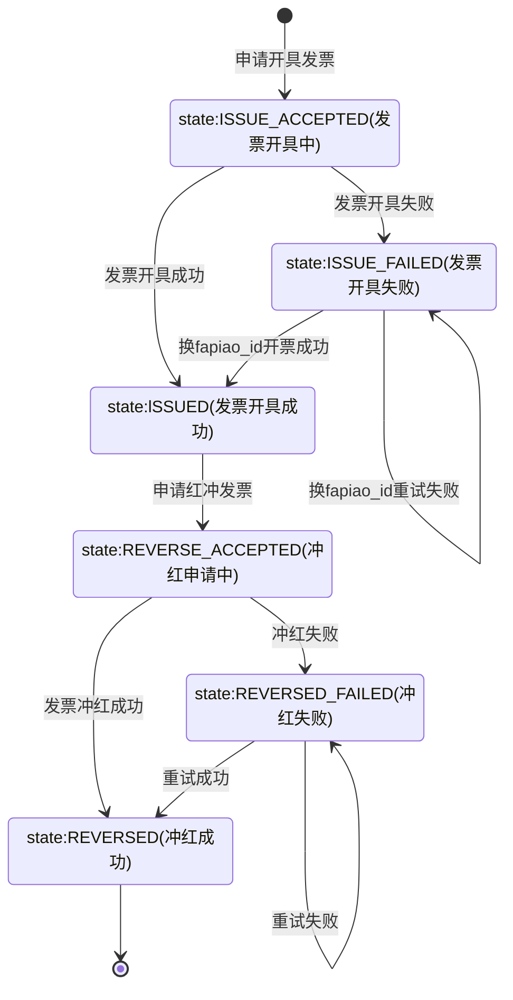

>更新时间：2026.06.10

## 1. 目标

通过本教程的学习，你应该可以：

- 邀请商户开通微信支付电子发票能力

- 设置商户的开发配置选项

- 让用户通过该商户的支付凭证开具微信支付电子发票

- 通过用户主动授权，使商户开具微信支付电子发票

- 将自建/第三方电子发票平台的发票，通过卡包交付给用户电子发票

- 开具或冲红数电发票，并下载微信支付电子发票文件


## 2. 业务处理流程

### 2.1 邀请商户开通微信支付电子发票

#### 2.1.1 业务描述

通过该业务，可以实现邀请未开通电子发票功能的商户开通微信支付电子发票。也可以邀请已经开通过电子发票功能的商户与原服务商/合作伙伴解除关联关系，并与新的服务商/合作伙伴进行绑定。还可以对已经开通了微信支付电子发票能力——微信电子发票数电模式的商户，追加邀请开通开票能力。

#### 2.1.2 业务示例代码

```
package com.java.partner;

import com.java.demo.CheckSubMchStatus; // https://pay.weixin.qq.com/doc/v3/partner/4015792561
import com.java.demo.CheckSubMchStatus.CheckSubMchStatusRequest;
import com.java.demo.CheckSubMchStatus.CheckSubMchStatusResponse;
import com.java.demo.CheckSubMchStatus.DigitalTaxAbilityInfo;
import com.java.demo.CheckSubMchStatus.DigitalTaxApplyStatus;
import com.java.demo.CheckSubMchStatus.DigitalTaxBillingPersonInfo;
import com.java.demo.CheckSubMchStatus.DigitalTaxMode;
import com.java.demo.CheckSubMchStatus.ThirdMode;
import com.java.demo.CheckSubMchStatus.ThirdModeStatus;
import com.java.demo.GetSpInviteUrl; // https://pay.weixin.qq.com/doc/v3/partner/4015941495
import com.java.demo.GetSpInviteUrl.FapiaoAbilityType;
import com.java.demo.GetSpInviteUrl.GetSpInviteUrlRequest;
import com.java.demo.GetSpInviteUrl.GetSpInviteUrlResp;
import com.java.demo.GetSpInviteUrl.InviteOperationType;
import com.java.demo.GetSpInviteUrl.InvoiceMode;
import com.java.demo.ListSpInviteMchInfo;  // https://pay.weixin.qq.com/doc/v3/partner/4015941524
import com.java.demo.ListSpInviteMchInfo.ListSpInviteMchInfoRequest;
import com.java.demo.ListSpInviteMchInfo.ListSpInviteMchInfoResp;
import com.java.demo.ListSpInviteMchInfo.MchInviteResultInfo;
import com.java.demo.ListSpInviteMchInfo.MchInviteStatus;
import com.java.utils.WXPayUtility;
import java.time.LocalDateTime;
import java.time.ZoneId;
import java.time.format.DateTimeFormatter;
import java.util.ArrayList;
import java.util.List;
import java.util.Objects;

public class InviteMerchantDemo {

    public static void main(String[] args) {
        // TODO: 请准备商户开发必要参数，参考：https://pay.weixin.qq.com/doc/v3/partner/4013080340
        GetSpInviteUrl getInvite = new GetSpInviteUrl(
                "19xxxxxxxx",
                // 商户号，是由微信支付系统生成并分配给每个商户的唯一标识符，商户号获取方式参考 https://pay.weixin.qq.com/doc/v3/partner/4013080340
                "1DDE55AD98Exxxxxxxxxx", // 商户API证书序列号，如何获取请参考 https://pay.weixin.qq.com/doc/v3/partner/4013058924
                "/path/to/apiclient_key.pem", // 商户API证书私钥文件路径，本地文件路径
                "PUB_KEY_ID_xxxxxxxxxxxxx", // 微信支付公钥ID，如何获取请参考 https://pay.weixin.qq.com/doc/v3/partner/4013038589
                "/path/to/wxp_pub.pem" // 微信支付公钥文件路径，本地文件路径
        );

        ListSpInviteMchInfo listSpInviteMchInfo = new ListSpInviteMchInfo(
                "19xxxxxxxx",
                // 商户号，是由微信支付系统生成并分配给每个商户的唯一标识符，商户号获取方式参考 https://pay.weixin.qq.com/doc/v3/partner/4013080340
                "1DDE55AD98Exxxxxxxxxx", // 商户API证书序列号，如何获取请参考 https://pay.weixin.qq.com/doc/v3/partner/4013058924
                "/path/to/apiclient_key.pem", // 商户API证书私钥文件路径，本地文件路径
                "PUB_KEY_ID_xxxxxxxxxxxxx", // 微信支付公钥ID，如何获取请参考 https://pay.weixin.qq.com/doc/v3/partner/4013038589
                "/path/to/wxp_pub.pem" // 微信支付公钥文件路径，本地文件路径
        );

        CheckSubMchStatus checkSubMchStatus = new CheckSubMchStatus(
                "19xxxxxxxx",
                // 商户号，是由微信支付系统生成并分配给每个商户的唯一标识符，商户号获取方式参考 https://pay.weixin.qq.com/doc/v3/partner/4013080340
                "1DDE55AD98Exxxxxxxxxx", // 商户API证书序列号，如何获取请参考 https://pay.weixin.qq.com/doc/v3/partner/4013058924
                "/path/to/apiclient_key.pem", // 商户API证书私钥文件路径，本地文件路径
                "PUB_KEY_ID_xxxxxxxxxxxxx", // 微信支付公钥ID，如何获取请参考 https://pay.weixin.qq.com/doc/v3/partner/4013038589
                "/path/to/wxp_pub.pem" // 微信支付公钥文件路径，本地文件路径
        );

        GetSpInviteUrlRequest inviteRequest = new GetSpInviteUrlRequest();
        inviteRequest.operationType = InviteOperationType.AUTH_BINDING;
        inviteRequest.fapiaoMode = new ArrayList<>();
        {
            inviteRequest.fapiaoMode.add(InvoiceMode.THIRD_OR_SELF_FAPIAO);
        }
        inviteRequest.fapiaoAbilityTypeList = new ArrayList<>();
        {
            inviteRequest.fapiaoAbilityTypeList.add(FapiaoAbilityType.BASE_ABILITY);
        }
        // 服务商设置标识此次邀请链接生成的渠道
        inviteRequest.inviteChannel = "miniprogram";
        // 服务商设置标识此次邀请链接生成的操作人员
        inviteRequest.operateUser = "mI7HGEJ4Q2B91IGjHZu/Gthm87Szv0MK2AoC0/3ZMDgltMtdoY6O0qZ4F1iXiwCuqkkBe+9M4ggvdzRVVVB9s+zLEQ8" +
        	"nv74vsgl77MZx14nd5obtCcfAvPfDJob3oG7FqlThmYKJqjiOwBvvQse7p9R8onj/POzSrbM8re8ZYGp4LcehXopTLdk2ZVWRv8bnJgKZeY4vpMmq4xuRTYk6xNXvowBBKLu4oaNFNdBO3fip1a1rFW0vRw==";
        inviteRequest.inviteCode = "code_20200101_123";
        // 子商户号非必填，如果填入表示这个链接只能邀请这个商户号，如果未填表示商户扫码后，需要手动输入商户号或者微信支付订单号来进行开通
        inviteRequest.subMchid = "19998278783";

        ListSpInviteMchInfoRequest listSpInviteMchInfoRequest = new ListSpInviteMchInfoRequest();
        final DateTimeFormatter dateTimeFormatter = DateTimeFormatter.ISO_OFFSET_DATE_TIME.withZone(
                ZoneId.of("Asia/Shanghai"));
        LocalDateTime now = LocalDateTime.now();
        // 定时查询当前时间过去10分钟之内邀请的商户信息
        listSpInviteMchInfoRequest.queryTimeStart = dateTimeFormatter.format(now.minusMinutes(10).atOffset(ZoneOffset.ofHours(8)));
        // 查询时间间隔不能查过7天
        listSpInviteMchInfoRequest.queryTimeEnd = dateTimeFormatter.format(now.atOffset(ZoneOffset.ofHours(8)));
        // 查询开始的起始位置
        listSpInviteMchInfoRequest.offset = 0L;
        listSpInviteMchInfoRequest.limit = 10L;
        // 与获取邀请链接时传入的inviteCode保持一致
        listSpInviteMchInfoRequest.inviteCode = "code_20200101_123";
        // 只有邀请成功的商户信息，才会同步返回商户号
        listSpInviteMchInfoRequest.mchInviteStatus = MchInviteStatus.MCH_INVITE_SUCC;

        try {
            GetSpInviteUrlResp response = getInvite.run(inviteRequest);

            //将inviteUrl转换为二维码，商户通过微信扫码后，
            //可以跳转到微信支付服务商电子发票能力开通页面，引导用户完成授权开通服务商电子发票能力。
            System.out.println("inviteUrl: " + response.inviteUrl);
            //通过指引https://developers.weixin.qq.com/miniprogram/dev/api/navigate/wx.navigateToMiniProgram.html，使用miniprogramAppid，miniprogramPath
            //引导商户跳转到微信支付服务商电子发票能力开通页面，完成授权开通服务商电子发票能力。
            System.out.println("miniprogramAppid: " + response.miniprogramAppid);
            System.out.println("miniprogramPath: " + response.miniprogramPath);

            // 等待商户操作完成开通
            // 如果服务商不知晓邀请商户的商户号，可以通过定时任务获取邀请确认授权成功的商户的商户号信息
            ListSpInviteMchInfoResp listSpInviteMchInfoResp = listSpInviteMchInfo.run(listSpInviteMchInfoRequest);
            List<MchInviteResultInfo> mchInviteResultList = listSpInviteMchInfoResp.mchInviteResultList;
            for (MchInviteResultInfo mchInviteResultInfo : mchInviteResultList) {
                if (mchInviteResultInfo.mchInviteStatus == MchInviteStatus.MCH_INVITE_SUCC) {
                    // 如果是邀请成功状态的商户，可以获取到商户的商户号，用于检查商户的开通授权状态
                    String subMchid = mchInviteResultInfo.subMchid;

                    CheckSubMchStatusRequest checkSubMchStatusRequest = new CheckSubMchStatusRequest();
                    checkSubMchStatusRequest.subMchid = subMchid;

                    // 服务商获取商户的商户号信息后，请求【检查子商户开票功能状态】（https://pay.weixin.qq.com/doc/v3/partner/4015792561）接口获取商户开通状态
                    CheckSubMchStatusResponse checkSubMchStatusResponse = checkSubMchStatus.run(
                            checkSubMchStatusRequest);
                    if (subMchid.equals(checkSubMchStatusResponse.subMchid)) {
                        ThirdMode thirdMode = checkSubMchStatusResponse.thirdMode;
                        DigitalTaxMode digitalTaxMode = checkSubMchStatusResponse.digitalTaxMode;
                        // 【获取邀请开通的商户信息】（https://pay.weixin.qq.com/doc/v3/partner/4015941524）邀请开通 【THIRD_OR_SELF_FAPIAO:第三方/自建发票】。检查该模式开通状态
                        if (Objects.nonNull(thirdMode)) {
                            ThirdModeStatus status = thirdMode.status;
                        }

                        // 获取邀请开通的商户信息】（https://pay.weixin.qq.com/doc/v3/partner/4015941524）邀请开通 【TENCENT_DIGITAL_TAX:腾讯数电发票】。检查该模式开通状态
                        if (Objects.nonNull(digitalTaxMode)) {
                            // 数电发票接入状态，根据【检查子商户开票功能状态】（https://pay.weixin.qq.com/doc/v3/partner/4015792561）状态描述判断用户开通的情况
                            DigitalTaxApplyStatus digitalTaxApplyStatus = digitalTaxMode.status;
                            List<DigitalTaxBillingPersonInfo> billingPersonInfoList = digitalTaxMode.billingPersonInfo;
                            for (DigitalTaxBillingPersonInfo digitalTaxBillingPersonInfo : billingPersonInfoList) {
                                // 商户在乐企平台上设置了开票员信息，才会返回对应开票员的开票员ID，用于开具数电发票接口，请求入参
                                String billingPersonId = digitalTaxBillingPersonInfo.id;
                            }
                            // 商户完成所有操作后，完成接入腾讯数电后的时间
                            String accessTime = digitalTaxMode.accessTime;
                            String expiredTime = digitalTaxMode.expiredTime;
                            String accessFailReason = digitalTaxMode.accessFailReason;
                            List<DigitalTaxAbilityInfo> abilityInfo = digitalTaxMode.abilityInfo;
                        }
                    }
                } else {
                    // 如果是邀请失败状态的商户，获取商户的商户名称，以及邀请开通失败的原因。
                    // 根据开通小程序页面下的帮助指引，指导商户解决问题重试开通授权流程
                    String epName = mchInviteResultInfo.epName;
                    String inviteFailedReason = mchInviteResultInfo.inviteFailedReason;
                }
            }
        } catch (WXPayUtility.ApiException e) {
            // 处理异常处理逻辑
            if (e.getErrorCode().equals("SYSTEM_ERROR")) {
                // 错误：系统错误
                // 解决方式：稍后重试
                // 描述：微信支付系统失败，建议等1分钟后再重试
            } else if (e.getErrorCode().equals("FREQUENCY_LIMITED")) {
                // 错误：限频报错
                // 解决方式：稍后重试
                // 描述： 接口频率限制，一定要原单重试，建议等1分钟后再重试
            } else if (e.getErrorCode().equals("ERROR")) {
                // 错误：系统错误
                // 解决方式：系统繁忙，请稍后重试
                // 描述：微信支付系统失败，建议等1分钟后再重试
            } else if (e.getErrorCode().equals("NO_AUTH")) {
                // 错误：服务商无权限
                // 解决方式：根据具体message，查看指引解决问题
                // 描述：
                // - 商户无权限访问，请确认是否已开通相关权限
                // - 服务商无电子发票权限，请联系支持开通服务商电子发票
                // - 乐企数电安全校验时间已过期，请登录电子税局重新设置数电安全校验时间
            } else if (e.getErrorCode().equals("SIGN_ERROR")) {
                // 错误：签名错误
                // 解决方式：检查平台商户证书序列号，证书私钥文件，公钥ID，公钥文件，同时确认下签名过程是不是按照微信支付的签名方式
                // 描述：签名报错，需要确认签名材料和签名流程是否正确
            } else if (e.getErrorCode().equals("PARAM_ERROR")) {
                // 错误：参数错误
                // 解决方式：按照报错返回的message，重新输入请求参数
                // 描述：参数的类型，长度，或者必填选项没有填写等
            } else if (e.getErrorCode().equals("INVALID_REQUEST")) {
                // 错误：请求非法，请求参数正确，但是不符合业务规则
                // 解决方式：根据具体message查看具体哪里不符合业务规则，如果可以修改参数达到符合业务规则的修改请求符合业务规则之后重试
                // 描述：不符合业务规则的场景如：
                // - 查询起止时间间隔不能大于7天
                // - 查询起始时间不能大于查询结束时间
            } else {
                // 其他类型错误：稍等一会后原单重试
            }
        }
    }
}
```

#### 2.1.3 商户操作

商户扫码生成的二维码或者点击按钮跳转到指定的小程序后，商户通过填写对应的微信支付商户号或者在商户交易的微信支付交易订单号后（如邀请填写了商户号，则不需要商户填写），即可按照指引进行微信支付电子发票能力的授权与开通

|     |     |     |
| --- | --- | --- |
|  |  |  |

|     |     |     |     |     |     |
| --- | --- | --- | --- | --- | --- |
|  |  |  |  | 法人扫脸<br> | 非法人扫脸<br> |

数电发票接入状态状态机：



### 2.2 设置商户开票配置

#### 2.2.1 业务示例代码

商户完成接入微信支付电子发票能力后，需要通过此流程，完成通知回调地址、是否支持开具专用发票等开票配置。

回调地址 by 服务商维度设置，设置一次即可。账单是否展示开发票入口，是否开专票 by 商户号设置。

```
package com.java.partner;

import com.java.demo.CreateFapiaoCardTemplate;  // https://pay.weixin.qq.com/doc/v3/partner/4015792562
import com.java.demo.CreateFapiaoCardTemplate.CardTemplateInfo;
import com.java.demo.CreateFapiaoCardTemplate.CreateFapiaoCardTemplateRequest;
import com.java.demo.CreateFapiaoCardTemplate.CustomCell;
import com.java.demo.CreateFapiaoCardTemplate.FapiaoCardTemplateEntity;
import com.java.demo.UpdateDevelopmentConfig; // https://pay.weixin.qq.com/doc/v3/partner/4015792563
import com.java.demo.UpdateDevelopmentConfig.DevelopmentConfigEntity;
import com.java.demo.UpdateDevelopmentConfig.UpdateDevelopmentConfigRequest;
import com.java.utils.WXPayUtility;

public class SetMerchantInvoiceConfigDemo {

    public static void main(String[] args) {
        // TODO: 请准备商户开发必要参数，参考：https://pay.weixin.qq.com/doc/v3/partner/4013080340
        CreateFapiaoCardTemplate createFapiaoCardTemplate = new CreateFapiaoCardTemplate(
                "19xxxxxxxx",
                // 商户号，是由微信支付系统生成并分配给每个商户的唯一标识符，商户号获取方式参考 https://pay.weixin.qq.com/doc/v3/partner/4013080340
                "1DDE55AD98Exxxxxxxxxx",
                // 商户API证书序列号，如何获取请参考 https://pay.weixin.qq.com/doc/v3/partner/4013058924
                "/path/to/apiclient_key.pem",     // 商户API证书私钥文件路径，本地文件路径
                "PUB_KEY_ID_xxxxxxxxxxxxx",      // 微信支付公钥ID，如何获取请参考 https://pay.weixin.qq.com/doc/v3/partner/4013038589
                "/path/to/wxp_pub.pem"           // 微信支付公钥文件路径，本地文件路径
        );

        UpdateDevelopmentConfig updateDevelopmentConfig = new UpdateDevelopmentConfig(
                "19xxxxxxxx",
                // 商户号，是由微信支付系统生成并分配给每个商户的唯一标识符，商户号获取方式参考 https://pay.weixin.qq.com/doc/v3/partner/4013080340
                "1DDE55AD98Exxxxxxxxxx",
                // 商户API证书序列号，如何获取请参考 https://pay.weixin.qq.com/doc/v3/partner/4013058924
                "/path/to/apiclient_key.pem",     // 商户API证书私钥文件路径，本地文件路径
                "PUB_KEY_ID_xxxxxxxxxxxxx",      // 微信支付公钥ID，如何获取请参考 https://pay.weixin.qq.com/doc/v3/partner/4013038589
                "/path/to/wxp_pub.pem"           // 微信支付公钥文件路径，本地文件路径
        );

        CreateFapiaoCardTemplateRequest createFapiaoCardTemplateRequest = new CreateFapiaoCardTemplateRequest();
        createFapiaoCardTemplateRequest.subMchid = "1900000109";
        createFapiaoCardTemplateRequest.cardAppid = "wxb1170446a4c0a5a2";
        createFapiaoCardTemplateRequest.cardTemplateInformation = new CardTemplateInfo();
        // 具体字段展示对应卡包展示内容在代码后有示例。
        createFapiaoCardTemplateRequest.cardTemplateInformation.payeeName = "某公司";
        createFapiaoCardTemplateRequest.cardTemplateInformation.logoUrl = "http://mmbiz.qpic.cn/mmbiz/iaL1LJM1mF9aRKPZJkmG8xXhiaHqkKSVMMWeN3hLut7X7hicFNjakmxibMLGWpXrEXB33367o7zHN0CwngnQY7zb7g/0";
        createFapiaoCardTemplateRequest.cardTemplateInformation.customCell = new CustomCell();
        createFapiaoCardTemplateRequest.cardTemplateInformation.customCell.words = "电子发票";
        createFapiaoCardTemplateRequest.cardTemplateInformation.customCell.description = "查看发票";
        // 点击卡券详情页自定义cell位后跳转的页面链接，用户跳转时会自动在链接后加上参数encrypt_code与card_id，商户需要调用code解码接口解码encrypt_code得到真实的code
        // https://developers.weixin.qq.com/doc/service/guide/product/card/Redeeming_a_coupon_voucher_or_card.html#5 2.2节 Code解码接口 解码encrypt_code
        // 通过【查询电子发票】接口，获取card_information.card_code 与 解密的Code进行比对，确认是否为该商户的电子发票。
        createFapiaoCardTemplateRequest.cardTemplateInformation.customCell.jumpUrl = "http://www.qq.com";
        createFapiaoCardTemplateRequest.cardTemplateInformation.customCell.miniprogramUserName = "gh_86a091e50ad4@app";
        createFapiaoCardTemplateRequest.cardTemplateInformation.customCell.miniprogramPath = "pages/xxxPage";

        UpdateDevelopmentConfigRequest updateDevelopmentConfigRequest = new UpdateDevelopmentConfigRequest();
        // 设置服务商的可以接受回调请求的地址，回调设置会校验接口是否能够正确返回http code 200，如果无法返回200，会返回错误。
        updateDevelopmentConfigRequest.callbackUrl = "https://pay.weixin.qq.com/callback";
        updateDevelopmentConfigRequest.subMchCode = "1900000109";
        updateDevelopmentConfigRequest.showFapiaoCell = false;
        updateDevelopmentConfigRequest.supportVatFapiao = false;

        try {
            FapiaoCardTemplateEntity fapiaoCardTemplateEntity = createFapiaoCardTemplate.run(
                    createFapiaoCardTemplateRequest);
            System.out.println("card_appid:" + fapiaoCardTemplateEntity.cardAppid);
            // 用于请求申请开具电子发票时，卡券模板ID参数
            System.out.println("card_id:" + fapiaoCardTemplateEntity.cardId);

            DevelopmentConfigEntity developmentConfigEntity = updateDevelopmentConfig.run(
                    updateDevelopmentConfigRequest);
            // 服务商申请接受回调请求的地址
            System.out.println("callback_url:" + developmentConfigEntity.callbackUrl);
            // 属于商户的微信支付账单凭证，是否展示开发票入口
            System.out.println("show_fapiao_cell:" + developmentConfigEntity.showFapiaoCell);
            // 商户是否支持开具增值税专用发票。如果设置为ture，针对商户所有的开票申请，填写抬头页面是否展示选择电子发票类型选项
            System.out.println("support_vat_fapiao:" + developmentConfigEntity.supportVatFapiao);
        } catch (WXPayUtility.ApiException e) {
            // 处理异常处理逻辑
            if (e.getErrorCode().equals("SYSTEM_ERROR")) {
                // 错误：系统错误
                // 解决方式：稍后重试
                // 描述：微信支付系统失败，建议等1分钟后再重试
            } else if (e.getErrorCode().equals("FREQUENCY_LIMITED")) {
                // 错误：限频报错
                // 解决方式：稍后重试
                // 描述： 接口频率限制，一定要原单重试，建议等1分钟后再重试
            } else if (e.getErrorCode().equals("ERROR")) {
                // 错误：系统错误
                // 解决方式：系统繁忙，请稍后重试
                // 描述：微信支付系统失败，建议等1分钟后再重试
            } else if (e.getErrorCode().equals("NO_AUTH")) {
                // 错误：服务商无权限
                // 解决方式：开通微信支付电子发票服务商权限，并且检查商户是否接受邀请开通授权微信支付电子发票能力，等1分钟后重试。
                // 描述：商户无权限访问，请确认是否已开通相关权限
            } else if (e.getErrorCode().equals("SIGN_ERROR")) {
                // 错误：签名错误
                // 解决方式：检查平台商户证书序列号，证书私钥文件，公钥ID，公钥文件，同时确认下签名过程是不是按照微信支付的签名方式
                // 描述：签名报错，需要确认签名材料和签名流程是否正确
            } else if (e.getErrorCode().equals("PARAM_ERROR")) {
                // 错误：参数错误
                // 解决方式：按照报错返回的message，重新输入请求参数
                // 描述：参数的类型，长度，或者必填选项没有填写等
            } else if (e.getErrorCode().equals("INVALID_REQUEST")) {
                // 错误：请求非法，请求参数正确，但是不符合业务规则
                // 解决方式：根据具体message查看具体哪里不符合业务规则，如果可以修改参数达到符合业务规则的修改请求符合业务规则之后重试
                // 描述：不符合业务规则的场景如：
                // - 创建发票卡券模板失败，请稍候重试
                // - 传入的参数“点击cell位跳转的地址”以及“点击cell位跳转的小程序的用户名/页面路径”均为空（位于/body/card_template_info/custom_cell/jump_url|miniprogram_user_name|miniprogram_page_path），
              	//   请检查参数格式是否符合要求
            } else {
                // 其他类型错误：稍等一会后原单重试
            }
        }
    }
}
```


设置商户支持开具专用发票后，用户填写抬头信息页面会支持选择开具的发票类型，服务商可以通过【[获取用户填写抬头信息](https://pay.weixin.qq.com/doc/v3/partner/4015784260.md)】获取到用户提交的申请开具发票的类型。


### 2.3 电子发票状态状态机



### 2.4 通过微信支付交易凭证开票

#### 2.4.1 业务描述

通过微信支付交易凭证，实现用户主动申请开具微信支付电子发票并插卡，以及用户未授权商户主动申请开具微信支付电子发票并插卡。

#### 2.4.2 用户操作


#### 2.4.3 处理用户填写抬头通知

用户提交开票申请后，如果通过【[配置开发选项](https://pay.weixin.qq.com/doc/v3/partner/4015792563.md)】接口，成功设置了回调地址，会接受到此次用户提交对应的填写抬头通知。

```
package com.tencent.wxpay.fapiao;

import com.google.gson.annotations.SerializedName;
import com.tencent.wxpay.utils.WXPayUtility;
import com.tencent.wxpay.utils.WXPayUtility.Notification;
import java.security.PublicKey;
import okhttp3.Headers;
import okhttp3.Response;

public class UserTitleNotifyDemo {
    // TODO: 请准备商户开发必要参数，参考：https://pay.weixin.qq.com/doc/v3/partner/4013080340
    // 商户号，是由微信支付系统生成并分配给每个商户的唯一标识符，商户号获取方式参考
    // https://pay.weixin.qq.com/doc/v3/merchant/4013070756
    private static String mchid = "19xxxxxxxx";
    // 商户API证书序列号，如何获取请参考 https://pay.weixin.qq.com/doc/v3/partner/4013080340
    private static String certificateSerialNo = "1DDE55AD98Exxxxxxxxxx";
    // 商户API证书私钥文件路径，本地文件路径
    private static String privateKeyFilePath = "/path/to/apiclient_key.pem";
    // 微信支付公钥ID，如何获取请参考 https://pay.weixin.qq.com/doc/v3/partner/4013080340
    private static String wechatPayPublicKeyId = "PUB_KEY_ID_xxxxxxxxxxxxx";
    // 微信支付公钥文件路径，本地文件路径
    private static String wechatPayPublicKeyFilePath = "/path/to/wxp_pub.pem";
    // 商户APIv3密钥，如何获取请参考 https://pay.weixin.qq.com/doc/v3/partner/4013080340
    private static String apiv3Key = "your apiv3 key";

    public static class UserTitle {
        @SerializedName("mchid")
        public String mchid;

        @SerializedName("sub_mchid")
        public String subMchId;

        @SerializedName("fapiao_apply_id")
        public String fapiaoApplyId;

        @SerializedName("apply_time")
        public String applyTime;
    }

    public void userTitleNotify(Response httpResponse) {
        String refundNotifyStr = WXPayUtility.extractBody(httpResponse); // 用户填写抬头通知的原始字符串
        Headers headers = httpResponse.headers(); // 用户填写抬头通知的Headers
        PublicKey wechatPayPublicKey = WXPayUtility.loadPublicKeyFromPath(wechatPayPublicKeyFilePath);

        Notification notification = WXPayUtility.parseNotification(
                apiv3Key,
                wechatPayPublicKeyId, wechatPayPublicKey, headers,
                refundNotifyStr);

        // 解析用户填写抬头信息
        UserTitle userTitle = WXPayUtility.fromJson(notification.getResource().getCiphertext(), UserTitle.class);

        String notifyMchId = userTitle.mchid;
        if (mchid.equals(notifyMchId)) {
            // 用于服务商获取用户填写抬头的具体信息
            String subMchId = userTitle.subMchId;
            String fapiaoApplyId = userTitle.fapiaoApplyId;
        }
    }
}
```

#### 2.4.4 业务示例代码

```
package com.java.partner;

import com.java.demo.GetFapiaoApplications;  // https://pay.weixin.qq.com/doc/v3/partner/4015792567
import com.java.demo.GetFapiaoApplications.FapiaoApplicationsEntity;
import com.java.demo.GetFapiaoApplications.FapiaoEntity;
import com.java.demo.GetFapiaoApplications.FapiaoInfo;
import com.java.demo.GetFapiaoApplications.GetFapiaoApplicationsRequest;
import com.java.demo.GetFapiaoFileDownloadInfo;  // https://pay.weixin.qq.com/doc/v3/partner/4015792576
import com.java.demo.GetFapiaoFileDownloadInfo.FapiaoDownloadInfo;
import com.java.demo.GetFapiaoFileDownloadInfo.GetFapiaoFileDownloadInfoRequest;
import com.java.demo.GetFapiaoFileDownloadInfo.GetFapiaoFileDownloadInfoResponse;
import com.java.demo.GetUserTitle; // https://pay.weixin.qq.com/doc/v3/partner/4015784260
import com.java.demo.GetUserTitle.BuyerType;
import com.java.demo.GetUserTitle.GetUserTitleRequest;
import com.java.demo.GetUserTitle.Scene;
import com.java.demo.GetUserTitle.UserTitleEntity;
import com.java.demo.IssueGeneralIndustryFapiaoApplications; // https://pay.weixin.qq.com/doc/v3/partner/4015792574
import com.java.demo.IssueGeneralIndustryFapiaoApplications.FapiaoBillType;
import com.java.demo.IssueGeneralIndustryFapiaoApplications.IssueGeneralFapiaoInfo;
import com.java.demo.IssueGeneralIndustryFapiaoApplications.IssueGeneralFapiaoItem;
import com.java.demo.IssueGeneralIndustryFapiaoApplications.IssueGeneralFapiaoRequest;
import com.java.demo.IssueGeneralIndustryFapiaoApplications.PayChannel;
import com.java.demo.IssueGeneralIndustryFapiaoApplications.TransactionInfo;
import com.java.utils.WXPayUtility.ApiException;
import java.util.ArrayList;
import java.util.Objects;

public class IssueByTransactionVoucherDemo {

    public static void main(String[] args) {
        // TODO: 请准备商户开发必要参数，参考：https://pay.weixin.qq.com/doc/v3/partner/4013080340
        GetUserTitle getUserTitle = new GetUserTitle(
                "19xxxxxxxx",
                // 商户号，是由微信支付系统生成并分配给每个商户的唯一标识符，商户号获取方式参考 https://pay.weixin.qq.com/doc/v3/partner/4013080340
                "1DDE55AD98Exxxxxxxxxx",
                // 商户API证书序列号，如何获取请参考 https://pay.weixin.qq.com/doc/v3/partner/4013058924
                "/path/to/apiclient_key.pem",     // 商户API证书私钥文件路径，本地文件路径
                "PUB_KEY_ID_xxxxxxxxxxxxx",      // 微信支付公钥ID，如何获取请参考 https://pay.weixin.qq.com/doc/v3/partner/4013038589
                "/path/to/wxp_pub.pem"           // 微信支付公钥文件路径，本地文件路径
        );

        IssueGeneralIndustryFapiaoApplications issueGeneralIndustryFapiaoApplications = new IssueGeneralIndustryFapiaoApplications(
                "19xxxxxxxx",
                // 商户号，是由微信支付系统生成并分配给每个商户的唯一标识符，商户号获取方式参考 https://pay.weixin.qq.com/doc/v3/partner/4013080340
                "1DDE55AD98Exxxxxxxxxx",
                // 商户API证书序列号，如何获取请参考 https://pay.weixin.qq.com/doc/v3/partner/4013058924
                "/path/to/apiclient_key.pem",     // 商户API证书私钥文件路径，本地文件路径
                "PUB_KEY_ID_xxxxxxxxxxxxx",      // 微信支付公钥ID，如何获取请参考 https://pay.weixin.qq.com/doc/v3/partner/4013038589
                "/path/to/wxp_pub.pem"           // 微信支付公钥文件路径，本地文件路径
        );

        GetFapiaoApplications getFapiaoApplications = new GetFapiaoApplications(
                "19xxxxxxxx",
                // 商户号，是由微信支付系统生成并分配给每个商户的唯一标识符，商户号获取方式参考 https://pay.weixin.qq.com/doc/v3/partner/4013080340
                "1DDE55AD98Exxxxxxxxxx",
                // 商户API证书序列号，如何获取请参考 https://pay.weixin.qq.com/doc/v3/partner/4013058924
                "/path/to/apiclient_key.pem",     // 商户API证书私钥文件路径，本地文件路径
                "PUB_KEY_ID_xxxxxxxxxxxxx",      // 微信支付公钥ID，如何获取请参考 https://pay.weixin.qq.com/doc/v3/partner/4013038589
                "/path/to/wxp_pub.pem"           // 微信支付公钥文件路径，本地文件路径
        );

        GetFapiaoFileDownloadInfo client = new GetFapiaoFileDownloadInfo(
                "19xxxxxxxx",
                // 商户号，是由微信支付系统生成并分配给每个商户的唯一标识符，商户号获取方式参考 https://pay.weixin.qq.com/doc/v3/partner/4013080340
                "1DDE55AD98Exxxxxxxxxx",
                // 商户API证书序列号，如何获取请参考 https://pay.weixin.qq.com/doc/v3/partner/4013058924
                "/path/to/apiclient_key.pem",     // 商户API证书私钥文件路径，本地文件路径
                "PUB_KEY_ID_xxxxxxxxxxxxx",      // 微信支付公钥ID，如何获取请参考 https://pay.weixin.qq.com/doc/v3/partner/4013038589
                "/path/to/wxp_pub.pem"           // 微信支付公钥文件路径，本地文件路径
        );

        GetUserTitleRequest getUserTitleRequest = new GetUserTitleRequest();
        getUserTitleRequest.subMchid = "1900000109";
        getUserTitleRequest.scene = Scene.WITH_WECHATPAY;
        // 通过处理用户抬头填写完成回调通知，获取此次申请的申请单号，交易凭证开票默认申请单号为此次交易的交易单号
        getUserTitleRequest.fapiaoApplyId = "4200000444201910177461284488";

        IssueGeneralFapiaoRequest issueGeneralFapiaoRequest = new IssueGeneralFapiaoRequest();
        issueGeneralFapiaoRequest.subMchid = "1900000109";
        issueGeneralFapiaoRequest.fapiaoApplyId = getUserTitleRequest.fapiaoApplyId;
        issueGeneralFapiaoRequest.buyerInformation = new IssueGeneralIndustryFapiaoApplications.UserTitleEntity();

        issueGeneralFapiaoRequest.fapiaoInformation = new IssueGeneralFapiaoInfo();
        // 此次申请开票下，申请开具的一张发票的唯一标识，如果需要红冲后换开发票、开票失败后重开发票，使用相同的fapiao_apply_id，更换不同的fapiao_id即可
        issueGeneralFapiaoRequest.fapiaoInformation.fapiaoId = "20200701123456";
        // 申请开票的金额，支持小于本次申请开票对应的所有交易信息的交易金额之和
        issueGeneralFapiaoRequest.fapiaoInformation.totalAmount = 1123L;
        issueGeneralFapiaoRequest.fapiaoInformation.items = new ArrayList<>();
        {
            IssueGeneralFapiaoItem itemsItem = new IssueGeneralFapiaoItem();
            itemsItem.taxCode = "3010101020203000000";
            itemsItem.goodsName = "*xxx*服务";
            itemsItem.specification = "米";
            itemsItem.unit = "米";
            itemsItem.quantity = 100000000L;
            itemsItem.totalAmount = 429900L;
            itemsItem.taxRate = 1300L;
            itemsItem.discount = false;
            itemsItem.preferentialPolicyCode = 1L;
            issueGeneralFapiaoRequest.fapiaoInformation.items.add(itemsItem);
        }
        ;
        issueGeneralFapiaoRequest.fapiaoInformation.exportBusinessPolicyCode = 1L;
        issueGeneralFapiaoRequest.fapiaoInformation.vatRefundLevyCode = 1L;
        issueGeneralFapiaoRequest.fapiaoInformation.billingPersonId = "128279891283";
        issueGeneralFapiaoRequest.fapiaoInformation.billingPerson = "example_billing_person";
        issueGeneralFapiaoRequest.fapiaoInformation.fapiaoBillType = FapiaoBillType.COMM_FAPIAO;

        issueGeneralFapiaoRequest.fapiaoInformation.remark = "备注";

        GetFapiaoApplicationsRequest getFapiaoApplicationsRequest = new GetFapiaoApplicationsRequest();
        getFapiaoApplicationsRequest.fapiaoApplyId = getUserTitleRequest.fapiaoApplyId;
        getFapiaoApplicationsRequest.subMchid = "1900000109";
        getFapiaoApplicationsRequest.fapiaoId = issueGeneralFapiaoRequest.fapiaoInformation.fapiaoId;

        GetFapiaoFileDownloadInfoRequest getFapiaoFileDownloadInfoRequest = new GetFapiaoFileDownloadInfoRequest();
        getFapiaoFileDownloadInfoRequest.fapiaoApplyId = getUserTitleRequest.fapiaoApplyId;
        getFapiaoFileDownloadInfoRequest.subMchid = "1900000109";
        getFapiaoFileDownloadInfoRequest.fapiaoId = issueGeneralFapiaoRequest.fapiaoInformation.fapiaoId;

        try {
            // 获取用户填写的抬头信息，用于申请开票接口。如果返回的字段内容为空，则开票接口不用传
            UserTitleEntity userTitleEntity = getUserTitle.run(getUserTitleRequest);
            // 申请开票的用户，提交的留言信息
            System.out.println("userApplyMessage:" + userTitleEntity.userApplyMessage);
            if (userTitleEntity.type.equals(BuyerType.INDIVIDUAL)) {
                issueGeneralFapiaoRequest.buyerInformation.type = IssueGeneralIndustryFapiaoApplications.BuyerType.INDIVIDUAL;
            } else {
                issueGeneralFapiaoRequest.buyerInformation.type = IssueGeneralIndustryFapiaoApplications.BuyerType.ORGANIZATION;
            }
            issueGeneralFapiaoRequest.buyerInformation.name = userTitleEntity.name;
            issueGeneralFapiaoRequest.buyerInformation.taxpayerId = userTitleEntity.taxpayerId;
            issueGeneralFapiaoRequest.buyerInformation.address = userTitleEntity.address;
            issueGeneralFapiaoRequest.buyerInformation.telephone = userTitleEntity.telephone;
            issueGeneralFapiaoRequest.buyerInformation.bankName = userTitleEntity.bankName;
            issueGeneralFapiaoRequest.buyerInformation.bankAccount = userTitleEntity.bankAccount;
            issueGeneralFapiaoRequest.buyerInformation.phone = issueGeneralIndustryFapiaoApplications.encrypt(
                    userTitleEntity.phone);
            issueGeneralFapiaoRequest.buyerInformation.email = issueGeneralIndustryFapiaoApplications.encrypt(
                    userTitleEntity.email);
            // 返回当前交易信息对应的交易金额
            issueGeneralFapiaoRequest.buyerInformation.amount = userTitleEntity.amount;
            if (userTitleEntity.fapiaoBillType.equals(GetUserTitle.FapiaoBillType.COMM_FAPIAO)) {
                issueGeneralFapiaoRequest.buyerInformation.fapiaoBillType = FapiaoBillType.COMM_FAPIAO;
            } else {
                issueGeneralFapiaoRequest.buyerInformation.fapiaoBillType = FapiaoBillType.VAT_FAPIAO;
            }

            issueGeneralFapiaoRequest.fapiaoInformation.transactionInformation = new ArrayList<>();
            {
                TransactionInfo transactionInformationItem = new TransactionInfo();
                transactionInformationItem.payChannel = PayChannel.WECHAT_PAY;
                transactionInformationItem.transactionId = getUserTitleRequest.fapiaoApplyId;
                transactionInformationItem.amount = userTitleEntity.amount;
                issueGeneralFapiaoRequest.fapiaoInformation.transactionInformation.add(transactionInformationItem);
            }
          	;

            // 服务商通过匹配交易的商品、服务内容等信息，根据税局的要求，自行选择需要调用的行业开票接口。本示例以通用行业接口为例
            // 无返回内容 http code202即为请求成功
            issueGeneralIndustryFapiaoApplications.run(issueGeneralFapiaoRequest);

            // 申请开具通用行业数电发票
            FapiaoApplicationsEntity fapiaoApplicationsEntity = getFapiaoApplications.run(getFapiaoApplicationsRequest);
            String fapiaoErrorCode = "";
            String fapiaoErrorMessage = "";
            for (FapiaoEntity fapiaoEntity : fapiaoApplicationsEntity.fapiaoInformation) {
                switch (fapiaoEntity.status) {
                    case ISSUED:
                        // 发票开具成功，可以获取蓝票信息
                        FapiaoInfo fapiaoInfo = fapiaoEntity.blueFapiao;
                        break;
                    case REVERSED:
                        // 发票已红冲，可以获取红票信息
                        FapiaoInfo redFapiaoInfo = fapiaoEntity.redFapiao;
                        break;
                    case ISSUE_ACCEPTED:
                        // 发票开票中,等待一段时间后，重试查询电子发票
                        break;
                    case REVERSE_ACCEPTED:
                        // 发票红冲中，等待一段时间后，重试查询电子发票
                        break;
                    case ISSUE_FAILED:
                        // 蓝票开具失败，根据错误原因，解决问题后，换fapiao_id 进行重试开票
                        // 常见的蓝票开具失败原因如：
                        // - 开票参数不符合。税收编码[ 1030201000000000000 ]为汇总项，不可开具，请修改后再试。
                        // - 开票失败乐企发票开具失败：他用或联用企业开票人未授权开票，请修改后再试。或联系主管税务机关。
                        // - 开票预扣授信额度失败，授信额度不足本次开票金额：9.71；剩余可用额度：0.00 —— 在税局重新申请额度后，换fapiao_id 重试
                        fapiaoErrorCode = fapiaoEntity.fapiaoErrorCode;
                        fapiaoErrorMessage = fapiaoEntity.fapiaoErrorMessage;
                        break;
                    case REVERSE_FAILED:
                        // 蓝票开具失败，根据错误原因，解决问题后，直接进行重试红冲
                        // 常见的红票开具失败原因如：
                        // - 该发票存在进行中的红字确认单 —— 电子税局已存在处理中的红字确认单，商户登录电子税局继续红冲，或者撤销红字确认单后，再重试请求红茶
                        fapiaoErrorCode = fapiaoEntity.fapiaoErrorCode;
                        fapiaoErrorMessage = fapiaoEntity.fapiaoErrorMessage;
                        break;
                    default:
                        break;
                }
            }
            System.out.println("fapiaoErrorCode:" + fapiaoErrorCode);
            System.out.println("fapiaoErrorMessage:" + fapiaoErrorMessage);

            // 获取电子发票下载信息
            GetFapiaoFileDownloadInfoResponse getFapiaoFileDownloadInfoResponse = client.run(
                    getFapiaoFileDownloadInfoRequest);
            for (FapiaoDownloadInfo fapiaoDownloadInfo : getFapiaoFileDownloadInfoResponse.fapiaoDownloadInfoList) {
                if (Objects.equals(getFapiaoFileDownloadInfoRequest.fapiaoId, fapiaoDownloadInfo.fapiaoId)) {
                    // 根据【下载发票文件】(https://pay.weixin.qq.com/doc/v3/partner/4015792569)指引，添加参数到downloadUrl，通过GET请求downloadUrl即可获取发票文件流
                    String downloadUrl = fapiaoDownloadInfo.downloadUrl;
                }
            }
        } catch (ApiException e) {
            // 异常处理逻辑
            if (e.getErrorCode().equals("SYSTEM_ERROR")) {
                // 错误：系统错误
                // 解决方式：稍后重试
                // 描述：微信支付系统失败，建议等1分钟后再重试
            } else if (e.getErrorCode().equals("FREQUENCY_LIMITED")) {
                // 错误：限频报错
                // 解决方式：稍后重试
                // 描述： 接口频率限制，一定要原单重试，建议等1分钟后再重试
            } else if (e.getErrorCode().equals("ERROR")) {
                // 错误：系统错误
                // 解决方式：系统繁忙，请稍后重试
                // 描述：微信支付系统失败，建议等1分钟后再重试
            } else if (e.getErrorCode().equals("NO_AUTH")) {
                // 错误：服务商无权限
                // 解决方式：根据具体message查看具体没有什么权限
                // 描述：无权限的场景如：
                // - 检查服务商商户号是否开通微信支付电子发票服务商权限，检查商户是否接受邀请开通授权微信支付电子发票能力，等待1分钟后重试
                // - 开票申请单不是当前服务商创建，无权限进行当前操作
                // - 商户乐企发票能力未授权，请授权相关发票能力 —— 确认通过【获取邀请商户开通服务商电子发票能力】(https://pay.weixin.qq.com/doc/v3/partner/4015941495)邀请追加能力开通，并且商户在电子税局乐企系统上完成授权
                // - 商户未开通数电发票能力，请开通数电发票 —— 确认通过【获取邀请商户开通服务商电子发票能力】(https://pay.weixin.qq.com/doc/v3/partner/4015941495)邀请能力开通，并且商户在电子税局乐企系统上完成授权
            } else if (e.getErrorCode().equals("SIGN_ERROR")) {
                // 错误：签名错误
                // 解决方式：检查平台商户证书序列号，证书私钥文件，公钥ID，公钥文件，同时确认下签名过程是不是按照微信支付的签名方式
                // 描述：签名报错，需要确认签名材料和签名流程是否正确
            } else if (e.getErrorCode().equals("PARAM_ERROR")) {
                // 错误：参数错误
                // 解决方式：按照报错返回的message，重新输入请求参数
                // 描述：参数的类型，长度，或者必填选项没有填写等
            } else if (e.getErrorCode().equals("RESOURCE_NOT_EXISTS")) {
                // 错误：资源错误
                // 解决方式：请检查发票申请单号是否正确，或在确认用户已提交抬头后重新调用
                // 描述：根据发票申请单查询不到用户填写的抬头
            } else if (e.getErrorCode().equals("RULE_LIMIT")) {
                // 错误：条件限制
                // 解决方式：按照报错返回的message接引操作后，重新调用
                // 描述：需要按照指引重新处理的情况如:
                // - 当前开票场景与发票申请单来源不匹配，请确认参数中的“开票场景”与“发票申请单号”是否符合要求。确认参数中的“开票场景”与“发票申请单号”是否对应
                // - 商户尚未配置电子发票卡券模版信息，请先调用【创建电子发票卡券模板】（https://pay.weixin.qq.com/doc/v3/partner/4015792562）接口成功后再重新调用
                // - 商户提交的购买方信息与用户填写的发票抬头不一致，请检查参数中的购买方信息与【获取用户填写抬头信息】（https://pay.weixin.qq.com/doc/v3/partner/4015784260）接口返回的发票抬头信息是否一致
                // - 开票总金额不能超过发票申请单的总金额，请检查参数中各张发票的“总价税合计”，若是微信支付场景，不能超过微信支付订单的金额，若是非微信支付场景，
                //   不能超过【获取用户抬头填写链接】（https://pay.weixin.qq.com/doc/v3/partner/4015770776）接口中指定的总金额
            } else if (e.getErrorCode().equals("ORDER_CLOSED")) {
                // 错误：订单错误
                // 解决方式：联系商户，重新申请开具发票
                // 描述：开票申请已被商户拒绝，无法进行当前操作
            } else if (e.getErrorCode().equals("RESOURCE_ALREADY_EXISTS")) {
                // 错误：资源已存在
                // 解决方式：调用【查询电子发票】接口获取开票结果
                // 描述：开票请求已被受理，请稍后调用【查询电子发票】接口获取开票结果
            } else if (e.getErrorCode().equals("INVALID_REQUEST")) {
                // 错误：请求非法，请求参数正确，但是不符合业务规则
                // 解决方式：根据具体message查看具体哪里不符合业务规则，如果可以修改参数达到符合业务规则的修改请求符合业务规则之后重试
                // 描述：不符合业务规则的场景如：
                // - 交易信息中，交易金额必须大于0
                // - 交易渠道非微信支付时，交易商户订单号必填
                // - 微信支付交易信息金额错误
                // - 多个微信支付渠道交易合并开票时，必须是同一个用户的所属交易账单
                // - 交易单号在支付宝渠道下非法
                // - 发票申请单申请开票的总金额，不能超过交易信息的总金额
                // - 非折扣行金额必须为正数，请使用正确的参数重新调用
                // - 总价税合计与所有发票行单行金额的累加和不相等，请使用正确的参数重新调用
                // - 折扣行不能作为首行
                // - 第{}行是折扣行，数电模式下，“单位”，“规格”必须为空，请使用正确的参数重新调用
                // - 第{}行是折扣行，数电模式下，“货物或应税劳务、服务名称”，“税率”，“税收分类编码”，“优惠政策标识” 必须和被折扣行相同
                // - 折扣行必须在被折扣行的下一行，请使用正确的参数重新调用
                // - 折扣行金额必须为负数，请使用正确的参数重新调用
                // - 折扣行金额绝对值不能超过被折扣行金额，请使用正确的参数重新调用
                // - 折扣行的数量值非法，请使用正确的参数重新调用
                // - 当前发票开具中，不可申请重开发票
                // - 当前发票红冲中，不可申请重开发票
                // - 申请开票次数，超过最大限制
                // - 开票请求已被受理，请调用【查询电子发票】(https://pay.weixin.qq.com/doc/v3/partner/4015792567)接口获取开票结果
                // - 交易单已申请开票，两次申请的交易金额不相同，修改交易金额重试
                // - 交易可剩余开票金额不足，修改交易订单或者开票金额重试
                // - 仅在微信支付侧开具的电子发票才允许下载发票文件
            } else {
                // 其他类型错误：联系获取支持
            }
        }
    }
}

```

#### 2.4.5 处理开票成功通知

```
package com.tencent.wxpay.fapiao;

import com.google.gson.annotations.SerializedName;
import com.tencent.wxpay.utils.WXPayUtility;
import com.tencent.wxpay.utils.WXPayUtility.Notification;
import java.security.PublicKey;
import java.util.List;
import okhttp3.Headers;
import okhttp3.Response;

public class FapiaoIssuedNotifyDemo {
    // TODO: 请准备商户开发必要参数，参考：https://pay.weixin.qq.com/doc/v3/partner/4013080340
    // 商户号，是由微信支付系统生成并分配给每个商户的唯一标识符，商户号获取方式参考
    // https://pay.weixin.qq.com/doc/v3/merchant/4013070756
    private static String mchid = "19xxxxxxxx";
    // 商户API证书序列号，如何获取请参考 https://pay.weixin.qq.com/doc/v3/partner/4013080340
    private static String certificateSerialNo = "1DDE55AD98Exxxxxxxxxx";
    // 商户API证书私钥文件路径，本地文件路径
    private static String privateKeyFilePath = "/path/to/apiclient_key.pem";
    // 微信支付公钥ID，如何获取请参考 https://pay.weixin.qq.com/doc/v3/partner/4013080340
    private static String wechatPayPublicKeyId = "PUB_KEY_ID_xxxxxxxxxxxxx";
    // 微信支付公钥文件路径，本地文件路径
    private static String wechatPayPublicKeyFilePath = "/path/to/wxp_pub.pem";
    // 商户APIv3密钥，如何获取请参考 https://pay.weixin.qq.com/doc/v3/partner/4013080340
    private static String apiv3Key = "your apiv3 key";

    public static class FapiaoIssued {
        @SerializedName("mchid")
        public String mchid;

        @SerializedName("sub_mchid")
        public String subMchId;

        @SerializedName("fapiao_apply_id")
        public String fapiaoApplyId;

        @SerializedName("fapiao_information")
        public List<FapiaoInfo> fapiaoInformation;
    }

    public static class FapiaoInfo {
        @SerializedName("fapiao_id")
        public String fapiaoId;

        @SerializedName("fapiao_status")
        public Status fapiaoStatus;

        @SerializedName("card_status")
        public CardStatus cardStatus;
    }

    public enum Status {
        @SerializedName("ISSUE_ACCEPTED")
        ISSUE_ACCEPTED,
        @SerializedName("ISSUED")
        ISSUED,
        @SerializedName("REVERSE_ACCEPTED")
        REVERSE_ACCEPTED,
        @SerializedName("REVERSED")
        REVERSED,
    }

    public enum CardStatus {
        @SerializedName("INSERT_ACCEPTED")
        INSERT_ACCEPTED,
        @SerializedName("INSERTED")
        INSERTED,
        @SerializedName("DISCARD_ACCEPTED")
        DISCARD_ACCEPTED,
        @SerializedName("DISCARDED")
        DISCARDED
    }

    public void FapiaoIssuedNotify(Response httpResponse) {
        String refundNotifyStr = WXPayUtility.extractBody(httpResponse); // 用户填写抬头通知的原始字符串
        Headers headers = httpResponse.headers(); // 用户填写抬头通知的Headers
        PublicKey wechatPayPublicKey = WXPayUtility.loadPublicKeyFromPath(wechatPayPublicKeyFilePath);

        Notification notification = WXPayUtility.parseNotification(
                apiv3Key,
                wechatPayPublicKeyId, wechatPayPublicKey, headers,
                refundNotifyStr);

        // 解析用户填写抬头信息
        FapiaoIssued fapiaoIssued = WXPayUtility.fromJson(notification.getResource().getCiphertext(), FapiaoIssued.class);

        String notifyMchId = fapiaoIssued.mchid;
        if (mchid.equals(notifyMchId)) {
            // 用于服务商获取电子发票信息
            String subMchId = fapiaoIssued.subMchId;
            String fapiaoApplyId = fapiaoIssued.fapiaoApplyId;
            for (FapiaoInfo fapiaoInfo : fapiaoIssued.fapiaoInformation) {
                Status fapiaoStatus = fapiaoInfo.fapiaoStatus;
                switch (fapiaoStatus) {
                    case ISSUED:
                        // 使用回调的fapiao_apply_id，调用【查询电子发票】接口，获取发票详情
                        break;
                    case ISSUE_ACCEPTED:
                        // 等待开票成功回调
                        break;
                    default:
                        break;
                }
            }
        }
    }
}
```

### 2.5 扫码/小程序开票（用户主动授权开票）

#### 2.5.1 业务描述

用户通过商户系统，提供的二维码，或者商户小程序，使用微信支付订单或者非微信支付订单，进行开票的流程。

#### 2.5.2 业务示例代码

```
package com.java.partner;

import com.java.demo.AcquireFapiaoTitleUrl;  // https://pay.weixin.qq.com/doc/v3/partner/4015770776
import com.java.demo.AcquireFapiaoTitleUrl.AcquireFapiaoTitleUrlRequest;
import com.java.demo.AcquireFapiaoTitleUrl.AcquireFapiaoTitleUrlResponse;
import com.java.demo.AcquireFapiaoTitleUrl.Source;
import com.java.demo.GetFapiaoApplications;  // https://pay.weixin.qq.com/doc/v3/partner/4015792567
import com.java.demo.GetFapiaoApplications.FapiaoApplicationsEntity;
import com.java.demo.GetFapiaoApplications.FapiaoEntity;
import com.java.demo.GetFapiaoApplications.FapiaoInfo;
import com.java.demo.GetFapiaoApplications.GetFapiaoApplicationsRequest;
import com.java.demo.GetFapiaoFileDownloadInfo;  // https://pay.weixin.qq.com/doc/v3/partner/4015792576
import com.java.demo.GetFapiaoFileDownloadInfo.FapiaoDownloadInfo;
import com.java.demo.GetFapiaoFileDownloadInfo.GetFapiaoFileDownloadInfoRequest;
import com.java.demo.GetFapiaoFileDownloadInfo.GetFapiaoFileDownloadInfoResponse;
import com.java.demo.GetUserTitle;  // https://pay.weixin.qq.com/doc/v3/partner/4015784260
import com.java.demo.GetUserTitle.BuyerType;
import com.java.demo.GetUserTitle.GetUserTitleRequest;
import com.java.demo.GetUserTitle.Scene;
import com.java.demo.GetUserTitle.UserTitleEntity;
import com.java.demo.IssueGeneralIndustryFapiaoApplications;  // https://pay.weixin.qq.com/doc/v3/partner/4015792574
import com.java.demo.IssueGeneralIndustryFapiaoApplications.FapiaoBillType;
import com.java.demo.IssueGeneralIndustryFapiaoApplications.IssueGeneralFapiaoInfo;
import com.java.demo.IssueGeneralIndustryFapiaoApplications.IssueGeneralFapiaoItem;
import com.java.demo.IssueGeneralIndustryFapiaoApplications.IssueGeneralFapiaoRequest;
import com.java.demo.IssueGeneralIndustryFapiaoApplications.PayChannel;
import com.java.demo.IssueGeneralIndustryFapiaoApplications.TransactionInfo;
import com.java.utils.WXPayUtility;
import java.util.ArrayList;
import java.util.Objects;

public class IssueByMerchantQrCodeDemo {

    public static void main(String[] args) {
        // TODO: 请准备商户开发必要参数，参考：https://pay.weixin.qq.com/doc/v3/partner/4013080340
        AcquireFapiaoTitleUrl acquireFapiaoTitleUrl = new AcquireFapiaoTitleUrl(
                "19xxxxxxxx",
                // 商户号，是由微信支付系统生成并分配给每个商户的唯一标识符，商户号获取方式参考 https://pay.weixin.qq.com/doc/v3/partner/4013080340
                "1DDE55AD98Exxxxxxxxxx",
                // 商户API证书序列号，如何获取请参考 https://pay.weixin.qq.com/doc/v3/partner/4013058924
                "/path/to/apiclient_key.pem",     // 商户API证书私钥文件路径，本地文件路径
                "PUB_KEY_ID_xxxxxxxxxxxxx",      // 微信支付公钥ID，如何获取请参考 https://pay.weixin.qq.com/doc/v3/partner/4013038589
                "/path/to/wxp_pub.pem"           // 微信支付公钥文件路径，本地文件路径
        );

        GetUserTitle getUserTitle = new GetUserTitle(
                "19xxxxxxxx",
                // 商户号，是由微信支付系统生成并分配给每个商户的唯一标识符，商户号获取方式参考 https://pay.weixin.qq.com/doc/v3/partner/4013080340
                "1DDE55AD98Exxxxxxxxxx",
                // 商户API证书序列号，如何获取请参考 https://pay.weixin.qq.com/doc/v3/partner/4013058924
                "/path/to/apiclient_key.pem",     // 商户API证书私钥文件路径，本地文件路径
                "PUB_KEY_ID_xxxxxxxxxxxxx",      // 微信支付公钥ID，如何获取请参考 https://pay.weixin.qq.com/doc/v3/partner/4013038589
                "/path/to/wxp_pub.pem"           // 微信支付公钥文件路径，本地文件路径
        );

        IssueGeneralIndustryFapiaoApplications issueGeneralIndustryFapiaoApplications = new IssueGeneralIndustryFapiaoApplications(
                "19xxxxxxxx",
                // 商户号，是由微信支付系统生成并分配给每个商户的唯一标识符，商户号获取方式参考 https://pay.weixin.qq.com/doc/v3/partner/4013080340
                "1DDE55AD98Exxxxxxxxxx",
                // 商户API证书序列号，如何获取请参考 https://pay.weixin.qq.com/doc/v3/partner/4013058924
                "/path/to/apiclient_key.pem",     // 商户API证书私钥文件路径，本地文件路径
                "PUB_KEY_ID_xxxxxxxxxxxxx",      // 微信支付公钥ID，如何获取请参考 https://pay.weixin.qq.com/doc/v3/partner/4013038589
                "/path/to/wxp_pub.pem"           // 微信支付公钥文件路径，本地文件路径
        );

        GetFapiaoApplications getFapiaoApplications = new GetFapiaoApplications(
                "19xxxxxxxx",
                // 商户号，是由微信支付系统生成并分配给每个商户的唯一标识符，商户号获取方式参考 https://pay.weixin.qq.com/doc/v3/partner/4013080340
                "1DDE55AD98Exxxxxxxxxx",
                // 商户API证书序列号，如何获取请参考 https://pay.weixin.qq.com/doc/v3/partner/4013058924
                "/path/to/apiclient_key.pem",     // 商户API证书私钥文件路径，本地文件路径
                "PUB_KEY_ID_xxxxxxxxxxxxx",      // 微信支付公钥ID，如何获取请参考 https://pay.weixin.qq.com/doc/v3/partner/4013038589
                "/path/to/wxp_pub.pem"           // 微信支付公钥文件路径，本地文件路径
        );

        GetFapiaoFileDownloadInfo getFapiaoFileDownloadInfo = new GetFapiaoFileDownloadInfo(
                "19xxxxxxxx",
                // 商户号，是由微信支付系统生成并分配给每个商户的唯一标识符，商户号获取方式参考 https://pay.weixin.qq.com/doc/v3/partner/4013080340
                "1DDE55AD98Exxxxxxxxxx",
                // 商户API证书序列号，如何获取请参考 https://pay.weixin.qq.com/doc/v3/partner/4013058924
                "/path/to/apiclient_key.pem",     // 商户API证书私钥文件路径，本地文件路径
                "PUB_KEY_ID_xxxxxxxxxxxxx",      // 微信支付公钥ID，如何获取请参考 https://pay.weixin.qq.com/doc/v3/partner/4013038589
                "/path/to/wxp_pub.pem"           // 微信支付公钥文件路径，本地文件路径
        );

        AcquireFapiaoTitleUrlRequest acquireFapiaoTitleUrlRequest = new AcquireFapiaoTitleUrlRequest();
        acquireFapiaoTitleUrlRequest.subMchid = "1900000109";
        // 服务商每次申请开票的唯一标识
        acquireFapiaoTitleUrlRequest.fapiaoApplyId = "fapiao_20200701_123456";
        acquireFapiaoTitleUrlRequest.source = Source.WEB;
        acquireFapiaoTitleUrlRequest.appid = "wxb1170446a4c0a5a2";
        acquireFapiaoTitleUrlRequest.openid = "plN5twRbHym_j-QcqCzstl0HmwEs";
        acquireFapiaoTitleUrlRequest.totalAmount = 382895L;
        acquireFapiaoTitleUrlRequest.sellerName = "深圳市南山区测试商户";
        acquireFapiaoTitleUrlRequest.showPhoneCell = true;
        acquireFapiaoTitleUrlRequest.mustInputPhone = true;
        acquireFapiaoTitleUrlRequest.showEmailCell = true;
        acquireFapiaoTitleUrlRequest.mustInputEmail = true;

        GetUserTitleRequest getUserTitleRequest = new GetUserTitleRequest();
        getUserTitleRequest.subMchid = "1900000109";
        getUserTitleRequest.scene = Scene.WITHOUT_WECHATPAY;
        getUserTitleRequest.fapiaoApplyId = acquireFapiaoTitleUrlRequest.fapiaoApplyId;

        IssueGeneralFapiaoRequest issueGeneralFapiaoRequest = new IssueGeneralFapiaoRequest();
        issueGeneralFapiaoRequest.subMchid = "1900000109";
        issueGeneralFapiaoRequest.fapiaoApplyId = acquireFapiaoTitleUrlRequest.fapiaoApplyId;
        issueGeneralFapiaoRequest.buyerInformation = new IssueGeneralIndustryFapiaoApplications.UserTitleEntity();

        issueGeneralFapiaoRequest.fapiaoInformation = new IssueGeneralFapiaoInfo();
        // 此次申请开票下，申请开具的一张发票的唯一标识，如果需要红冲后换开发票、开票失败后重开发票，使用相同的fapiao_apply_id，更换不同的fapiao_id即可
        issueGeneralFapiaoRequest.fapiaoInformation.fapiaoId = "20200701123456";
        // 申请开票的金额，支持小于本次申请开票对应的所有交易信息的交易金额之和
        issueGeneralFapiaoRequest.fapiaoInformation.totalAmount = 1123L;
        issueGeneralFapiaoRequest.fapiaoInformation.items = new ArrayList<>();
        {
            IssueGeneralFapiaoItem itemsItem = new IssueGeneralFapiaoItem();
            itemsItem.taxCode = "3010101020203000000";
            itemsItem.goodsName = "*xxx*服务";
            itemsItem.specification = "米";
            itemsItem.unit = "米";
            itemsItem.quantity = 100000000L;
            itemsItem.totalAmount = 429900L;
            itemsItem.taxRate = 1300L;
            itemsItem.discount = false;
            itemsItem.preferentialPolicyCode = 1L;
            issueGeneralFapiaoRequest.fapiaoInformation.items.add(itemsItem);
        }
      	;

        issueGeneralFapiaoRequest.fapiaoInformation.exportBusinessPolicyCode = 1L;
        issueGeneralFapiaoRequest.fapiaoInformation.vatRefundLevyCode = 1L;
        issueGeneralFapiaoRequest.fapiaoInformation.billingPersonId = "128279891283";
        issueGeneralFapiaoRequest.fapiaoInformation.billingPerson = "example_billing_person";
        issueGeneralFapiaoRequest.fapiaoInformation.fapiaoBillType = FapiaoBillType.COMM_FAPIAO;
        issueGeneralFapiaoRequest.fapiaoInformation.remark = "备注";

        GetFapiaoApplicationsRequest getFapiaoApplicationsRequest = new GetFapiaoApplicationsRequest();
        getFapiaoApplicationsRequest.fapiaoApplyId = acquireFapiaoTitleUrlRequest.fapiaoApplyId;
        getFapiaoApplicationsRequest.subMchid = "1900000109";
        getFapiaoApplicationsRequest.fapiaoId = issueGeneralFapiaoRequest.fapiaoInformation.fapiaoId;

        GetFapiaoFileDownloadInfoRequest getFapiaoFileDownloadInfoRequest = new GetFapiaoFileDownloadInfoRequest();
        getFapiaoFileDownloadInfoRequest.fapiaoApplyId = acquireFapiaoTitleUrlRequest.fapiaoApplyId;
        getFapiaoFileDownloadInfoRequest.subMchid = "1900000109";
        getFapiaoFileDownloadInfoRequest.fapiaoId = issueGeneralFapiaoRequest.fapiaoInformation.fapiaoId;

        try {
            AcquireFapiaoTitleUrlResponse acquireFapiaoTitleUrlResponse = acquireFapiaoTitleUrl.run(
                    acquireFapiaoTitleUrlRequest);
            // 通过指引https://developers.weixin.qq.com/miniprogram/dev/api/navigate/wx.navigateToMiniProgram.html，使用返回的参数，跳转到指定的小程序，展示给用户
            String miniprogramAppid = acquireFapiaoTitleUrlResponse.miniprogramAppid;
            String miniprogramPath = acquireFapiaoTitleUrlResponse.miniprogramPath;
            String miniprogramUserName = acquireFapiaoTitleUrlResponse.miniprogramUserName;

            // 用户填写抬头信息完成后，会发送回调请求，然后就可以获取用户填写的抬头信息
            UserTitleEntity userTitleEntity = getUserTitle.run(getUserTitleRequest);
            // 申请开票的用户，提交的留言信息
            System.out.println("userApplyMessage:" + userTitleEntity.userApplyMessage);
            if (userTitleEntity.type.equals(BuyerType.INDIVIDUAL)) {
                issueGeneralFapiaoRequest.buyerInformation.type = IssueGeneralIndustryFapiaoApplications.BuyerType.INDIVIDUAL;
            } else {
                issueGeneralFapiaoRequest.buyerInformation.type = IssueGeneralIndustryFapiaoApplications.BuyerType.ORGANIZATION;
            }
            issueGeneralFapiaoRequest.buyerInformation.name = userTitleEntity.name;
            issueGeneralFapiaoRequest.buyerInformation.taxpayerId = userTitleEntity.taxpayerId;
            issueGeneralFapiaoRequest.buyerInformation.address = userTitleEntity.address;
            issueGeneralFapiaoRequest.buyerInformation.telephone = userTitleEntity.telephone;
            issueGeneralFapiaoRequest.buyerInformation.bankName = userTitleEntity.bankName;
            issueGeneralFapiaoRequest.buyerInformation.bankAccount = userTitleEntity.bankAccount;
            issueGeneralFapiaoRequest.buyerInformation.phone = issueGeneralIndustryFapiaoApplications.encrypt(
                    userTitleEntity.phone);
            issueGeneralFapiaoRequest.buyerInformation.email = issueGeneralIndustryFapiaoApplications.encrypt(
                    userTitleEntity.email);
            // 返回当前交易信息对应的交易金额
            issueGeneralFapiaoRequest.buyerInformation.amount = userTitleEntity.amount;
            if (userTitleEntity.fapiaoBillType.equals(GetUserTitle.FapiaoBillType.COMM_FAPIAO)) {
                issueGeneralFapiaoRequest.buyerInformation.fapiaoBillType = FapiaoBillType.COMM_FAPIAO;
            } else {
                issueGeneralFapiaoRequest.buyerInformation.fapiaoBillType = FapiaoBillType.VAT_FAPIAO;
            }

            issueGeneralFapiaoRequest.fapiaoInformation.transactionInformation = new ArrayList<>();
            {
                TransactionInfo transactionInformationItem = new TransactionInfo();
                transactionInformationItem.payChannel = PayChannel.WECHAT_PAY;
                // 服务商系统自行收集该笔发票申请对应交易信息的交易单号以及交易金额
                transactionInformationItem.transactionId = "x23189jojfiujei1o08";
                transactionInformationItem.amount = 1231243L;
                issueGeneralFapiaoRequest.fapiaoInformation.transactionInformation.add(transactionInformationItem);
            }
            ;

            // 服务商通过匹配交易的商品、服务内容等信息，根据税局的要求，自行选择需要调用的行业开票接口。本示例以通用行业接口为例
            // 无返回内容 http code202即为请求成功
            issueGeneralIndustryFapiaoApplications.run(issueGeneralFapiaoRequest);

            FapiaoApplicationsEntity fapiaoApplicationsEntity = getFapiaoApplications.run(getFapiaoApplicationsRequest);
            String fapiaoErrorCode = "";
            String fapiaoErrorMessage = "";
            for (FapiaoEntity fapiaoEntity : fapiaoApplicationsEntity.fapiaoInformation) {
                switch (fapiaoEntity.status) {
                    case ISSUED:
                        // 发票开具成功，可以获取蓝票信息
                        FapiaoInfo fapiaoInfo = fapiaoEntity.blueFapiao;
                        break;
                    case REVERSED:
                        // 发票已红冲，可以获取红票信息
                        FapiaoInfo redFapiaoInfo = fapiaoEntity.redFapiao;
                        break;
                    case ISSUE_ACCEPTED:
                        // 发票开票中,等待一段时间后，重试查询电子发票
                        break;
                    case REVERSE_ACCEPTED:
                        // 发票红冲中，等待一段时间后，重试查询电子发票
                        break;
                    case ISSUE_FAILED:
                        // 蓝票开具失败，根据错误原因，解决问题后，换fapiao_id 进行重试开票
                        // 常见的蓝票开具失败原因如：
                        // - 开票参数不符合。税收编码[ 1030201000000000000 ]为汇总项，不可开具，请修改后再试。
                        // - 开票失败乐企发票开具失败：他用或联用企业开票人未授权开票，请修改后再试。或联系主管税务机关。
                        // - 开票预扣授信额度失败，授信额度不足本次开票金额：9.71；剩余可用额度：0.00 —— 在税局重新申请额度后，换fapiao_id 重试
                        fapiaoErrorCode = fapiaoEntity.fapiaoErrorCode;
                        fapiaoErrorMessage = fapiaoEntity.fapiaoErrorMessage;
                        break;
                    case REVERSE_FAILED:
                        // 蓝票开具失败，根据错误原因，解决问题后，直接进行重试红冲
                        // 常见的红票开具失败原因如：
                        // - 该发票存在进行中的红字确认单 —— 电子税局已存在处理中的红字确认单，商户登录电子税局继续红冲，或者撤销红字确认单后，再重试请求红茶
                        fapiaoErrorCode = fapiaoEntity.fapiaoErrorCode;
                        fapiaoErrorMessage = fapiaoEntity.fapiaoErrorMessage;
                        break;
                    default:
                        break;
                }
            }
            System.out.println("fapiaoErrorCode:" + fapiaoErrorCode);
            System.out.println("fapiaoErrorMessage:" + fapiaoErrorMessage);

            // 获取电子发票下载信息
            GetFapiaoFileDownloadInfoResponse getFapiaoFileDownloadInfoResponse = getFapiaoFileDownloadInfo.run(
                    getFapiaoFileDownloadInfoRequest);
            for (FapiaoDownloadInfo fapiaoDownloadInfo : getFapiaoFileDownloadInfoResponse.fapiaoDownloadInfoList) {
                if (Objects.equals(getFapiaoFileDownloadInfoRequest.fapiaoId, fapiaoDownloadInfo.fapiaoId)) {
                    // 根据【下载发票文件】(https://pay.weixin.qq.com/doc/v3/partner/4015792569)指引，添加参数到downloadUrl，通过GET请求downloadUrl即可获取发票文件流
                    String downloadUrl = fapiaoDownloadInfo.downloadUrl;
                }
            }
        } catch (WXPayUtility.ApiException e) {
            // 处理异常处理逻辑
            if (e.getErrorCode().equals("SYSTEM_ERROR")) {
                // 错误：系统错误
                // 解决方式：稍后重试
                // 描述：微信支付系统失败，建议等1分钟后再重试
            } else if (e.getErrorCode().equals("FREQUENCY_LIMITED")) {
                // 错误：限频报错
                // 解决方式：稍后重试
                // 描述： 接口频率限制，一定要原单重试，建议等1分钟后再重试
            } else if (e.getErrorCode().equals("ERROR")) {
                // 错误：系统错误
                // 解决方式：系统繁忙，请稍后重试
                // 描述：微信支付系统失败，建议等1分钟后再重试
            } else if (e.getErrorCode().equals("NO_AUTH")) {
                // 错误：商户无权限
                // 解决方式：按照报错返回的message，参照指引解决问题
                // 描述：无权限的场景如下：
                // - 检查服务商商户号是否开通微信支付电子发票服务商权限，检查商户是否接受邀请开通授权微信支付电子发票能力，等待1分钟后重试
                // - 开票申请单不是当前服务商创建，无权限进行当前操作
                // - 商户乐企发票能力未授权，请授权相关发票能力 —— 确认通过【获取邀请商户开通服务商电子发票能力】邀请能力开通，并且商户在电子税局乐企系统上完成授权
                // - 商户未开通数电发票能力，请开通数电发票 —— 确认通过【获取邀请商户开通服务商电子发票能力】邀请能力开通，并且商户在电子税局乐企系统上完成授权
            } else if (e.getErrorCode().equals("SIGN_ERROR")) {
                // 错误：签名错误
                // 解决方式：检查平台商户证书序列号，证书私钥文件，公钥ID，公钥文件，同时确认下签名过程是不是按照微信支付的签名方式
                // 描述：签名报错，需要确认签名材料和签名流程是否正确
            } else if (e.getErrorCode().equals("PARAM_ERROR")) {
                // 错误：参数错误
                // 解决方式：按照报错返回的message，重新输入请求参数
                // 描述：参数的类型，长度，或者必填选项没有填写等
            } else if (e.getErrorCode().equals("RULE_LIMIT")) {
                // 错误：条件限制
                // 解决方式：按照报错返回的message接引操作后，重新调用
                // 描述：需要按照指引重新处理的情况如:
                // - 商户获取抬头链接指定的用户与已提交抬头的用户不一致，请确认发票申请单号对应的用户是否正确
                // - 当前开票场景与发票申请单来源不匹配，请确认参数中的“开票场景”与“发票申请单号”是否符合要求。确认参数中的“开票场景”与“发票申请单号”是否对应
                // - 商户尚未配置电子发票卡券模版信息，请先调用【创建电子发票卡券模板】接口成功后再重新调用
                // - 商户提交的购买方信息与用户填写的发票抬头不一致，请检查参数中的购买方信息与【获取用户填写的抬头】接口返回的发票抬头信息是否一致
                // - 开票总金额不能超过发票申请单的总金额，请检查参数中各张发票的“总价税合计”，若是微信支付场景，不能超过微信支付订单的金额，若是非微信支付场景，不能超过【获取抬头填写链接】接口中指定的总金额
            } else if (e.getErrorCode().equals("INVALID_REQUEST")) {
                // 错误：请求非法，请求参数正确，但是不符合业务规则
                // 解决方式：根据具体message查看具体哪里不符合业务规则，如果可以修改参数达到符合业务规则的修改请求符合业务规则之后重试
                // 描述：不符合业务规则的场景如：
                // - 传入的参数“用户是否必须填写手机号”在“是否需要展示手机号填写栏”为false时不能为true（位于/url/must_input_phone），请检查参数格式是否符合要求
                // - 传入的参数“用户是否必须填写邮箱地址”在“是否需要展示邮箱地址填写栏”为false时不能为true（位于/url/must_input_email），请检查参数格式是否符合要求
                // - 交易信息中，交易金额必须大于0
                // - 交易渠道非微信支付时，交易商户订单号必填
                // - 微信支付交易信息金额错误
                // - 多个微信支付渠道交易合并开票时，必须是同一个用户的所属交易账单
                // - 交易单号在支付宝渠道下非法
                // - 发票申请单申请开票的总金额，不能超过交易信息的总金额
                // - 非折扣行金额必须为正数，请使用正确的参数重新调用
                // - 总价税合计与所有发票行单行金额的累加和不相等，请使用正确的参数重新调用
                // - 折扣行不能作为首行
                // - 第{}行是折扣行，数电模式下，“单位”，“规格”必须为空，请使用正确的参数重新调用
                // - 第{}行是折扣行，数电模式下，“货物或应税劳务、服务名称”，“税率”，“税收分类编码”，“优惠政策标识” 必须和被折扣行相同
                // - 折扣行必须在被折扣行的下一行，请使用正确的参数重新调用
                // - 折扣行金额必须为负数，请使用正确的参数重新调用
                // - 折扣行金额绝对值不能超过被折扣行金额，请使用正确的参数重新调用
                // - 折扣行的数量值非法，请使用正确的参数重新调用
                // - 当前发票开具中，不可申请重开发票
                // - 当前发票红冲中，不可申请重开发票
                // - 申请开票次数，超过最大限制
                // - 开票请求已被受理，请调用【查询电子发票】接口获取开票结果
                // - 交易单已申请开票，两次申请的交易金额不相同，修改交易金额重试
                // - 交易可剩余开票金额不足，修改交易订单或者开票金额重试
            } else {
                // 其他类型错误：联系支持
            }
        }
    }
}
```

#### 2.5.3 用户操作


用户完成操作后，即可通过2.3.3处理用户填写抬头完成通知，然后获取到用户填写的对应的抬头信息。

### 2.6 第三方/自建模式插卡

#### 2.6.1 业务描述

商户通过【[获取用户填写抬头链接](https://pay.weixin.qq.com/doc/v3/partner/4015770776.md)】的方式或者通过自建发票系统收集用户抬头信息，在第三方、自建的发票平台上，成功开具发票。可以通过微信支付，将该发票交付到用户的微信卡包中。如果是微信支付的交易订单开票场景，无需用户授权，即可插卡。

#### 2.6.2 业务示例代码

```
package com.java.partner;

import com.java.demo.InsertCards;  // https://pay.weixin.qq.com/doc/v3/partner/4015792579
import com.java.demo.InsertCards.BuyerType;
import com.java.demo.InsertCards.ExtraInfo;
import com.java.demo.InsertCards.FapiaoCardInfo;
import com.java.demo.InsertCards.FapiaoItem;
import com.java.demo.InsertCards.InsertCardsRequest;
import com.java.demo.InsertCards.Scene;
import com.java.demo.InsertCards.SellerInfo;
import com.java.demo.InsertCards.TaxPreferMark;
import com.java.demo.InsertCards.UserTitleEntity;
import com.java.demo.UploadFapiaoFile;  // https://pay.weixin.qq.com/doc/v3/partner/4015792580
import com.java.demo.UploadFapiaoFile.DigestType;
import com.java.demo.UploadFapiaoFile.FapiaoFileType;
import com.java.demo.UploadFapiaoFile.FileMeta;
import com.java.demo.UploadFapiaoFile.UploadFapiaoFileRequest;
import com.java.demo.UploadFapiaoFile.UploadFapiaoFileResponse;
import com.java.utils.WXPayUtility;
import java.util.ArrayList;

public class InsertInvoiceCardDemo {

    public static void main(String[] args) {
        // TODO: 请准备商户开发必要参数，参考：https://pay.weixin.qq.com/doc/v3/partner/4013080340
        UploadFapiaoFile uploadFapiaoFile = new UploadFapiaoFile(
                "19xxxxxxxx",
                // 商户号，是由微信支付系统生成并分配给每个商户的唯一标识符，商户号获取方式参考 https://pay.weixin.qq.com/doc/v3/partner/4013080340
                "1DDE55AD98Exxxxxxxxxx",
                // 商户API证书序列号，如何获取请参考 https://pay.weixin.qq.com/doc/v3/partner/4013058924
                "/path/to/apiclient_key.pem",     // 商户API证书私钥文件路径，本地文件路径
                "PUB_KEY_ID_xxxxxxxxxxxxx",      // 微信支付公钥ID，如何获取请参考 https://pay.weixin.qq.com/doc/v3/partner/4013038589
                "/path/to/wxp_pub.pem"           // 微信支付公钥文件路径，本地文件路径
        );

        InsertCards insertCards = new InsertCards(
                "19xxxxxxxx",
                // 商户号，是由微信支付系统生成并分配给每个商户的唯一标识符，商户号获取方式参考 https://pay.weixin.qq.com/doc/v3/partner/4013080340
                "1DDE55AD98Exxxxxxxxxx",
                // 商户API证书序列号，如何获取请参考 https://pay.weixin.qq.com/doc/v3/partner/4013058924
                "/path/to/apiclient_key.pem",     // 商户API证书私钥文件路径，本地文件路径
                "PUB_KEY_ID_xxxxxxxxxxxxx",      // 微信支付公钥ID，如何获取请参考 https://pay.weixin.qq.com/doc/v3/partner/4013038589
                "/path/to/wxp_pub.pem"           // 微信支付公钥文件路径，本地文件路径
        );

        UploadFapiaoFileRequest uploadFapiaoFileRequest = new UploadFapiaoFileRequest();
        uploadFapiaoFileRequest.file = "file_bytes".getBytes();
        uploadFapiaoFileRequest.meta = new FileMeta();
        uploadFapiaoFileRequest.meta.subMchid = "1900000109";
        uploadFapiaoFileRequest.meta.fileType = FapiaoFileType.PDF;
        uploadFapiaoFileRequest.meta.digestAlogrithm = DigestType.SM3;
        uploadFapiaoFileRequest.meta.digest = "addca90a6a290b9642dbaccffdf01e8c22aa348940b2e96754169ba08c19e5db";

        InsertCardsRequest insertCardsRequest = new InsertCardsRequest();
        // 申请插卡的唯一标识
        insertCardsRequest.fapiaoApplyId = "4200000444201910177461284488";
        insertCardsRequest.subMchid = "1900000109";
        insertCardsRequest.scene = Scene.WITH_WECHATPAY;
        insertCardsRequest.buyerInformation = new UserTitleEntity();
        insertCardsRequest.buyerInformation.type = BuyerType.INDIVIDUAL;
        insertCardsRequest.buyerInformation.name = "深圳市南山区测试企业";
        insertCardsRequest.buyerInformation.taxpayerId = "202003261233701778";
        insertCardsRequest.buyerInformation.address = "深圳市南山区深南大道10000号";
        insertCardsRequest.buyerInformation.telephone = "075512345678";
        insertCardsRequest.buyerInformation.bankName = "测试银行";
        insertCardsRequest.buyerInformation.bankAccount = "62001234567890";
        insertCardsRequest.buyerInformation.phone = insertCards.encrypt("phone");
        insertCardsRequest.buyerInformation.email = insertCards.encrypt("email");
        insertCardsRequest.buyerInformation.amount = 1000L;

        try {
            UploadFapiaoFileResponse uploadFapiaoFileResponse = uploadFapiaoFile.run(uploadFapiaoFileRequest);

            insertCardsRequest.fapiaoCardInformation = new ArrayList<>();
            {
                FapiaoCardInfo fapiaoCardInformationItem = new FapiaoCardInfo();
                // 【上传电子发票文件】调用成功后，会立即返回对应文件的fapiaoMediaId
                fapiaoCardInformationItem.fapiaoMediaId = uploadFapiaoFileResponse.fapiaoMediaId;
                //  申请插卡请求的发票信息，要和上传的发票文件票面内容保持一致
                fapiaoCardInformationItem.fapiaoNumber = "12897794";
                fapiaoCardInformationItem.fapiaoCode = "044001911211";
                fapiaoCardInformationItem.fapiaoTime = "2020-07-01T12:00:00+08:00";
                fapiaoCardInformationItem.checkCode = "69001808340631374774";
                fapiaoCardInformationItem.password = "006>299-375/326>2+7/_*0-+<351059<80<4*_/5>+<11631+*3030/5*37+/-243159658+013>3409*044>4-/1+/9->*>69501*6++1997--21";
                fapiaoCardInformationItem.totalAmount = 382895L;
                fapiaoCardInformationItem.taxAmount = 44050L;
                fapiaoCardInformationItem.amount = 338845L;
                fapiaoCardInformationItem.sellerInformation = new SellerInfo();
                fapiaoCardInformationItem.sellerInformation.name = "深圳市南山区测试公司";
                fapiaoCardInformationItem.sellerInformation.taxpayerId = "202003261233701778";
                fapiaoCardInformationItem.sellerInformation.address = "深圳市南山区深南大道10000号";
                fapiaoCardInformationItem.sellerInformation.telephone = "075512345678";
                fapiaoCardInformationItem.sellerInformation.bankName = "测试银行";
                fapiaoCardInformationItem.sellerInformation.bankAccount = "62001234567890";
                fapiaoCardInformationItem.extraInformation = new ExtraInfo();
                fapiaoCardInformationItem.extraInformation.drawer = "张三";
                fapiaoCardInformationItem.items = new ArrayList<>();
                {
                    FapiaoItem itemsItem = new FapiaoItem();
                    itemsItem.taxCode = "3010101020203000000";
                    itemsItem.goodsName = "出租汽车客运服务";
                    itemsItem.specification = "A4";
                    itemsItem.unit = "次";
                    itemsItem.quantity = 100000000L;
                    itemsItem.unitPrice = 380442000000L;
                    itemsItem.amount = 380442L;
                    itemsItem.taxAmount = 49458L;
                    itemsItem.totalAmount = 429900L;
                    itemsItem.taxRate = 1300L;
                    itemsItem.taxPreferMark = TaxPreferMark.NO_FAVORABLE;
                    itemsItem.discount = false;
                    fapiaoCardInformationItem.items.add(itemsItem);
                }
                fapiaoCardInformationItem.remark = "备注";
                insertCardsRequest.fapiaoCardInformation.add(fapiaoCardInformationItem);
            }
            insertCards.run(insertCardsRequest);
        } catch (WXPayUtility.ApiException e) {
            // 处理异常处理逻辑
            if (e.getErrorCode().equals("SYSTEM_ERROR")) {
                // 错误：系统错误
                // 解决方式：稍后重试
                // 描述：微信支付系统失败，建议等1分钟后再重试
            } else if (e.getErrorCode().equals("FREQUENCY_LIMITED")) {
                // 错误：限频报错
                // 解决方式：稍后重试
                // 描述： 接口频率限制，一定要原单重试，建议等1分钟后再重试
            } else if (e.getErrorCode().equals("ERROR")) {
                // 错误：系统错误
                // 解决方式：系统繁忙，请稍后重试
                // 描述：微信支付系统失败，建议等1分钟后再重试
            } else if (e.getErrorCode().equals("NO_AUTH")) {
                // 错误：商户无权限
                // 解决方式：按照报错返回的message，参照指引解决问题
                // 描述：商户无权限访问，请确认是否已开通相关权限 —— 开通微信支付电子发票服务商权限，并且检查商户是否接受邀请开通授权微信支付电子发票能力，等1分钟后重试。
                // - 根据发票申请单查询不到用户提交的授权，请检查发票申请单号是否正确，或在确认用户已提交授权后重新调用
            } else if (e.getErrorCode().equals("SIGN_ERROR")) {
                // 错误：签名错误
                // 解决方式：检查平台商户证书序列号，证书私钥文件，公钥ID，公钥文件，同时确认下签名过程是不是按照微信支付的签名方式
                // 描述：签名报错，需要确认签名材料和签名流程是否正确
            } else if (e.getErrorCode().equals("PARAM_ERROR")) {
                // 错误：参数错误
                // 解决方式：按照报错返回的message，重新输入请求参数
                // 描述：参数的类型，长度，或者必填选项没有填写等
                // - 传入的参数“电子发票文件”长度超过限制（位于/body/file），请检查参数格式是否符合要求
                // - 传入的参数“文件摘要”与上传的电子发票文件不匹配（位于/body/meta/digest），请检查参数格式是否符合要求
            } else if (e.getErrorCode().equals("RULE_LIMIT")) {
                // 错误：条件限制
                // 解决方式：按照报错返回的message接引操作后，重新调用
                // 描述：需要按照指引重新处理的情况如:
                // - 商户尚未配置电子发票卡券模版信息，请先调用【创建电子发票卡券模板】（https://pay.weixin.qq.com/doc/v3/partner/4015792562）接口成功后再重新调用
                // - 当前开票场景与发票申请单来源不匹配，请确认参数中的“开票场景”与“发票申请单号”是否符合要求
                // - 商户提交的购买方信息与用户填写的发票抬头不一致，请检查参数中的购买方信息与【获取用户填写抬头信息】（https://pay.weixin.qq.com/doc/v3/partner/4015784260）接口返回的发票抬头信息是否一致
                // - 微信支付订单状态不满足开票要求，请确认微信支付订单已完成支付
                // - 该间连商户未绑定可开票的直连商户
                // - 微信支付订单所属商户与当前开票商户不一致，请检查微信支付订单号是否属于商户，若是服务商模式则检查是否属于子商户
                // - 开票总金额不能超过微信支付订单的总金额，请检查参数中各张发票的“总价税合计”
            } else if (e.getErrorCode().equals("INVALID_REQUEST")) {
                // 错误：请求非法，请求参数正确，但是不符合业务规则
                // 解决方式：根据具体message查看具体哪里不符合业务规则，如果可以修改参数达到符合业务规则的修改请求符合业务规则之后重试
                // 描述：不符合业务规则的场景如：
                // - 电子发票文件内容无法解析，请检查文件格式是否正确
                // - 请求中的发票代码、发票号码或校验码与电子发票文件不匹配，请使用正确的参数重新调用
            } else {
                // 其他类型错误：联系获取支持
            }
        }
    }
}

```

插入成功后，用户会在微信上收到卡包通知


#### 2.6.3 处理发票插入用户卡包成功通知

```
package com.tencent.wxpay.fapiao;

import com.google.gson.annotations.SerializedName;
import com.tencent.wxpay.fapiao.FapiaoIssuedNotifyDemo.CardStatus;
import com.tencent.wxpay.fapiao.FapiaoIssuedNotifyDemo.FapiaoInfo;
import com.tencent.wxpay.fapiao.FapiaoIssuedNotifyDemo.Status;
import com.tencent.wxpay.fapiao.UserTitleNotifyDemo.UserTitle;
import com.tencent.wxpay.utils.WXPayUtility;
import com.tencent.wxpay.utils.WXPayUtility.Notification;
import java.security.PublicKey;
import java.util.List;
import okhttp3.Headers;
import okhttp3.Response;

public class CardInsertedNotifyDemo {
    // TODO: 请准备商户开发必要参数，参考：https://pay.weixin.qq.com/doc/v3/partner/4013080340
    // 商户号，是由微信支付系统生成并分配给每个商户的唯一标识符，商户号获取方式参考
    // https://pay.weixin.qq.com/doc/v3/merchant/4013070756
    private static String mchid = "19xxxxxxxx";
    // 商户API证书序列号，如何获取请参考 https://pay.weixin.qq.com/doc/v3/partner/4013080340
    private static String certificateSerialNo = "1DDE55AD98Exxxxxxxxxx";
    // 商户API证书私钥文件路径，本地文件路径
    private static String privateKeyFilePath = "/path/to/apiclient_key.pem";
    // 微信支付公钥ID，如何获取请参考 https://pay.weixin.qq.com/doc/v3/partner/4013080340
    private static String wechatPayPublicKeyId = "PUB_KEY_ID_xxxxxxxxxxxxx";
    // 微信支付公钥文件路径，本地文件路径
    private static String wechatPayPublicKeyFilePath = "/path/to/wxp_pub.pem";
    // 商户APIv3密钥，如何获取请参考 https://pay.weixin.qq.com/doc/v3/partner/4013080340
    private static String apiv3Key = "your apiv3 key";

    public static class CardInserted {
        @SerializedName("mchid")
        public String mchid;

        @SerializedName("sub_mchid")
        public String subMchId;

        @SerializedName("fapiao_apply_id")
        public String fapiaoApplyId;

        @SerializedName("fapiao_information")
        public List<FapiaoInfo> fapiaoInformation;
    }

    public static class FapiaoInfo {
        @SerializedName("fapiao_id")
        public String fapiaoId;

        @SerializedName("fapiao_status")
        public Status fapiaoStatus;

        @SerializedName("card_status")
        public CardStatus cardStatus;
    }

    public enum Status {
        @SerializedName("ISSUE_ACCEPTED")
        ISSUE_ACCEPTED,
        @SerializedName("ISSUED")
        ISSUED,
        @SerializedName("REVERSE_ACCEPTED")
        REVERSE_ACCEPTED,
        @SerializedName("REVERSED")
        REVERSED,
    }

    public enum CardStatus {
        @SerializedName("INSERT_ACCEPTED")
        INSERT_ACCEPTED,
        @SerializedName("INSERTED")
        INSERTED,
        @SerializedName("DISCARD_ACCEPTED")
        DISCARD_ACCEPTED,
        @SerializedName("DISCARDED")
        DISCARDED
    }

    public void cardInsertedNotify(Response httpResponse) {
        String refundNotifyStr = WXPayUtility.extractBody(httpResponse); // 用户填写抬头通知的原始字符串
        Headers headers = httpResponse.headers(); // 用户填写抬头通知的Headers
        PublicKey wechatPayPublicKey = WXPayUtility.loadPublicKeyFromPath(wechatPayPublicKeyFilePath);

        Notification notification = WXPayUtility.parseNotification(
                apiv3Key,
                wechatPayPublicKeyId, wechatPayPublicKey, headers,
                refundNotifyStr);

        // 解析用户填写抬头信息
        CardInserted cardInserted = WXPayUtility.fromJson(notification.getResource().getCiphertext(), CardInserted.class);

        String notifyMchId = cardInserted.mchid;
        if (mchid.equals(notifyMchId)) {
            for (FapiaoInfo fapiaoInfo : cardInserted.fapiaoInformation) {
                CardStatus cardStatus = fapiaoInfo.cardStatus;
                switch (cardStatus) {
                    case INSERTED:
                        // 插卡成功
                        break;
                    case DISCARDED:
                        // 发票卡劵已作废，已从用户卡包移除
                        break;
                    case INSERT_ACCEPTED:
                        // 插卡已受理，等待插卡成功回调
                        break;
                    case DISCARD_ACCEPTED:
                        // 作废申请已受理
                        break;
                    default:
                        break;
                }
            }
        }
    }
}
```

### 2.7 开具/冲红电子发票

#### 2.7.1 业务描述

申请对商户在微信支付电子发票系统申请开具并且已经开具成功的电子发票进行冲红，然后自动作废已经插入用户卡包的发票。

#### 2.7.2 业务示例代码

```
package com.java.partner;

import com.java.demo.GetFapiaoApplications; // https://pay.weixin.qq.com/doc/v3/partner/4015792576
import com.java.demo.GetFapiaoApplications.FapiaoApplicationsEntity;
import com.java.demo.GetFapiaoApplications.FapiaoEntity;
import com.java.demo.GetFapiaoApplications.FapiaoInfo;
import com.java.demo.GetFapiaoApplications.GetFapiaoApplicationsRequest;
import com.java.demo.ReverseFapiaoApplications;  // https://pay.weixin.qq.com/doc/v3/partner/4015792575
import com.java.demo.ReverseFapiaoApplications.ReverseFapiaoApplicationsRequest;
import com.java.demo.ReverseFapiaoApplications.ReverseFapiaoInfo;
import com.java.utils.WXPayUtility;
import java.util.ArrayList;

public class ReverseFapiaoDemo {

    public static void main(String[] args) {
        // TODO: 请准备商户开发必要参数，参考：https://pay.weixin.qq.com/doc/v3/partner/4013080340
        ReverseFapiaoApplications reverseFapiaoApplications = new ReverseFapiaoApplications(
                "19xxxxxxxx",
                // 商户号，是由微信支付系统生成并分配给每个商户的唯一标识符，商户号获取方式参考 https://pay.weixin.qq.com/doc/v3/partner/4013080340
                "1DDE55AD98Exxxxxxxxxx",
                // 商户API证书序列号，如何获取请参考 https://pay.weixin.qq.com/doc/v3/partner/4013058924
                "/path/to/apiclient_key.pem",     // 商户API证书私钥文件路径，本地文件路径
                "PUB_KEY_ID_xxxxxxxxxxxxx",      // 微信支付公钥ID，如何获取请参考 https://pay.weixin.qq.com/doc/v3/partner/4013038589
                "/path/to/wxp_pub.pem"           // 微信支付公钥文件路径，本地文件路径
        );

        GetFapiaoApplications getFapiaoApplications = new GetFapiaoApplications(
                "19xxxxxxxx",
                // 商户号，是由微信支付系统生成并分配给每个商户的唯一标识符，商户号获取方式参考 https://pay.weixin.qq.com/doc/v3/partner/4013080340
                "1DDE55AD98Exxxxxxxxxx",
                // 商户API证书序列号，如何获取请参考 https://pay.weixin.qq.com/doc/v3/partner/4013058924
                "/path/to/apiclient_key.pem",     // 商户API证书私钥文件路径，本地文件路径
                "PUB_KEY_ID_xxxxxxxxxxxxx",      // 微信支付公钥ID，如何获取请参考 https://pay.weixin.qq.com/doc/v3/partner/4013038589
                "/path/to/wxp_pub.pem"           // 微信支付公钥文件路径，本地文件路径
        );

        // 现阶段红冲只支持全额红冲，不支持部分红冲
        ReverseFapiaoApplicationsRequest reverseFapiaoApplicationsRequest = new ReverseFapiaoApplicationsRequest();
        // 申请红冲发票，对应蓝票开票时申请开票的唯一标识
        reverseFapiaoApplicationsRequest.fapiaoApplyId = "4200000444201910177461284488";
        reverseFapiaoApplicationsRequest.subMchid = "1900000109";
        // ISSUE_ERROR: 开票有误
        // SALES_RETURN: 销货退回
        // SERVICE_SUSPENTION: 服务中止
        // SALES_DISCOUNT: 销售折让
        reverseFapiaoApplicationsRequest.reverseReason = "ISSUE_ERROR";
        reverseFapiaoApplicationsRequest.fapiaoInformation = new ArrayList<>();
        {
            ReverseFapiaoInfo fapiaoInformationItem = new ReverseFapiaoInfo();
            // 申请红冲的发票对应蓝票的fapiaoId
            fapiaoInformationItem.fapiaoId = "20200701123456";
            fapiaoInformationItem.fapiaoNumber = "12897794";
            reverseFapiaoApplicationsRequest.fapiaoInformation.add(fapiaoInformationItem);
        };

        GetFapiaoApplicationsRequest getFapiaoApplicationsRequest = new GetFapiaoApplicationsRequest();
        getFapiaoApplicationsRequest.fapiaoApplyId = reverseFapiaoApplicationsRequest.fapiaoApplyId;
        getFapiaoApplicationsRequest.subMchid = "1900000109";
        try {
            // 无返回内容， http code 202即为申请红冲成功
            reverseFapiaoApplications.run(reverseFapiaoApplicationsRequest);

            // 申请开具通用行业数电发票
            FapiaoApplicationsEntity fapiaoApplicationsEntity = getFapiaoApplications.run(getFapiaoApplicationsRequest);
            String fapiaoErrorCode = "";
            String fapiaoErrorMessage = "";
            for (FapiaoEntity fapiaoEntity : fapiaoApplicationsEntity.fapiaoInformation) {
                switch (fapiaoEntity.status) {
                    case ISSUED:
                        // 发票开具成功，可以获取蓝票信息
                        FapiaoInfo fapiaoInfo = fapiaoEntity.blueFapiao;
                        break;
                    case REVERSED:
                        // 发票已红冲，可以获取红票信息
                        FapiaoInfo redFapiaoInfo = fapiaoEntity.redFapiao;
                        break;
                    case ISSUE_ACCEPTED:
                        // 发票开票中,等待一段时间后，重试查询电子发票
                        break;
                    case REVERSE_ACCEPTED:
                        // 发票红冲中，等待一段时间后，重试查询电子发票
                        break;
                    case ISSUE_FAILED:
                        // 蓝票开具失败，根据错误原因，解决问题后，换fapiao_id 进行重试开票
                        // 常见的蓝票开具失败原因如：
                        // - 开票参数不符合。税收编码[ 1030201000000000000 ]为汇总项，不可开具，请修改后再试。
                        // - 开票失败乐企发票开具失败：他用或联用企业开票人未授权开票，请修改后再试。或联系主管税务机关。
                        // - 开票预扣授信额度失败，授信额度不足本次开票金额：9.71；剩余可用额度：0.00 —— 在税局重新申请额度后，换fapiao_id 重试
                        fapiaoErrorCode = fapiaoEntity.fapiaoErrorCode;
                        fapiaoErrorMessage = fapiaoEntity.fapiaoErrorMessage;
                        break;
                    case REVERSE_FAILED:
                        // 蓝票开具失败，根据错误原因，解决问题后，直接进行重试红冲
                        // 常见的红票开具失败原因如：
                        // - 该发票存在进行中的红字确认单 —— 电子税局已存在处理中的红字确认单，商户登录电子税局继续红冲，或者撤销红字确认单后，再重试请求冲红
                        fapiaoErrorCode = fapiaoEntity.fapiaoErrorCode;
                        fapiaoErrorMessage = fapiaoEntity.fapiaoErrorMessage;
                        break;
                    default:
                        break;
                }
            }
            System.out.println("fapiaoErrorCode:" + fapiaoErrorCode);
            System.out.println("fapiaoErrorMessage:" + fapiaoErrorMessage);
        } catch (WXPayUtility.ApiException e) {
            // 异常处理逻辑
            if (e.getErrorCode().equals("SYSTEM_ERROR")) {
                // 错误：系统错误
                // 解决方式：稍后重试
                // 描述：微信支付系统失败，建议等1分钟后再重试
            } else if (e.getErrorCode().equals("FREQUENCY_LIMITED")) {
                // 错误：限频报错
                // 解决方式：稍后重试
                // 描述： 接口频率限制，一定要原单重试，建议等1分钟后再重试
            } else if (e.getErrorCode().equals("ERROR")) {
                // 错误：系统错误
                // 解决方式：系统繁忙，请稍后重试
                // 描述：微信支付系统失败，建议等1分钟后再重试
            } else if (e.getErrorCode().equals("NO_AUTH")) {
                // 错误：无权限
                // 解决方式：按照报错返回的message，查看对应的解决指引
                // 描述：无权限的情况如：
                // - 商户无权限访问，请确认是否已开通相关权限。—— 开通微信支付电子发票服务商权限，并且检查商户是否接受邀请开通授权微信支付电子发票能力，等1分钟后重试。
                // - 开票申请单不是当前服务商创建，无权限进行当前操作
            } else if (e.getErrorCode().equals("SIGN_ERROR")) {
                // 错误：签名错误
                // 解决方式：检查平台商户证书序列号，证书私钥文件，公钥ID，公钥文件，同时确认下签名过程是不是按照微信支付的签名方式
                // 描述：签名报错，需要确认签名材料和签名流程是否正确
            } else if (e.getErrorCode().equals("PARAM_ERROR")) {
                // 错误：参数错误
                // 解决方式：按照报错返回的message，重新输入请求参数
                // 描述：参数的类型，长度，或者必填选项没有填写,
                // - 传入的参数“需要冲红的发票信息”为空（位于/body/fapiao_information），请检查参数格式是否符合要求
            } else if (e.getErrorCode().equals("RESOURCE_NOT_EXISTS")) {
                // 错误：资源错误
                // 解决方式：请检查发票申请单号是否正确，或在确认用户已提交抬头后重新调用
                // 描述：根据发票申请单查询不到用户填写的抬头
            } else if (e.getErrorCode().equals("ORDER_CLOSED")) {
                // 错误：订单错误
                // 解决方式：联系商户，重新申请开具发票
                // 描述：开票申请已被商户拒绝，无法进行当前操作
            } else if (e.getErrorCode().equals("RESOURCE_ALREADY_EXISTS")) {
                // 错误：资源已存在
                // 解决方式：调用【查询电子发票】接口获取开票结果
                // 描述：开票请求已被受理，请稍后调用【查询电子发票】接口获取开票结果
            } else if (e.getErrorCode().equals("INVALID_REQUEST")) {
                // 错误：请求非法，请求参数正确，但是不符合业务规则
                // 解决方式：根据具体message查看具体哪里不符合业务规则，如果可以修改参数达到符合业务规则的修改请求符合业务规则之后重试
                // 描述：不符合业务规则的场景如：
                // - 仅在微信支付侧开具的电子发票才允许发起冲红
                // - 传入的参数“商户发票单号”出现重复（位于/body/fapiao_information/fapiao_id），请使用正确的参数重新调用
                // - 传入的参数“发票代码”及“发票号码”出现重复（位于/body/fapiao_information/fapiao_code|fapiao_number），请使用正确的参数重新调用
            } else {
                // 其他类型错误：联系获取支持
            }
        }
    }

}

```

#### 2.7.3 处理发票冲红成功通知

```
package com.tencent.wxpay.fapiao;

import com.google.gson.annotations.SerializedName;
import com.tencent.wxpay.utils.WXPayUtility;
import com.tencent.wxpay.utils.WXPayUtility.Notification;
import java.security.PublicKey;
import java.util.List;
import okhttp3.Headers;
import okhttp3.Response;

public class ReversedNotifyDemo {
    // TODO: 请准备商户开发必要参数，参考：https://pay.weixin.qq.com/doc/v3/partner/4013080340
    // 商户号，是由微信支付系统生成并分配给每个商户的唯一标识符，商户号获取方式参考
    // https://pay.weixin.qq.com/doc/v3/merchant/4013070756
    private static String mchid = "19xxxxxxxx";
    // 商户API证书序列号，如何获取请参考 https://pay.weixin.qq.com/doc/v3/partner/4013080340
    private static String certificateSerialNo = "1DDE55AD98Exxxxxxxxxx";
    // 商户API证书私钥文件路径，本地文件路径
    private static String privateKeyFilePath = "/path/to/apiclient_key.pem";
    // 微信支付公钥ID，如何获取请参考 https://pay.weixin.qq.com/doc/v3/partner/4013080340
    private static String wechatPayPublicKeyId = "PUB_KEY_ID_xxxxxxxxxxxxx";
    // 微信支付公钥文件路径，本地文件路径
    private static String wechatPayPublicKeyFilePath = "/path/to/wxp_pub.pem";
    // 商户APIv3密钥，如何获取请参考 https://pay.weixin.qq.com/doc/v3/partner/4013080340
    private static String apiv3Key = "your apiv3 key";

    public static class Reversed {
        @SerializedName("mchid")
        public String mchid;

        @SerializedName("sub_mchid")
        public String subMchId;

        @SerializedName("fapiao_apply_id")
        public String fapiaoApplyId;

        @SerializedName("fapiao_information")
        public List<FapiaoInfo> fapiaoInformation;
    }

    public static class FapiaoInfo {
        @SerializedName("fapiao_id")
        public String fapiaoId;

        @SerializedName("fapiao_status")
        public Status fapiaoStatus;

        @SerializedName("card_status")
        public CardStatus cardStatus;
    }

    public enum Status {
        @SerializedName("ISSUE_ACCEPTED")
        ISSUE_ACCEPTED,
        @SerializedName("ISSUED")
        ISSUED,
        @SerializedName("REVERSE_ACCEPTED")
        REVERSE_ACCEPTED,
        @SerializedName("REVERSED")
        REVERSED,
    }

    public enum CardStatus {
        @SerializedName("INSERT_ACCEPTED")
        INSERT_ACCEPTED,
        @SerializedName("INSERTED")
        INSERTED,
        @SerializedName("DISCARD_ACCEPTED")
        DISCARD_ACCEPTED,
        @SerializedName("DISCARDED")
        DISCARDED
    }

    public void cardInsertedNotify(Response httpResponse) {
        String refundNotifyStr = WXPayUtility.extractBody(httpResponse); // 用户填写抬头通知的原始字符串
        Headers headers = httpResponse.headers(); // 用户填写抬头通知的Headers
        PublicKey wechatPayPublicKey = WXPayUtility.loadPublicKeyFromPath(wechatPayPublicKeyFilePath);

        Notification notification = WXPayUtility.parseNotification(
                apiv3Key,
                wechatPayPublicKeyId, wechatPayPublicKey, headers,
                refundNotifyStr);

        // 解析用户填写抬头信息
        Reversed reversed = WXPayUtility.fromJson(notification.getResource().getCiphertext(), Reversed.class);

        String notifyMchId = reversed.mchid;
        if (mchid.equals(notifyMchId)) {
          	String fapiaoApplyId = reversed.fapiaoApplyId;
            for (FapiaoInfo fapiaoInfo : reversed.fapiaoInformation) {
                Status status = fapiaoInfo.fapiaoStatus;
                switch (status) {
                    case REVERSED:
                        // 使用回调的fapiao_apply_id，调用【查询电子发票】接口，获取发票详情
                        break;
                    case REVERSE_ACCEPTED:
                        // 发票红冲中，继续等待发票红冲成功通知
                        break;
                    default:
                        break;
                }
            }
        }
    }
}
```

#### 2.7.4 处理发票卡券作废通知

```
package com.tencent.wxpay.fapiao;

import com.google.gson.annotations.SerializedName;
import com.tencent.wxpay.fapiao.ReversedNotifyDemo.CardStatus;
import com.tencent.wxpay.fapiao.ReversedNotifyDemo.FapiaoInfo;
import com.tencent.wxpay.fapiao.ReversedNotifyDemo.Reversed;
import com.tencent.wxpay.fapiao.ReversedNotifyDemo.Status;
import com.tencent.wxpay.utils.WXPayUtility;
import com.tencent.wxpay.utils.WXPayUtility.Notification;
import java.security.PublicKey;
import java.util.List;
import okhttp3.Headers;
import okhttp3.Response;

public class CardDiscarded {
    // TODO: 请准备商户开发必要参数，参考：https://pay.weixin.qq.com/doc/v3/partner/4013080340
    // 商户号，是由微信支付系统生成并分配给每个商户的唯一标识符，商户号获取方式参考
    // https://pay.weixin.qq.com/doc/v3/merchant/4013070756
    private static String mchid = "19xxxxxxxx";
    // 商户API证书序列号，如何获取请参考 https://pay.weixin.qq.com/doc/v3/partner/4013080340
    private static String certificateSerialNo = "1DDE55AD98Exxxxxxxxxx";
    // 商户API证书私钥文件路径，本地文件路径
    private static String privateKeyFilePath = "/path/to/apiclient_key.pem";
    // 微信支付公钥ID，如何获取请参考 https://pay.weixin.qq.com/doc/v3/partner/4013080340
    private static String wechatPayPublicKeyId = "PUB_KEY_ID_xxxxxxxxxxxxx";
    // 微信支付公钥文件路径，本地文件路径
    private static String wechatPayPublicKeyFilePath = "/path/to/wxp_pub.pem";
    // 商户APIv3密钥，如何获取请参考 https://pay.weixin.qq.com/doc/v3/partner/4013080340
    private static String apiv3Key = "your apiv3 key";

    public static class Reversed {
        @SerializedName("mchid")
        public String mchid;

        @SerializedName("sub_mchid")
        public String subMchId;

        @SerializedName("fapiao_apply_id")
        public String fapiaoApplyId;

        @SerializedName("fapiao_information")
        public List<FapiaoInfo> fapiaoInformation;
    }

    public static class FapiaoInfo {
        @SerializedName("fapiao_id")
        public String fapiaoId;

        @SerializedName("fapiao_status")
        public Status fapiaoStatus;

        @SerializedName("card_status")
        public CardStatus cardStatus;
    }

    public enum Status {
        @SerializedName("ISSUE_ACCEPTED")
        ISSUE_ACCEPTED,
        @SerializedName("ISSUED")
        ISSUED,
        @SerializedName("REVERSE_ACCEPTED")
        REVERSE_ACCEPTED,
        @SerializedName("REVERSED")
        REVERSED,
    }

    public enum CardStatus {
        @SerializedName("INSERT_ACCEPTED")
        INSERT_ACCEPTED,
        @SerializedName("INSERTED")
        INSERTED,
        @SerializedName("DISCARD_ACCEPTED")
        DISCARD_ACCEPTED,
        @SerializedName("DISCARDED")
        DISCARDED
    }

    public void cardDiscardedNotify(Response httpResponse) {
        String refundNotifyStr = WXPayUtility.extractBody(httpResponse); // 用户填写抬头通知的原始字符串
        Headers headers = httpResponse.headers(); // 用户填写抬头通知的Headers
        PublicKey wechatPayPublicKey = WXPayUtility.loadPublicKeyFromPath(wechatPayPublicKeyFilePath);

        Notification notification = WXPayUtility.parseNotification(
                apiv3Key,
                wechatPayPublicKeyId, wechatPayPublicKey, headers,
                refundNotifyStr);

        // 解析用户填写抬头信息
        CardDiscarded cardDiscarded = WXPayUtility.fromJson(notification.getResource().getCiphertext(), CardDiscarded.class);

        String notifyMchId = cardDiscarded.mchid;
        if (mchid.equals(notifyMchId)) {
            for (FapiaoInfo fapiaoInfo : cardDiscarded.fapiaoInformation) {
                CardStatus cardStatus = fapiaoInfo.cardStatus;
                switch (cardStatus) {
                    case DISCARD_ACCEPTED:
                        // 发票作废已申请，等待发票作废成功通知
                        break;
                    case DISCARDED:
                        // 发票已作废
                        break;
                    default:
                        break;
                }
            }
        }
    }
}

```