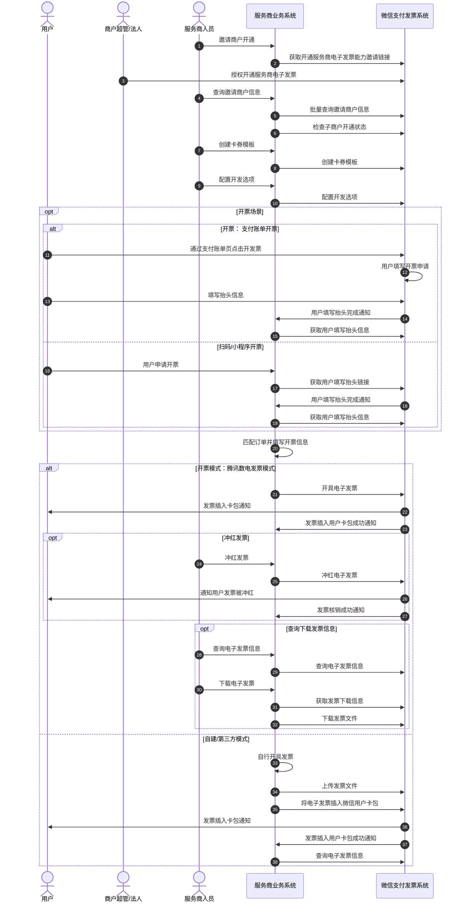

>更新时间：2026.07.27

本开发指引对微信支付电子发票的标准流程、关键场景的开发思路和最佳实践展开介绍。你可以阅读开发指引，并结合【API文档】完成微信支付电子发票的接入流程。

## 1、前置条件

为降低开发指引环节的阅读和实践成本，建议在阅读本指引前，确保你已经：

- 阅读[开发接入准备](https://pay.weixin.qq.com/doc/v3/partner/4015792554.md)、[快速开发](https://pay.weixin.qq.com/doc/v3/partner/4015942799.md)文档，完成AppID、商户证书等相关参数和材料的准备

- 阅读[APIv3概述](https://pay.weixin.qq.com/doc/v3/partner/4012081673.md)文档，了解微信支付API v3通用的基础约定，包括认证机制、请求规则、数据格式、参数兼容性、错误处理等

## 2、开发指引

你可以根据商户的不同需求，调用微信的电子发票能力，进行场景应用。

业务时序图

### 步骤一 邀请商户开通

1、邀请商户开通：通过《[获取开通服务商电子发票能力邀请链接](https://pay.weixin.qq.com/doc/v3/partner/4015941495.md)》接口获取授权链接，可生成邀请二维码或按钮邀请商户号的超管/法人开通；

2、查询开通商户：通过《[获取邀请开通的商户信息](https://pay.weixin.qq.com/doc/v3/partner/4015941524.md)》接口，查询指定时间内邀请的商户列表，可按照时间维度增量查询并记录保存；

3、查询授权状态：通过《[检查子商户开票功能状态](https://pay.weixin.qq.com/doc/v3/partner/4015792561.md)》查询已邀请成功的商户接入状态、授权功能状态等详细信息；

### 步骤二 初始化配置

1、创建卡券模板：通过《[创建电子发票卡券模板](https://pay.weixin.qq.com/doc/v3/partner/4015792562.md)》接口为商户创建电子发票的卡券模板，用于交付电子发票，每个商户号支持创建多个卡券模板。

2、配置开发选项：通过《[配置开发选项](https://pay.weixin.qq.com/doc/v3/partner/4015792563.md)》接口设置服务商的回调地址等，用于接收开票成功、插卡等通知，为子商户号设置是否打开支付账单开票入口，是否支持开电子专用发票等。

### 步骤三 申请开票

场景1、 微信支付账单申请开票

调用《[配置开发选项](https://pay.weixin.qq.com/doc/v3/partner/4015792563.md)》接口开启功能后，用户微信支付完成即可通过支付账单页「开发票」入口进入填写发票抬头等并提交申请。

用户提交后，服务商会收到[用户发票抬头填写完成通知](https://pay.weixin.qq.com/doc/v3/partner/4015792559.md)，然后通过《[获取用户填写抬头信息](https://pay.weixin.qq.com/doc/v3/partner/4015784260.md)》接口，获取用户填写的申请信息等；

场景2、H5/小程序扫码申请开票

调用《[获取用户抬头填写链接](https://pay.weixin.qq.com/doc/v3/partner/4015770776.md)》接口，由用户通过扫描开票二维码或在订单小程序申请开票。

用户提交后，服务商会收到[用户发票抬头填写完成通知](https://pay.weixin.qq.com/doc/v3/partner/4015792559.md)，然后通过《[获取用户填写抬头信息](https://pay.weixin.qq.com/doc/v3/partner/4015784260.md)》接口，获取用户填写的申请信息。

场景3、商家自行收集抬头等申请开票

针对商家或服务商有自己开票申请页面，可以自行收集抬头等信息，实现支付后开票等功能；

### 步骤四 开具发票

可根据自身情况，选择以下模式之一进行开票：

#### 模式一【腾讯数电发票模式】

为了便于服务商开发，腾讯提供了全国数电发票能力，可实现发票的开具生成、查询、下载等（腾讯生成电子发票文件）；

1、开具发票：根据订单号匹配相关订单信息，然后调用《[开具通用行业电子发票](https://pay.weixin.qq.com/doc/v3/partner/4015792574.md)》/《[开具不动产租赁行业电子发票](https://pay.weixin.qq.com/doc/v3/partner/4015941740.md)》/《[开具成品油行业电子发票](https://pay.weixin.qq.com/doc/v3/partner/4016760559.md)》/[《开具旅客运输电子发票》](https://pay.weixin.qq.com/doc/v3/partner/4025863376.md)为用户开具电子发票，会收到[发票开具成功通知](https://pay.weixin.qq.com/doc/v3/partner/4015792570.md)。

注意

如果通过微信支付单号（即支付渠道为微信支付渠道）开票或者调用《[获取用户抬头填写链接](https://pay.weixin.qq.com/doc/v3/partner/4015770776.md)》申请开票，会自动插入卡包，并收到[发票插入用户卡包成功通](https://pay.weixin.qq.com/doc/v3/partner/4015792578.md) [知](https://pay.weixin.qq.com/doc/v3/partner/4015792578.md)；

2、冲红发票：如商户需对已开具的电子发票进行冲红（开具红票），可调用《[冲红数电发票](https://pay.weixin.qq.com/doc/v3/partner/4015792575.md)》进行冲红，并收到[发票冲红成功通知](https://pay.weixin.qq.com/doc/v3/partner/4015792571.md)。插卡的发票，会收到[发票卡券作废通知](https://pay.weixin.qq.com/doc/v3/partner/4015792560.md)，将其从用户的微信卡包中删除；

3、查询发票：调用开具电子发票接口或冲红电子发票接口成功后，可通过《[查询电子发票](https://pay.weixin.qq.com/doc/v3/partner/4015792567.md)》查询电子发票开具/冲红结果，并获取已开具/冲红/插卡的电子发票信息；

4、下载发票：如需下载电子发票，可先通过《[查询电子发票](https://pay.weixin.qq.com/doc/v3/partner/4015792567.md)》获取电子发票相关参数信息，然后通过《[获取发票下载信息](https://pay.weixin.qq.com/doc/v3/partner/4015792576.md)》，获取发票信息，调用《[下载发票文件](https://pay.weixin.qq.com/doc/v3/partner/4015792569.md)》，下载发票版式文件。

#### 模式二【自建/第三方平台模式】

如果商户/服务商已经自建或者选择了其他发票平台，且具备发票的开具、生成等能力，通过此模式将发票插入微信卡包等；

1、开具发票：获取用户提交的开票信息后，根据订单号匹配相关订单信息，然后调用自建/第三方开票平台发起开票申请；

2、发票插卡：开票完成后，调用《[上传电子发票文件](https://pay.weixin.qq.com/doc/v3/partner/4015792580.md)》接口和《[将电子发票插入微信用户卡包](https://pay.weixin.qq.com/doc/v3/partner/4015792579.md)》（非微信支付交易单号且未通过《[获取用户抬头填写链接](https://pay.weixin.qq.com/doc/v3/partner/4015770776.md)》提交信息的无法插卡），交付消费者卡包，并收到[发票插入用户卡包成功通知](https://pay.weixin.qq.com/doc/v3/partner/4015792578.md)；

3、查询插卡：可调用《[查询电子发票](https://pay.weixin.qq.com/doc/v3/partner/4015792567.md)》接口，获取发票的插卡信息。

名词解释：

1、【腾讯数电发票模式】：为了便于服务商开发，腾讯提供了数电发票能力，可实现发票的开具生成、查询、下载等（腾讯生成电子发票文件）；

2、【自建/第三方模式】：如果商户/服务商已经自建或者选择了其他发票平台，且具备发票的开具、生成等能力，可通过「自建/第三方平台模式」自行开具发票，并通过微信卡包交付发票等；

3、【电子发票插卡】：即将电子发票插入用户微信卡包，可在我-小店与卡包-卡包-票证-发票中查看，也可搜索【微信发票助手】小程序查看；

其他问题详见[常见问题](https://pay.weixin.qq.com/doc/v3/partner/4016960715.md)。