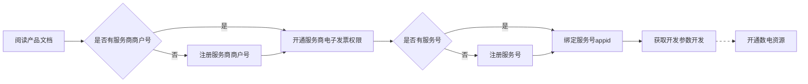

>更新时间：2026.10.20

## 流程说明

1、阅读[产品介绍文档](https://pay.weixin.qq.com/doc/v3/partner/4015792553.md)，了解电子发票产品特性；

2、请超级管理员在微信支付合作伙伴平台登录[微信支付服务商号](https://pay.wechatpay.cn/partner/public/home)，在「产品中心-产品大全-特约商户授权产品-服务商电子发票」申请权限；

3、登录[微信支付服务商号](https://pay.wechatpay.cn/partner/public/home)，在「产品中心-开发配置」[发起与appid 授权绑定](https://pay.weixin.qq.com/doc/v3/partner/4013335081.md)申请，用于后续创建卡券等；

如果没有服务号，参考[公众平台账号注册指引](https://kf.qq.com/product/weixinmp.html#hid=87)注册公众平台服务号，并参考[公众平台账号认证指引](https://kf.qq.com/product/weixinmp.html#hid=99)完成公众平台账号认证；

4、登录[公众平台](https://mp.weixin.qq.com/)，[确认授权绑定的服务商号](https://pay.weixin.qq.com/doc/v3/merchant/4013287010.md#2.3.1%E3%80%81%E6%9C%8D%E5%8A%A1%E5%8F%B7/%E5%85%AC%E4%BC%97%E5%8F%B7)，完成服务商号与公众平台APPID绑定；

5、登录[微信支付服务商号](https://pay.wechatpay.cn/partner/public/home)，获取[开发参数](https://pay.weixin.qq.com/doc/v3/partner/4013080340.md)，进入[开发流程](https://pay.weixin.qq.com/doc/v3/partner/4015792556.md)；

6、如需开通数电发票，可在开通服务商电子发票时或者通过进入「服务商电子发票-产品设置-查看数电资源」来完成开通。

## 权限申请

### 1. 申请微信支付服务商号

在微信支付合作伙伴平台：[注册微信支付服务商号](https://pay.weixin.qq.com/static/partner_guide/wechat_pay_developer.shtml)。支持普通服务商和三方机构开通，渠道商可申请普通服务商进行开通。

### 2. 开通服务商电子发票产品权限

进入[微信支付合作伙伴](https://pay.weixin.qq.com/index.php/partner/public/home)平台，登录[微信支付服务号](https://pay.wechatpay.cn/partner/public/home)，在「产品中心-特约商户授权产品—服务商电子发票」，申请开通；

如需开通数电发票，可在开通服务商电子发票时或通过进入「服务商电子发票-产品设置-查看数电资源」开通。

