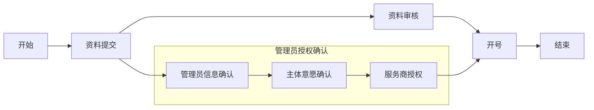
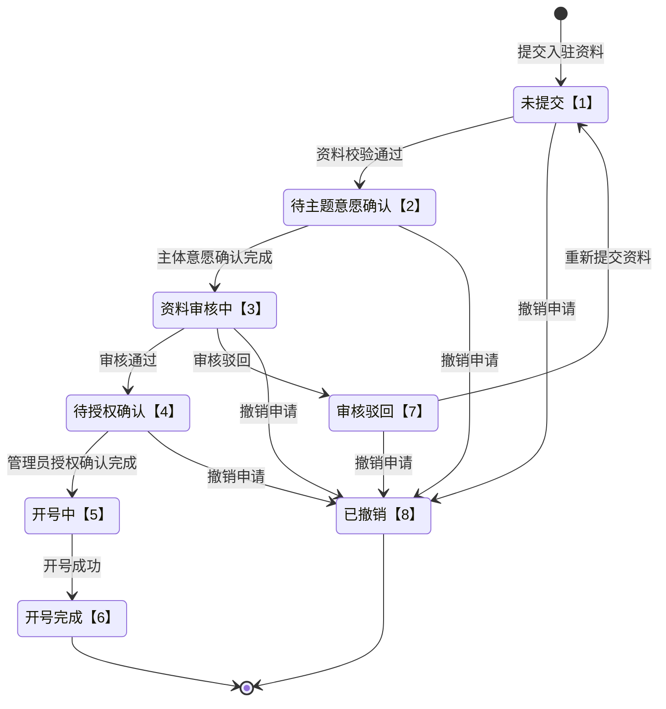

>更新时间：2026.10.20

# 1\. 开发前准备


## 1.1. 熟悉微信支付接口规则

正式进入开发前，开发者需要先阅读[基本规则](https://pay.weixin.qq.com/doc/v3/partner/4012081726.md)、[如何签名和验签](https://pay.weixin.qq.com/doc/v3/partner/4012365870.md)，了解调用微信支付接口的基本规则和签名、验签规则。

## 1.2. 准备开发参数

在发起接口请求时，开发者还需传入一些必要参数，如服务商商户号、服务商API证书私钥、公钥等，获取方式详见：[服务商模式开发必要参数说明](https://pay.weixin.qq.com/doc/v3/partner/4015981654.md)。

注意事项:

开发联调阶段，调用接口后，建议在日志中保留应答的HTTP头 `Request-ID` 值， `Request-ID` 作为[请求的唯一标识](https://pay.weixin.qq.com/doc/v3/partner/4012081726.md#%E8%AF%B7%E6%B1%82%E7%9A%84%E5%94%AF%E4%B8%80%E6%A0%87%E8%AF%86)，在调用接口遇到问题时，可向微信侧提供该值用于快速定位到请求记录，协助排查问题原因。

# 2\. 整体业务开发流程概览

- 图片上传：服务商需先调用「[图片上传](https://pay.weixin.qq.com/doc/v3/partner/4016276333.md)」接口上传入驻申请资料中的图片文件；

- 资料提交：服务商调用「[提交入驻申请](https://pay.weixin.qq.com/doc/v3/partner/4016249989.md)」接口提交入驻申请，申请提交成功后将开启管理员授权确认和资料审核两个并行流程；

- 管理员授权确认：服务商调用「[根据业务申请编号查询申请状态](https://pay.weixin.qq.com/doc/v3/partner/4016257694.md)」或「[根据申请单ID查询申请状态](https://pay.weixin.qq.com/doc/v3/partner/4016257685.md)」接口获取管理员授权确认二维码( `authorization_confirmation_qr_code`)，管理员扫码完成授权确认流程，流程包括以下三个子流程：

  - 管理员信息确认：管理员初次扫授权码需要核对身份信息，签署平台协议；

  - 主体意愿确认：管理员身份与商家主体的法人不一致时，则需要进行主体意愿确认，管理员需联系主体法人操作完成，一般有法人扫码和上行打款两种方式，完成其中任意一项即可；

  - 服务商授权：管理员可选择授权的权限给服务商，服务商后续可代品牌完成对应功能的操作和管理。
- 资料审核：支付侧人工审核入驻申请资料；

- 开号：支付侧系统为品牌开号。


整体主业务流程如下图所示：



# 3\. 品牌入驻申请单状态流转图



入驻申请流程分为两条并行线路，状态机呈现为串行，便于理解整体流转顺序，以下为具体流转说明：

1、初步校验阶段：服务商调用「[提交入驻申请](https://pay.weixin.qq.com/doc/v3/partner/4016249989.md)」接口提交入驻申请资料后，申请单会先流转为“未提交”(applyment\_state: APPLYMENT\_STATE\_UNSUBMITTED)状态，系统会初步校验申请资料是否符合规范：

- 若校验通过则申请单会自动流转为“待主体意愿确认”(applyment\_state: APPLYMENT\_STATE\_WAITING\_VALIDATE)状态；

- 若校验失败，服务商需要根据失败原因修改申请资料后再次调用「[提交入驻申请](https://pay.weixin.qq.com/doc/v3/partner/4016249989.md)」接口。


2、并行处理阶段：申请单进入“待主体意愿确认”状态后，以下两个流程同时启动：

2.1、管理员授权确认：服务商需调用「[根据业务申请编号查询申请状态](https://pay.weixin.qq.com/doc/v3/partner/4016257694.md)」或「[根据申请单ID查询申请状态](https://pay.weixin.qq.com/doc/v3/partner/4016257685.md)」接口获取品牌经营管理员授权二维码链接，供管理员进行授权确认。在管理员授权确认流程中有三个子流程：管理员信息确认、意愿确认和服务商授权。其中主体意愿确认环节是否存在需根据如下条件判断：

- 若管理员身份与商家主体的法人不一致，则需要进行主体意愿确认，管理员需联系主体法人操作完成；

- 若管理员身份与商家主体的法人一致，则直接跳过此环节，操作页面不会显示主体意愿确认的相关内容。


完成主体意愿确认环节之后，申请单会流转为“资料审核中”(applyment\_state: APPLYMENT\_STATE\_WAITING\_AUDIT)状态。

2.2、支付侧审核：支付侧同时会对申请资料进行人工审核：

- “资料审核中”的申请单审批通过后申请单将流转为“待授权确认”(applyment\_state: APPLYMENT\_STATE\_WAITING\_AUTH)状态；

- 若审核驳回则申请单流转为“审核驳回”(applyment\_state: APPLYMENT\_STATE\_AUDIT\_REJECTED)状态。


3、品牌开号阶段：“待授权确认”状态的申请单需要管理员完成所有授权流程后才能扭转为“开号中”(applyment\_state: APPLYMENT\_STATE\_OPEN\_ACCOUNT)状态，之后支付侧系统将完成最后的开号流程，完成后申请单自动流转为“开号完成”(applyment\_state: APPLYMENT\_STATE\_FINISH)状态。

特殊状态说明：

- “审核驳回”态的申请单可修改资料后调用「[提交入驻申请](https://pay.weixin.qq.com/doc/v3/partner/4016249989.md)」接口重新提交入驻申请，申请单会再次流转为“未提交”(applyment\_state: APPLYMENT\_STATE\_UNSUBMITTED)状态，重新开始新的入驻流程，注意如果资料初步校验通过，仍然需要进行管理员授权确认和主体意愿确认流程。

- “开号中”状态之前的申请单，服务商可调用「[撤销入驻申请](https://pay.weixin.qq.com/doc/v3/partner/4016257700.md)」接口撤销申请，管理员可在授权页点击“拒绝品牌注册”按钮撤销申请，申请单将流转为“已撤销”(applyment\_state：APPLYMENT\_STATE\_CANCELED)状态。


以下两个状态为终态：

- “入驻完成”(applyment\_state：APPLYMENT\_STATE\_FINISH)

- “已撤销”(applyment\_state：APPLYMENT\_STATE\_CANCELED)


# 4\. 接口接入说明

## 4.1. API接口概览

| 类型 | API名称 | 描述 |
| --- | --- | --- |
| 必须接入 | [提交入驻申请](https://pay.weixin.qq.com/doc/v3/partner/4016249989.md) | 服务商通过该接口提交商家资料，帮助商家入驻成为微信支付的品牌商家。<br>注意：本接口不支持进件境外个人小微商户<br>频率限制：接口级限制1/s |
| 必须接入 | [撤销入驻申请](https://pay.weixin.qq.com/doc/v3/partner/4016257700.md) | 服务商提交申请后需要进行撤销操作时，可调用该撤销申请接口。<br>注意：仅当申请状态为初始化、未提交、待主体意愿确认、审核中、已驳回时才允许撤销。<br>频率限制：接口级限制1/s<br>前置条件：已提交入驻申请 |
| 必须接入 | [根据业务申请编号查询申请状态](https://pay.weixin.qq.com/doc/v3/partner/4016257694.md) | 服务商可使用业务申请编号调用该接口查询入驻申请状态，获取管理员授权链接。<br>频率限制：接口级限制50/s<br>前置条件：已提交入驻申请 |
| 必须接入 | [根据申请单ID查询申请状态](https://pay.weixin.qq.com/doc/v3/partner/4016257685.md) | 服务商可使用业务申请编号调用该接口查询入驻申请的状态，获取管理员授权链接。<br>频率限制：接口级限制50/s<br>前置条件：已提交入驻申请 |

## 4.2. API接入（含示例代码）

文档展示了如何使用微信支付服务端 SDK 快速接入品牌入驻申请，完成与微信支付对接的部分。

注意事项:

- 文档中的代码示例是用来阐述 API 基本使用方法，代码中的示例参数需替换成服务商自己账号及请求参数才能跑通。

- 以下接入步骤仅提供参考，请服务商结合自身业务需求进行评估、修改。


### 4.2.1. 【服务端】提交入驻申请

步骤说明： 服务商收集商户申请资料后，调用提交入驻申请接口，提交创建入驻申请单。

JAVA

```
public void Applyment() throws Exception {
  // 加载商户私钥（privateKey：私钥字符串）
  PrivateKey merchantPrivateKey = PemUtil
          .loadPrivateKey(new ByteArrayInputStream(privateKey.getBytes("utf-8")));

  // 加载平台证书（mchId：商户号,mchSerialNo：商户证书序列号,apiV3Key：V3秘钥）
  AutoUpdateCertificatesVerifier verifier = new AutoUpdateCertificatesVerifier(
          new WechatPay2Credentials(mchId, new PrivateKeySigner(mchSerialNo, merchantPrivateKey)),apiV3Key.getBytes("utf-8"));

  CloseableHttpClient httpClient = HttpClients.createDefault();
  // 初始化httpClient
  httpClient = WechatPayHttpClientBuilder.create()
          .withMerchant(mchId, mchSerialNo, merchantPrivateKey)
          .withValidator(new WechatPay2Validator(verifier)).build();

  //请求URL
  HttpPost httpPost = new HttpPost("https://api.mch.weixin.qq.com/v3/brand/applyments");
  // 请求body参数
  String reqdata = "{"
          + "\"business_code\":\"1111111111\","
          + "\"admin_info\": {"
          + "\"admin_name\":\"wRNIsXOvVuTYIhVxZJCD8uJIGmNPGozCe44Ph8rD+QAJEPxw==\","
          + "\"id_doc_type\":\"IDENTIFICATION_TYPE_MAINLAND_ID_CARD\","
          + "\"id_card_number\":\"rjbq82xBwMixDGA5A4x6/hqZRAYmaeM+yyjn9BU8qUBZga+mKqQ==\""
          + "},"
          + "\"subject_info\": {"
          + "\"subject_type\":\"SUBJECT_TYPE_ENTERPRISE\","
          + "\"subject_name\":\"xx有限公司\","
          + "\"unified_social_credit_code\": \"91310101MA1FPX1234\""
          + "},"
          + "\"brand_basic_info\": {"
          + "\"brand_name\": \"爱马哥\","
          + "\"brand_logo\": \"V1_RmiTYG0bm7Qrdg659tbD2HZDcD8XWK-bliSsXX4ylAMiiWMmDIgs0LPp2g5bcH4yj8UCPbHhCQxYfQ9hsKcnyfisSnBL\""
          + "},"
          + "\"trademark\": {"
          + "\"trademark_exists\": \"TRADEMARK_EXISTS\","
          + "\"trademark_registration_certificate\": {"
          + "\"certificate\": \"V1_RmiTYG0bm7Qrdg65xUdNJB4oT9tbD2HZDcD8XWK-bliSsXXgs0LPp2g5bcH4yj8UCPbHhCQxYfQ9hsKcnyfisSnBL\","
          + "\"name\": \"爱马哥\","
          + "\"number\": \"12345678\","
          + "\"valid_begin_time\": \"2025-10-01\","
          + "\"valid_end_time\": \"长期\","
          + "\"international_class\": \"43\","
          + "\"holder\": \"xx有限公司\","
          + "\"license\": \"V1_RmiTYG0bm7Qrdg65xUdNJB4oT9tbD2HZDcD8XWK-bliSsXXgs0LPp2g5bcH4yj8UCPbHhCQxYfQ9hsKcnyfisSnBL\","
          + "\"authorization_begin_time\": \"2025-10-01\","
          + "\"authorization_end_time\": \"2035-10-01\""
          + "},"
          + "\"logo_trademark_registration_certificate\": {"
          + "\"certificate\": \"V1_RmiTYG0bm7Qrdg65xUdNJB4oT9tbD2HZDcD8XWK-bliSsXX4ylAMiiWMm2YXv-gDDIgs0LPp2g5bcH4yj8UCPbHhCQxYfQ9hsKcnyfisSnBL\","
          + "\"name\": \"爱马哥\","
          + "\"number\": \"12345678\","
          + "\"valid_begin_time\": \"2025-10-01\","
          + "\"valid_end_time\": \"长期\","
          + "\"international_class\": \"43\","
          + "\"holder\": \"xx有限公司\","
          + "\"license\": \"V1_RmiTYG0bm7Qrdg65xUdNJB4oT9tbD2HZDcD8XWK-bliSsXXgs0LPp2g5bcH4yj8UCPbHhCQxYfQ9hsKcnyfisSnBL\","
          + "\"authorization_begin_time\": \"2025-10-01\","
          + "\"authorization_end_time\": \"2035-10-01\""
          + "},"
          + "\"no_trademark_addition_prove\": \"V1_RmiTYG0bm7Qrdg65xUdNJB4oT9tbD2HZDcD8XWK-bliSsXX4ylAMiiWMm2YXv-gDDIgs0LPp2g5bcH4yj8UCPbHhCQxYfQ9hsKSnBL\""
          + "}"
          + "}";
  StringEntity entity = new StringEntity(reqdata,"utf-8");
  entity.setContentType("application/json");
  httpPost.setEntity(entity);
  httpPost.setHeader("Accept", "application/json");

  //完成签名并执行请求
  CloseableHttpResponse response = httpClient.execute(httpPost);

  try {
      int statusCode = response.getStatusLine().getStatusCode();
      if (statusCode == 200) { //处理成功
          System.out.println("success,return body = " + EntityUtils.toString(response.getEntity()));
      } else if (statusCode == 204) { //处理成功，无返回Body
		  System.out.println("success");
      } else {
          System.out.println("failed,resp code = " + statusCode+ ",return body = " + EntityUtils.toString(response.getEntity()));
          throw new IOException("request failed");
      }
  } finally {
      response.close();
  }
}
```

PHP

```
示例代码
  try {
    $resp = $client->request(
        'POST',
        'https://api.mch.weixin.qq.com/v3/brand/applyments', //请求URL
        [
            // JSON请求体
            'json' => [
                'business_code' => '1111111111',
                'admin_info' => [
                    'admin_name' => 'wRNIsXOvVuTYIhVxZJCD8uJIGmNPGozCe44Ph8rD+QAJEPxw==',
                    'id_doc_type' => 'IDENTIFICATION_TYPE_MAINLAND_ID_CARD',
                    'id_card_number' => 'rjbq82xBwMixDGA5A4x6/hqZRAYmaeM+yyjn9BU8qUBZga+mKqQ==',
                ],
                'subject_info' => [
                    'subject_type' => 'SUBJECT_TYPE_ENTERPRISE',
                    'subject_name' => 'xx有限公司',
                    'unified_social_credit_code' => '91310101MA1FPX1234',
                ],
                'brand_basic_info' => [
                    'brand_name' => '爱马哥',
                    'brand_logo' => 'V1_RmiTYG0bm7Qrdg659tbD2HZDcD8XWK-bliSsXX4ylAMiiWMm2YXvgDDIgs0LPp2g5bcH4yj8UCPbHhCQxYfQ9hsKcnyfisSnBL',
                ],
                'trademark' => [
                    'trademark_exists' => 'TRADEMARK_EXISTS',
                    'trademark_registration_certificate' => [
                        'certificate' => 'V1_RmiTYG0bm7Qrdg65xtbD2HZDcD8XWK-bliSsXX4ylAMiiWMm2YXv-gDDIgs0LPp2g5bcH4yj8UCPbHhCQxYfQ9hsKcnyfisSnBL',
                        'name' => '爱马哥',
                        'number' => '12345678',
                        'valid_begin_time' => '2025-10-01',
                        'valid_end_time' => '长期',
                        'international_class' => '43',
                        'holder' => 'xx有限公司',
                        'license' => 'V1_RmiTYG0bm7Qrdg65xtbD2HZDcD8XWK-bliSsXX4ylAMiiWMm2YXv-gDDIgs0LPp2g5bcH4yj8UCPbHhCQxYfQ9hsKcnyfisSnBL',
                        'authorization_begin_time' => '2025-10-01',
                        'authorization_end_time' => '2035-10-01',
                    ],
                    'logo_trademark_registration_certificate' => [
                        'certificate' => 'V1_RmiTYG0bm7Qrdg65xUdNJB4oT9tbD2HZDcD8XWK-bliSsXX4ylAMiiWMm2YXv-gDDIgs0LPp2g5bcH4yj8UCPbHhCQxYfQ9hsKcnyfisSnBL',
                        'name' => '爱马哥',
                        'number' => '12345678',
                        'valid_begin_time' => '2025-10-01',
                        'valid_end_time' => '长期',
                        'international_class' => '43',
                        'holder' => 'xx有限公司',
                        'license' => 'V1_RmiTYG0bm7Qrdg65xtbD2HZDcD8XWK-bliSsXX4ylAMiiWMm2YXv-gDDIgs0LPp2g5bcH4yj8UCPbHhCQxYfQ9hsKcnyfisSnBL',
                        'authorization_begin_time' => '2025-10-01',
                        'authorization_end_time' => '2035-10-01',
                    ],
                    'no_trademark_addition_prove' => 'V1_RmiTYG0bm7Qrdg65xUdNJB4oT8XWK-bliSsXX4ylAMiiWMm2YXv-gDDIgs0LPp2g5bcH4yj8UCPbHhCQxYfQ9hsKSnBL',
                ],
            ],
            'headers' => [ 'Accept' => 'application/json' ]
        ]
    );
    $statusCode = $resp->getStatusCode();
    if ($statusCode == 200) { //处理成功
        echo "success,return body = " . $resp->getBody()->getContents()."\n";
    } else if ($statusCode == 204) { //处理成功，无返回Body
        echo "success";
    }
} catch (RequestException $e) {
    // 进行错误处理
    echo $e->getMessage()."\n";
    if ($e->hasResponse()) {
        echo "failed,resp code = " . $e->getResponse()->getStatusCode() . " return body = " . $e->getResponse()->getBody() . "\n";
    }
    return;
}
```

重要入参说明：

- business\_code： 业务申请编号，服务商自定义的唯一编号，每个编号对应一个申请单。

- id\_doc\_type： 管理员证件类型，不支持护照和外国人居住证类型。枚举值：

  - IDENTIFICATION\_TYPE\_MAINLAND\_ID\_CARD：中国大陆居民-身份证

  - IDENTIFICATION\_TYPE\_HONGKONG：中国香港居民--来往内地通行证

  - IDENTIFICATION\_TYPE\_MACAO：中国澳门居民--来往内地通行证

  - IDENTIFICATION\_TYPE\_TAIWAN：中国台湾居民--来往大陆通行证

  - IDENTIFICATION\_TYPE\_HONGKONG\_MACAO\_RESIDENT：港澳居民居住证

  - IDENTIFICATION\_TYPE\_TAIWAN\_RESIDENT：台湾居民居住证
- subject\_type： 主体类型。枚举值：

  - SUBJECT\_TYPE\_ENTERPRISE：企业

  - SUBJECT\_TYPE\_INDIVIDUAL：个体工商户
- unified\_social\_credit\_code： 社会统一信用代码。校验规则：

  - 请填写营业执照上的注册号。

  - 注册号格式须为15位数字或18位数字\|大写字母。
- brand\_logo： 品牌logo。

  - 要求上传尺寸不小于200px \* 200px，不大于300px \* 300px，图片宽高比1:1。

  - 只支持上传jpg、png格式，最大支持2MB。
- holder： 商标注册人。

  - 只能由中文字符、英文字符、数字和括号组成。

  - 请填写商标注册证上的注册人名称。

  - 若商标注册人与主体法人/主体名称不一致，则需要补充商标许可使用授权书。

更多参数、响应详情及错误码请参见[提交入驻申请](https://pay.weixin.qq.com/doc/v3/partner/4016249989.md)接口文档。

### 4.2.2. 【服务端】撤销入驻申请

步骤说明： 服务商提交申请后，开号未完成前需要进行撤销操作时，可调用该撤销申请接口。

JAVA

```
public void CancelApplyment() throws Exception{
  // 加载商户私钥（privateKey：私钥字符串）
  PrivateKey merchantPrivateKey = PemUtil
          .loadPrivateKey(new ByteArrayInputStream(privateKey.getBytes("utf-8")));

  // 加载平台证书（mchId：商户号,mchSerialNo：商户证书序列号,apiV3Key：V3秘钥）
  AutoUpdateCertificatesVerifier verifier = new AutoUpdateCertificatesVerifier(
          new WechatPay2Credentials(mchId, new PrivateKeySigner(mchSerialNo, merchantPrivateKey)),apiV3Key.getBytes("utf-8"));

  CloseableHttpClient httpClient = HttpClients.createDefault();
  // 初始化httpClient
  httpClient = WechatPayHttpClientBuilder.create()
          .withMerchant(mchId, mchSerialNo, merchantPrivateKey)
          .withValidator(new WechatPay2Validator(verifier)).build();

  //请求URL
  HttpPost httpPost = new HttpPost("https://api.mch.weixin.qq.com/v3/brand/applyments/cancel-applyment");
  // 请求body参数
  String reqdata = "{"
          + "\"business_code\":\"1111111111\","
          + "\"applyment_id\": \"1234567\""
    	  + "}";
  StringEntity entity = new StringEntity(reqdata,"utf-8");
  entity.setContentType("application/json");
  httpPost.setEntity(entity);
  httpPost.setHeader("Accept", "application/json");

  //完成签名并执行请求
  CloseableHttpResponse response = httpClient.execute(httpPost);

  try {
      int statusCode = response.getStatusLine().getStatusCode();
      if (statusCode == 200) { //处理成功
          System.out.println("success,return body = " + EntityUtils.toString(response.getEntity()));
      } else if (statusCode == 204) { //处理成功，无返回Body
          System.out.println("success");
      } else {
          System.out.println("failed,resp code = " + statusCode+ ",return body = " + EntityUtils.toString(response.getEntity()));
          throw new IOException("request failed");
      }
  } finally {
      response.close();
  }
}
```

PHP

```
try {
    $resp = $client->request(
        'POST',
        'https://api.mch.weixin.qq.com/v3/brand/applyments/cancel-applyment', //请求URL
        [
            // JSON请求体
            'json' => [
                'business_code' => '1111111111',  //二选一
                'applyment_id' => '1234567',
            ],
            'headers' => [ 'Accept' => 'application/json' ]
        ]
    );
    $statusCode = $resp->getStatusCode();
    if ($statusCode == 200) { //处理成功
        echo "success,return body = " . $resp->getBody()->getContents()."\n";
    } else if ($statusCode == 204) { //处理成功，无返回Body
        echo "success";
    }
} catch (RequestException $e) {
    // 进行错误处理
    echo $e->getMessage()."\n";
    if ($e->hasResponse()) {
        echo "failed,resp code = " . $e->getResponse()->getStatusCode() . " return body = " . $e->getResponse()->getBody() . "\n";
    }
    return;
}
```

重要入参说明：

- applyment\_id： 微信支付申请单号，微信支付分配的申请单号，申请单编号和业务申请编号至少传一个。

- business\_code： 业务申请编号，服务商自定义的唯一编号，每个编号对应一个申请单。


更多参数、响应详情及错误码请参见[撤销入驻申请](https://pay.weixin.qq.com/doc/v3/partner/4016257700.md)接口文档。

### 4.2.3. 【服务端】根据业务申请编号查询申请状态

步骤说明： 根据业务申请编号查询申请单申请状态。

JAVA

```
public void QueryApplyment() throws Exception{
  // 加载商户私钥（privateKey：私钥字符串）
  PrivateKey merchantPrivateKey = PemUtil
          .loadPrivateKey(new ByteArrayInputStream(privateKey.getBytes("utf-8")));

  // 加载平台证书（mchId：商户号,mchSerialNo：商户证书序列号,apiV3Key：V3秘钥）
  AutoUpdateCertificatesVerifier verifier = new AutoUpdateCertificatesVerifier(
          new WechatPay2Credentials(mchId, new PrivateKeySigner(mchSerialNo, merchantPrivateKey)),apiV3Key.getBytes("utf-8"));

  CloseableHttpClient httpClient = HttpClients.createDefault();
  // 初始化httpClient
  httpClient = WechatPayHttpClientBuilder.create()
          .withMerchant(mchId, mchSerialNo, merchantPrivateKey)
          .withValidator(new WechatPay2Validator(verifier)).build();

  //请求URL
  HttpGet httpGet = new HttpGet("https://api.mch.weixin.qq.com/v3/brand/applyments/business-code/1111111111");
  httpGet.setHeader("Accept", "application/json");

  //完成签名并执行请求
  CloseableHttpResponse response = httpClient.execute(httpGet);

  try {
      int statusCode = response.getStatusLine().getStatusCode();
      if (statusCode == 200) { //处理成功
          System.out.println("success,return body = " + EntityUtils.toString(response.getEntity()));
      } else if (statusCode == 204) { //处理成功，无返回Body
          System.out.println("success");
      } else {
          System.out.println("failed,resp code = " + statusCode+ ",return body = " + EntityUtils.toString(response.getEntity()));
          throw new IOException("request failed");
      }
  } finally {
      response.close();
  }
}
```

PHP

```
try {
    $resp = $client->request(
        'GET',
        'https://api.mch.weixin.qq.com/v3/brand/applyments/business-code/1111111111', //请求URL
        [
            'headers' => [ 'Accept' => 'application/json']
        ]
    );
    $statusCode = $resp->getStatusCode();
    if ($statusCode == 200) { //处理成功
        echo "success,return body = " . $resp->getBody()->getContents()."\n";
    } else if ($statusCode == 204) { //处理成功，无返回Body
        echo "success";
    }
} catch (RequestException $e) {
    // 进行错误处理
    echo $e->getMessage()."\n";
    if ($e->hasResponse()) {
        echo "failed,resp code = " . $e->getResponse()->getStatusCode() . " return body = " . $e->getResponse()->getBody() . "\n";
    }
    return;
}
```

重要入参说明：

- business\_code： 业务申请编号。

  - 服务商自定义的唯一编号。

  - 每个编号对应一个申请单。

更多参数、响应详情及错误码请参见[根据业务申请编号查询申请状态](https://pay.weixin.qq.com/doc/v3/partner/4016257694.md)接口文档。

### 4.2.4. 【服务端】根据申请单ID查询申请状态

步骤说明： 根据申请单ID查询申请单申请状态。

JAVA

```
public void QueryApplyment() throws Exception{
  // 加载商户私钥（privateKey：私钥字符串）
  PrivateKey merchantPrivateKey = PemUtil
          .loadPrivateKey(new ByteArrayInputStream(privateKey.getBytes("utf-8")));

  // 加载平台证书（mchId：商户号,mchSerialNo：商户证书序列号,apiV3Key：V3秘钥）
  AutoUpdateCertificatesVerifier verifier = new AutoUpdateCertificatesVerifier(
          new WechatPay2Credentials(mchId, new PrivateKeySigner(mchSerialNo, merchantPrivateKey)),apiV3Key.getBytes("utf-8"));

  CloseableHttpClient httpClient = HttpClients.createDefault();
  // 初始化httpClient
  httpClient = WechatPayHttpClientBuilder.create()
          .withMerchant(mchId, mchSerialNo, merchantPrivateKey)
          .withValidator(new WechatPay2Validator(verifier)).build();

  //请求URL
  HttpGet httpGet = new HttpGet("https://api.mch.weixin.qq.com/v3/brand/applyments/applyment-id/1234567");
  httpGet.setHeader("Accept", "application/json");

  //完成签名并执行请求
  CloseableHttpResponse response = httpClient.execute(httpGet);

  try {
      int statusCode = response.getStatusLine().getStatusCode();
      if (statusCode == 200) { //处理成功
          System.out.println("success,return body = " + EntityUtils.toString(response.getEntity()));
      } else if (statusCode == 204) { //处理成功，无返回Body
          System.out.println("success");
      } else {
          System.out.println("failed,resp code = " + statusCode+ ",return body = " + EntityUtils.toString(response.getEntity()));
          throw new IOException("request failed");
      }
  } finally {
      response.close();
  }
}
```

PHP

```
try {
    $resp = $client->request(
        'GET',
        'https://api.mch.weixin.qq.com/v3/brand/applyments/applyment-id/1234567', //请求URL
        [
            'headers' => [ 'Accept' => 'application/json']
        ]
    );
    $statusCode = $resp->getStatusCode();
    if ($statusCode == 200) { //处理成功
        echo "success,return body = " . $resp->getBody()->getContents()."\n";
    } else if ($statusCode == 204) { //处理成功，无返回Body
        echo "success";
    }
} catch (RequestException $e) {
    // 进行错误处理
    echo $e->getMessage()."\n";
    if ($e->hasResponse()) {
        echo "failed,resp code = " . $e->getResponse()->getStatusCode() . " return body = " . $e->getResponse()->getBody() . "\n";
    }
    return;
}
```

重要入参说明：

- applyment\_id： 微信支付申请单号，微信支付分配的申请单号。


更多参数、响应详情及错误码请参见[根据申请单ID查询申请状态](https://pay.weixin.qq.com/doc/v3/partner/4016257685.md)接口文档。