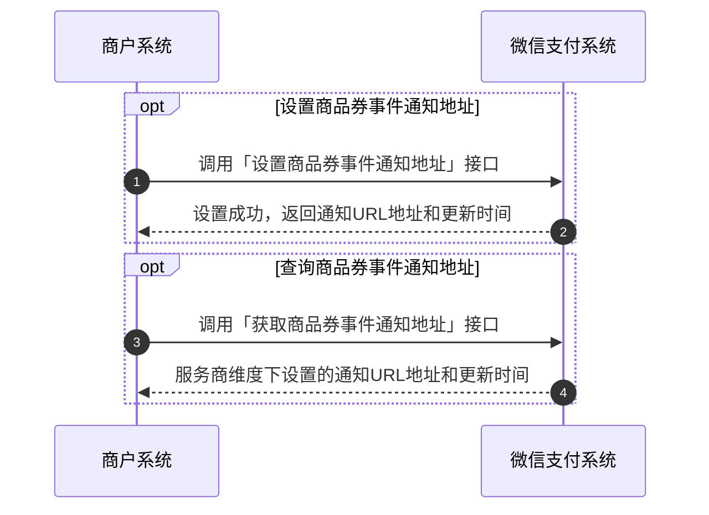
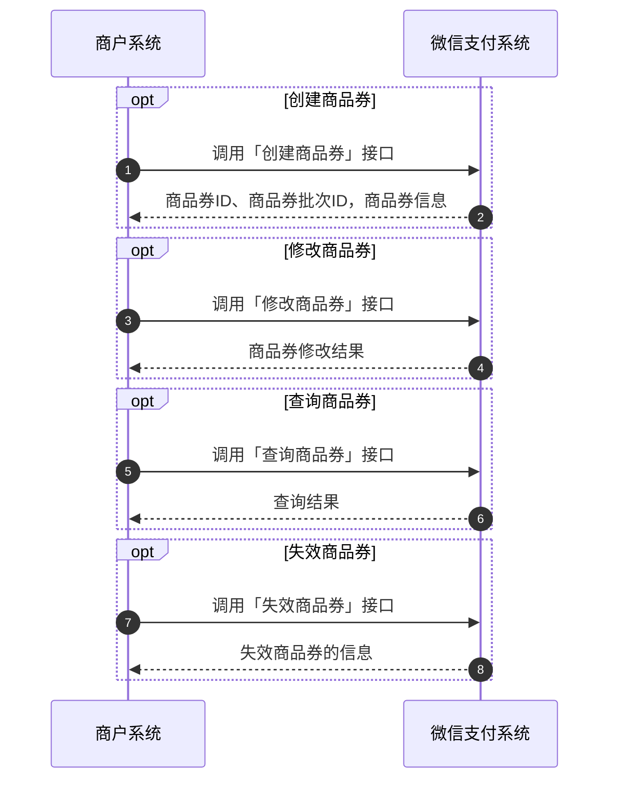
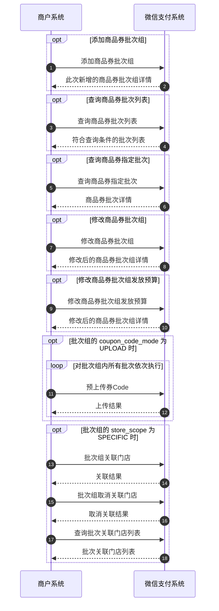
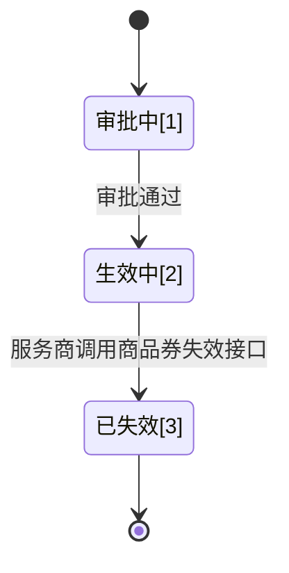
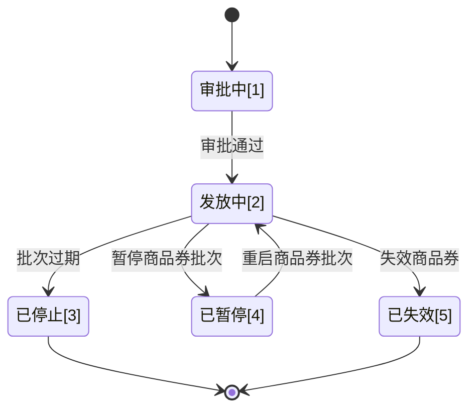
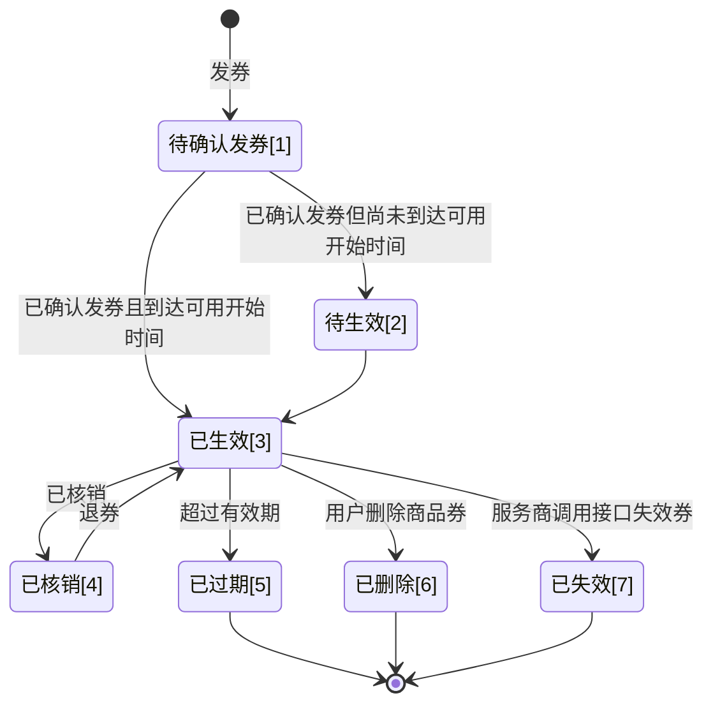

>更新时间：2026.06.10

## 1、开发前准备

### 1.1、熟悉微信支付接口规则

正式进入开发前，开发者需要先阅读[基本规则](https://pay.weixin.qq.com/doc/v3/partner/4012081726.md)、[如何签名和验签](https://pay.weixin.qq.com/doc/v3/partner/4012365870.md)了解调用微信支付接口的基本规则和签名、验签规则。

### 1.2、准备开发参数

在发起接口请求时，开发者还需传入一些必要参数，如服务商商户号、brand\_id(品牌ID)、服务商API证书私钥、公钥等，获取方式详见：[服务商模式开发必要参数说明](https://pay.weixin.qq.com/doc/v3/partner/4015981654.md)。

注意事项：

开发联调阶段，调用接口后，建议在日志中保留应答的HTTP头 `Request-ID` 值， `Request-ID` 作为[请求的唯一标识](https://pay.weixin.qq.com/doc/v3/partner/4012081726.md#%E8%AF%B7%E6%B1%82%E7%9A%84%E5%94%AF%E4%B8%80%E6%A0%87%E8%AF%86)，在调用接口遇到问题时，可向微信侧提供该值用于快速定位到请求记录，协助排查问题原因。

## 2、整体业务开发流程概览

- 服务商参考[服务商申请品牌授权流程指引](https://pay.weixin.qq.com/doc/v3/partner/4016026183.md)，获取品牌方的“商品券”产品功能授权；

- 为服务商进行商品券回调通知配置，具体方式可参考下方概览图中的「商品券回调通知配置」流程。

- 创建商品券后，可对商品券进行管理，具体方式可参考下方概览图中的「商品券管理」流程。

- 添加商品券批次后，可对商品券关联的各个商品券批次进行管理，具体方式可参考下方概览图中的「商品券批次管理」流程。

- 用户领券后，可对用户用户商品券进行管理，具体方式可参考下方概览图中的「用户商品券管理」流程：


## 3、详细步骤说明

#### 3.1、商品券回调通知配置

商户系统可以通过API管理回调通知配置：包括[设置](https://pay.weixin.qq.com/doc/v3/partner/4016435719.md)、[查询](https://pay.weixin.qq.com/doc/v3/partner/4016435718.md)商品券回调通知地址的操作。

注意：商品券回调通知地址是以服务商为维度配置的，所有商品券共用，若已有配置，则无需重复调用接口设置。回调地址的设置规范请参考文档：[回调通知注意事项](https://pay.weixin.qq.com/doc/v3/partner/4012082570.md)



#### 3.2、管理商品券

商户系统可以通过API管理商品券：包括[创建](https://pay.weixin.qq.com/doc/v3/partner/4016434630.md)、[修改](https://pay.weixin.qq.com/doc/v3/partner/4016434633.md)、[查询](https://pay.weixin.qq.com/doc/v3/partner/4016434632.md)、[失效](https://pay.weixin.qq.com/doc/v3/partner/4016434631.md)的操作。

注意：

1、创建商品券的同时也会创建一个商品券批次组，若需创建更多批次组需另外调用「[添加商品券批次组](https://pay.weixin.qq.com/doc/v3/partner/4016280622.md)」接口。

2、修改后的商品券信息只会对新发的券生效，历史已经发放给用户的券信息不会改变。

3、商品券失效时，商品券下所有批次都会失效。并且会同步终止该商品券所有投放渠道和活动，不会有新的用户领券事件，但历史已经通过该商品券对应的批次发放的用户券仍然有效。



#### 3.3、管理商品券批次

商户系统可以通过API管理商品券批次：包括[添加](https://pay.weixin.qq.com/doc/v3/partner/4016280622.md)、[修改](https://pay.weixin.qq.com/doc/v3/partner/4016280633.md)、[查询](https://pay.weixin.qq.com/doc/v3/partner/4016434649.md)、[关联门店](https://pay.weixin.qq.com/doc/v3/partner/4016280620.md)等的操作。

注意：

1、「[修改商品券批次组](https://pay.weixin.qq.com/doc/v3/partner/4016280633.md)」接口仅能修改批次的基本信息，包括展示信息、通知配置，如需修改预算请调用「[修改商品券批次组发放预算](https://pay.weixin.qq.com/doc/v3/partner/4016280642.md)」接口。修改后的商品券批次信息只会对新发的券生效，历史已经发放给用户的券信息不会改变。

2、「[修改商品券批次组发放预算](https://pay.weixin.qq.com/doc/v3/partner/4016280642.md)」接口每次调用只能调整一个维度的投放预算，如果你需要调整多个维度的预算，请多次调用本接口。



#### 3.4、管理用户的券

商户系统可以通过API管理用户的商品券：包括[发券](https://pay.weixin.qq.com/doc/v3/partner/4016280664.md)、[核销](https://pay.weixin.qq.com/doc/v3/partner/4016435636.md)、[查询](https://pay.weixin.qq.com/doc/v3/partner/4016435702.md)、[退券](https://pay.weixin.qq.com/doc/v3/partner/4016435674.md)、[失效](https://pay.weixin.qq.com/doc/v3/partner/4016280658.md)等的操作。

注意

商品券有多个发券渠道，可以由微信支付提供的营销渠道（摇一摇有优惠、商家名片等）发券，服务商也可以调用「[向用户发放商品券批次组](https://pay.weixin.qq.com/doc/v3/partner/4016280664.md)」接口主动发券，不论由何渠道发放，微信支付均会发送「[商品券回调通知](https://pay.weixin.qq.com/doc/v3/partner/4016435717.md)」给服务商，服务商需调用「[确认发放用户商品券](https://pay.weixin.qq.com/doc/v3/partner/4016435562.md)」接口确认发放成功，用户的券才会生效。

```mermaid
sequenceDiagram
  autonumber
  actor p0 as 微信用户
  participant p1 as 商户系统
  participant p2 as 小程序发券组件
  participant p3 as 微信支付系统
  participant p4 as 小程序核销组件
  opt 领券：用户通过“摇一摇有优惠”领券
    p0->>p3: 领取商品券
    p3->>p3: 发放商品券，用户券状态为「待确认」
    p3-)p1: 接收商品券回调通知
    p1->>p1: 商户内部给用户发券
    p1->>p3: 确认发放用户商品券
    p3->>p3: 用户券状态转为「已发放待生效」/「已生效」
    p1->>p3: 向用户发放商品券
    p3->>p3: 发放商品券，用户券状态为「待确认」
    p3-)p1: 接收商品券回调通知
    p1->>p1: 商户内部给用户发券
    p1->>p3: 确认发放用户商品券
    p3->>p3: 用户券状态转为「已发放待生效」/「已生效」
    p0->>p1: 展示可领券信息
    p1->>p3: 预发放商品券
    p1->>p2: 拉起组件，展示商品券信息
    p0->>p2: 领取商品券
    p2->>p3: 领取商品券
    p3->>p3: 发放商品券，用户券状态为「待确认」
    p3-)p1: 接收商品券回调通知
    p1->>p1: 商户内部给用户发券
    p1->>p3: 确认发放用户商品券
    p3->>p3: 用户券状态转为「已发放待生效」/「已生效」
  end
  opt 核券
    opt 商户小程序中使用核销组件
      p0->>p1: 展示可核销券信息
      p1->>p4: 拉起核销组件，展示用户券信息
    end
    p0->>p1: 用券买单
    p1->>p1: 商户内部核券
    p1->>p3: 核销用户商品券
    p3->>p3: 用户券状态转为「已核销」
    p3--)p0: 接收核销成功通知
  end
  opt 退券
    p0->>p1: 用券订单退款
    p1->>p1: 商户内部退券
    p1->>p3: 退券
    p3->>p3: 用户券状态转为「已生效」
  end
  opt 失效用户商品券：单次优惠
    p1->>p3: 失效用户商品券
    p3->>p3: 用户券状态转为「已失效」
    Note over p4: 用户状态扭转需要遵守其状态机

「已使用」、「已删除」的用户券不会因本操作变为「已失效」
    p1->>p3: 失效用户商品券组
    p3->>p3: 组内所有用户券状态转换为「已失效」
  end
  opt 查询用户券列表
    p1->>p3: 指定券状态查询用户商品券列表
    p3-->>p1: 符合查询条件的用户券列表
  end
  opt 查询用户商品券详情
    p1->>p3: 查询用户商品券详情
    p3-->>p1: 用户券详情
  end
```

#### 3.5、状态流转图

##### 3.5.1、商品券状态流转图



1、服务商调用「[创建商品券](https://pay.weixin.qq.com/doc/v3/partner/4016434630.md)」接口创建成功后，商品券会流转为“审批中”(state：AUDITING)状态。

2、微信侧审批方式为机器审核，耗时极短，审批通过后商品券流转为“生效中”(state：EFFECTIVE)状态。

3、服务商调用「[失效商品券](https://pay.weixin.qq.com/doc/v3/partner/4016434631.md)」接口后，商品券流转为“已失效”(state：DEACTIVATED)状态。

以下状态为终态：

- “已失效”(state：DEACTIVATED)


##### 3.5.2、商品券批次状态流转图



1、服务商调用「[添加商品券批次组](https://pay.weixin.qq.com/doc/v3/partner/4016280622.md)」接口添加新批次到商品券后，批次会流转为“审批中”(state：AUDITING)状态。

2、微信侧审批方式为机器审核，耗时极短，审批通过后批次流转为“发放中”(state：SENDING)状态。

3、批次在发放中”(state：EFFECTIVE)状态时，以下操作会使商品券批次流转为不同的状态：

- 服务商如果调用「[失效商品券](https://pay.weixin.qq.com/doc/v3/partner/4016434631.md)」接口，批次会流转为“已失效”(state：DEACTIVATED)状态；

- 批次过期后，批次会流转为“已停止”(state：STOPPED)状态；


以下两个状态为终态：

- “已停止”(state：STOPPED)

- “已失效”(state：DEACTIVATED)


##### 3.5.3、用户商品券状态流转图



1、微信支付提供的营销渠道（摇一摇有优惠、商家名片等）向用户发券，服务商也可以调用「[向用户发放商品券批次组](https://pay.weixin.qq.com/doc/v3/partner/4016280664.md)」接口主动向用户发券，发券后微信会向服务商发送「[商品券回调通知](https://pay.weixin.qq.com/doc/v3/partner/4016435717.md)」，此时用户商品券会流转为“待确认发券”(coupon\_state：CONFIRMING)的状态。

2、服务商收到「[商品券回调通知](https://pay.weixin.qq.com/doc/v3/partner/4016435717.md)」后，需调用「[确认发放用户商品券](https://pay.weixin.qq.com/doc/v3/partner/4016435562.md)」接口确认发放成功，确认完成后：

- 若当前时间未到达用户商品券的可用开始时间，用户商品券会从“待确认发券”(coupon\_state：CONFIRMING)流转为“待生效”(coupon\_state：PENDING)的状态；

- 若当前时间到达用户商品券的可用开始时间，用户商品券会从“待确认发券”(coupon\_state：CONFIRMING)或“待生效”(coupon\_state：PENDING)流转为“已生效”(coupon\_state：EFFECTIVE)的状态。


3、用户商品券处于“已生效”(coupon\_state：EFFECTIVE)的状态时，以下操作会使用户商品券流转为不同的状态：

- 服务商可调用「[核销用户商品券](https://pay.weixin.qq.com/doc/v3/partner/4016435636.md)」接口进行核销，此时用户商品券会流转为“已核销”(coupon\_state：USED)的状态；

- 用户商品券超过有效期未核销，用户商品券会流转为“已过期”(coupon\_state：EXPIRED)的状态；

- 用户商品券被用户在客户端主动删除后，用户商品券会流转为“已删除”(coupon\_state：DELETED)的状态；

- 服务商如果调用「[失效用户商品券组](https://pay.weixin.qq.com/doc/v3/partner/4016280658.md)」接口，用户商品券会流转为“已失效”(coupon\_state：DEACTIVATED)的状态。


4、用户商品券核销后，服务商如果调用「[退券](https://pay.weixin.qq.com/doc/v3/partner/4016435674.md)」接口，此时用户商品券会从“已核销”(coupon\_state：USED)流转为“已生效”(coupon\_state：EFFECTIVE)的状态。

以下三个状态为终态：

- “已过期”(coupon\_state：EXPIRED)

- “已删除”(coupon\_state：DELETED)

- “已失效”(coupon\_state：DEACTIVATED)


## 4、接口接入说明

| 类型 | API类型 | API名称 | 接口是否与单券共用 | 描述 |
| --- | --- | --- | --- | --- |
| 必须接入 | 商品券管理 | [创建商品券](https://pay.weixin.qq.com/doc/v3/partner/4016434630.md) | 是 | 服务商可以通过该接口创建商品券和批次组。微信支付创建成功后，会返回此次创建的商品券以及批次组。<br>频率限制：接口级限制1000/min<br>注意：由于该接口参数较多，故按“单券”和“多次优惠”模式的传参要求拆分成了两个文档，实际接口为同一个 |
| 必须接入 | 商品券管理 | [修改商品券](https://pay.weixin.qq.com/doc/v3/partner/4016434633.md) | 是 | 服务商可以通过该接口修改商品券信息。注：修改只会对新发的券生效，历史已经发放给用户的券不会改变。<br>前置条件：已创建商品券 |
| 必须接入 | 商品券管理 | [失效商品券](https://pay.weixin.qq.com/doc/v3/partner/4016434631.md) | 是 | 服务商可以通过该接口使某个商品券失效。<br>注意：<br>- 失效商品券会失效商品券所有批次。<br>  <br>- 失效商品券会同步终止该商品券所有投放渠道和活动，不会有新的用户领券事件，但历史已经通过该商品券对应的批次发放的用户券仍然有效。<br>  <br>前置条件：已创建商品券 |
| 必须接入 | 商品券批次管理 | [添加商品券批次组](https://pay.weixin.qq.com/doc/v3/partner/4016280622.md) | 否 | 服务商可以通过该接口为已有的商品券添加更多批次组，多个批次组可以实现服务商多样化的投放需求。<br>前置条件：已创建商品券 |
| 必须接入 | 商品券批次管理 | [修改商品券批次组](https://pay.weixin.qq.com/doc/v3/partner/4016280633.md) | 否 | 服务商可以通过该接口修改商品券批次组的基本信息，包括展示信息、通知配置。<br>如果你需要调整批次的投放预算，请使用【[修改商品券批次组发放预算API](https://pay.weixin.qq.com/doc/v3/partner/4016280642.md)】<br>前置条件：已创建商品券批次 |
| 必须接入 | 商品券批次管理 | [修改商品券批次组发放预算](https://pay.weixin.qq.com/doc/v3/partner/4016280642.md) | 否 | 服务商可以通过本接口修改商品券批次组的投放预算。<br>注：本接口每次调用只能调整一个维度的投放预算，如果你需要调整多个维度的预算，请多次调用本接口。<br>前置条件：已创建商品券批次 |
| 必须接入 | 商品券批次管理 | [批次组批量关联门店](https://pay.weixin.qq.com/doc/v3/partner/4016280620.md) | 否 | 服务商可以通过该接口将品牌的门店列表批量与商品券批次组内所有批次关联<br>前置条件：已创建商品券批次组且批次组的 `store_scope` 为 `SPECIFIC` |
| 必须接入 | 商品券批次管理 | [批次组批量取消关联门店](https://pay.weixin.qq.com/doc/v3/partner/4016280629.md) | 否 | 服务商可以通过该接口取消品牌的门店列表与商品券批次组内所有批次的关联关系<br>前置条件：已创建商品券批次组且批次组的 `store_scope` 为 `SPECIFIC` |
| 必须接入 | 用户商品券管理 | [向用户发放商品券批次组](https://pay.weixin.qq.com/doc/v3/partner/4016280664.md) | 否 | 服务商可以通过本接口向用户发放指定商品券批次组，能否发放受限于商品券批次的发放限额：<br>1. 商品券批次总预算<br>   <br>2. 商品券批次每日预算（如果有）<br>   <br>3. 商品券批次每人限领（如果有）<br>   <br>前置条件：已创建商品券批次，商品券批次处于 `SENDING` 状态<br>注意：配置到“[投放计划](https://pay.weixin.qq.com/doc/v3/partner/4016402231.md)”的批次，用户可通过投放计划领券，领券时由微信侧发放商品券，服务商无需调用本接口再次发券。 |
| 必须接入 | 用户商品券管理 | [确认发放用户商品券](https://pay.weixin.qq.com/doc/v3/partner/4016435562.md) | 是 | 给用户发券后，微信支付会给服务商发送【[商品券回调通知](https://pay.weixin.qq.com/doc/v3/partner/4016435717.md)】，此时服务商应调用本接口确认发放成功。<br>注：商品券有多个发券渠道，可以由微信支付提供的营销渠道（摇一摇有优惠、商家名片等）发券，服务商也可以调用商品券本身的发券API主动发券，不论由何渠道发放，微信支付均会发送该通知给服务商，服务商均需调用本接口确认发放成功。 |
| 必须接入 | 用户商品券管理 | [核销用户商户券](https://pay.weixin.qq.com/doc/v3/partner/4016435636.md) | 是 | 服务商可以通过本接口核销已经发放给用户的商品券<br>前置条件：已经给用户发券成功，且用户券当前可用 |
| 必须接入 | 用户商品券管理 | [失效用户商品券组](https://pay.weixin.qq.com/doc/v3/partner/4016280658.md) | 否 | 服务商可以通过本接口将用户的商品券组失效<br>前置条件：已经给用户发券成功 |
| 必须接入 | 用户商品券管理 | [退券](https://pay.weixin.qq.com/doc/v3/partner/4016435674.md) | 是 | 服务商可以通过本接口将已经核销用户的商品券退回给用户<br>前置条件：已经给用户发券成功，且用户券当前已核销 |
| 必须接入 | 商品券回调通知配置 | [设置商品券事件通知地址](https://pay.weixin.qq.com/doc/v3/partner/4016435719.md) | 是 | 服务商可以通过本接口设置商品券相关事件的回调地址，该地址配置为服务商维度配置，该服务商下的所有商品券相关事件均会通知到该地址。 |
| 必须接入 | 商品券回调通知配置 | [获取商品券事件通知地址](https://pay.weixin.qq.com/doc/v3/partner/4016435718.md) | 是 | 服务商可以通过本接口查询商品券相关事件的回调地址，该地址配置为服务商维度配置，该服务商下的所有商品券相关事件均会通知到该地址。<br>前置条件：服务商已经配置商品券事件通知地址 |
| 必须接入 | 商品券回调通知配置 | [商品券回调通知](https://pay.weixin.qq.com/doc/v3/partner/4016435717.md) | 是 | 用户商品券发放成功后，微信支付会将相关领券结果与用户信息发送给服务商，服务商需要接收处理，在服务商内部系统为用户发放同样的券。服务商发券完成后，还需要调用【[确认发放用户商品券](https://pay.weixin.qq.com/doc/v3/partner/4016435562.md)】接口进行确认。<br>回调地址设置方式： 回调地址通过【[设置商品券事件通知地址](https://pay.weixin.qq.com/doc/v3/partner/4016435719.md)】接口中的 `notify_url` 参数设置，回调地址的设置规范请参考文档：[回调通知注意事项](https://pay.weixin.qq.com/doc/v3/partner/4012082570.md)<br>注意：<br>- 同样的通知可能会多次发送给商户系统。商户系统必须能够正确处理重复的通知。 推荐的做法是，当商户系统收到通知进行处理时，先检查对应业务数据的状态，并判断该通知是否已经处理。如果未处理，则再进行处理；如果已处理，则直接返回结果成功。在对业务数据进行状态检查和处理之前，要采用数据锁进行并发控制，以避免函数重入造成的数据混乱。<br>  <br>- 商户系统对于开启结果通知的内容一定要做签名验证，并校验通知的信息是否与商户侧的信息一致，防止数据泄露导致出现“假通知”，造成资金损失。 |
| 按需接入 | 商品券管理 | [查询商品券](https://pay.weixin.qq.com/doc/v3/partner/4016434632.md) | 是 | 服务商可以通过该接口查询商品券的详细信息，但不包括商品券的批次信息。如果要查询商品券的批次列表，请使用【查询商品券批次列表API】<br>前置条件：已创建商品券 |
| 按需接入 | 商品券批次管理 | [查询商品券批次列表](https://pay.weixin.qq.com/doc/v3/partner/4016434641.md) | 是 | 服务商可以通过该接口分页查询某个商品券的批次列表。<br>前置条件：已创建商品券 |
| 按需接入 | 商品券批次管理 | [查询商品券指定批次](https://pay.weixin.qq.com/doc/v3/partner/4016434649.md) | 是 | 服务商可以通过该接口查询某个商品券批次的详情。<br>前置条件：已创建商品券批次 |
| 按需接入 | 商品券批次管理 | [查询批次关联门店列表](https://pay.weixin.qq.com/doc/v3/partner/4016434665.md) | 是 | 服务商可以通过该接口分页查询商品券批次所关联的门店列表<br>前置条件：已创建商品券批次且批次的 `store_scope` 为 `SPECIFIC` |
| 按需接入 | 商品券批次管理 | [预上传券Code](https://pay.weixin.qq.com/doc/v3/partner/4016434668.md) | 是 | 服务商可以通过该接口为商品券批次预上传券Code<br>前置条件：已创建商品券批次，商品券批次的 `coupon_code_mode` 配置为 `UPLOAD` |
| 按需接入 | 用户商品券管理 | [查询用户商品券详情](https://pay.weixin.qq.com/doc/v3/partner/4016435702.md) | 是 | 服务商可以通过本接口查询已经发放给用户的商品券详情<br>前置条件：已经给用户发券成功 |
| 按需接入 | 用户商品券管理 | [指定券状态查询用户商品券列表](https://pay.weixin.qq.com/doc/v3/partner/4016435703.md) | 是 | 服务商可以通过本接口查询已经发放给用户的特定状态的商品券<br>前置条件：已经给用户发券成功 |