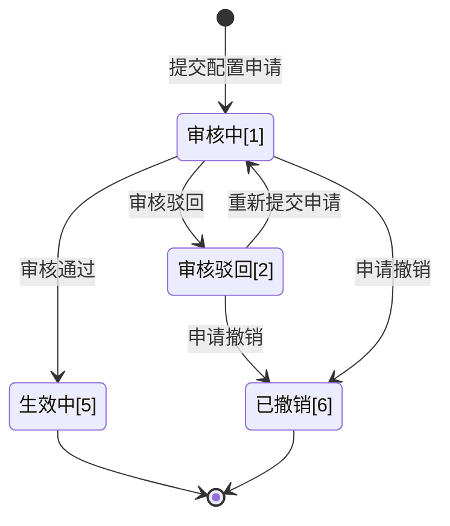
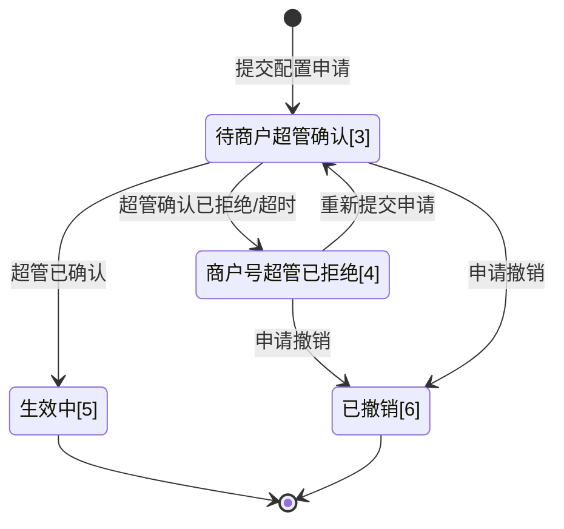

>更新时间：2026.06.10

# 1\. 开发前准备

## 1.1. 熟悉微信支付接口规则

正式进入开发前，开发者需要先阅读[基本规则](https://pay.weixin.qq.com/doc/v3/partner/4015788446.md)、[如何签名和验签](https://pay.weixin.qq.com/doc/v3/partner/4012365870.md)，了解调用微信支付接口的基本规则和签名、验签规则。

## 1.2. 准备开发参数

在发起接口请求时，开发者还需传入一些必要参数，如服务商商户号、服务商API证书私钥、公钥等，获取方式详见：[服务商模式开发必要参数说明](https://pay.weixin.qq.com/doc/v3/partner/4015981654.md)。

注意事项:

开发联调阶段，调用接口后，建议在日志中保留应答的HTTP头 `Request-ID` 值， `Request-ID` 作为[请求的唯一标识](https://pay.weixin.qq.com/doc/v3/partner/4012081726.md#%E8%AF%B7%E6%B1%82%E7%9A%84%E5%94%AF%E4%B8%80%E6%A0%87%E8%AF%86)，在调用接口遇到问题时，可向微信侧提供该值用于快速定位到请求记录，协助排查问题原因。

# 2\. 整体业务开发流程概览

- 服务商参考[服务商申请品牌授权流程](https://pay.weixin.qq.com/doc/v3/partner/4016026183.md)，获取品牌方的“交易连接名片”产品功能授权；

- 服务商调用「[添加交易连接名片规则申请](https://pay.weixin.qq.com/doc/v3/partner/4016333302.md)」接口提交配置申请；

- 配置申请提交成功后，系统会根据交易场景类别进入不同处理流程：

  - 若交易场景类别为小程序支付（普通小程序）、APP支付、支付分支付，则需要支付侧人工审核；

  - 若交易场景类别为小程序支付（收银类小程序）、刷卡支付，则需要商户号超管确认。
- 审核通过/超管确认完成后，支付侧系统将配置商户指定的交易连接规则，生效后用户在相应交易场景支付成功后，点击微信支付公众号向用户下发的支付凭证，将跳转商家名片。

# 3\. 交易连接名片申请单状态流转图

## 3.1. 普通小程序支付/APP支付/支付分支付场景

下图展示了普通小程序支付/APP支付/支付分支付场景下申请单的状态流转过程：

1、服务商调用「[添加交易连接名片规则申请](https://pay.weixin.qq.com/doc/v3/partner/4016333302.md)」接口提交配置申请后，申请单会流转为“审核中”(configuration\_state: WAITING\_AUDIT)状态，微信侧进行审批，审批方式为人工审核：

- 审批通过后申请单流转为“生效中”(configuration\_state：IN\_EFFECT)状态；

- 若审核驳回则申请单转为“审核驳回”(configuration\_state：AUDIT\_REJECT)状态。

2、审核驳回态的申请单可修改配置信息调用「[添加交易连接名片规则申请](https://pay.weixin.qq.com/doc/v3/partner/4016333302.md)」接口重新提交配置申请，申请单会再次流转为“审核中”(configuration\_state:  WAITING\_AUDIT)状态，重新开始新的流程。

3、服务商调用「[撤销交易连接名片配置申请](https://pay.weixin.qq.com/doc/v3/partner/4016366797.md)」接口后，申请单流转为“已撤销”(configuration\_state：CANCELED)状态。

以下两个状态为终态：

- “生效中”(configuration\_state：IN\_EFFECT)

- “已撤销”(configuration\_state：CANCELED)

## 3.2. 收银类小程序支付/付款码支付场景

下图展示了收银类小程序支付/付款码支付场景下申请单的状态流转过程：

1、服务商调用「[添加交易连接名片规则申请](https://pay.weixin.qq.com/doc/v3/partner/4016333302.md)」接口提交配置申请后，申请单会先流转为“待商户号超管确认”(configuration\_state: WAITING\_CONFIRMATION)状态，是否需要商户号超管确认，判断条件为：

- 若配置的商户号对应主体与品牌对应主体一致，则无需商户号超管确认，申请单将自动流转为“生效中”(configuration\_state：IN\_EFFECT)状态；

- 若配置的商户号对应主体与品牌对应主体不一致，则需要商户号超管确认，届时商户号超管绑定的微信将收到确认通知。

2、对于商户号和品牌异主体的配置申请单，商户号超管收到通知后可以主动拒绝确认或者等待确认逾期，此时申请单将流转为“商户号超管已拒绝”(configuration\_state：MERCHANT\_ADMIN\_REJECT)状态；若商户号超管同意确认，则申请单将流转为“生效中”(configuration\_state：IN\_EFFECT)状态。

3、服务商调用「[撤销交易连接名片配置申请](https://pay.weixin.qq.com/doc/v3/partner/4016366797.md)」接口后，申请单流转为“已撤销”(configuration\_state：CANCELED)状态。

以下两个状态为终态：

- “生效中”(configuration\_state：IN\_EFFECT)

- “已撤销”(configuration\_state：CANCELED)

# 4\. 接口接入说明

| 类型 | API名称 | 描述 |
| --- | --- | --- |
| 必须接入 | [添加交易连接名片规则申请](https://pay.weixin.qq.com/doc/v3/partner/4016333302.md) | 服务商可调用该接口提交配置交易连接名片规则申请，配置完成后，用户在相应交易场景支付成功后，点击微信支付公众号向用户下发的支付凭证，将跳转商家名片。交易连接名片规则是判断“哪个支付凭证可跳转商家名片”的依据。 注意：配置成功的连接规则将在6小时内生效 频率限制：接口级限制100/s |
| 必须接入 | [撤销交易连接名片配置申请](https://pay.weixin.qq.com/doc/v3/partner/4016366797.md) | 服务商可调用该接口撤销交易连接名片申请。 注意：仅当申请状态为审核中、审核驳回、待商户号超管确认、商户号超管已拒绝时才允许撤销。 频率限制：接口级限制1/s 前置条件：已提交配置申请 |
| 必须接入 | [根据业务申请编号查询添加申请状态](https://pay.weixin.qq.com/doc/v3/partner/4016366816.md) | 服务商可调用此接口查询申请状态。 频率限制：接口级限制100/s 前置条件：已提交配置申请 |
| 按需接入 | [查询已生效交易连接名片规则](https://pay.weixin.qq.com/doc/v3/partner/4016366785.md) | 服务商可调用该接口查询品牌下所有已生效的交易连接名片规则列表。 频率限制：接口级限制1/s |
| 按需接入 | [解除已生效交易连接名片场景](https://pay.weixin.qq.com/doc/v3/partner/4016366804.md) | 服务商可调用该接口直接解除交易连接关系。 注意：解除配置成功的连接规则将在6小时内失效 频率限制：接口级限制1/s 前置条件：已配置连接规则 |