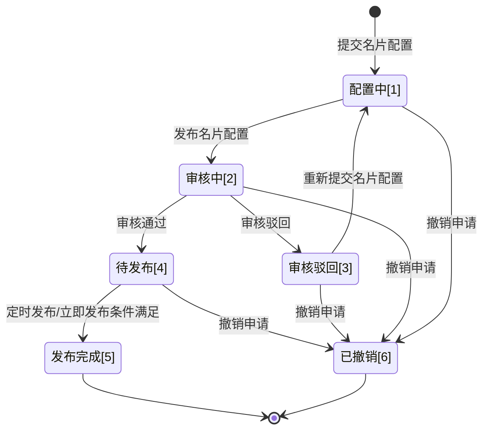

>更新时间：2026.06.10

# 1\. 开发前准备

## 1.1. 熟悉微信支付接口规则

正式进入开发前，开发者需要先阅读[基本规则](https://pay.weixin.qq.com/doc/v3/partner/4012081726.md)、[如何签名和验签](https://pay.weixin.qq.com/doc/v3/partner/4012365870.md)，了解调用微信支付接口的基本规则和签名、验签规则。

## 1.2. 准备开发参数

在发起接口请求时，开发者还需传入一些必要参数，如服务商商户号、brand\_id(品牌ID)、服务商API证书私钥、公钥等，获取方式详见：[服务商模式开发必要参数说明](https://pay.weixin.qq.com/doc/v3/partner/4015981654.md)。

注意事项:

开发联调阶段，调用接口后，建议在日志中保留应答的HTTP头 `Request-ID` 值， `Request-ID` 作为[请求的唯一标识](https://pay.weixin.qq.com/doc/v3/partner/4012081726.md#%E8%AF%B7%E6%B1%82%E7%9A%84%E5%94%AF%E4%B8%80%E6%A0%87%E8%AF%86)，在调用接口遇到问题时，可向微信侧提供该值用于快速定位到请求记录，协助排查问题原因。

# 2\. 整体业务开发流程概览

- 服务商参考[商家名片配置指引](https://pay.weixin.qq.com/doc/v3/partner/4016433970.md)，获取品牌方的“商家名片”产品功能授权；

- 「名片配置」阶段: 服务商配置商家名片，并预览名片是否符合预期；

- 「名片审核」阶段: 服务商配置发布方式并提交审核，该环节由支付侧人工审批，若审核驳回，服务商可修改配置重新提交；

- 「名片发布」阶段: 人工审核通过后，系统将根据服务商配置的发布方式进行发布，新的名片配置将完全覆盖旧的配置。

# 3\. 名片配置申请单状态流转图

1、服务商调用「[提交商家名片配置申请](https://pay.weixin.qq.com/doc/v3/partner/4016468440.md)」接口提交名片配置后，申请单会流转为“配置中”(applyment\_state: DRAFTING)状态。

2、商家在预览确认商家名片配置无误后，服务商调用「[发布商家名片配置](https://pay.weixin.qq.com/doc/v3/partner/4016475176.md)」接口正式提交发布申请，申请单会流转为“审核中”(applyment\_state: AUDITING)状态。

3、微信侧审批方式为人工审核:

- 审批通过后申请单流转为“待发布”(applyment\_state：PENDING\_PUBLISH)状态；

- 若审核驳回则申请单转为“审核驳回”(applyment\_state：AUDIT\_REJECTED)状态。

4、审核驳回态的申请单可修改配置后调用「[提交商家名片配置申请](https://pay.weixin.qq.com/doc/v3/partner/4016468440.md)」接口重新提交名片配置，无需更换业务申请编号，申请单会再次流转为“配置中”(applyment\_state: DRAFTING)状态。

5、“待发布”状态的申请单将定期查看商户的发布配置条件(定时发布/立即发布)是否满足，当满足条件时，申请单会流转为“发布完成”(applyment\_state: PUBLISHED)状态。

6、服务商调用「[撤销商家名片配置申请](https://pay.weixin.qq.com/doc/v3/partner/4016475172.md)」接口后，申请单流转为“已撤销”(state：CANCELED)状态。

以下两个状态为终态：

- “发布完成”(applyment\_state：PUBLISHED)

- “已撤销”(applyment\_state：CANCELED)

# 4\. 接口接入说明

| 类型 | API名称 | 描述 |
| --- | --- | --- |
| 必须接入 | [提交商家名片配置申请](https://pay.weixin.qq.com/doc/v3/partner/4016468440.md) | 服务商可以通过该接口提交商家名片配置申请，支持配置商家服务列表（用户可点击跳转至小程序或网页）和多渠道客服信息（包括自研客服、客服电话等），配置提交后返回名片预览二维码链接供商家验证跳转路径是否符合预期。 注意：接口采用全量覆盖机制，每次提交均视为完整配置。最新提交将完全覆盖历史配置，不支持多轮次增量更新，请确保每次请求包含完整的配置信息。 频率限制：接口级限制1/s |
| 必须接入 | [发布商家名片配置](https://pay.weixin.qq.com/doc/v3/partner/4016475176.md) | 商家在预览确认商家名片配置无误后，服务商可通过该接口正式提交发布申请。提交后将启动审核流程，审核通过后商家名片将在指定时间（立即或定时）正式发布生效。服务商可通过查询接口跟踪审核进度和结果。 注意：提交发布审核通过后，​​发布操作会立即（或定时）将线上环境的名片配置替换为当前最新通过审核的版本，每次发布都会生成一个新的线上版本。 频率限制：接口级限制1/s 前置条件：已提交商家名片配置申请 |
| 必须接入 | [撤销商家名片配置申请](https://pay.weixin.qq.com/doc/v3/partner/4016475172.md) | 服务商可调用该接口撤销处于非发布状态的配置申请。 频率限制：接口级限制1/s 前置条件：已提交商家名片配置申请 |
| 必须接入 | [查询商家名片配置申请状态](https://pay.weixin.qq.com/doc/v3/partner/4016475174.md) | 服务商可通过该接口查询名片配置申请状态。 频率限制：接口级限制30/s 前置条件：已提交商家名片配置申请 |
| 按需接入 | [获取商家名片预览二维码](https://pay.weixin.qq.com/doc/v3/partner/4016641998.md) | 当预览二维码链接失效时，服务商可通过该接口重新获取有效的预览链接，以便商家验证各跳转路径是否符合业务预期。 频率限制：接口级限制1/s 前置条件：已提交商家名片配置申请，未提交发布配置 |