>更新时间：2026.10.20

接入流程

```mermaid
flowchart LR
    C[创建品牌]
    D[权限申请与授权]
    E[品牌关联appid]
    F["配置商家名片/创建品牌门店"]
    G[交易连接名片]
    I[接入商品券]
    J[配置投放计划]
  A[了解产品] --> B[商户号、appid申请及关联]
    B --> C
    C --> D
    D --> E
    E --> F
    F --> G
    I --> J
    G --> I
    F@{ w: 237.4, h: 55.4 }
    B@{ w: 221.7, h: 57.3 }
    C@{ w: 108, h: 55.3 }
    D@{ w: 148.7, h: 54.7 }
    E@{ w: 149.1, h: 54 }
    G@{ w: 135.3, h: 52.7 }
    I@{ w: 117.3, h: 54 }
    J@{ w: 132, h: 53.3 }
```

流程说明

| 环节 | 步骤 | 执行方 | 是否必须 |
| --- | --- | --- | --- |
| 了解产品 | 阅读[产品介绍文档](https://pay.weixin.qq.com/doc/v3/partner/4015782374.md)，了解摇一摇有优惠产品特性。 | 服务商 | 是 |
| 商户号、appid申请及关联 | 按自身需求，参考以下注册指引注册[公众平台](https://mp.weixin.qq.com/)或[开放平台](https://open.weixin.qq.com/)账号，以获取appid： - 服务号、政府或媒体类型的公众号：参考指引[注册服务号/公众号](https://kf.qq.com/product/weixinmp.html#hid=87)类型的公众平台账号；    - 小程序：参考指引[注册小程序](https://kf.qq.com/faq/170109iQBJ3Q170109JbQfiu.html)类型的公众平台账号；    - 移动应用：先参考指引[注册开放平台账号](https://kf.qq.com/faq/170811QrE3En170811bUNRJb.html)，再参考指引[创建移动应用](https://developers.weixin.qq.com/doc/oplatform/Mobile_App/guideline/create.html)。 | 服务商 | 是 |
| 商户号、appid申请及关联 | 公众账号或开放平台账号认证（未认证的账号无法绑定服务商）： - 服务号、政府或媒体类型的公众号：参考[服务号/公众号认证指引](https://kf.qq.com/product/weixinmp.html#hid=99)完成公众平台账号认证；    - 小程序：参考[小程序认证指引](https://kf.qq.com/faq/170109by2mQB170109zUFfqe.html)完成公众平台账号认证；    - 移动应用：参考[开放平台账号认证指引](https://kf.qq.com/faq/170824URbmau170824r2uY7j.html)完成开放平台账号认证。 | 服务商 | 是 |
| 商户号、appid申请及关联 | 参考[合作伙伴接入指引](https://kf.qq.com/faq/161220iqeAfA1612202yeURB.html)在[合作伙伴平台](https://pay.weixin.qq.com/index.php/partner/public/home)申请服务商商户号。 | 服务商 | 是 |
| 商户号、appid申请及关联 | 参考[服务商商户号与appid关联指引](https://pay.weixin.qq.com/doc/v3/partner/4015788437.md#5%E3%80%81%E6%9C%8D%E5%8A%A1%E5%95%86%E7%BB%91%E5%AE%9AAppID)，完成服务商商户号与appid的关联。 | 服务商 | 是 |
| 创建品牌 | 目前有两种方式可以创建品牌： - 方式一：品牌方通过[品牌经营平台](https://pay.weixin.qq.com/xdc/brandhomeweb/brand/home)创建品牌，获取品牌ID；    - 方式二：服务商通过[品牌入驻API](https://pay.weixin.qq.com/doc/v3/partner/4016433410.md)创建品牌，获取品牌ID。 | 服务商、品牌方 | 是 |
| 权限申请与授权 | 各业务调用接口的权限要求： - 需要服务商参考[权限申请](https://pay.weixin.qq.com/doc/v3/partner/4015788437.md)获取品牌方授权：商品券（必要）、商家名片配置、交易连接名片、品牌门店、投放计划    - 需要联系微信支付运营申请权限：商品券发券组件、商品券核销组件    - 无需申请权限，可直接调用接口：品牌入驻    注意：交易连接名片、品牌门店、投放计划等业务的接口权限可根据接入方式按需申请。 | 服务商、品牌方 | 是 |
| 品牌关联appid | 品牌关联appid目前有两种路径，可选择其中之一进行关联，appid关联的前提为已通过微信认证： - 路径一：小程序、服务号、公众号、APP类型的都可以按以下步骤进行关联：      - 步骤1：品牌方在【品牌经营平台-账号管理-下单appid管理】页面，点击“关联appid”。        - 步骤2：品牌经营平台完成关联后，将在次日生效，请耐心等待。 - 路径二：小程序、APP类型的appid，如果是用于支付交易的appid，可通过“交易连接名片”功能进行关联，具体步骤请参考下文“交易连接名片”部分。 | 品牌方 | 否 |
| 配置商家名片/创建品牌门店 | 需先完成[商家名片](https://pay.weixin.qq.com/doc/v3/partner/4016433952.md)的配置，或创建[品牌门店](https://pay.weixin.qq.com/doc/v3/partner/4016628074.md)后才能创建投放计划。（至少完成其中一个） 1、商家名片目前支持支持通过两种方式配置 - 方式一：服务商通过[商家名片配置API](https://pay.weixin.qq.com/doc/v3/partner/4016914463.md)为品牌方配置商家名片。    - 方式二：品牌方通过[商家名片配置](https://pay.weixin.qq.com/doc/v3/partner/4016433970.md)指引配置商家名片。在配置商家名片时，需进行商家客服的配置。    2、品牌门店目前支持通过两种方式创建： - 方式一：服务商通过[品牌门店API](https://pay.weixin.qq.com/doc/v3/partner/4016628135.md)为品牌方创建品牌门店。    - 方式二：品牌方通过[品牌经营平台管理品牌门店](https://pay.weixin.qq.com/doc/v3/partner/4016689827.md)指引创建品牌门店。 | 服务商、品牌方 | 是 |
| 交易连接名片 | 交易连接名片规则配置完成后，用户在相应交易场景支付成功后，点击微信支付公众号向用户下发的支付凭证，将跳转商家名片。 交易连接名片规则是判断“哪个支付凭证可跳转商家名片”的依据。 目前配置交易连接名片规则的方式有两种： - 方式一：服务商通过商家名片下的“[交易连接名片](https://pay.weixin.qq.com/doc/v3/partner/4016985845.md)”功能，为品牌方关联appid。（目前只支持服务商模式）    - 方式二：品牌方在【品牌经营平台-商家名片-交易链接名片】页面，点击“添加”关联对应交易类型的appid。    注意： 1、配置“交易连接名片”的前提是品牌已配置“商家名片” 2、配置成功的连接规则将在6小时内生效 | 服务商、品牌方 | 否 |
| 接入商品券 | 服务商获取[开发参数](https://pay.weixin.qq.com/doc/v3/partner/4015981654.md)，进入开发流程：对接使用“[商品券](https://pay.weixin.qq.com/doc/v3/partner/4015788446.md)”功能，为品牌方创建商品券。 注意：目前投放计划不支持配置核销方式（ `coupon_usage_method_list`）为“线下滴码核销”的商品券批次。 | 服务商、品牌方 | 是 |
| 接入商品券 | 按照自身需求选择性接入“[发券组件](https://pay.weixin.qq.com/doc/v3/partner/4015989376.md#2.5%E3%80%81%E5%B0%8F%E7%A8%8B%E5%BA%8F%E5%8F%91%E5%88%B8%E7%BB%84%E4%BB%B6%E5%8A%9F%E8%83%BD%E4%BB%8B%E7%BB%8D)”功能。 该功能为微信支付平台提供的小程序内标准化发券组件，用户领券后，可收到消息触达，提升用户用券体验促进核销率。 | 服务商 | 否 |
| 接入商品券 | 按照自身需求选择性接入“[核销组件](https://pay.weixin.qq.com/doc/v3/partner/4016110741.md)”功能。 该功能为微信支付平台提供的标准化核销组件，用于提升用户领券率与领取核销率。 | 服务商 | 否 |
| 配置投放计划 | 接入完成后，可通过以下三种方式创建投放计划： - 方式一：品牌方可通过[品牌经营平台管理投放计划](https://pay.weixin.qq.com/doc/v3/partner/4016111064.md#2%E3%80%81%E6%B4%BB%E5%8A%A8%E5%88%9B%E5%BB%BA)指引创建投放计划。    - 方式二：服务商可调用[投放计划 API](https://pay.weixin.qq.com/doc/v3/partner/4016184554.md) 创建投放计划。    - 方式三：服务商联系微信支付运营协助创建投放计划。 | 服务商、品牌方 | 是 |

注意事项：

开发联调阶段，调用接口后，建议在日志中保留应答的HTTP头 `Request-ID` 值， `Request-ID` 作为[请求的唯一标识](https://pay.weixin.qq.com/doc/v3/partner/4012081726.md#%E8%AF%B7%E6%B1%82%E7%9A%84%E5%94%AF%E4%B8%80%E6%A0%87%E8%AF%86)，在调用接口遇到问题时，可向微信侧提供该值用于快速定位到请求记录，协助排查问题原因。