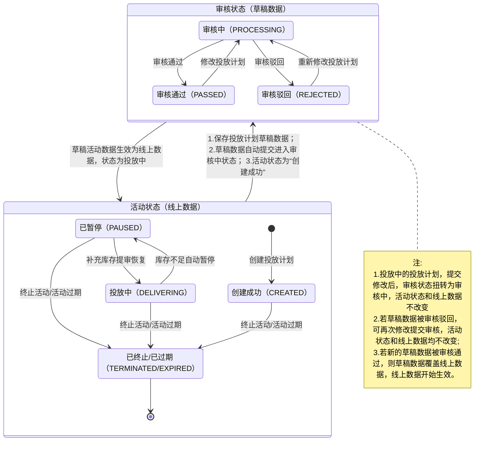

>更新时间：2026.06.10

## 1、概览

投放计划是摇一摇有优惠的投放端管理能力，创建投放计划后，优惠会进入微信多个场景进行曝光，用户有机会在支付后摇优惠、支付后领取优惠运营位、微信支付公众号、微信支付 交易凭证、商家名片、摇优惠「今日」、摇优惠「附近」、找商家等场景领取优惠，从而帮助商家实现用户拉新、老客促活等经营目标。

- 创建简单，无需区分渠道可一键通投；

- 场景丰富，有机会在多个场景曝光；

- 流量推荐，优惠力度越大可获得更多曝光；

注：支付后运营位等部分场景正在陆续接入中

## 2、创建模式

按照创建方式，投放计划可分为API创建模式和经营平台页面创建模式两种

|     |     |     |
| --- | --- | --- |
| 创建模式 | 创建说明 | 适用商家 |
| 模式 1：投放计划 API创建 | 商家可基于最新的投放计划接口文档，进行投放计划开发，开发完成后即可直接通过api接口创建出投放计划，无需经营平台做二次配置 | 所有品牌+服务商 |
| 模式 2：品牌在经营平台创建投放计划 | 可登录品牌经营平台创建投放计划，查询投放计划和管理投放计划，详见：[投放计划配置指引](https://pay.weixin.qq.com/doc/v3/partner/4016111064.md) | 所有品牌 |

注：当前暂无服务商页面模式，如需页面模式，需品牌在经营平台进行操作。

## 3、投放计划状态

3.1 状态机

3.2 状态说明

投放计划有【活动状态】、【审核状态】两个状态字段，分别对应投放计划的生效状态和投放计划信息的审核状态。具体状态如下

|     |     |     |
| --- | --- | --- |
| 活动状态 | 审核状态 | 状态说明 |
| 创建成功 | 审核中 | 投放计划创建完成后，即为创建成功状态，创建成功后会进入审核流程，同时商家可在经营平台页面端进行扫码预览， |
| 创建成功 | 审核驳回 | 投放计划若审核不通过，进入审核驳回状态，需要根据驳回原因，重新修改投放计划，重新进入审核 |
| 投放中 | 审核通过 | 投放计划审核通过，状态扭转为投放中状态，该状态下面向 C 端开始曝光；该状态下可修改投放计划，修改时投放计划活动状态不受影响 |
| 投放中 | 审核中 | 对投放中的投放计划，未复用商品券信息的投放计划，可选择修改名称、增加库存、延长有效期等修改操作，修改草稿会重新进入审核中 |
| 投放中 | 审核驳回 | 若提交修改的草稿审核不通过，投放计划会被审核驳回，可根据驳回原因重新修改投放计划进行提交 |
| 已暂停 | - | 投放计划因库存用尽等原因进入暂停状态，在投放批次补充库存后，可重新进入审核，审核通过后恢复投放 |
| 已过期 | - | 投放计划结束时间小于当前时间，进入已过期状态，投放计划已过期时，不支持续期，如需调整投放时间，需在投放计划过期之前进行操作 |
| 已终止 | - | 投放计划进入终止状态 |