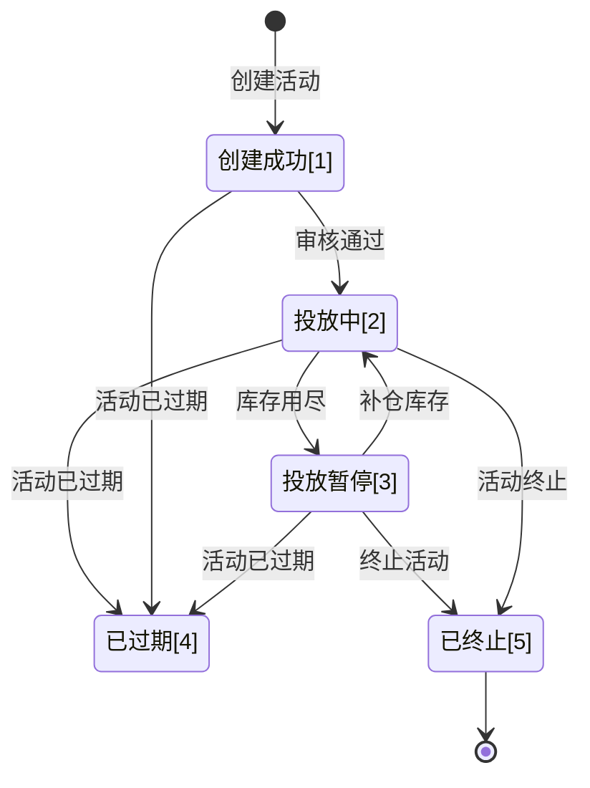

>更新时间：2026.06.30

针对服务商模式可通过以下三种方式进行投放计划的配置

方式一：服务商联系微信支付运营配置；

方式二：服务商可调用[投放计划 API](https://pay.weixin.qq.com/doc/v3/partner/4016184554.md) 创建投放计划。

方式三：品牌方登录[品牌经营平台](https://pay.weixin.qq.com/xdc/brandhomeweb/brand/home#/)配置，参考下方指引。

## 1、投放计划创建

- 可通过「摇优惠-投放计划-投放计划管理」进行投放计划的创建和管理。

注意：页面路径请参考文字版的描述，截图主要展示页面内容，左侧目录会随各业务更新而变动）

- 投放计划创建后进入审核流程，一般在创建投放计划的 2 个工作日内完成审核。

页面示意：

### 字段介绍

|     |     |     |     |
| --- | --- | --- | --- |
| 字段 | 必填 | 是否可修改 | 字段说明 |
| 投放商品券 | 是 | 否 | 自动展开该创建方品牌下，所有的商品券 ID列表。 可从中选择 其中一个作为投放的券批次。 |
| 价格批次 | 是 | 否 | 商品券优惠批次展示规则： 1、选择项，默认展示商品券下的可选优惠，包括优惠价和特价（力度+ 门槛）、券名称、券ID、券库存。 2、区分状态：单独失效和到期的不展示，其他展示。 3、对于展示的优惠批次，若关联批次券code数量不足，小于10000的特价批次置灰，提示库存不足，需大于10000。 选择批次时的校验规则： 1、券开始可用，当前系统时间>=批次生效时间 2、仅支持核销方式为“线上小程序核销”、“微信支付付款码核销”、“APP核销”的批次 |
| 投放用户 | 是 | 否 | 当前仅支持“智能通投”，基于用户在微信支付的消费偏好进行投放。 |
| 投放计划名称 | 否 | 是 | 不超过 11 个中文字符或者 22 个英文字符，该名称会在活动页面对外展示，建议与商品券名称一致。 |
| 投放时间 -开始时间 -结束时间 | 否 | 是 | 1、投放计划的开始时间需晚于当前时间； 2、投放计划的持续时间不得少于 5 天； 3、投放计划的开始时间需晚于批次的开始时间（ `available_begin_time`） 4、商品券会随批次结束时间到期而直接失效，因此投放计划的结束时间需早于批次时间，保证用户不会在活动期间领取到一张立即过期的券。调用【[查询商品券指定批次](https://pay.weixin.qq.com/doc/v3/partner/4015781542.md)】接口可查询到批次配置的 `coupon_available_period`（券可核销时间）信息。 - 情况1: 若商品券配置了 `wait_days_after_receive`（领券后需等待N天生效）和 `available_days`（券生效后N天内可用），则投放计划的结束时间最长可配置为【 `available_end_time`（批次结束时间）- `wait_days_after_receive`（领券后需等待N天生效）- `available_days`（券生效后N天内可用） -1 】。    - 情况2: 若商品券没有配置了 `wait_days_after_receive`（领券后需等待N天生效）和 `available_days`（券生效后N天内可用），则投放计划的结束时间最长可配置为【 `available_end_time`（批次结束时间） -1】。 |
| 投放限领 | 是 |  | 目前提供两种限领方式： - 使用批次限领（默认）：将投放批次剩余的所有库存，单日领取上限、单用户领取上限按批次配置信息进行限领。    - 自定义限领：可自定义“投放库存”、“单日领取上限”、“单用户领取上限”进行限领 |
| -投放库存 | 是 | 是 | 1、投放批次可用库存需 >=10000 2、投放数量需 >= 10000，并<= 券批次剩余库存 |
| -单日领取上限 | 是 | 是 | 需<=券批次最大发放数 |
| -单用户领取上限 | 否 | 是 | 需<=券批次单用户领取上限 |
| 营销标签 | 否 | 是 | 选择运营标签（N 选 1）： 枚举值及释义： 全网低价：商品价格是所有销售渠道中最低的。 新品特惠：新上市的商品（3个月内），价格优惠，至少和其他渠道一样便宜。 招牌限量：招牌为商家的最出名、卖的最好、最有特色、最好口碑的有代表性的商品。 爆款返场：已上架过的活动，曝光转化效果好（领取率、领取量水位线待定），再次返场。 省钱套餐：套餐类、优惠券类组合特惠。 全场立减：平台类商家的全场通用立减。 节日特惠：在特定节日或购物节期间提供的特别优惠。 限时特惠：在规定的时间段内的特别特惠。 出行立减：打车、单车、电单车等出行服务立减。 |

## 2、投放计划查看

- 登录经营平台可查看已创建的投放计划列表和活动状态。

- 投放计划列表支持通过商品券ID、价格批次ID进行搜索。

- 从投放计划列表点击查看可进入查看投放计划详情。

## 3、投放计划修改

- 创建投放计划后，支持在投放计划详情页面对投放计划进行暂停、修改、终止的操作；

- 若当前投放计划正在审核中，仅支持做终止操作，不允许做暂停和修改；

- 若投放计划被驳回，则会在顶部运营栏提示驳回原因，可根据驳回原因重新修改投放计划做提交。

流程示意：

## 4、投放计划测试

投放计划创建完成后，可扫活动列表中的预览活动二维码测试活动曝光展示效果。

测试预览步骤

（1）品牌人员登陆[品牌经营平台](https://pay.weixin.qq.com/xdc/brandhomeweb/brand/home#/)。

（2）品牌人员点击「摇优惠-投放计划-投放计划管理-体验设置」，配置体验人员微信号（至多可配置10个）

（3）点击预览按钮，用已配置体验人员的微信扫描体验二维码

（4）手机预览当前活动C端效果 （ 注：2个活动均为当前投放计划的活动，实际对用户曝光时会是二选一不同品牌的活动，不会重复）

（5）领取后，商品券会进入测试人员微信账户，可用于进行后续的领券回调、核销、退券等操作。

## 5、投放交易数据

投放计划创建后可查看活动的领取和核销数据。

注：投放交易数据当前在商家灰度中，仍为定向邀请能力。

## 6. 投放计划状态

- 状态说明

|     |     |
| --- | --- |
| 状态 | 状态说明 |
| 创建成功 | 投放计划创建完成后，即为创建成功状态，创建成功后会进入审核流程，同时商家可在经营平台页面端进行扫码预览， |
| 投放中 | 投放计划为投放计划中状态，该状态下面向 C 端开始曝光 |
| 投放暂停 | 投放计划因库存用尽等原因进入暂停状态，在投放批次补充库存后，可恢复投放 |
| 已过期 | 投放计划结束时间小于当前时间，进入已过期状态，投放计划已过期时，不支持续期，如需调整投放时间，需在投放计划过期之前进行操作 |
| 已终止 | 投放计划进入终止状态 |

- 状态机

