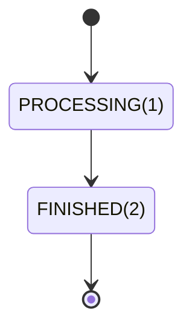
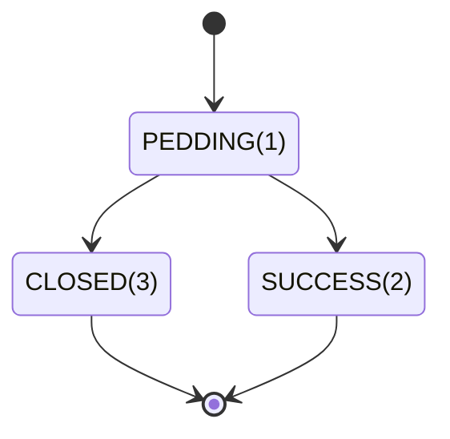
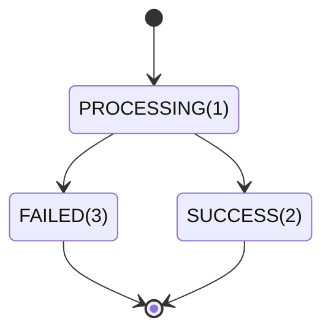

>更新时间：2026.06.09

## 1、分账

### 1.1、简介

适用于已开通连锁品牌工具箱的服务商、品牌商户和接入品牌的门店，品牌可通过供应链分账对门店、连锁业态其它参与者进行更灵活的资金管理。

### 1.2、使用场景

- 品牌管理门店账期：门店独立收款，品牌可以通过供应链分账的“冻结解冻”功能实现对门店的账期管理。

- 品牌基于门店交易抽成：门店独立收款，品牌根据门店的每笔交易在线抽成。

- 分账给服务商、供应商、店员或其他分账方：门店独立收款，按每笔交易分账给品牌合作的服务商、供应商、门店店员、或者有品牌合作的其他分润方。

- 品牌分账给门店：在品牌统一营销活动等场景，品牌可先收款再分账给门店。


### 1.3、功能特点

- 需分账/资金管控的订单，服务商在下单时打上分账标识。

- 周期可控+平台兜底：服务商可根据品牌与门店的协议，实时（支付成功后30s）分账，或按周期延时分账/完结分账（解冻订单未分账资金）。最长冻结周期默认180天，若超时仍未发起分账指令，该笔订单的剩余资金将自动解冻。

- 多次分账+可分多方：支持同一笔订单最多分账50次，每次分账可最多可分给50个接收方。

- 接口可查+支持回退：提供接口查询分账结果；若已分账的订单需要退款，对于商户类型的分账接收方，服务商可协助发起分账回退，将已分账资金回退回交易方账户。


## 2、目标

通过本文档的学习可以利用分账相关接口完成分账流程操作

## 3、业务处理流程

### 3.1、分账

微信订单支付成功后，平台商户可以在180天内发起分账，超过180天的订单，微信支付系统会自动把该笔订单剩余未分金额解冻给子商户

分账的流程正常是：

1. 先通过[查询订单剩余待分金额](https://pay.weixin.qq.com/doc/v3/partner/4012467021.md)查询订单的剩余可分金额

2. 通过[添加分账接收方](https://pay.weixin.qq.com/doc/v3/partner/4012467100.md)添加分账接收方

3. 通过[请求分账](https://pay.weixin.qq.com/doc/v3/partner/4012692975.md)发起分账，分账接收方的总金额不能超过步骤1中返回的剩余可分金额，同时分账接收方的总金额不能超过这笔订单全部可分金额的30%（分账给其他商户或者其他人的，不包括解冻给子商户的资金），是受理型[请求分账](https://pay.weixin.qq.com/doc/v3/partner/4012692975.md)接口，即请求分账接口成功之后不代表分账成功，需要通过[查询分账结果](https://pay.weixin.qq.com/doc/v3/partner/4012467002.md)查询分账的最终结果

4. 发起分账成功之后，可以通过[查询分账结果](https://pay.weixin.qq.com/doc/v3/partner/4012467002.md)查询分账结果

   分账单状态：




分账接收方分账结果：



```
package com.java.brand.profitsharing;

import com.java.demo.QueryOrderAmount; // 使用查询订单剩余待分金额接口：https://pay.weixin.qq.com/doc/v3/partner/4012467021
import static com.java.demo.QueryOrderAmount.*;
import com.java.demo.AddReceiver; // 使用添加分账接收方接口：https://pay.weixin.qq.com/doc/v3/partner/4012467100
import static com.java.demo.AddReceiver.*;
import com.java.demo.CreateOrder; // 使用请求分账接口：https://pay.weixin.qq.com/doc/v3/partner/4012692975
import static com.java.demo.CreateOrder.*;
import com.java.demo.QueryOrder; // 使用查询分账结果接口：https://pay.weixin.qq.com/doc/v3/partner/4012467002
import static com.java.demo.QueryOrder.*;
import com.java.demo.FinishOrder; // 使用请求分账完结接口：https://pay.weixin.qq.com/doc/v3/partner/4012467016
import static com.java.demo.FinishOrder.*;
import com.java.utils.WXPayUtility; // 引用微信支付工具库，参考：https://pay.weixin.qq.com/doc/v3/partner/4014985777

import java.util.ArrayList;

public class ProfitSharingDemo {
  // TODO: 请准备商户开发必要参数，参考：https://pay.weixin.qq.com/doc/v3/partner/4013080340
  // 商户号，是由微信支付系统生成并分配给每个商户的唯一标识符，商户号获取方式参考
  // https://pay.weixin.qq.com/doc/v3/partner/4013080340
  private static String mchid = "19xxxxxxxx";
  // 商户API证书序列号，如何获取请参考 https://pay.weixin.qq.com/doc/v3/partner/4013058924
  private static String certificateSerialNo = "1DDE55AD98Exxxxxxxxxx";
  // 商户API证书私钥文件路径，本地文件路径
  private static String privateKeyFilePath = "/path/to/apiclient_key.pem";
  // 微信支付公钥ID，如何获取请参考 https://pay.weixin.qq.com/doc/v3/partner/4013038589
  private static String wechatPayPublicKeyId = "PUB_KEY_ID_xxxxxxxxxxxxx";
  // 微信支付公钥文件路径，本地文件路径
  private static String wechatPayPublicKeyFilePath = "/path/to/wxp_pub.pem";

  public static void main(String[] argv) {
    String transactionId = "4208450740201411110007820472";
    ProfitSharingDemo demo = new ProfitSharingDemo();

    // 建议用户支付完成30s之后，再发起分账请求

    // 1. 查询订单剩余待分金额
    long unsplitAmount = demo.getUnsplitAmount(transactionId);
    if (unsplitAmount <= 0) {
      // 该笔订单没有可分金额了，不能发起分账，退出
      return;
    }

    // 2. 添加分账接收方（若已添加过的分账接收方无需重复添加，可跳过这步骤。）
    demo.addReceiver();

    // 3. 申请分账（分账的金额一定小于等于步骤1返回的订单剩余待分金额）
    // 商户分账单号需系统内唯一，且完结分账的商户分账单号与请求分账单号不可以一致。
    String outOrderNo = "P20150806125346";
    demo.applyProfitSharing(transactionId, outOrderNo);

    // 4. 查询分账结果
    // 步骤三申请分账成功，不代表分账成功，需要查询分账结果才执行，建议申请分账成功之后等5分钟之后再查询分账结果
    demo.queryProfitSharingResult(transactionId, outOrderNo);

    // 5. 完结分账(如果订单不需要分账给其他商户或者用户并且订单还有剩余可分金额时，可以请求完结分账接口，把剩余可分金额解冻给特约商户)
    outOrderNo = "P20150806125347";
    demo.FinishProfitSharing(transactionId, outOrderNo);

    // 6. 查询完结分账结果
    // 步骤五完结分账成功，不代表完结分账成功，需要查询分账结果才执行，建议完结分账成功之后等5分钟之后再查询分账结果
    demo.queryProfitSharingResult(transactionId, outOrderNo);
  }

  private long getUnsplitAmount(String transactionId) {
    QueryOrderAmount client = new QueryOrderAmount(
        mchid,
        certificateSerialNo,
        privateKeyFilePath,
        wechatPayPublicKeyId,
        wechatPayPublicKeyFilePath);
    QueryOrderAmountRequest request = new QueryOrderAmountRequest();
    request.transactionId = transactionId;
    try {
      QueryOrderAmountResponse response = client.run(request);
      return response.unsplitAmount;
    } catch (WXPayUtility.ApiException e) {
      // 异常处理逻辑
      if (e.getErrorCode().equals("SYSTEM_ERROR")) {
        // 错误：系统错误
        // 解决方式：稍后重试
        // 描述：微信支付系统失败，系统失败直接立即重试大概率还会是系统失败，建议等1分钟后再重试
      } else if (e.getErrorCode().equals("FREQUENCY_LIMITED"))   {
        // 错误：限频报错
        // 解决方式：稍后重试
        // 描述： 接口频率限制，直接立即重试大概率还会是系统失败，建议等1分钟后再重试
      } else if (e.getErrorCode().equals("SIGN_ERROR")) {
        // 错误：签名错误
        // 解决方式：检查服务商商户证书序列号，证书私钥文件，公钥ID，公钥文件，同时确认下签名过程是不是按照微信支付的签名方式
        // 描述：签名报错，需要确认签名材料和签名流程是否正确
      } else if (e.getErrorCode().equals("PARAM_ERROR")) {
        // 错误：参数错误
        // 解决方式：按照报错返回的message，重新输入请求参数
        // 描述：参数的类型，长度，或者必填选项没有填写等，大概率是传的微信支付订单号是非法的
      } else if (e.getErrorCode().equals("ORDER_NOT_EXIST")) {
        // 错误：订单不存在
        // 解决方式：查询的订单不存在，大概率是该笔订单和对应的商户不一致
      } else if (e.getErrorCode().equals("INVALID_REQUEST")) {
        // 错误：请求非法，请求参数正确，但是不符合分账业务规则
        // 解决方式：根据具体message查看具体哪里不符合业务规则，如果可以修改参数达到符合业务规则的修改请求符合业务规则之后再原单重试
        // 描述：不符合业务规则的场景如：
        // -
        // 订单还未结算完成，请等分账完成后再发起分账，一般等待2分钟即可
        // - 非分账订单
      } else {
        // 其他类型错误：稍等一会后原单重试
      }
      throw e;
    }
  }

  private void addReceiver() {
    // TODO: 请准备商户开发必要参数，参考：https://pay.weixin.qq.com/doc/v3/partner/4013080340
    AddReceiver client = new AddReceiver(
        mchid,
        certificateSerialNo,
        privateKeyFilePath,
        wechatPayPublicKeyId,
        wechatPayPublicKeyFilePath);

    AddReceiverRequest request = new AddReceiverRequest();
    request.brandMchid = "1900000108";
    request.appid = "wx8888888888888888";
    request.subAppid = "wx8888888888888889";
    request.type = "MERCHANT_ID";
    request.account = "1900000109";
    request.name = "示例商户全称";
    request.relationType = "SUPPLIER";
    try {
      AddReceiverResponse response = client.run(request);
      // 添加分账接收方成功
      // 可以发起分账
    } catch (WXPayUtility.ApiException e) {
      // 异常处理逻辑
      if (e.getErrorCode().equals("SYSTEM_ERROR")) {
        // 错误：系统错误
        // 解决方式：稍后重试
        // 描述：微信支付系统失败，系统失败直接立即重试大概率还会是系统失败，建议等1分钟后再重试
      } else if (e.getErrorCode().equals("FREQUENCY_LIMITED")) {
        // 错误：限频报错
        // 解决方式：稍后重试
        // 描述： 接口频率限制，直接立即重试大概率还会是系统失败，建议等1分钟后再重试
      } else if (e.getErrorCode().equals("NO_AUTH")) {
        // 错误：无分账权限
        // 解决方式：
        // 1. 检查商户是否是被处罚：登录商户平台进入账户中心-违约记录查询是否违约记录，如果有按照上面的指引解决违约记录之后重试
        // 2.
        // 检查特约商户是否已授权平台分账权限：登录商户平台进入产品中心-特约商户授权产品，在特约商户列表中看看该特约商户是否存在并且授权状态为“已授权”，
        // 如果不存在或者授权状态不是“已授权”就需要发起授权邀请，等特约商户审批之后重新查询一遍，授权状态为“已授权”之后再重试
        // 描述：服务商商户被处罚或者服务商商户和特约商户没有父子受理关系
      } else if (e.getErrorCode().equals("SIGN_ERROR")) {
        // 错误：签名错误
        // 解决方式：检查服务商商户证书序列号，证书私钥文件，公钥ID，公钥文件，同时确认下签名过程是不是按照微信支付的签名方式
        // 描述：签名报错，需要确认签名材料和签名流程是否正确
      } else if (e.getErrorCode().equals("PARAM_ERROR")) {
        // 错误：参数错误
        // 解决方式：按照报错返回的message，重新输入请求参数
        // 描述：参数的类型，长度，或者必填选项没有填写等
      } else if (e.getErrorCode().equals("INVALID_REQUEST")) {
        // 错误：请求非法，请求参数正确，但是不符合分账业务规则
        // 解决方式：根据具体message查看具体哪里不符合业务规则，如果可以修改参数达到符合业务规则的修改请求符合业务规则之后再原单重试
        // 描述：不符合业务规则的场景如：
        // - 分账接收用户没有实名
        // - 分账接收商户不存在
        // - 分账给用户传的appid和openid不匹配
        // - 分账接收商户全称不匹配
      } else {
        // 其他类型错误：稍等一会后原单重试
      }
      throw e;
    }
  }

  private void applyProfitSharing(String transactionId, String outOrderNo) {
    CreateOrder client = new CreateOrder(
        mchid,
        certificateSerialNo,
        privateKeyFilePath,
        wechatPayPublicKeyId,
        wechatPayPublicKeyFilePath);

    CreateOrderRequest request = new CreateOrderRequest();
    request.brandMchid = "1900000108";
    request.subMchid = "1900000109";
    request.appid = "wx8888888888888888";
    request.subAppid = "wx8888888888888889";
    request.transactionId = transactionId;
    request.outOrderNo = outOrderNo;
    request.receivers = new ArrayList<>();
    // 分账给商户
    {
      ReceiverEntity reciever = new ReceiverEntity();
      reciever.type = "MERCHANT_ID";
      reciever.account = "1900000109";
      reciever.amount = 1L;
      reciever.description = "分给商户1900000110";
      reciever.name = client.encrypt("商户1900000110的全称");
      request.receivers.add(reciever);
    }
    // 分账给用户
    {
      ReceiverEntity reciever = new ReceiverEntity();
      reciever.type = "PERSONAL_OPENID";
      reciever.account = "oLIsd5O4GKSw4Qcsv2cQAk_mS";
      reciever.amount = 2L;
      reciever.description = "分给用户";
      reciever.name = client.encrypt("用户oLIsd5O4GKSw4Qcsv2cQAk_mS的姓名");
      request.receivers.add(reciever);
    }
    // 注意
    // 上面分给商户的金额+分给用户的金额之和不能大于步骤1返回的订单剩余待分金额
    // 同时分给商户的金额+分给用户的金额之和不能超过该笔订单的总的可分金额的30%
    // 每次分账最多可分给50个接收方
    // 同一个分账请求内，不支持有重复的接收方

    // 是否分账完成
    // 为true时：该笔订单剩余所有的未分金额都会自动解冻给特约商户
    // 为false时：该笔订单剩余所有的未分金额不会解冻给特约商户，该笔订单的剩余可分金额还可以继续分账
    // 一笔订单最多可以发起50次分账
    request.finish = false;
    try {
      CreateOrderResponse response = client.run(request);
      // 请求分账成功，但是不代表分账成功，需要通过查询分账结果来判断分账是否成功
    } catch (WXPayUtility.ApiException e) {
      // 异常处理逻辑
      if (e.getErrorCode().equals("SYSTEM_ERROR")) {
        // 错误：系统错误
        // 解决方式：稍后原单重试
        // 描述：微信支付系统失败，一定要原单重试，系统失败直接立即重试大概率还会是系统失败，建议等1分钟后再重试
      } else if (e.getErrorCode().equals("FREQUENCY_LIMITED")) {
        // 错误：限频报错
        // 解决方式：稍后原单重试
        // 描述： 接口频率限制，一定要原单重试，直接立即重试大概率还会是系统失败，建议等1分钟后再重试
      } else if (e.getErrorCode().equals("NO_AUTH")) {
        // 错误：无分账权限
        // 解决方式：
        // 1. 检查商户是否是被处罚：登录商户平台进入账户中心-违约记录查询是否违约记录，如果有按照上面的指引解决违约记录之后原单重试
        // 2.
        // 检查特约商户是否已授权平台分账权限：登录商户平台进入产品中心-特约商户授权产品，在特约商户列表中看看该特约商户是否存在并且授权状态为“已授权”，
        // 如果不存在或者授权状态不是“已授权”就需要发起授权邀请，等特约商户审批之后重新查询一遍，授权状态为“已授权”之后再原单重试
        // 描述：服务商商户被处罚或者服务商商户和特约商户没有父子受理关系
      } else if (e.getErrorCode().equals("SIGN_ERROR")) {
        // 错误：签名错误
        // 解决方式：检查服务商商户证书序列号，证书私钥文件，公钥ID，公钥文件，同时确认下签名过程是不是按照微信支付的签名方式
        // 描述：签名报错，需要确认签名材料和签名流程是否正确
      } else if (e.getErrorCode().equals("PARAM_ERROR")) {
        // 错误：参数错误
        // 解决方式：按照报错返回的message，重新输入请求参数
        // 描述：参数的类型，长度，或者必填选项没有填写等
      } else if (e.getErrorCode().equals("NOT_ENOUGH")) {
        // 错误：账户余额不足
        // 解决方式：商户充值之后原单重试
        // 描述：商户账户余额不足，导致退款失败，商户充值之后一定要原单重试
      } else if (e.getErrorCode().equals("INVALID_REQUEST")) {
        // 错误：请求非法，请求参数正确，但是不符合分账业务规则
        // 解决方式：根据具体message查看具体哪里不符合业务规则，如果可以修改参数达到符合业务规则的修改请求符合业务规则之后再原单重试
        // 描述：不符合业务规则的场景如：
        // - 分账次数过多，该笔订单分账次数已经超过50次了，不能再发起分账了
        // - 该笔订单还未结算完成，请等待结算完成才能发起分账
        // - 剩余可分账金额不足
        // - 小程序交易被冻结，在用户主动/系统自动确认收货后才进行资金结算，详细规则可查看《交易类小程序运营规范》
        // - 订单已过期，不支持分账，请等待系统自动解冻（订单已经超过180天，不允许发起分账）

      } else {
        // 其他类型错误：稍等一会后原单重试
      }
      throw e;
    }
  }

  private void queryProfitSharingResult(String transactionId, String outOrderNo) {
    QueryOrder client = new QueryOrder(
        mchid,
        certificateSerialNo,
        privateKeyFilePath,
        wechatPayPublicKeyId,
        wechatPayPublicKeyFilePath);

    QueryOrderRequest request = new QueryOrderRequest();
    request.subMchid = "1900000109";
    request.transactionId = transactionId;
    request.outOrderNo = outOrderNo;
    try {
      QueryOrderResponse response = client.run(request);
      // 1. 根据分账单状态处理分账结果
      switch (response.status) {
        case "PROCESSING":
          // 分账处理中
          // 稍等2分钟之后再重新查单，直到分账单状态为FINISHED
          break;
        case "FINISHED":
          // 分账完成，检查每个接收方状态
          for (QueryOrder.ReceiverResultEntity receiver : response.receivers) {
            switch (receiver.result) {
              case "SUCCESS":
                // 分账成功
                // 处理商户自己的业务逻辑
                break;
              case "CLOSED":
                // 分账失败
                // 分账给该分账方失败了，可以通过receiver.failReason查看失败原因，对应的处理指引见：https://pay.weixin.qq.com/doc/v3/partner/4015504955
                // 商户如果根据失败原因做了相应的处理，可以换单重新发起分账
                break;
              default:
                // 非法状态，因为上面分账单已经是FINISHED状态了，所以分账接收方的状态也不会出现pending状态
                throw new RuntimeException("非法分账接收方状态：" + receiver.result);
            }
          }
          break;
        default:
          // 非法状态
          throw new RuntimeException("非法分账单状态：" + response.status);
      }
    } catch (WXPayUtility.ApiException e) {
      // 异常处理逻辑
      if (e.getErrorCode().equals("SYSTEM_ERROR")) {
        // 错误：系统错误
        // 解决方式：稍后重试
        // 描述：微信支付系统失败，系统失败直接立即重试大概率还会是系统失败，建议等1分钟后再重试
      } else if (e.getErrorCode().equals("FREQUENCY_LIMITED")) {
        // 错误：限频报错
        // 解决方式：稍后重试
        // 描述： 接口频率限制，直接立即重试大概率还会是系统失败，建议等1分钟后再重试
      } else if (e.getErrorCode().equals("NO_AUTH")) {
        // 错误：无分账权限
        // 解决方式：
        // 1. 检查商户是否是被处罚：登录商户平台进入账户中心-违约记录查询是否违约记录，如果有按照上面的指引解决违约记录之后重试
        // 2.
        // 检查特约商户是否已授权服务商商户分账权限：登录商户平台进入产品中心-特约商户授权产品，在特约商户列表中看看该特约商户是否存在并且授权状态为“已授权”，
        // 如果不存在或者授权状态不是“已授权”就需要发起授权邀请，等特约商户审批之后重新查询一遍，授权状态为“已授权”之后再重试
        // 描述：服务商商户被处罚或者服务商商户和特约商户没有父子受理关系
      } else if (e.getErrorCode().equals("SIGN_ERROR")) {
        // 错误：签名错误
        // 解决方式：检查服务商商户证书序列号，证书私钥文件，公钥ID，公钥文件，同时确认下签名过程是不是按照微信支付的签名方式
        // 描述：签名报错，需要确认签名材料和签名流程是否正确
      } else if (e.getErrorCode().equals("RESOURCE_NOT_EXISTS")) {
        // 错误：分账单不存在
        // 解决方式：确定outOrderId和transactionId输入是否正确
        // 描述：申请分账未成功
      } else if (e.getErrorCode().equals("PARAM_ERROR")) {
        // 错误：参数错误
        // 解决方式：按照报错返回的message，重新输入请求参数
        // 描述：参数的类型，长度，或者必填选项没有填写等
      } else if (e.getErrorCode().equals("INVALID_REQUEST")) {
        // 错误：请求非法，请求参数正确，但是不符合分账业务规则
        // 解决方式：根据具体message查看具体哪里不符合业务规则，如果可以修改参数达到符合业务规则的修改请求符合业务规则之后再重试
        // 描述：不符合业务规则的场景如：
        // - 电商商户不允许调用非电商分账API
      } else {
        // 其他类型错误：稍等一会后原单重试
      }
      throw e;
    }
  }

  private void FinishProfitSharing(String transactionId, String outOrderNo) {

    FinishOrder client = new FinishOrder(
        mchid,
        certificateSerialNo,
        privateKeyFilePath,
        wechatPayPublicKeyId,
        wechatPayPublicKeyFilePath);

    FinishOrderRequest request = new FinishOrderRequest();
    request.subMchid = "1900000109";
    request.transactionId = transactionId;
    request.outOrderNo = outOrderNo;
    request.description = "分账完结";
    try {
      FinishOrderResponse response = client.run(request);
      // 请求完结分账成功，但是不代表完结分账成功，需要通过查询分账结果来判断分账是否成功
    } catch (WXPayUtility.ApiException e) {
      // 异常处理逻辑
      if (e.getErrorCode().equals("SYSTEM_ERROR")) {
        // 错误：系统错误
        // 解决方式：稍后原单重试
        // 描述：微信支付系统失败，一定要原单重试，系统失败直接立即重试大概率还会是系统失败，建议等1分钟后再重试
      } else if (e.getErrorCode().equals("FREQUENCY_LIMITED")) {
        // 错误：限频报错
        // 解决方式：稍后原单重试
        // 描述： 接口频率限制，一定要原单重试，直接立即重试大概率还会是系统失败，建议等1分钟后再重试
      } else if (e.getErrorCode().equals("NO_AUTH")) {
        // 错误：无分账权限
        // 解决方式：
        // 1. 检查商户是否是被处罚：登录商户平台进入账户中心-违约记录查询是否违约记录，如果有按照上面的指引解决违约记录之后原单重试
        // 2.
        // 检查特约商户是否已授权平台分账权限：登录商户平台进入产品中心-特约商户授权产品，在特约商户列表中看看该特约商户是否存在并且授权状态为“已授权”，
        // 如果不存在或者授权状态不是“已授权”就需要发起授权邀请，等特约商户审批之后重新查询一遍，授权状态为“已授权”之后再原单重试
        // 描述：服务商商户被处罚或者服务商商户和特约商户没有父子受理关系
      } else if (e.getErrorCode().equals("SIGN_ERROR")) {
        // 错误：签名错误
        // 解决方式：检查服务商商户证书序列号，证书私钥文件，公钥ID，公钥文件，同时确认下签名过程是不是按照微信支付的签名方式
        // 描述：签名报错，需要确认签名材料和签名流程是否正确
      } else if (e.getErrorCode().equals("PARAM_ERROR")) {
        // 错误：参数错误
        // 解决方式：按照报错返回的message，重新输入请求参数
        // 描述：参数的类型，长度，或者必填选项没有填写等
      } else if (e.getErrorCode().equals("NOT_ENOUGH")) {
        // 错误：账户余额不足
        // 解决方式：商户充值之后原单重试
        // 描述：商户账户余额不足，导致退款失败，商户充值之后一定要原单重试
      } else if (e.getErrorCode().equals("INVALID_REQUEST")) {
        // 错误：请求非法，请求参数正确，但是不符合分账业务规则
        // 解决方式：根据具体message查看具体哪里不符合业务规则，如果可以修改参数达到符合业务规则的修改请求符合业务规则之后再原单重试
        // 描述：不符合业务规则的场景如：
        // - 分账次数过多，该笔订单分账次数已经超过50次了，不能再发起分账了
        // - 该笔订单还未结算完成，请等待结算完成才能发起分账
        // - 剩余可分账金额不足
        // - 小程序交易被冻结，在用户主动/系统自动确认收货后才进行资金结算，详细规则可查看《交易类小程序运营规范》
        // - 订单已过期，不支持分账，请等待系统自动解冻（订单已经超过180天，不允许发起分账）

      } else {
        // 其他类型错误：稍等一会后原单重试
      }
      throw e;
    }
  }
}

```

### 3.2、分账回退

当成功分账给商户之后（分账给用户不支持分账回退），如果因为退款需要回退分账金额时，可以请求分账回退接口退还分账给商户的资金，请求分账回退接口会交易分账订单的状态，只有发生过退款的分账单才支持分账回退

分账回退接口为同步接口，接口返回成功即代表回退到终态，但是可能是回退成功或者回退失败，需要根据回退结果来判断，如果请求回退返回报错，可以通过查询分账回退结果接口查询分账回退结果

分账回退单状态机：



```
package com.java.brand.profitsharing;

import com.java.demo.CreateReturnOrder; // 使用请求分账回退接口：https://pay.weixin.qq.com/doc/v3/partner/4012467097
import static com.java.demo.CreateReturnOrder.*;
import com.java.demo.QueryReturnOrder; // 使用查询分账回退结果接口：https://pay.weixin.qq.com/doc/v3/partner/4012467011
import static com.java.demo.QueryReturnOrder.*;
import com.java.utils.WXPayUtility; // 引用微信支付工具库，参考：https://pay.weixin.qq.com/doc/v3/partner/4014985777

public class ProfitSharingReturnDemo {
  // TODO: 请准备商户开发必要参数，参考：https://pay.weixin.qq.com/doc/v3/partner/4013080340
  // 商户号，是由微信支付系统生成并分配给每个商户的唯一标识符，商户号获取方式参考
  // https://pay.weixin.qq.com/doc/v3/partner/4013080340
  private static String mchid = "19xxxxxxxx";
  // 商户API证书序列号，如何获取请参考 https://pay.weixin.qq.com/doc/v3/partner/4013058924
  private static String certificateSerialNo = "1DDE55AD98Exxxxxxxxxx";
  // 商户API证书私钥文件路径，本地文件路径
  private static String privateKeyFilePath = "/path/to/apiclient_key.pem";
  // 微信支付公钥ID，如何获取请参考 https://pay.weixin.qq.com/doc/v3/partner/4013038589
  private static String wechatPayPublicKeyId = "PUB_KEY_ID_xxxxxxxxxxxxx";
  // 微信支付公钥文件路径，本地文件路径
  private static String wechatPayPublicKeyFilePath = "/path/to/wxp_pub.pem";

  public static void main(String[] args) {
    ProfitSharingReturnDemo demo = new ProfitSharingReturnDemo();
    // 发起分账回退
    demo.returnProfitSharing();
  }

  private void returnProfitSharing() {
    CreateReturnOrder client = new CreateReturnOrder(
        mchid,
        certificateSerialNo,
        privateKeyFilePath,
        wechatPayPublicKeyId,
        wechatPayPublicKeyFilePath);

    CreateReturnOrderRequest request = new CreateReturnOrderRequest();
    request.subMchid = "1900000109";

    // orderId和outOrderNo二选一
    // orderId是微信支付分账单号，即请求分账返回的orderId
    // outOrderNo是商户分账单号，即请求分账时传入的outOrderNo
    request.orderId = "3008450740201411110007820472";
    // request.outOrderNo = "P20150806125346";
    request.outReturnNo = "R20190516001";
    request.returnMchid = "86693852";
    // 分账回退金额不能超过分账给该商户的金额
    request.amount = 10L;
    request.description = "分账回退";
    try {
      CreateReturnOrderResponse response = client.run(request);
      // 请求分账回退成功，即代表分账回退单到终态，但是可能是回退成功，也可能回退失败
      switch (response.result) {
        case "SUCCESS":
          // 分账回退成功
          // 商户处理自己的业务逻辑
          break;
        case "FAILED":
          // 分账回退失败
          // 可以查看response.failReason查看失败原因
          // 如果商户根据failReason做了相应的处理，可以换单重新发起分账回退，不能原单重试了
          break;
        default:
          // 非法状态，PROCESSING状态也不会出现，因为分账回退接口是同步接口，接口返回成功即代表分账回退单到终态
          throw new RuntimeException("非法分账回退状态：" + response.result);
      }

    } catch (WXPayUtility.ApiException e) {
      // 异常处理逻辑
      if (e.getErrorCode().equals("SYSTEM_ERROR")) {
        // 错误：系统错误
        // 解决方式：稍后原单重试，也可以通过查询分账回退结果进行处理（demo.queryProfitSharingReturnResult()）
        // 描述：微信支付系统失败，一定要原单重试，系统失败直接立即重试大概率还会是系统失败，建议等1分钟后再重试
      } else if (e.getErrorCode().equals("FREQUENCY_LIMITED")) {
        // 错误：限频报错
        // 解决方式：稍后原单重试
        // 描述： 接口频率限制，一定要原单重试，直接立即重试大概率还会是系统失败，建议等1分钟后再重试
      } else if (e.getErrorCode().equals("NO_AUTH")) {
        // 错误：无分账权限
        // 解决方式：
        // 1. 检查商户是否是被处罚：登录商户平台进入账户中心-违约记录查询是否违约记录，如果有按照上面的指引解决违约记录之后原单重试
        // 2.
        // 检查特约商户是否已授权平台分账权限：登录商户平台进入产品中心-特约商户授权产品，在特约商户列表中看看该特约商户是否存在并且授权状态为“已授权”，
        // 如果不存在或者授权状态不是“已授权”就需要发起授权邀请，等特约商户审批之后重新查询一遍，授权状态为“已授权”之后再原单重试
        // 描述：服务商商户被处罚或者服务商商户和特约商户没有父子受理关系
      } else if (e.getErrorCode().equals("SIGN_ERROR")) {
        // 错误：签名错误
        // 解决方式：检查服务商商户证书序列号，证书私钥文件，公钥ID，公钥文件，同时确认下签名过程是不是按照微信支付的签名方式
        // 描述：签名报错，需要确认签名材料和签名流程是否正确
      } else if (e.getErrorCode().equals("PARAM_ERROR")) {
        // 错误：参数错误
        // 解决方式：按照报错返回的message，重新输入请求参数
        // 描述：参数的类型，长度，或者必填选项没有填写等
      } else if (e.getErrorCode().equals("NOT_ENOUGH")) {
        // 错误：账户余额不足
        // 解决方式：商户充值之后原单重试
        // 描述：商户账户余额不足，导致退款失败，商户充值之后一定要原单重试
      } else if (e.getErrorCode().equals("INVALID_REQUEST")) {
        // 错误：请求非法，请求参数正确，但是不符合分账业务规则
        // 解决方式：根据具体message查看具体哪里不符合业务规则，如果可以修改参数达到符合业务规则的修改请求符合业务规则之后再原单重试
        // 描述：不符合业务规则的场景如：
        // - 分账单存在，或超过分账回退时效（只能回退180天内的分账单），请检查对应的分账单
        // - 超过分账回退最大周期（只能回退180天内的分账单）
        // - 剩余可回退的金额不足
        // - 当前商户号暂不能进行“资金收款类”相关业务操作，可前往“商户平台>账户中心>违约记录”或“商家助手小程序>风险处理”了解原因
        // - 分账回退出资商户不允许和接收商户相同，请重新输入回退商户号

      } else {
        // 其他类型错误：稍等一会后原单重试，也可以通过查询分账回退结果进行处理（demo.queryProfitSharingReturnResult()）
      }
      throw e;
    }
  }

  private void queryProfitSharingReturnResult() {
    QueryReturnOrder client = new QueryReturnOrder(
        mchid,
        certificateSerialNo,
        privateKeyFilePath,
        wechatPayPublicKeyId,
        wechatPayPublicKeyFilePath);

    QueryReturnOrderRequest request = new QueryReturnOrderRequest();
    request.subMchid = "1900000109";
    request.outReturnNo = "R20190516001";
    // orderId和outOrderNo二选一
    // orderId是微信支付分账单号，即请求分账返回的orderId
    // outOrderNo是商户分账单号，即请求分账时传入的outOrderNo
    request.orderId = "4208450740201411110007820472";
    // request.outOrderNo = "P20190806125346";
    try {
      QueryReturnOrderResponse response = client.run(request);
      // 根据response.result处理分账回退结果
      switch (response.result) {
        case "PROCESSING":
          // 分账回退处理中
          // 稍等2分钟之后再重新查单，直到分账回退单状态为SUCCESS或FAILED
          // 也可以原单重试请求分账回退接口
          break;
        case "SUCCESS":
          // 分账回退成功
          // 商户处理自己的业务逻辑
          break;
        case "FAILED":
          // 分账回退失败
          // 可以查看response.failReason查看失败原因
          // 如果商户根据failReason做了相应的处理，可以换单重新发起分账回退，不能原单重试了
          break;
        default:
          // 非法状态
          throw new RuntimeException("非法分账回退状态：" + response.result);
      }
    } catch (WXPayUtility.ApiException e) {
      // 异常处理逻辑
      if (e.getErrorCode().equals("SYSTEM_ERROR")) {
        // 错误：系统错误
        // 解决方式：稍后重试
        // 描述：微信支付系统失败，系统失败直接立即重试大概率还会是系统失败，建议等1分钟后再重试
      } else if (e.getErrorCode().equals("FREQUENCY_LIMITED")) {
        // 错误：限频报错
        // 解决方式：稍后重试
        // 描述： 接口频率限制，直接立即重试大概率还会是系统失败，建议等1分钟后再重试
      } else if (e.getErrorCode().equals("NO_AUTH")) {
        // 错误：无分账权限
        // 解决方式：
        // 1. 检查商户是否是被处罚：登录商户平台进入账户中心-违约记录查询是否违约记录，如果有按照上面的指引解决违约记录之后重试
        // 2.
        // 检查特约商户是否已授权服务商商户分账权限：登录商户平台进入产品中心-特约商户授权产品，在特约商户列表中看看该特约商户是否存在并且授权状态为“已授权”，
        // 如果不存在或者授权状态不是“已授权”就需要发起授权邀请，等特约商户审批之后重新查询一遍，授权状态为“已授权”之后再重试
        // 描述：服务商商户被处罚或者服务商商户和特约商户没有父子受理关系
      } else if (e.getErrorCode().equals("SIGN_ERROR")) {
        // 错误：签名错误
        // 解决方式：检查服务商商户证书序列号，证书私钥文件，公钥ID，公钥文件，同时确认下签名过程是不是按照微信支付的签名方式
        // 描述：签名报错，需要确认签名材料和签名流程是否正确
      } else if (e.getErrorCode().equals("PARAM_ERROR")) {
        // 错误：参数错误
        // 解决方式：按照报错返回的message，重新输入请求参数
        // 描述：参数的类型，长度，或者必填选项没有填写等，大概率是传的微信支付订单号是非法的
      } else if (e.getErrorCode().equals("INVALID_REQUEST")) {
        // 错误：请求非法，请求参数正确，但是不符合分账业务规则
        // 解决方式：根据具体message查看具体哪里不符合业务规则，如果可以修改参数达到符合业务规则的修改请求符合业务规则之后再原单重试
      } else {
        // 其他类型错误：稍等一会后原单重试
      }
      throw e;
    }
  }
}

```