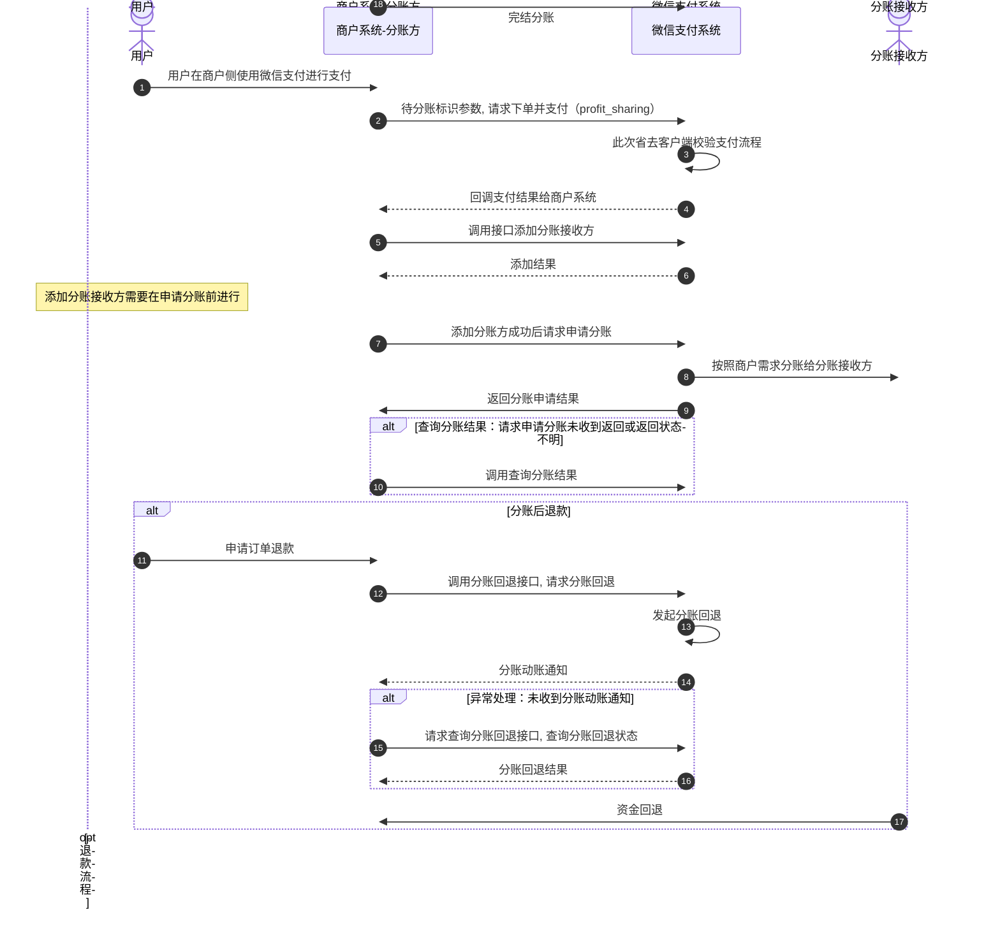

>更新时间：2026.06.09

## 1. 接口规则

为了在保证支付安全的前提下，带给商户简单、一致且易用的开发体验，我们推出了全新的微信支付APIv3接口。该版本API的具体规则请参考[APIv3接口规则](https://pay.weixin.qq.com/doc/v3/merchant/4012081606.md)。

## 2. 开发准备

### 2.1. 搭建和配置开发环境

开发者应当依据自身的编程语言来构建并配置相应的开发环境。

### 2.2. 业务开发配置

#### 2.2.1. 服务商开通连锁品牌工具箱

服务商可登录【[服务商平台](https://pay.weixin.qq.com/partner/public/home)-合作工具箱】申请开通【连锁品牌工具箱】。进行品牌申请、查看品牌申请进度、邀请品牌总部授权、品牌门店管理、品牌流量场景管理等日常管理。


#### 2.2.2. 设置分账比例

连锁工具箱开通后，品牌主在商户平台进入：“品牌专区-品牌交易-品牌供应链分账-供应链分账管理”中可进行分账比例的调整。


## 3. 快速接入

### 3.1. 业务流程图



重点步骤说明：

步骤5：分账前需调用[添加分账接收方](https://pay.weixin.qq.com/doc/v3/partner/4012467100.md)接口添加分账接收方。

步骤7：在基础支付中上传参数 `profit_sharing`，请求支付；支付完成后，调用[请求分账接口](https://pay.weixin.qq.com/doc/v3/partner/4012692975.md)；

步骤8：请求分账接口采用异步处理模式，即在接收到商户请求后，会先受理请求（受理请求返回的结果非最终分账结果）再异步处理，最终的分账结果需要通过[查询分账结果接口](https://pay.weixin.qq.com/doc/v3/partner/4012467002.md)获取；

步骤9：分账完成后，微信会通过[分账动账通知](https://pay.weixin.qq.com/doc/v3/partner/4012075400.md)接口，主动通知分账接收方商户；

步骤10：分账发起方商户调用[查询分账结果接口](https://pay.weixin.qq.com/doc/v3/partner/4012467002.md)，主动查询分账结果，根据 `receivers.result` 判断每个接收方的分账结果，如返回 `CLOSED：已关闭`，可根据返回的 `receivers.fail_reason` 分账失败原因参考[分账失败处理指引](https://pay.weixin.qq.com/doc/v3/partner/4015504918.md)进行处理；

步骤12：分账后若产生退款，则需先调用[请求分账回退](https://pay.weixin.qq.com/doc/v3/partner/4012467097.md)接口，请求将已经分给分账方的资金回退，再处理退款；

步骤14：分账回退完成后，微信同样会通过[分账动账通知](https://pay.weixin.qq.com/doc/v3/partner/4012075400.md)接口，主动通知分账回退方商户；

步骤15：分账发起方商户可以通过[查询分账回退结果](https://pay.weixin.qq.com/doc/v3/partner/4012467011.md)接口，主动查询分账回退结果；

步骤18：分账结束后，商户需调用[完结分账](https://pay.weixin.qq.com/doc/v3/partner/4012467016.md)接口结束分账订单。

### 3.2. API接入（含示例代码）

文档展示了如何使用微信支付服务端 SDK 快速接入连锁品牌分账产品，完成与微信支付对接的部分。

注意

- 文档中的代码示例是用来阐述 API 基本使用方法，代码中的示例参数需替换成商户自己账号及请求参数才能跑通。

- 以下接入步骤仅提供参考，请商户结合自身业务需求进行评估、修改。


#### 3.2.1. 【服务端】请求分账

步骤说明：微信订单支付成功后，由服务商发起分账请求，将结算后的资金分给分账接收方。

示例代码

JAVA

```
public void ProfitSharing() throws Exception{
    //请求URL
    HttpPost httpPost = new HttpPost("https://api.mch.weixin.qq.com/v3/brand/profitsharing/orders");
    // 请求body参数
    String reqdata = "{"
            + "\"brand_mchid\":\"1900000108\","
            + "\"sub_mchid\":\"1900000109\","
            + "\"appid\":\"wx8888888888888888\","
            + "\"sub_appid\":\"wx8888888888888889\","
            + "\"transaction_id\":\"4208450740201411110007820472\","
            + "\"out_order_no\":\"P20150806125346\","
            + "\"receivers\": ["
            + "{"
            + "\"type\":\"MERCHANT_ID\","
            + "\"account\":\"1900000110\","
            + "\"amount\":100,"
            + "\"description\":\"1900000109分给商户1900000110\""
            + "}"
            + "],"
            + "\"finish\":true"
            + "}";
    StringEntity entity = new StringEntity(reqdata,"utf-8");
    entity.setContentType("application/json");
    httpPost.setEntity(entity);
    httpPost.setHeader("Accept", "application/json");

    //完成签名并执行请求
    CloseableHttpResponse response = httpClient.execute(httpPost);

    try {
        int statusCode = response.getStatusLine().getStatusCode();
        if (statusCode == 200) { //处理成功
            System.out.println("success,return body = " + EntityUtils.toString(response.getEntity()));
        } else if (statusCode == 204) { //处理成功，无返回Body
            System.out.println("success");
        } else {
            System.out.println("failed,resp code = " + statusCode+ ",return body = " + EntityUtils.toString(response.getEntity()));
            throw new IOException("request failed");
        }
    } finally {
        response.close();
    }
}
```

PHP

```
try {
    $resp = $client->request(
        'POST',
        'https://api.mch.weixin.qq.com/v3/brand/profitsharing/orders', //请求URL
        [
            // JSON请求体
            'json' => [
                "brand_mchid" => "1900000108",
                "sub_mchid" => "1900000109",
                "appid" => "wx8888888888888888",
                "sub_appid" => "wx8888888888888889",
                "transaction_id" => "4208450740201411110007820472",
                "out_order_no" => "P20150806125346",
                "receivers" => [
                    [
                        "type" => "MERCHANT_ID",
                        "account" => "1900000110",
                        "amount" => 100,
                        "description" => "1900000109分给商户1900000110",
                    ],
                ],
                "finish" => true,
            ],
            'headers' => [ 'Accept' => 'application/json' ]
        ]
    );
    $statusCode = $resp->getStatusCode();
    if ($statusCode == 200) { //处理成功
        echo "success,return body = " . $resp->getBody()->getContents()."\n";
    } else if ($statusCode == 204) { //处理成功，无返回Body
        echo "success";
    }
} catch (RequestException $e) {
    // 进行错误处理
    echo $e->getMessage()."\n";
    if ($e->hasResponse()) {
        echo "failed,resp code = " . $e->getResponse()->getStatusCode() . " return body = " . $e->getResponse()->getBody() . "\n";
    }
    return;
}
```

重要入参说明：

- brand\_mchid：品牌主商户号，填写微信支付分配的商户号。

- sub\_mchid：子商户号，订单收款方商户号，可以是品牌主商户号，也可以是门店商户号，填写微信支付分配的商户号。

- AppID：公众账号ID，微信分配的公众账号ID，这里指服务商的AppID。

- out\_order\_no：商户分账单号，商户系统内部的分账单号，在商户系统内部唯一（单次分账、多次分账、完结分账应使用不同的商户分账单号），同一分账单号多次请求等同一次，只能是数字、大小写字母 ```_``-``|``*``@```。


更多参数、响应详情及错误码请参见[请求分账](https://pay.weixin.qq.com/doc/v3/partner/4012692975.md)接口文档。

#### 3.2.2. 【服务端】查询分账结果

步骤说明： 发起分账请求后，可调用此接口查询分账结果 。发起分账完结请求后，可调用此接口查询分账完结的结果。

示例代码

JAVA

```
public void QueryProfitSharing() throws Exception{
    //请求URL
    HttpGet httpGet = new HttpGet("https://api.mch.weixin.qq.com/v3/brand/profitsharing/orders?sub_mchid=1900000109&transaction_id=4208450740201411110007820472&out_order_no=P20150806125346");
    httpGet.setHeader("Accept", "application/json");
    //完成签名并执行请求
    CloseableHttpResponse response = httpClient.execute(httpGet);
    try {
        int statusCode = response.getStatusLine().getStatusCode();
        if (statusCode == 200) { //处理成功
            System.out.println("success,return body = " + EntityUtils.toString(response.getEntity()));
        } else if (statusCode == 204) { //处理成功，无返回Body
            System.out.println("success");
        } else {
            System.out.println("failed,resp code = " + statusCode+ ",return body = " + EntityUtils.toString(response.getEntity()));
            throw new IOException("request failed");
        }
    } finally {
        response.close();
    }
}
```

PHP

```
try {
    $resp = $client->request(
        'GET',
        'https://api.mch.weixin.qq.com/v3/brand/profitsharing/orders?sub_mchid=1900000109&transaction_id=4208450740201411110007820472&out_order_no=P20150806125346', //请求URL
        [
            'headers' => [ 'Accept' => 'application/json']
        ]
    );
    $statusCode = $resp->getStatusCode();
    if ($statusCode == 200) { //处理成功
        echo "success,return body = " . $resp->getBody()->getContents()."\n";
    } else if ($statusCode == 204) { //处理成功，无返回Body
        echo "success";
    }
} catch (RequestException $e) {
    // 进行错误处理
    echo $e->getMessage()."\n";
    if ($e->hasResponse()) {
        echo "failed,resp code = " . $e->getResponse()->getStatusCode() . " return body = " . $e->getResponse()->getBody() . "\n";
    }
    return;
}
```

重要入参说明：

- transaction\_id：微信订单号， 微信支付订单号。

- sub\_mchid：子商户号，订单收款方商户号，可以是品牌主商户号，也可以是门店商户号，填写微信支付分配的商户号。

- out\_order\_no：商户分账单号，商户系统内部的分账单号，在商户系统内部唯一（单次分账、多次分账、完结分账应使用不同的商户分账单号），同一分账单号多次请求等同一次，只能是数字、大小写字母\_-\|\*@。


更多参数、响应详情及错误码请参见[查询分账结果](https://pay.weixin.qq.com/doc/v3/partner/4012467002.md)接口文档。

#### 3.2.3. 【服务端】分账动账通知

步骤说明： 此功能仅针对分账接收方，当分账动账金额发生变动时，微信会把相关变动结果发送给需要实时关注的分账接收方。

注意

- 分账动账通知是以POST 方法访问商户设置的通知URL，通知的数据以JSON 格式通过请求主体（BODY）传输。通知的数据包括了加密的支付结果详情。

- 加密不能保证通知请求来自微信。微信会对发送给商户的通知进行签名，并将签名值放在通知的HTTP头Wechatpay-Signature。商户应当验证签名，以确认请求来自微信，而不是其他的第三方。签名验证的算法请参考[《微信支付API v3签名验证》](https://pay.weixin.qq.com/doc/v3/partner/4012365870.md#%E9%AA%8C%E8%AF%81%E7%AD%BE%E5%90%8D)。

- 分账动账通知HTTP应答码为200或204才会当作正常接收，当回调处理异常时，应答的HTTP状态码应为500，或者4xx。

- 商户成功接收到回调通知后应返回成功的HTTP应答码为200或204。

- 同样的通知可能会多次发送给商户系统。商户系统必须能够正确处理重复的通知。 推荐的做法是，当商户系统收到通知进行处理时，先检查对应业务数据的状态，并判断该通知是否已经处理。如果未处理，则再进行处理；如果已处理，则直接返回结果成功。在对业务数据进行状态检查和处理之前，要采用数据锁进行并发控制，以避免函数重入造成的数据混乱。


更多参数、响应详情及错误码请参见[分账动账通知](https://pay.weixin.qq.com/doc/v3/partner/4012075400.md)接口文档。

#### 3.2.4. 【服务端】请求分账回退

步骤说明： 如果订单已经分账，在退款时，可以先调此接口，将已分账的资金从商户类型的分账接收方的账户回退给分账方，再发起退款。

示例代码

JAVA

```
public void ReturnProfitSharing() throws Exception{
    //请求URL
    HttpPost httpPost = new HttpPost("https://api.mch.weixin.qq.com/v3/brand/profitsharing/returnorders");
    // 请求body参数
    String reqdata = "{"
            + "\"sub_mchid\":\"1900000109\","
            + "\"order_id\":\"3008450740201411110007820472\","
            + "\"out_order_no\":\"P20150806125346\","
            + "\"out_return_no\":\"R20190516001\","
            + "\"return_mchid\":\"86693852\","
            + "\"amount\":10,"
            + "\"description\":\"分账回退\""
            + "}";
    StringEntity entity = new StringEntity(reqdata,"utf-8");
    entity.setContentType("application/json");
    httpPost.setEntity(entity);
    httpPost.setHeader("Accept", "application/json");
    //完成签名并执行请求
    CloseableHttpResponse response = httpClient.execute(httpPost);
    try {
        int statusCode = response.getStatusLine().getStatusCode();
        if (statusCode == 200) { //处理成功
            System.out.println("success,return body = " + EntityUtils.toString(response.getEntity()));
        } else if (statusCode == 204) { //处理成功，无返回Body
            System.out.println("success");
        } else {
            System.out.println("failed,resp code = " + statusCode+ ",return body = " + EntityUtils.toString(response.getEntity()));
            throw new IOException("request failed");
        }
    } finally {
        response.close();
    }
}
```

PHP

```
try {
    $resp = $client->request(
        'POST',
        'https://api.mch.weixin.qq.com/v3/brand/profitsharing/returnorders', //请求URL
        [
            // JSON请求体
            'json' => [
                "sub_mchid" => "1900000109",
                "order_id" => "3008450740201411110007820472",
                "out_order_no" => "P20150806125346",
                "out_return_no" => "R20190516001",
                "return_mchid" => "86693852",
                "amount" => 10,
                "description" => "分账回退",
            ],
            'headers' => [ 'Accept' => 'application/json' ]
        ]
    );
    $statusCode = $resp->getStatusCode();
    if ($statusCode == 200) { //处理成功
        echo "success,return body = " . $resp->getBody()->getContents()."\n";
    } else if ($statusCode == 204) { //处理成功，无返回Body
        echo "success";
    }
} catch (RequestException $e) {
    // 进行错误处理
    echo $e->getMessage()."\n";
    if ($e->hasResponse()) {
        echo "failed,resp code = " . $e->getResponse()->getStatusCode() . " return body = " . $e->getResponse()->getBody() . "\n";
    }
    return;
}
```

重要入参说明：

- sub\_mchid：子商户号，订单收款方商户号，可以是品牌主商户号，也可以是门店商户号，填写微信支付分配的商户号。

- out\_order\_no：商户分账单号，商户系统内部的分账单号，在商户系统内部唯一（单次分账、多次分账、完结分账应使用不同的商户分账单号），同一分账单号多次请求等同一次，只能是数字、大小写字母\_-\|\*@。

- out\_return\_no：商户回退单号，此回退单号是商户在自己后台生成的一个新的回退单号，在商户后台唯一，只能是数字、大小写字母\_-\|\*@。

- return\_mchid：回退商户号，回退商户号只能填写原分账请求中接收分账的商户号。


更多参数、响应详情及错误码请参见[请求分账回退](https://pay.weixin.qq.com/doc/v3/partner/4012467097.md)接口文档。

#### 3.2.5. 【服务端】查询分账回退结果

步骤说明：商户需要核实回退结果，可调用此接口查询回退结果。如果分账回退接口返回状态为处理中，可调用此接口查询回退结果。

示例代码

JAVA

```
public void QueryReturnOrder() throws Exception{
    //请求URL
    HttpGet httpGet = new HttpGet("https://api.mch.weixin.qq.com/v3/brand/profitsharing/returnorders?sub_mchid=1900000109&out_return_no=R20190516001&order_id=4208450740201411110007820472");
    httpGet.setHeader("Accept", "application/json");
    //完成签名并执行请求
    CloseableHttpResponse response = httpClient.execute(httpGet);
    try {
        int statusCode = response.getStatusLine().getStatusCode();
        if (statusCode == 200) { //处理成功
            System.out.println("success,return body = " + EntityUtils.toString(response.getEntity()));
        } else if (statusCode == 204) { //处理成功，无返回Body
            System.out.println("success");
        } else {
            System.out.println("failed,resp code = " + statusCode+ ",return body = " + EntityUtils.toString(response.getEntity()));
            throw new IOException("request failed");
        }
    } finally {
        response.close();
    }
}
```

PHP

```
try {
    $resp = $client->request(
        'GET',
        'https://api.mch.weixin.qq.com/v3/brand/profitsharing/returnorders?sub_mchid=1900000109&out_return_no=R20190516001&order_id=4208450740201411110007820472', //请求URL
        [
            'headers' => [ 'Accept' => 'application/json']
        ]
    );
    $statusCode = $resp->getStatusCode();
    if ($statusCode == 200) { //处理成功
        echo "success,return body = " . $resp->getBody()->getContents()."\n";
    } else if ($statusCode == 204) { //处理成功，无返回Body
        echo "success";
    }
} catch (RequestException $e) {
    // 进行错误处理
    echo $e->getMessage()."\n";
    if ($e->hasResponse()) {
        echo "failed,resp code = " . $e->getResponse()->getStatusCode() . " return body = " . $e->getResponse()->getBody() . "\n";
    }
    return;
}
```

重要入参说明：

- sub\_mchid：子商户号，订单收款方商户号，可以是品牌主商户号，也可以是门店商户号，填写微信支付分配的商户号。

- out\_order\_no：商户分账单号，商户系统内部的分账单号，在商户系统内部唯一（单次分账、多次分账、完结分账应使用不同的商户分账单号），同一分账单号多次请求等同一次，只能是数字、大小写字母\_-\|\*@。

- out\_return\_no：商户回退单号，调用回退接口提供的商户系统内部的回退单号。


更多参数、响应详情及错误码请参见[查询分账回退结果](https://pay.weixin.qq.com/doc/v3/partner/4012467011.md)接口文档。

#### 3.2.6. 【服务端】完结分账

步骤说明： 不需要进行分账的订单，可直接调用本接口将订单的金额全部解冻给分账方商户。

示例代码

JAVA

```
public void FinishProfitSharing() throws Exception{
    //请求URL
    HttpPost httpPost = new HttpPost("https://api.mch.weixin.qq.com/v3/brand/profitsharing/finish-order");
    // 请求body参数
    String reqdata = "{"
            + "\"sub_mchid\":\"1900000109\","
            + "\"transaction_id\":\"4208450740201411110007820472\","
            + "\"out_order_no\":\"P20150806125346\","
            + "\"description\":\"分账完结\""
            + "}";
    StringEntity entity = new StringEntity(reqdata,"utf-8");
    entity.setContentType("application/json");
    httpPost.setEntity(entity);
    httpPost.setHeader("Accept", "application/json");
    //完成签名并执行请求
    CloseableHttpResponse response = httpClient.execute(httpPost);
    try {
        int statusCode = response.getStatusLine().getStatusCode();
        if (statusCode == 200) { //处理成功
            System.out.println("success,return body = " + EntityUtils.toString(response.getEntity()));
        } else if (statusCode == 204) { //处理成功，无返回Body
            System.out.println("success");
        } else {
            System.out.println("failed,resp code = " + statusCode+ ",return body = " + EntityUtils.toString(response.getEntity()));
            throw new IOException("request failed");
        }
    } finally {
        response.close();
    }
}
```

PHP

```
try {
    $resp = $client->request(
        'POST',
        'https://api.mch.weixin.qq.com/v3/brand/profitsharing/finish-order', //请求URL
        [
            // JSON请求体
            'json' => [
                "sub_mchid" => "1900000109",
                "transaction_id" => "4208450740201411110007820472",
                "out_order_no" => "P20150806125346",
                "description" => "分账完结",
            ],
            'headers' => [ 'Accept' => 'application/json' ]
        ]
    );
    $statusCode = $resp->getStatusCode();
    if ($statusCode == 200) { //处理成功
        echo "success,return body = " . $resp->getBody()->getContents()."\n";
    } else if ($statusCode == 204) { //处理成功，无返回Body
        echo "success";
    }
} catch (RequestException $e) {
    // 进行错误处理
    echo $e->getMessage()."\n";
    if ($e->hasResponse()) {
        echo "failed,resp code = " . $e->getResponse()->getStatusCode() . " return body = " . $e->getResponse()->getBody() . "\n";
    }
    return;
}
```

重要入参说明：

- transaction\_id：微信订单号， 微信支付订单号。

- sub\_mchid：子商户号，订单收款方商户号，可以是品牌主商户号，也可以是门店商户号，填写微信支付分配的商户号。

- out\_order\_no：商户分账单号，商户系统内部的分账单号，在商户系统内部唯一（单次分账、多次分账、完结分账应使用不同的商户分账单号），同一分账单号多次请求等同一次，只能是数字、大小写字母\_-\|\*@。


更多参数、响应详情及错误码请参见[完结分账](https://pay.weixin.qq.com/doc/v3/partner/4012467016.md)接口文档。

#### 3.2.7. 【服务端】查询订单剩余待分金额

步骤说明： 可调用此接口查询订单剩余待分金额。

示例代码

JAVA

```
public void QueryRemainAmounts() throws Exception{
    //请求URL
    HttpGet httpGet = new HttpGet("https://api.mch.weixin.qq.com/v3/brand/profitsharing/orders/4208450740201411110007820472/amounts");
    httpGet.setHeader("Accept", "application/json");
    //完成签名并执行请求
    CloseableHttpResponse response = httpClient.execute(httpGet);
    try {
        int statusCode = response.getStatusLine().getStatusCode();
        if (statusCode == 200) { //处理成功
            System.out.println("success,return body = " + EntityUtils.toString(response.getEntity()));
        } else if (statusCode == 204) { //处理成功，无返回Body
            System.out.println("success");
        } else {
            System.out.println("failed,resp code = " + statusCode+ ",return body = " + EntityUtils.toString(response.getEntity()));
            throw new IOException("request failed");
        }
    } finally {
        response.close();
    }
}
```

PHP

```
try {
    $resp = $client->request(
        'GET',
        'https://api.mch.weixin.qq.com/v3/brand/profitsharing/orders/4208450740201411110007820472/amounts', //请求URL
        [
            'headers' => [ 'Accept' => 'application/json']
        ]
    );
    $statusCode = $resp->getStatusCode();
    if ($statusCode == 200) { //处理成功
        echo "success,return body = " . $resp->getBody()->getContents()."\n";
    } else if ($statusCode == 204) { //处理成功，无返回Body
        echo "success";
    }
} catch (RequestException $e) {
    // 进行错误处理
    echo $e->getMessage()."\n";
    if ($e->hasResponse()) {
        echo "failed,resp code = " . $e->getResponse()->getStatusCode() . " return body = " . $e->getResponse()->getBody() . "\n";
    }
    return;
}
```

重要入参说明：

- transaction\_id：微信订单号， 微信支付订单号。


更多参数、响应详情及错误码请参见[查询订单剩余待分金额](https://pay.weixin.qq.com/doc/v3/partner/4012467021.md)接口文档。

#### 3.2.8. 【服务端】查询最大分账比例

步骤说明： 服务商可通过此接口添加分账接收方，建立分账接收方列表。连锁加盟模式下，服务商添加的分账接收方统一在品牌主商户号维度进行管理。

示例代码

JAVA

```
public void QueryBrandConfigs() throws Exception{
    //请求URL
    HttpGet httpGet = new HttpGet("https://api.mch.weixin.qq.com/v3/brand/profitsharing/brand-configs/1900000109");
    httpGet.setHeader("Accept", "application/json");
    //完成签名并执行请求
    CloseableHttpResponse response = httpClient.execute(httpGet);
    try {
        int statusCode = response.getStatusLine().getStatusCode();
        if (statusCode == 200) { //处理成功
            System.out.println("success,return body = " + EntityUtils.toString(response.getEntity()));
        } else if (statusCode == 204) { //处理成功，无返回Body
            System.out.println("success");
        } else {
            System.out.println("failed,resp code = " + statusCode+ ",return body = " + EntityUtils.toString(response.getEntity()));
            throw new IOException("request failed");
        }
    } finally {
        response.close();
    }
}
```

PHP

```
try {
    $resp = $client->request(
        'GET',
        'https://api.mch.weixin.qq.com/v3/brand/profitsharing/brand-configs/1900000109', //请求URL
        [
            'headers' => [ 'Accept' => 'application/json']
        ]
    );
    $statusCode = $resp->getStatusCode();
    if ($statusCode == 200) { //处理成功
        echo "success,return body = " . $resp->getBody()->getContents()."\n";
    } else if ($statusCode == 204) { //处理成功，无返回Body
        echo "success";
    }
} catch (RequestException $e) {
    // 进行错误处理
    echo $e->getMessage()."\n";
    if ($e->hasResponse()) {
        echo "failed,resp code = " . $e->getResponse()->getStatusCode() . " return body = " . $e->getResponse()->getBody() . "\n";
    }
    return;
}
```

重要入参说明：

- brand\_mchid：品牌主商户号，通过微信支付认证的品牌主商户号，填写微信支付分配的商户号。


更多参数、响应详情及错误码请参见[查询最大分账比例](https://pay.weixin.qq.com/doc/v3/partner/4012467022.md)接口文档。

#### 3.2.9. 【服务端】添加分账接收方

步骤说明： 服务商可通过此接口添加分账接收方，建立分账接收方列表。连锁加盟模式下，服务商添加的分账接收方统一在品牌主商户号维度进行管理。

示例代码

JAVA

```
public void AddReceivers() throws Exception{
    //请求URL
    HttpPost httpPost = new HttpPost("https://api.mch.weixin.qq.com/v3/brand/profitsharing/receivers/add");
    // 请求body参数
    String reqdata = "{"
            + "\"brand_mchid\":\"1900000108\","
            + "\"appid\":\"wx8888888888888888\","
            + "\"sub_appid\":\"wx8888888888888889\","
            + "\"type\":\"MERCHANT_ID\","
            + "\"account\":\"1900000109\","
            + "\"name\":\"张三网络公司\","
            + "\"relation_type\":\"SUPPLIER\""
            + "}";
    StringEntity entity = new StringEntity(reqdata,"utf-8");
    entity.setContentType("application/json");
    httpPost.setEntity(entity);
    httpPost.setHeader("Accept", "application/json");
    //完成签名并执行请求
    CloseableHttpResponse response = httpClient.execute(httpPost);
    try {
        int statusCode = response.getStatusLine().getStatusCode();
        if (statusCode == 200) { //处理成功
            System.out.println("success,return body = " + EntityUtils.toString(response.getEntity()));
        } else if (statusCode == 204) { //处理成功，无返回Body
            System.out.println("success");
        } else {
            System.out.println("failed,resp code = " + statusCode+ ",return body = " + EntityUtils.toString(response.getEntity()));
            throw new IOException("request failed");
        }
    } finally {
        response.close();
    }
}
```

PHP

```
try {
    $resp = $client->request(
        'POST',
        'https://api.mch.weixin.qq.com/v3/brand/profitsharing/receivers/add', //请求URL
        [
            // JSON请求体
            'json' => [
                "brand_mchid" => "1900000108",
                "appid" => "wx8888888888888888",
                "sub_appid" => "wx8888888888888889",
                "type" => "MERCHANT_ID",
                "account" => "1900000109",
                "name" => "张三网络公司",
                "relation_type" => "SUPPLIER",
            ],
            'headers' => [ 'Accept' => 'application/json' ]
        ]
    );
    $statusCode = $resp->getStatusCode();
    if ($statusCode == 200) { //处理成功
        echo "success,return body = " . $resp->getBody()->getContents()."\n";
    } else if ($statusCode == 204) { //处理成功，无返回Body
        echo "success";
    }
} catch (RequestException $e) {
    // 进行错误处理
    echo $e->getMessage()."\n";
    if ($e->hasResponse()) {
        echo "failed,resp code = " . $e->getResponse()->getStatusCode() . " return body = " . $e->getResponse()->getBody() . "\n";
    }
    return;
}
```

重要入参说明：

- brand\_mchid：品牌主商户号，通过微信支付认证的品牌主商户号，填写微信支付分配的商户号。

- AppID：公众账号ID，微信分配的公众账号ID，这里指服务商的AppID。

- type：分账接收方类型，枚举值：

  - MERCHANT\_ID：商户号（mch\_id或者sub\_mch\_id）

  - PERSONAL\_OPENID：个人OpenID（由服务商的AppID转换得到）

  - PERSONAL\_SUB\_OPENID：个人sub\_openid（由品牌主的AppID转换得到）
- account：分账接收方账号：

  - 分账接收方类型为：MERCHANT\_ID时，分账接收方账号为商户号（mch\_id或者sub\_mch\_id）

  - 分账接收方类型为：PERSONAL\_OPENID时，分账接收方账号为个人OpenID

  - 分账接收方类型为：PESONAL\_SUB\_OPENID时，分账接收方账号为个人sub\_openid

更多参数、响应详情及错误码请参见[添加分账接收方](https://pay.weixin.qq.com/doc/v3/partner/4012467100.md)接口文档。

#### 3.2.10. 【服务端】删除分账接收方

步骤说明： 服务商发起删除分账接收方请求。删除后，不再支持品牌主或门店分到该分账接收方。

示例代码

JAVA

```
public void DelReceivers() throws Exception{
    //请求URL
    HttpPost httpPost = new HttpPost("https://api.mch.weixin.qq.com/v3/brand/profitsharing/receivers/delete");
    // 请求body参数
    String reqdata = "{"
            + "\"brand_mchid\":\"1900000108\","
            + "\"appid\":\"wx8888888888888888\","
            + "\"sub_appid\":\"wx8888888888888889\","
            + "\"type\":\"MERCHANT_ID\","
            + "\"account\":\"1900000109\""
            + "}";
    StringEntity entity = new StringEntity(reqdata,"utf-8");
    entity.setContentType("application/json");
    httpPost.setEntity(entity);
    httpPost.setHeader("Accept", "application/json");
    //完成签名并执行请求
    CloseableHttpResponse response = httpClient.execute(httpPost);
    try {
        int statusCode = response.getStatusLine().getStatusCode();
        if (statusCode == 200) { //处理成功
            System.out.println("success,return body = " + EntityUtils.toString(response.getEntity()));
        } else if (statusCode == 204) { //处理成功，无返回Body
            System.out.println("success");
        } else {
            System.out.println("failed,resp code = " + statusCode+ ",return body = " + EntityUtils.toString(response.getEntity()));
            throw new IOException("request failed");
        }
    } finally {
        response.close();
    }
}
```

PHP

```
try {
    $resp = $client->request(
        'POST',
        'https://api.mch.weixin.qq.com/v3/brand/profitsharing/receivers/delete', //请求URL
        [
            // JSON请求体
            'json' => [
                "brand_mchid" => "1900000108",
                "appid" => "wx8888888888888888",
                "sub_appid" => "wx8888888888888889",
                "type" => "MERCHANT_ID",
                "account" => "1900000109",
            ],
            'headers' => [ 'Accept' => 'application/json' ]
        ]
    );
    $statusCode = $resp->getStatusCode();
    if ($statusCode == 200) { //处理成功
        echo "success,return body = " . $resp->getBody()->getContents()."\n";
    } else if ($statusCode == 204) { //处理成功，无返回Body
        echo "success";
    }
} catch (RequestException $e) {
    // 进行错误处理
    echo $e->getMessage()."\n";
    if ($e->hasResponse()) {
        echo "failed,resp code = " . $e->getResponse()->getStatusCode() . " return body = " . $e->getResponse()->getBody() . "\n";
    }
    return;
}
```

重要入参说明：

- brand\_mchid：品牌主商户号，通过微信支付认证的品牌主商户号，填写微信支付分配的商户号。

- AppID：公众账号ID，微信分配的公众账号ID，这里指服务商的AppID。

- type：分账接收方类型，枚举值：

  - MERCHANT\_ID：商户号（mch\_id或者sub\_mch\_id）

  - PERSONAL\_OPENID：个人OpenID（由服务商的AppID转换得到）

  - PERSONAL\_SUB\_OPENID：个人sub\_openid（由品牌主的AppID转换得到）
- account：分账接收方账号：

  - 分账接收方类型为：MERCHANT\_ID时，分账接收方账号为商户号（mch\_id或者sub\_mch\_id）

  - 分账接收方类型为：PERSONAL\_OPENID时，分账接收方账号为个人OpenID

  - 分账接收方类型为：PESONAL\_SUB\_OPENID时，分账接收方账号为个人sub\_openid

更多参数、响应详情及错误码请参见[删除分账接收方](https://pay.weixin.qq.com/doc/v3/partner/4012467103.md)接口文档。

## 4. 常见问题

### Q：分账调用“请求分账接口”返回“非分账订单不支持分账”

A：请按照以下几点检查：

1. 微信订单号填写错误；

2. 下单的时候未传分账标识（profit\_sharing）的订单，是没有分账权限的。


### Q：分账调用“请求分账接口”返回“分账金额不足”

A：请按照以下几点检查：

1. 该订单已全额退款，没有资金可以分账；

2. 已经调用过“请求单次分账”，订单剩余的待分账金额已经解冻，已无分账资金；

3. 超过订单可分账金额或者该订单已无可分账金额，请检查确认。


### Q：分账调用“请求分账接口”返回“订单处理中，暂时无法分账，请稍后再试”

A：请按照以下几点检查：

1. 请在订单支付成功1分钟后再调用分账接口；

2. 未结算的订单，请在结算后再调用分账接口请求分账；

3. 老资金流商户的订单，不支持分账；

4. 商户开通了收支分离但手续费账户余额不足（手续费账户最低余额要求是100元以上，在充值手续费账户1小时后，订单会正常结算，即可正常调用分账接口）。


### Q：分账调用“请求分账接口”返回“分账接收商户全称不匹配”

A：请按照以下几点检查：

1. 分账接收商户全称填写错误，请填写正确的商户全称；

2. 接口需要使用UTF-8编码。


### Q：分账调用“添加分账接收方接口”返回“系统繁忙，请稍后重试”

A：receiver中的参数account错误，参数account的规则如下：

1. 类型是MERCHANT\_ID时，是商户ID；

2. 类型是PERSONAL\_OPENID时，是个人OpenID；

3. 类型是PERSONAL\_SUB\_OPENID时，是个人sub\_openid；

4. AppID与mchid不匹配也会报该错误，请检查确认；

5. 签名类型错误，分账接口签名类型目前支持SHA256-RSA、国密（又称商用加密算法，即商密SM）。