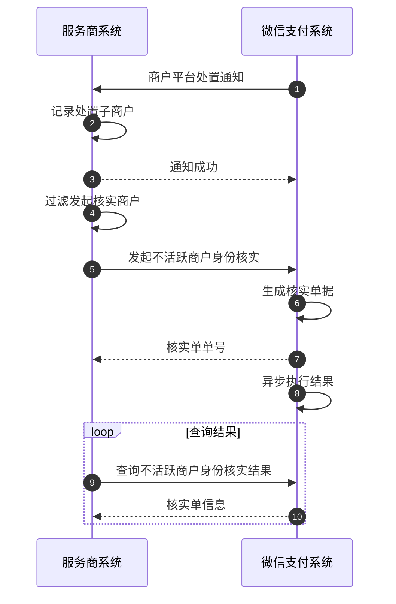

>更新时间：2026.06.09

## 1. 接口规则

为了在保证支付安全的前提下，带给商户简单、一致且易用的开发体验，我们推出了全新的微信支付APIv3接口。该版本API的具体规则请参考“[APIv3接口规则](https://pay.weixin.qq.com/doc/v3/partner/4012081673.md)”。

## 2. 开发环境搭建

为了帮助开发者更好的调用接口，我们提供[微信支付APIv3官方SDK](https://pay.weixin.qq.com/doc/v3/partner/4012083109.md)，请根据自身开发语言，选择对应的SDK库集成到项目。

目前微信支付提供JAVA、PHP、GO三种语言版本的SDK，封装了签名生成、签名验证、敏感信息加/解密、媒体文件上传等基础接口功能。

| SDK | 说明 |
| --- | --- |
| [wechatpay-java](https://github.com/wechatpay-apiv3/wechatpay-java) | Java 服务端 SDK |
| [wechatpay-php](https://github.com/wechatpay-apiv3/wechatpay-php) | PHP 服务端 SDK |
| [wechatpay-go](https://github.com/wechatpay-apiv3/wechatpay-go) | GO 服务端 SDK |

如下通用基础功能接口，已经在SDK中完成封装，可替换相关参数后快速测试。

1. [签名生成](https://pay.weixin.qq.com/doc/v3/partner/4012365870.md#%E8%AF%B7%E6%B1%82%E6%8E%A5%E5%8F%A3%E5%90%8E%E7%AB%AF%E7%AD%BE%E5%90%8D)

2. [签名验证](https://pay.weixin.qq.com/doc/v3/partner/4012365870.md#%E9%AA%8C%E8%AF%81%E7%AD%BE%E5%90%8D)

3. [敏感信息加解密](https://pay.weixin.qq.com/doc/v3/partner/4013059044.md)

4. [merchantPrivateKey（私钥）](https://pay.weixin.qq.com/doc/v3/partner/4013058924.md#%E5%A6%82%E4%BD%95%E8%8E%B7%E5%8F%96%E5%95%86%E6%88%B7API%E8%AF%81%E4%B9%A6%E7%A7%81%E9%92%A5%EF%BC%9F)

5. [wechatpayCertificates（平台证书）](https://pay.weixin.qq.com/doc/v3/partner/4012082320.md)

6. [APIV3Key（V3 key）](https://kf.qq.com/faq/180830E36vyQ180830AZFZvu.html)


若使用的编程语言无对应的SDK，则需要按照接口规则与接口详细信息自行开发。

## 3. 业务接入

### 3.1. 业务序列图



### 3.2. 关键步骤说明

#### 步骤1：接收商户平台处置记录通知

1、在调用接口前，开发者需要根据[商户平台处置通知](https://pay.weixin.qq.com/doc/v3/partner/4012064844.md)，完成商户违规通知回调地址的创建，接收商户平台处置回调通知。

2、在收到商户平台处置回调通知后，开发者需要关注[回调通知](https://pay.weixin.qq.com/doc/v3/partner/4012079216.md) 字段中 `event_type`（通知类型）为 `VIOLATION.PUNISH` 且回调通知解密后 `risk_type`（风险类型）为 `ALL_MERCHANTS_HAVE_CONFIRMED_THE_WILLINGNESS_TO_OPEN_AN_ACCOUNT` 的消息，建议将其中 `sub_mchid`(处置商户号)、 `record_id`(通知唯一标识)、 `punish_plan`(处罚方案)和 `risk_type`(风险类型)等信息予以记录以便后续使用和问题排查。

回调通知内容示例如下：

```
{
  "sub_mchid": "1900009231",
  "company_name":"财付通支付科技有限公司",
  "record_id":"200201820200101080076610000",
  "punish_plan":"关闭支付权限，延迟结算",
  "punish_time":"2015-05-20T13:29:35+08:00",
  "punish_description":"",
  "risk_type":"ALL_MERCHANTS_HAVE_CONFIRMED_THE_WILLINGNESS_TO_OPEN_AN_ACCOUNT",
  "risk_description":"无交易商户未确认开户意愿"
}
```

#### 步骤2：发起不活跃商户身份核实

1、同一商户同一时间只会存在一笔核实单，如果针对该商户重复发起核实，接口会返回成功以及流程中的核实单单号。

2、发起不活跃商户身份核实接口采用异步处理模式，即在接收到服务商请求后，优先受理请求再异步处理，最终的核实结果可以通过[查询接口](https://pay.weixin.qq.com/doc/v3/partner/4012471359.md)获得。

#### 步骤3：查询不活跃商户身份核实结果

1、不活跃商户身份核实结束后，目前不会有回调通知，需要开发者对已发起单据进行轮询。

2、当查询到核实单状态为SUCCESS或FAIL时，即可停止轮询，核实单状态不再改变。

3、核实单除了记录单号和单据状态外，还会记录失败原因，当核实单状态为FAIL时返回，可以协助判断问题。

注意

一般三天内单据即会流转为终态，建议轮询时间3天，轮询频率每小时1次。