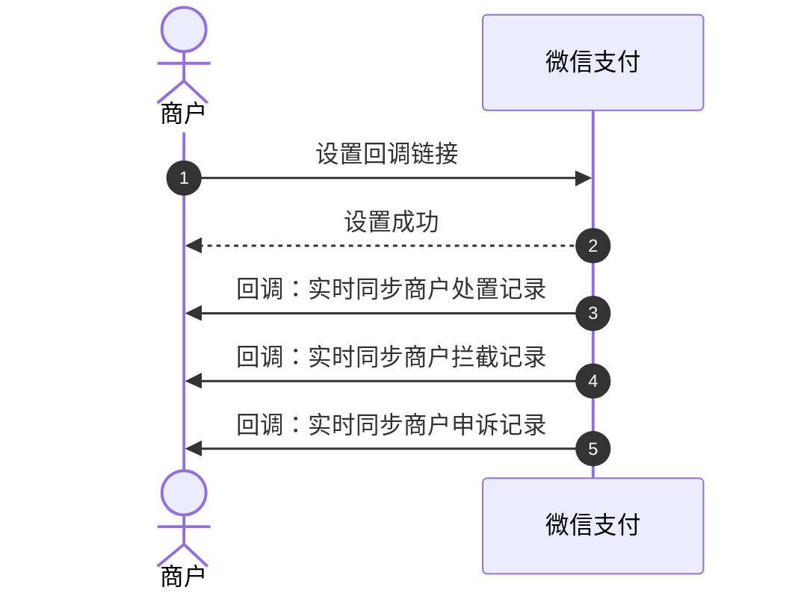

>更新时间：2026.10.20

## 1. 接口规则

为了在保证支付安全的前提下，带给商户简单、一致且易用的开发体验，我们推出了全新的微信支付APIv3接口。该版本API的具体规则请参考[APIv3接口规则](https://pay.weixin.qq.com/doc/v3/merchant/4012081606.md)。

## 2. 开发准备

### 2.1. 搭建和配置开发环境

开发者应当依据自身的编程语言来构建并配置相应的开发环境。

## 3. 快速接入

### 3.1. 业务流程图

重点步骤说明：

步骤1.1 [创建商户违规通知回调地址](https://pay.weixin.qq.com/doc/v3/partner/4012471333.md) ，调服务商、渠道商、从业机构向微信支付设置回调链接。

步骤1.2、1.3、1.4 服务商、渠道商、从业机构向微信支付设置回调链接成功后，当有新的违规、拦截（大于10次时）和申诉事件发生申诉单据状态发生变化时，商户会收到实时同步通知回调。

## 4. 常见问题

### Q：商户平台处置通知什么情况下会通知？

A：商户反馈API每分钟60次，查询投诉单列表 API频率是每分钟200次。