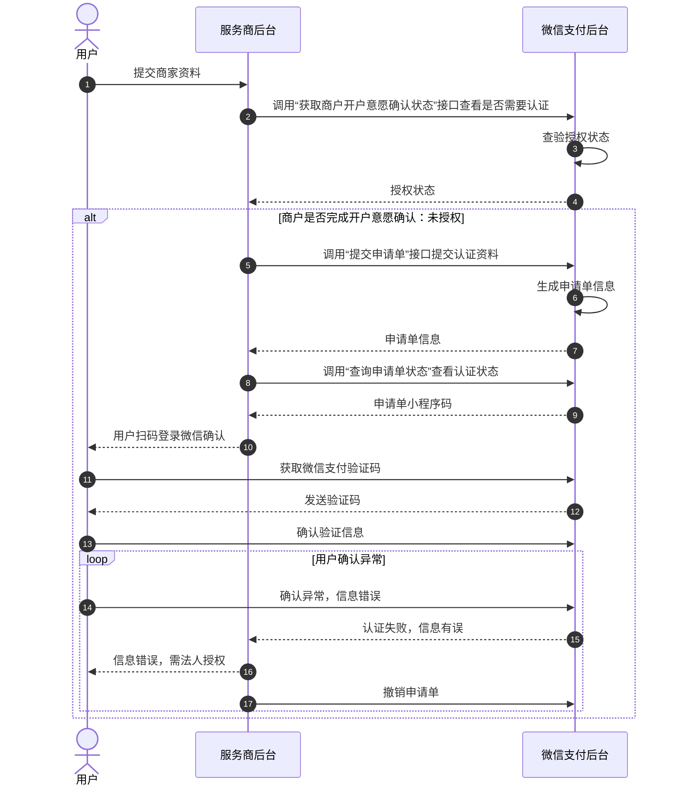
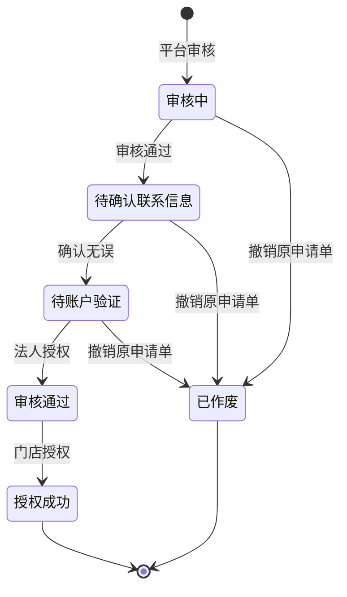

>更新时间：2026.10.20

## 1. 接口规则

为了在保证支付安全的前提下，带给商户简单、一致且易用的开发体验，我们推出了全新的微信支付APIv3接口。该版本API的具体规则请参考[APIv3接口规则](https://pay.weixin.qq.com/doc/v3/merchant/4012081606.md)。

## 2. 开发准备

### 2.1. 搭建和配置开发环境

开发者应当依据自身的编程语言来构建并配置相应的开发环境。

## 3. 快速接入

### 3.1. 业务流程图

#### 业务流程时序图



申请单状态变化如下：



重点步骤说明：

步骤1.1： 获取微信支付商户号：渠道商使用银行或者支付机构提供的API或者后台系统录入商家门店信息，获取商家每个门店在微信支付侧的商户号（上送给微信支付的“商户名称”字段必须与营业执照上商户名称一致，具体规则 [点击查看](https://kf.qq.com/faq/190805aauYnM190805V3yMJ7.html) ）。

步骤.12：查询微信支付商户号授权状态：渠道商使用[《获取商户号开户意愿确认状态接口》](https://pay.weixin.qq.com/doc/v3/partner/4012467549.md)查询微信支付商户号是否完成开户意愿确认。

步骤1.4：提交商家资料给微信支付：渠道商根据商家类型（企业、个体户、小微、事业单位、其他组织等）准备好相关的商家资料，使用微信支付接口[《提交开户意愿确认申请单》](https://pay.weixin.qq.com/doc/v3/partner/4012722388.md)获取微信支付申请单编号。

步骤1.6：查询申请单审核结果：渠道商提交商家资料后，建议每隔五分钟调用[《查询申请单审核结果接口》](https://pay.weixin.qq.com/doc/v3/partner/4012697715.md)查询申请单审核结果。

申请单正常情况下的状态转换如下

1. 提交后申请单状态为“审核中”，微信支付后台会进行审核，审核通过后申请单状态变成“待联系人确认”，同时接口会提供“申请单小程序码” （小程序码的图片）。

2. 联系人扫“申请单小程序码”后确认资料无误后，申请单状态变成“待账户验证”。

3. 联系人将“法人确认二维码”在微信上发给法人确认后（或打款验证），申请单状态变成“审核通过”。


- 当审核结果为“审核驳回”时，请根据驳回原因重新提交商家资料，重新提交前请使用[《撤销原申请单》](https://pay.weixin.qq.com/doc/v3/partner/4012697627.md)，再次提交新的商家资料。

- 当审核结果为“待联系人确认”或“待账户验证”或“审核通过”时，接口会同时给出“申请单小程序码”。


### 3.2. API接入（含示例代码）

文档展示了如何使用微信支付服务端 SDK 快速接入商户开户意愿确认，完成与微信支付对接的部分。

注意

- 文档中的代码示例是用来阐述 API 基本使用方法，代码中的示例参数需替换成商户自己账号及请求参数才能跑通。

- 以下接入步骤仅提供参考，请商户结合自身业务需求进行评估、修改。


#### 3.2.1. 【服务端】提交申请单

步骤说明： 服务商收集商户资料后，调用提交申请单接口，提交创建入驻申请单。

JAVA

```
public void Applyment() throws Exception {
  // 加载商户私钥（privateKey：私钥字符串）
  PrivateKey merchantPrivateKey = PemUtil
          .loadPrivateKey(new ByteArrayInputStream(privateKey.getBytes("utf-8")));

  // 加载平台证书（mchId：商户号,mchSerialNo：商户证书序列号,apiV3Key：V3秘钥）
  AutoUpdateCertificatesVerifier verifier = new AutoUpdateCertificatesVerifier(
          new WechatPay2Credentials(mchId, new PrivateKeySigner(mchSerialNo, merchantPrivateKey)),apiV3Key.getBytes("utf-8"));

  CloseableHttpClient httpClient = HttpClients.createDefault();
  // 初始化httpClient
  httpClient = WechatPayHttpClientBuilder.create()
          .withMerchant(mchId, mchSerialNo, merchantPrivateKey)
          .withValidator(new WechatPay2Validator(verifier)).build();

  //请求URL
  HttpPost httpPost = new HttpPost("https://api.mch.weixin.qq.com/v3/apply4subject/applyment");
  // 请求body参数
  String reqdata = "{"
          + "\"business_code\":\"1111111111\","
          + "\"contact_info\": {"
          + "\"name\":\"wRNIsXOvVuTYIhVxZJCD8uJIGmNPGozCe44Ph8rD+QAJEPxw==\","
          + "\"mobile\":\"w+zPKEVNm7IDxPvK55P0OfNd5E5VXoWbRwyyGk37HiB6C/F2lUog==\","
          + "\"id_card_number\":\"rjbq82xBwMixDGA5A4x6/hqZRAYmaeM+yyjn9BU8qUBZga+mKqQ==\""
          + "},"
          + "\"subject_info\": {"
          + "\"subject_type\":\"SUBJECT_TYPE_ENTERPRISE\","
          + "\"business_licence_info\": {"
          + "\"licence_number\":\"914201123033363296\","
          + "\"licence_copy\":\"0P3ng6KTIW4-Q_l2FjKLZuhHjBWoMAjmVtCz7ScmhEIThCaV4BBgVwtNkCHO_XXqK5dE5YdOmFJBZR9FwczhJehHhAZN6BKXQPcs-VvdSo\","
          + "\"merchant_name\":\"李四网络有限公司\","
          + "\"legal_person\":\"李四\","
          + "\"company_address\":\"广东省深圳市南山区xx路xx号\","
          + "\"licence_valid_date\":\"["1970-01-01","forever"]\""
          + "},"
          + "\"certificate_info\": {"
          + "\"cert_type\":\"CERTIFICATE_TYPE_2388\","
          + "\"cert_number\":\"111111111111\","
          + "\"cert_copy\":\"0P3ng6KTIW4-Q_l2FjKLZuhHjBWoMAjmVtCz7ScmhEIThCaV4BBgVwtNkCHO_XXqK5dE5YdOmFJBZR9FwczhJehHhAZN6BKXQPcs-VvdSo\","
          + "\"merchant_name\":\"xx公益团体\","
          + "\"legal_person\":\"李四\","
          + "\"company_address\":\"广东省深圳市南山区xx路xx号\","
          + "\"cert_valid_date\":\"["1970-01-01","forever"]\""
          + "},"
          + "\"company_prove_copy\":\"0P3ng6KTIW4-Q_l2FjKLZuhHjBWoMAjmVtCz7ScmhEIThCaV4BBgVwtNkCHO_XXqK5dE5YdOmFJBZR9FwczhJehHhAZN6BKXQPcs-VvdSo\","
          + "\"assist_prove_info\": {"
          + "\"micro_biz_type\":\"MICRO_TYPE_STORE\","
          + "\"store_name\":\"大郎烧饼\","
          + "\"store_address_code\":\"440305\","
          + "\"store_address\":\"广东省深圳市南山区xx大厦x层xxxx室\","
          + "\"store_header_copy\":\"0P3ng6KTIW4-Q_l2FjKLZuhHjBWoMAjmVtCz7ScmhEIThCaV-4BBgVwtNkCHO_XXqK5dE5YdOmFJBZR9FwczhJehHhAZN6BKXQPcs-VvdSo\","
          + "\"store_indoor_copy\":\"0P3ng6KTIW4-Q_l2FjKLZuhHjBWoMAjmVtCz7ScmhEIThCaV4BBgVwtNkCHO_XXqK5dE5YdOmFJBZR9FwczhJehHhAZN6BKXQPcs-VvdSo\""
          + "}"
          + "},"
          + "\"identification_info\": {"
          + "\"identification_type\":\"IDENTIFICATION_TYPE_IDCARD\","
          + "\"identification_name\":\"MZnwEx6zotwIz6ctW2/iQL5z94odwP9sKiFRL8Aii3L4U74RPCPztcJOScaXsaGs82HJNU3K+46ndk7prENiPDw==\","
          + "\"identification_number\":\"ZTnn5dKGCvP4csw4XTLug/+VLB+4R6nxSPQwqSpmPVZtXmye+/3s9O+y32w==\","
          + "\"identification_valid_date\":\"["1970-01-01","forever"]\","
          + "\"identification_front_copy\":\"0P3ng6KTIW4-Q_l2FjKLZuhHjBWoMAjmVtCz7ScmhEIThCaV-4BBgVwtNkCHO_XXqK5dE5YdOmFJBZR9FwczhJehHhAZN6BKXQPcs-VvdSo\","
          + "\"identification_back_copy\":\"0P3ng6KTIW4-Q_l2FjKLZuhHjBWoMAjmVtCz7ScmhEIThCaV4BBgVwtNkCHO_XXqK5dE5YdOmFJBZR9FwczhJehHhAZN6BKXQPcs-VvdSo\""
          + "},"
          + "\"addition_info\": {"
          + "\"confirm_mchid_list\": ["
          + "\"20001113\","
          + "\"20001112\""
          + "]"
          + "}"
          + "}";
  StringEntity entity = new StringEntity(reqdata,"utf-8");
  entity.setContentType("application/json");
  httpPost.setEntity(entity);
  httpPost.setHeader("Accept", "application/json");

  //完成签名并执行请求
  CloseableHttpResponse response = httpClient.execute(httpPost);

  try {
      int statusCode = response.getStatusLine().getStatusCode();
      if (statusCode == 200) { //处理成功
          System.out.println("success,return body = " + EntityUtils.toString(response.getEntity()));
      } else if (statusCode == 204) { //处理成功，无返回Body
          System.out.println("success");
      } else {
          System.out.println("failed,resp code = " + statusCode+ ",return body = " + EntityUtils.toString(response.getEntity()));
          throw new IOException("request failed");
      }
  } finally {
      response.close();
  }
}
```

PHP

```
try {
    $resp = $client->request(
        'POST',
        'https://api.mch.weixin.qq.com/v3/apply4subject/applyment', //请求URL
        [
            // JSON请求体
            'json' => [
                "business_code" => "1111111111",
                "contact_info" => [
                    "name" => "wRNIsXOvVuTYIhVxZJCD8uJIGmNPGozCe44Ph8rD+QAJEPxw==",
                    "mobile" => "w+zPKEVNm7IDxPvK55P0OfNd5E5VXoWbRwyyGk37HiB6C/F2lUog==",
                    "id_card_number" => "rjbq82xBwMixDGA5A4x6/hqZRAYmaeM+yyjn9BU8qUBZga+mKqQ==",
                ],
                "subject_info" => [
                    "subject_type" => "SUBJECT_TYPE_ENTERPRISE",
                    "business_licence_info" => [
                        "licence_number" => "914201123033363296",
                        "licence_copy" => "0P3ng6KTIW4-Q_l2FjKLZuhHjBWoMAjmVtCz7ScmhEIThCaV4BBgVwtNkCHO_XXqK5dE5YdOmFJBZR9FwczhJehHhAZN6BKXQPcs-VvdSo",
                        "merchant_name" => "李四网络有限公司",
                        "legal_person" => "李四",
                        "company_address" => "广东省深圳市南山区xx路xx号",
                        "licence_valid_date" => "["1970-01-01","forever"]",
                    ],
                    "certificate_info" => [
                        "cert_type" => "CERTIFICATE_TYPE_2388",
                        "cert_number" => "111111111111",
                        "cert_copy" => "0P3ng6KTIW4-Q_l2FjKLZuhHjBWoMAjmVtCz7ScmhEIThCaV4BBgVwtNkCHO_XXqK5dE5YdOmFJBZR9FwczhJehHhAZN6BKXQPcs-VvdSo",
                        "merchant_name" => "xx公益团体",
                        "legal_person" => "李四",
                        "company_address" => "广东省深圳市南山区xx路xx号",
                        "cert_valid_date" => "["1970-01-01","forever"]",
                    ],
                    "company_prove_copy" => "0P3ng6KTIW4-Q_l2FjKLZuhHjBWoMAjmVtCz7ScmhEIThCaV4BBgVwtNkCHO_XXqK5dE5YdOmFJBZR9FwczhJehHhAZN6BKXQPcs-VvdSo",
                    "assist_prove_info" => [
                        "micro_biz_type" => "MICRO_TYPE_STORE",
                        "store_name" => "大郎烧饼",
                        "store_address_code" => "440305",
                        "store_address" => "广东省深圳市南山区xx大厦x层xxxx室",
                        "store_header_copy" => "0P3ng6KTIW4-Q_l2FjKLZuhHjBWoMAjmVtCz7ScmhEIThCaV-4BBgVwtNkCHO_XXqK5dE5YdOmFJBZR9FwczhJehHhAZN6BKXQPcs-VvdSo",
                        "store_indoor_copy" => "0P3ng6KTIW4-Q_l2FjKLZuhHjBWoMAjmVtCz7ScmhEIThCaV4BBgVwtNkCHO_XXqK5dE5YdOmFJBZR9FwczhJehHhAZN6BKXQPcs-VvdSo",
                    ],
                ],
                "identification_info" => [
                    "identification_type" => "IDENTIFICATION_TYPE_IDCARD",
                    "identification_name" => "MZnwEx6zotwIz6ctW2/iQL5z94odwP9sKiFRL8Aii3L4U74RPCPztcJOScaXsaGs82HJNU3K+46ndk7prENiPDw==",
                    "identification_number" => "ZTnn5dKGCvP4csw4XTLug/+VLB+4R6nxSPQwqSpmPVZtXmye+/3s9O+y32w==",
                    "identification_valid_date" => "["1970-01-01","forever"]",
                    "identification_front_copy" => "0P3ng6KTIW4-Q_l2FjKLZuhHjBWoMAjmVtCz7ScmhEIThCaV-4BBgVwtNkCHO_XXqK5dE5YdOmFJBZR9FwczhJehHhAZN6BKXQPcs-VvdSo",
                    "identification_back_copy" => "0P3ng6KTIW4-Q_l2FjKLZuhHjBWoMAjmVtCz7ScmhEIThCaV4BBgVwtNkCHO_XXqK5dE5YdOmFJBZR9FwczhJehHhAZN6BKXQPcs-VvdSo",
                ],
                "addition_info" => [
                    "confirm_mchid_list" => [
                        "0" => "20001113",
                        "1" => "20001112",
                    ],
                ]
            ],
            'headers' => [ 'Accept' => 'application/json' ]
        ]
    );
    $statusCode = $resp->getStatusCode();
    if ($statusCode == 200) { //处理成功
        echo "success,return body = " . $resp->getBody()->getContents()."\n";
    } else if ($statusCode == 204) { //处理成功，无返回Body
        echo "success";
    }
} catch (RequestException $e) {
    // 进行错误处理
    echo $e->getMessage()."\n";
    if ($e->hasResponse()) {
        echo "failed,resp code = " . $e->getResponse()->getStatusCode() . " return body = " . $e->getResponse()->getBody() . "\n";
    }
    return;
}
```

重要入参说明：

- out\_trade\_no： 业务申请编号，服务商自定义的唯一编号，每个编号对应一个申请单。

- subject\_type： 主体类型。枚举值：

  - SUBJECT\_TYPE\_ENTERPRISE：企业

  - SUBJECT\_TYPE\_INSTITUTIONS\_CLONED：事业单位

  - SUBJECT\_TYPE\_INDIVIDUAL：个体工商户

  - SUBJECT\_TYPE\_OTHERS：其他组织

  - SUBJECT\_TYPE\_MICRO：小微商户
- licence\_number： 营业执照注册号。校验规则：

  - 请填写营业执照上的注册号。

  - 若主体类型为个体工商户或企业，注册号格式须为15位数字或18位数字\|大写字母。
- merchant\_name： 商户名称。

  - 个体工商户，不能以“公司”结尾。

  - 个体工商户，若营业执照上商户名称为空或为“无”，请填写"个体户+经营者姓名"，如“个体户张三”。
- legal\_person： 法人姓名。

  - 只能由中文字符、英文字符、可见符号组成。

  - 请填写营业执照的经营者/法定代表人姓名。

更多参数、响应详情及错误码请参见[提交申请单](https://pay.weixin.qq.com/doc/v3/partner/4012722388.md)接口文档。

#### 3.2.2.【服务端】撤销申请单

步骤说明： 服务商提交申请单后需要修改信息时，或者申请单审核结果为“已驳回”时服务商要修改申请材料时，均需要先调用撤销申请单接口。

JAVA

```
public void CancelApplyment() throws Exception{
  // 加载商户私钥（privateKey：私钥字符串）
  PrivateKey merchantPrivateKey = PemUtil
          .loadPrivateKey(new ByteArrayInputStream(privateKey.getBytes("utf-8")));

  // 加载平台证书（mchId：商户号,mchSerialNo：商户证书序列号,apiV3Key：V3秘钥）
  AutoUpdateCertificatesVerifier verifier = new AutoUpdateCertificatesVerifier(
          new WechatPay2Credentials(mchId, new PrivateKeySigner(mchSerialNo, merchantPrivateKey)),apiV3Key.getBytes("utf-8"));

  CloseableHttpClient httpClient = HttpClients.createDefault();
  // 初始化httpClient
  httpClient = WechatPayHttpClientBuilder.create()
          .withMerchant(mchId, mchSerialNo, merchantPrivateKey)
          .withValidator(new WechatPay2Validator(verifier)).build();

  //请求URL
  HttpPost httpPost = new HttpPost("https://api.mch.weixin.qq.com/v3/apply4subject/applyment/20000011111/cancel");
  StringEntity entity = new StringEntity("");
  entity.setContentType("application/json");
  httpPost.setEntity(entity);
  httpPost.setHeader("Accept", "application/json");

  //完成签名并执行请求
  CloseableHttpResponse response = httpClient.execute(httpPost);

  try {
      int statusCode = response.getStatusLine().getStatusCode();
      if (statusCode == 200) { //处理成功
          System.out.println("success,return body = " + EntityUtils.toString(response.getEntity()));
      } else if (statusCode == 204) { //处理成功，无返回Body
          System.out.println("success");
      } else {
          System.out.println("failed,resp code = " + statusCode+ ",return body = " + EntityUtils.toString(response.getEntity()));
          throw new IOException("request failed");
      }
  } finally {
      response.close();
  }
}
```

PHP

```
try {
    $resp = $client->request(
        'POST',
        'https://api.mch.weixin.qq.com/v3/apply4subject/applyment/123/cancel', //请求URL
        [
            'headers' => [
                'Accept' => 'application/json',
                'Content-Type'=>'application/json'

            ]
        ]
    );
    $statusCode = $resp->getStatusCode();
    if ($statusCode == 200) { //处理成功
        echo "success,return body = " . $resp->getBody()->getContents()."\n";
    } else if ($statusCode == 204) { //处理成功，无返回Body
        echo "success";
    }
} catch (RequestException $e) {
    // 进行错误处理
    echo $e->getMessage()."\n";
    if ($e->hasResponse()) {
        echo "failed,resp code = " . $e->getResponse()->getStatusCode() . " return body = " . $e->getResponse()->getBody() . "\n";
    }
    return;
}
```

重要入参说明：

- applyment\_id： 申请单编号，微信支付分配的申请单号，申请单编号和业务申请编号至少传一个。

- business\_code： 业务申请编号。


更多参数、响应详情及错误码请参见[撤销申请单](https://pay.weixin.qq.com/doc/v3/partner/4012697627.md)接口文档。

#### 3.2.3. 【服务端】查询申请单审核结果

步骤说明： 查询申请单审核结果。

JAVA

```
public void QueryApplyment() throws Exception{
  // 加载商户私钥（privateKey：私钥字符串）
  PrivateKey merchantPrivateKey = PemUtil
          .loadPrivateKey(new ByteArrayInputStream(privateKey.getBytes("utf-8")));

  // 加载平台证书（mchId：商户号,mchSerialNo：商户证书序列号,apiV3Key：V3秘钥）
  AutoUpdateCertificatesVerifier verifier = new AutoUpdateCertificatesVerifier(
          new WechatPay2Credentials(mchId, new PrivateKeySigner(mchSerialNo, merchantPrivateKey)),apiV3Key.getBytes("utf-8"));

  CloseableHttpClient httpClient = HttpClients.createDefault();
  // 初始化httpClient
  httpClient = WechatPayHttpClientBuilder.create()
          .withMerchant(mchId, mchSerialNo, merchantPrivateKey)
          .withValidator(new WechatPay2Validator(verifier)).build();

  //请求URL
  HttpGet httpGet = new HttpGet("https://api.mch.weixin.qq.com/v3/apply4subject/applyment?applyment_id=20000011111");
  httpGet.setHeader("Accept", "application/json");

  //完成签名并执行请求
  CloseableHttpResponse response = httpClient.execute(httpGet);

  try {
      int statusCode = response.getStatusLine().getStatusCode();
      if (statusCode == 200) { //处理成功
          System.out.println("success,return body = " + EntityUtils.toString(response.getEntity()));
      } else if (statusCode == 204) { //处理成功，无返回Body
          System.out.println("success");
      } else {
          System.out.println("failed,resp code = " + statusCode+ ",return body = " + EntityUtils.toString(response.getEntity()));
          throw new IOException("request failed");
      }
  } finally {
      response.close();
  }
}
```

PHP

```
try {
    $resp = $client->request(
        'GET',
        'https://api.mch.weixin.qq.com/v3/apply4subject/applyment?applyment_id=20000011111', //请求URL
        [
            'headers' => [ 'Accept' => 'application/json']
        ]
    );
    $statusCode = $resp->getStatusCode();
    if ($statusCode == 200) { //处理成功
        echo "success,return body = " . $resp->getBody()->getContents()."\n";
    } else if ($statusCode == 204) { //处理成功，无返回Body
        echo "success";
    }
} catch (RequestException $e) {
    // 进行错误处理
    echo $e->getMessage()."\n";
    if ($e->hasResponse()) {
        echo "failed,resp code = " . $e->getResponse()->getStatusCode() . " return body = " . $e->getResponse()->getBody() . "\n";
    }
    return;
}
```

重要入参说明：

- applyment\_id： 申请单编号，微信支付分配的申请单号，申请单编号和业务申请编号至少传一个。

- business\_code： 业务申请编号。

  - 服务商自定义的唯一编号。

  - 每个编号对应一个申请单。

更多参数、响应详情及错误码请参见[撤销申请单](https://pay.weixin.qq.com/doc/v3/partner/4012697627.md)接口文档。

#### 3.2.4. 【服务端】获取商户开户意愿确认状态

步骤说明： 当服务商需要确认微信支付子商户号是否完成确认时，如果调用此接口提到“已授权”状态，则说明该商户号已完成开户意愿确认。

JAVA

```
public void QueryMerchantsState() throws Exception{
  // 加载商户私钥（privateKey：私钥字符串）
  PrivateKey merchantPrivateKey = PemUtil
          .loadPrivateKey(new ByteArrayInputStream(privateKey.getBytes("utf-8")));

  // 加载平台证书（mchId：商户号,mchSerialNo：商户证书序列号,apiV3Key：V3秘钥）
  AutoUpdateCertificatesVerifier verifier = new AutoUpdateCertificatesVerifier(
          new WechatPay2Credentials(mchId, new PrivateKeySigner(mchSerialNo, merchantPrivateKey)),apiV3Key.getBytes("utf-8"));

  CloseableHttpClient httpClient = HttpClients.createDefault();
  // 初始化httpClient
  httpClient = WechatPayHttpClientBuilder.create()
          .withMerchant(mchId, mchSerialNo, merchantPrivateKey)
          .withValidator(new WechatPay2Validator(verifier)).build();

  //请求URL
  HttpGet httpGet = new HttpGet("https://api.mch.weixin.qq.com/v3/apply4subject/applyment/merchants/20000011111/state");
  httpGet.setHeader("Accept", "application/json");

  //完成签名并执行请求
  CloseableHttpResponse response = httpClient.execute(httpGet);

  try {
      int statusCode = response.getStatusLine().getStatusCode();
      if (statusCode == 200) { //处理成功
          System.out.println("success,return body = " + EntityUtils.toString(response.getEntity()));
      } else if (statusCode == 204) { //处理成功，无返回Body
          System.out.println("success");
      } else {
          System.out.println("failed,resp code = " + statusCode+ ",return body = " + EntityUtils.toString(response.getEntity()));
          throw new IOException("request failed");
      }
  } finally {
      response.close();
  }
}
```

PHP

```
try {
    $resp = $client->request(
        'GET',
        'https://api.mch.weixin.qq.com/v3/apply4subject/applyment/merchants/20000011111/state', //请求URL
        [
            'headers' => [ 'Accept' => 'application/json']
        ]
    );
    $statusCode = $resp->getStatusCode();
    if ($statusCode == 200) { //处理成功
        echo "success,return body = " . $resp->getBody()->getContents()."\n";
    } else if ($statusCode == 204) { //处理成功，无返回Body
        echo "success";
    }
} catch (RequestException $e) {
    // 进行错误处理
    echo $e->getMessage()."\n";
    if ($e->hasResponse()) {
        echo "failed,resp code = " . $e->getResponse()->getStatusCode() . " return body = " . $e->getResponse()->getBody() . "\n";
    }
    return;
}
```

重要入参说明：

- sub\_mchid： 特约商户号，微信支付分配的特约商户的唯一标识。


更多参数、响应详情及错误码请参见[获取商户开户意愿确认状态](https://pay.weixin.qq.com/doc/v3/partner/4012467549.md)接口文档。

## 4. 常见问题

### Q1：商户开户意愿调用“提交申请单”返回：暂未查询到该营业执照注册号，请检查营业执照注册号是否填写正确

A1：请求参数“营业执照注册号（licence\_number）”填写错误，请填写营业执照上的注册号，若主体类型为个体工商户或企业，注册号格式须为15位数字或18位数字\|大写字母。

### Q2：商户开户意愿调用“提交申请单”返回：系统繁忙，请稍后重试

A2：请按照以下几点检查：

1. 系统异常，请使用相同参数稍后重新调用；

2. 请求参数错误，请确认参数的大小写、参数名、格式是否与接口文档一致；

3. 请求头里面的参数mchid错误，也会报这个错误，请检查确认。


### Q3：商户开户意愿调用“撤消申请单”返回：查询申请单不存在，请检查申请单号是否正确

A3：请求参数申请单编号（applyment\_id）填写错误或没有填写，请填写微信支付分配的申请单号，申请单编号和业务申请编号至少传一个。

### Q4：商户开户意愿调用“获取特约商户授权状态”返回：Authorization不合法

A4：请按照以下几点检查：

1. Authorization头认证类型或签名信息错误,请严格按照文档要求填写参数。

   - Authorization头认证类型目前为WECHATPAY2-SHA256-RSA2048。

   - Authorization头签名信息包括发起请求的商户（渠道商）的商户号mchid。

     - 商户API证书序列号serial\_no，用于声明所使用的证书

     - 请求随机串nonce\_str

     - 时间戳timestamp

     - 签名值signature
2. Authorization头参数存在换行，实际数据应在一行。


### Q5：商户开户意愿调用“提交申请单”返回：商户未申请过证书，请到商户平台上申请证书授权机构颁发的证书

A5：请按照错误提示，到商户平台上申请下载API证书并正确使用，请参考以下几点：

1. [证书获取指引](https://kf.qq.com/faq/161222NneAJf161222U7fARv.html)

2. [如何在程序中加载证书](https://pay.weixin.qq.com/doc/v3/partner/4012073263.md#%E5%A6%82%E4%BD%95%E5%9C%A8%E7%A8%8B%E5%BA%8F%E4%B8%AD%E5%8A%A0%E8%BD%BD%E8%AF%81%E4%B9%A6)


### Q6：商户开户意愿调用“撤销申请单”返回：无法将传入参数“申请单编号”转换为uint64类型

A6：请求参数类型填写错误，正确的参数类型是uint64。