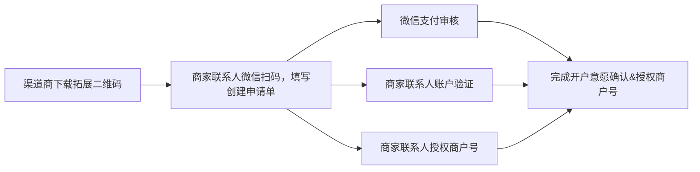
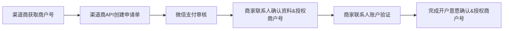

>更新时间：2026.10.22

在正式接入微信支付商户开户意愿确认服务前，你需要进行以下准备步骤：

1. 选择接入模式：商户需要判断自己公司注册区域适用的接入模式和自身实际情况，申请成为普通商户或普通服务商：

   - 普通商户自行申请入驻微信支付，无需服务商协助。

   - 普通服务商则自身无法作为一个普通商户直接发起交易，其发起交易必须传入相关特约商户商户号的参数信息。
2. 申请参数：请根据自身接入模式分别参考[微信支付接入准备-普通商户](https://pay.weixin.qq.com/doc/v3/merchant/4012071573.md)或[微信支付接入准备-普通服务商](https://pay.weixin.qq.com/doc/v3/partner/4012081990.md)中的[参数申请](https://pay.weixin.qq.com/doc/v3/merchant/4012071573.md) \- [配置API key](https://pay.weixin.qq.com/doc/v3/merchant/4012072195.md) \- [下载并配置商户证书](https://pay.weixin.qq.com/doc/v3/merchant/4012072428.md)三个步骤申请接入参数，具体接入模式介绍请参考[接入模式](https://pay.weixin.qq.com/doc/v3/merchant/4012068443.md)文档，并按照参考文档完成相应模式的接入。

完成以上步骤后可根据以下内容申请商户开户意愿确认。

## 1. 商户开户意愿确认方式

### 1.1. 渠道商可以通过以下两种方式协助商户完成商户开户意愿确认

1. 商家注册小程序

2. 商户开户意愿确认API

## 2. 商家注册小程序操作步骤

名称解释：

- 联系人：指为商户号的超级联系人，将接收开户信息及日常重要管理信息。

- 核实商家信息：指联系人，查看申请单资料，确定是商家的正确资料。

- 账户验证：指联系人，需通过指定方式，证明已获得商家授权开户。

- 授权商户号：指联系人，授权指定渠道商为指定商户号提供服务。

### 2.1. 渠道商获取商户号

渠道商使用银行或者支付机构提供的API或者后台系统录入商家信息，获取微信支付侧商户号。

提示

- 提交给微信支付的“商户名称”字段必须与营业执照上商户名称一致，具体规则[点击查看](https://kf.qq.com/faq/201118a6RbEJ201118EVFjue.html)；

- 若已有历史商户号，可直接查看[下载渠道商拓展二维码](https://pay.weixin.qq.com/doc/v3/partner/4012064824.md#2.2.-%E4%B8%8B%E8%BD%BD%E6%B8%A0%E9%81%93%E5%95%86%E6%8B%93%E5%B1%95%E4%BA%8C%E7%BB%B4%E7%A0%81)。

### 2.2. 下载渠道商拓展二维码

渠道商登录微信支付商户平台，进入【服务商功能 -\> 特约商户管理】，下载渠道商拓展二维码。

### 2.3. 指导商家在小程序上注册

商家需扫描渠道商拓展二维码，进入小程序后按页面指引提交商家联系人信息、营业执照照片、法人/经营者身份证照片，并进行主体身份验证。

- 联系人，使用微信扫描渠道商拓展二维码。

- 联系人选择商家主体类型，提交对应要求的资料（若商家已经注册，可直接查看[商家预授权商户号](https://pay.weixin.qq.com/doc/v3/partner/4012064824.md#2.4.-%E5%95%86%E5%AE%B6%E9%A2%84%E6%8E%88%E6%9D%83%E5%95%86%E6%88%B7%E5%8F%B7-%EF%BC%88%E6%8E%A8%E8%8D%90%E6%B8%A0%E9%81%93%E5%95%86%E5%BC%95%E5%AF%BC%E5%95%86%E5%AE%B6%E8%81%94%E7%B3%BB%E4%BA%BA%E5%AE%8C%E6%88%90%EF%BC%89)）。

| 类型 | 定义 | 所需资料 |
| --- | --- | --- |
| 小微 | 无营业执照、免办理工商注册登记的实体商户 | 小微经营者的个人身份证、负责人身份证及辅助证明材料（门店场所或流动经营或线上商品等相关证明，详见小程序指引） |
| 个体工商户 | 营业执照上的主体类型一般为个体户、个体工商户、个体经营 | 营业执照、经营者身份证 |
| 企业 | 营业执照上的主体类型一般为有限公司、有限责任公司 | 营业执照、法人身份证 |
| 党政、机关及事业单位 | 包括国内各级、各类政府机构、事业单位等。如：公安、党团、司法、交通、旅游、工商税务、市政、医疗、教育、学校等机构 | 法人身份证、单位证明函、登记证书（事业单位法人证书或者统一社会信用代码证书等） |
| 其他组织 | 不属于企业、政府/事业单位的组织机构，如社会团体、民办非企业、基金会。要求机构已办理组织机构代码证。 | 法人身份证、登记证书（如民办非企业单位登记证书等） |

### 2.4. 商家预授权商户号 （推荐渠道商引导商家联系人完成）

- 前置条件：商家已提交申请单，进入“审核中” or “待账户验证”状态。

- 商家可点击页面下方“进行预授权”，进入授权页面。

- 商家查看渠道商信息，勾选商户号，授权渠道商提供服务，则资料审核通过后无需再次授权；

注意

只有商户全称与所注册商家名称一致的商户号才能进行授权（具体规则[点击查看](https://kf.qq.com/faq/201118a6RbEJ201118EVFjue.html)）

### 2.5. 账户验证

| 主体类型 | 联系人身份 | 账户验证方式 |
| --- | --- | --- |
| 小微 | 法人/经营者 | 法人/经营者 |
| 党政、机关及事业单位 | 法人/经营者 | 无需账户验证 |
| 党政、机关及事业单位 | 负责人 | 无需账户验证 |
| 个体工商户 | 法人/经营者 | 无需账户验证 |
| 个体工商户 | 负责人 | 法人扫码：法人微信扫码，完成验证。 |
| 企业 | 法人/经营者 | 无需账户验证 |
| 企业 | 负责人 | 支持以下方式二选一： 1 汇款验证：商户使用指定户名的银行账户，汇款指定金额至财付通指定银行账户，完成验证。（10天有效期） 2 法人扫码：法人微信扫码，完成验证。（10天有效期） |
| 其他组织 | 法人/经营者 | 汇款验证：商户使用指定户名的银行账户，汇款指定金额至财付通指定银行账户，完成验证。（10天有效期） |
| 其他组织 | 负责人 | 汇款验证：商户使用指定户名的银行账户，汇款指定金额至财付通指定银行账户，完成验证。（10天有效期） |

### 2.6. 联系人使用微信授权门店商户号

- 前置条件：若联系人未完成预授权，则资料审核通过后，需再次进行授权商户号；

- 联系人可通过以下路径授权：联系人可接收“微信支付商家助手”公众号的消息通知，点击消息进入授权页面；

- 商家查看渠道商信息，勾选商户号，授权渠道商提供服务。

注意

只有商户全称与所注册商家名称一致的商户号才能进行授权（具体规则[点击查看](https://kf.qq.com/faq/201118a6RbEJ201118EVFjue.html)）

### 3. 商户开户意愿确认API操作步骤

名称解释：

- 联系人：指为商户号的超级联系人，将接收开户信息及日常重要管理信息；

- 核实商家信息：指联系人，查看申请单资料，确定是商家的正确资料；

- 授权商户号：指联系人，授权指定渠道商为指定商户号提供服务；

- 账户验证：指联系人，需通过指定方式，证明已获得商家授权开户。

### 3.1. 渠道商获取商户号

渠道商使用银行或者支付机构提供的API或者后台系统录入商家信息，获取微信支付侧商户号。

提示

- 提交给微信支付的“商户名称”字段必须与营业执照上商户名称一致，具体规则[点击查看](https://kf.qq.com/faq/201118a6RbEJ201118EVFjue.html)；

- 若已有历史商户号，可直接查看[渠道商创建开户意愿申请单](https://pay.weixin.qq.com/doc/v3/partner/4012064824.md#3.2.-%E6%B8%A0%E9%81%93%E5%95%86%E5%88%9B%E5%BB%BA%E5%BC%80%E6%88%B7%E6%84%8F%E6%84%BF%E7%94%B3%E8%AF%B7%E5%8D%95)。

### 3.2. 渠道商创建开户意愿申请单

- 渠道商使用微信支付接口[提交开户意愿申请单](https://pay.weixin.qq.com/doc/v3/partner/4012722388.md)，提交“商家资料+商户号”，创建开户意愿申请单。

提示

在【补充材料 \- 待确认商户号列表】传入商户号，则商家联系人在“核实开户意愿过程”，即完成授权商户号，无需后续二次授权。详情可看[商家授权商户号](https://pay.weixin.qq.com/doc/v3/partner/4012064824.md#3.5.-%E5%95%86%E5%AE%B6%E6%8E%88%E6%9D%83%E5%95%86%E6%88%B7%E5%8F%B7)；

- 创建申请单后，可通过[查询申请单审核结果接口](https://pay.weixin.qq.com/doc/v3/partner/4012697715.md)，查询申请单状态做对应处理。

### 3.3. 微信支付审核

- 若申请单状态为“审核中”，微信支付将在1-3个工作日内完成审核，请等待审核结果。

- 若申请单状态为“审核驳回“时，请根据驳回原因修改商家资料，重新提交前请使用" 撤销原申请单 "，再次提交新的商家资料。

### 3.4. 联系人确认商家资料

若申请单状态为“待联系人确认”，渠道商获取“申请单小程序码”，引导联系人微信扫描二维码，完成核对“联系信息”&“商户信息”。

提示

联系人微信实名的身份证号，需与申请单填写的联系人身份证号一致。

#### 3.4.1. 联系信息核对

联系人确认手机号（可手工修改），完成短信验证。

#### 3.4.2. 商家信息核对

联系人核实商家资质信息后，点击确认无误。

### 3.5. 商家授权商户号

- 前置条件：API创建开户意愿申请单，渠道商在【补充材料 - 待确认商户号列表】传入商户号，则商家联系人可进入本流程。

- 商家查看渠道商信息，勾选商户号，授权渠道商提供服务。

注意

只有商户全称与所注册商家名称一致的商户号才能进行授权（具体规则[点击查看](https://kf.qq.com/faq/201118a6RbEJ201118EVFjue.html)）

### 3.6. 账户验证

| 主体类型 | 联系人身份 | 账户验证方式 |
| --- | --- | --- |
| 小微 | 法人/经营者 | 法人/经营者 |
| 党政、机关及事业单位 | 法人/经营者 | 无需账户验证 |
| 党政、机关及事业单位 | 负责人 | 无需账户验证 |
| 个体工商户 | 法人/经营者 | 无需账户验证 |
| 个体工商户 | 负责人 | 法人扫码：法人微信扫码，完成验证。 |
| 企业 | 法人/经营者 | 无需账户验证 |
| 企业 | 负责人 | 支持以下方式二选一： 1 汇款验证：商户使用指定户名的银行账户，汇款指定金额至财付通指定银行账户，完成验证。（10天有效期） 2 法人扫码：法人微信扫码，完成验证。（10天有效期） |
| 其他组织 | 法人/经营者 | 汇款验证：商户使用指定户名的银行账户，汇款指定金额至财付通指定银行账户，完成验证。（10天有效期） |
| 其他组织 | 负责人 | 汇款验证：商户使用指定户名的银行账户，汇款指定金额至财付通指定银行账户，完成验证。（10天有效期） |

### 3.7. 联系人使用微信授权门店商户号

1. 前置条件：API创建开户意愿申请单，没有在【补充材料 - 待确认商户号列表】传入商户号；

2. 当完成开户意愿后，联系人可通过以下路径授权：

   - 渠道商可将“申请单小程序码”，指引联系人打开，点击进入授权页面；

   - 联系人可接收“微信支付商家助手”公众号的消息通知，点击消息进入授权页面。
3. 商家查看渠道商信息，勾选商户号，授权渠道商提供服务。

注意

只有商户全称与所注册商家名称一致的商户号才能进行授权（具体规则[点击查看](https://kf.qq.com/faq/201118a6RbEJ201118EVFjue.html)）

### 3.8. 渠道商确认已完成开户意愿注册及授权

渠道商，需核实以下均已完成：

1. 通过[查询申请单审核结果接口](https://pay.weixin.qq.com/doc/v3/partner/4012697715.md) ，查询申请单状态为“审核通过”

2. 通过[获取商户开户意愿确认状态接口](https://pay.weixin.qq.com/doc/v3/partner/4012467549.md)，授权状态为“已授权”

