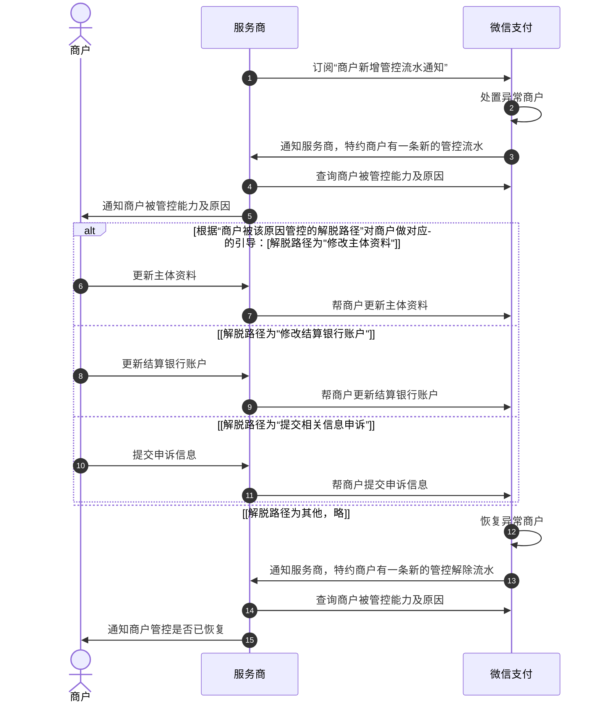
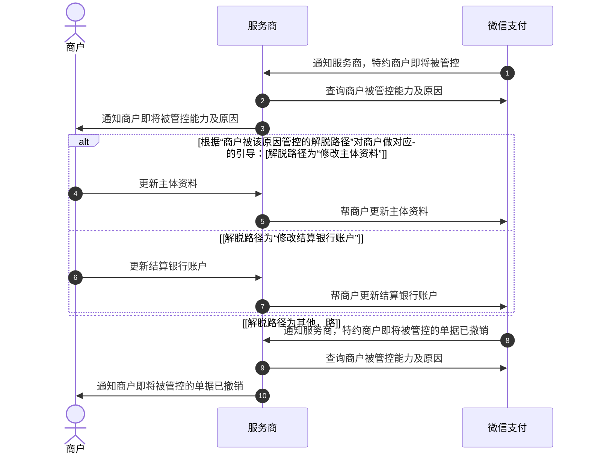

>更新时间：2026.10.20

## 1. 产品简介

为提高服务商对商户的日常管理效率，提升商户体验，微信支付为服务商提供了“商户被管控能力及原因（[点此查看接口文档](https://pay.weixin.qq.com/doc/v3/partner/4012803072.md)）”的查询服务。

通过该服务，服务商可做到：

- 可查询商户被管控的能力，以便引导商户前往微信支付平台进行处理；

- 可获得商户被管控的原因、解脱路径，以便协助商户提交材料并完成解脱。

## 2. 产品特色

- 准确：查询结果可准确反映商户的实际被管控能力，每个“被管控能力”均被明确定义（详见“名词解释”）；

- 完整：查询结果包含商户被管控的所有原因，每个“被管控原因类型”均被明确定义（详见“名词解释”）；

- 清晰：每个被管控原因均返回具体被管控的能力和解脱指引，每个“解脱路径”均被明确定义（详见“名词解释”）。

## 3. 产品流程

该查询服务可单独使用，也可结合「合作伙伴订阅（[点此了解](https://pay.weixin.qq.com/doc/v3/partner/4016022264.md)）」功能中的“商户新增管控流水通知“一起完整使用。

微信支付对商户管控，按处置方式可分为“立即管控”和“延迟管控”：

- 立即管控，会在发现风险后立即执行处置

- 延迟管控，会在发现风险后先通知服务商，到达指定时间才执行处置。比如：“法定代表人证件信息已经过期”，过期90天后才会执行管控

若只关注子商户实际被处置、恢复的动作，可按如下流程，结合“商户新增管控流水通知“订阅服务对接：

步骤1：服务商订阅“商户新增管控流水通知“

步骤2：当商户被微信支付管控后，服务商会通过「合作伙伴订阅」功能收到一条「商户新增管控流水通知」，消息中的业务状态为「PUNISHMENT：特约商户有一条新的管控流水」

步骤3：服务商在收到订阅回调后，可使用本服务查询商户即将被管控能力及原因，然后根据情况引导商户解脱

步骤4：商户管控解脱后，服务商会通过「合作伙伴订阅」收到一条「商户新增管控流水通知」，消息中的业务状态为「RECOVERY：特约商户有一条新的管控解除流水」

步骤5：服务商在收到解除管控的订阅回调后，可使用本服务查询商户被管控能力及原因，确认商户管控是否全部解脱，若仍有其他被管控原因，则根据情况引导商户继续处理

以下为流程示意：

若也希望关注子商户即将被管控的动作，提前引导商户解脱，可增加如下流程对接“延迟管控”的提前通知：

步骤1：微信支付会通过「合作伙伴订阅」功能发送一条「商户新增管控流水通知」，消息中的业务状态为「DELAYPUNISHMENT：特约商户即将被管控」

步骤2：服务商在收到订阅回调后，可使用本服务查询商户即将被管控能力及原因，然后根据情况引导商户解脱

步骤3：商户管控撤销后，服务商会通过「合作伙伴订阅」收到一条「商户新增管控流水通知」，消息中的业务状态为「PUNISHMENTCANCELLED：特约商户即将被管控的单据已撤销」

步骤4：服务商在收到撤销管控的订阅回调后，可使用本服务查询商户被管控能力及原因，确认商户管控是否全部解脱，若仍有其他被管控原因，则根据情况引导商户继续处理

以下为流程示意：

## 4. 准入条件

该服务面向微信支付的“收单外包机构”、“开发者”、“从业机构（银行）”、“从业机构（支付机构）”、“渠道商”开放。

## 5. 名词解释

|  | 名词 | 解释说明 |
| --- | --- | --- |
| 被管控能力 | 关闭收单和充值 | 指商户号不可有资金入账，具体包括但不限于：JSAPI支付、APP支付、H5支付、Native支付、小程序支付、平台代扣、委托代扣、合单支付、发起支付分订单、接收他方分账分入、转账充值、扫码充值等 |
| 被管控能力 | 关闭付款 | 指商户号不可有除提现、退款外的资金出账，具体包括但不限于：代金券发放、红包发放、企业付款到零钱、企业付款到银行卡、企业红包、向他方分账分出等 |
| 被管控能力 | 关闭提现 | 指商户号被限制将资金从商户平台提现至关联银行卡的能力 |
| 被管控能力 | 关闭退款 | 指商户号不可发起退款 |
| 被管控能力 | 关闭收单 | 指商户号不可有除充值外的资金入账，具体包括但不限于： JSAPI支付、APP支付、H5支付、Native支付、小程序支付、平台代扣、委托代扣、合单支付、发起支付分订单、接收他方分账分入等 |
| 被管控能力 | 关闭分账分出 | 指商户号已收款资金不可通过分账方式对外出账 |
| 被管控能力 | 关闭支付分结单 | 指商户号已发起的支付分订单，不可向用户进行扣款 |
| 被管控原因类型 | 法定代表人/负责人资料异常 | 指商户的法定代表人/经营者身份证件存在缺失、无效、过期等异常问题 |
| 被管控原因类型 | 经营状态异常 | 指商户的经营证照注销/吊销/撤销、个人经营者身份证件状态异常等问题 |
| 被管控原因类型 | 经营证照资料异常 | 指商户的经营证照存在缺失、无效、过期等异常问题 |
| 被管控原因类型 | 受益所有人资料异常 | 指商户的受益所有人身份证件存在缺失、无效、过期等异常问题 |
| 被管控原因类型 | 经营证照异常 | 指商户的营业执照/登记证书、法定代表人/经营者身份证件存在缺失、注吊撤、更新、过期等异常问题 （为方便服务商更好的理解和识别，当前的“经营证照异常”预计在2025年11月30号前逐步细分为上述4个类型：法定代表人/负责人资料异常、经营状态异常、经营证照资料异常、受益所有人资料异常；过渡期间，当前的“经营证照异常”类型仍会存在） |
| 被管控原因类型 | 无交易 | 指商户号由于长时间未发生交易而被限制功能 |
| 被管控原因类型 | 结算信息异常 | 指商户的结算银行账户存在信息缺失、验证不通过、非同名等异常问题 |
| 被管控原因类型 | 风险异常 | 指商户号存在交易风险或违规行为 |
| 被管控原因类型 | 巡检异常 | 指商户没有配合完成经营场景检查，包含未提交资料/提交资料后审核不通过等情况 |
| 解脱路径 | 修改主体资料 | 商户需更新在微信支付留存的经营证照相关资料 方式一、服务商可通过接入[修改主体信息API](https://pay.weixin.qq.com/doc/v3/partner/4014090649.md)为商户发起变更 方式二、可引导商户登录「微信支付商家助手」小程序->「业务受限处理」页面进行处理 |
| 解脱路径 | 修改结算银行账户 | 商户需更新在微信支付留存的结算银行账户 方式一、服务商可通过接入[修改结算账户API](https://pay.weixin.qq.com/doc/v3/partner/4012760618.md)为商户发起变更 方式二、可引导商户登录「微信支付商家助手」小程序->「业务受限处理」页面进行处理 |
| 解脱路径 | 修改超级管理员 | 商户需更新在微信支付留存的超级管理员信息 可引导商户参考[客服指引](https://kf.qq.com/faq/241206RBNn2y241206EFbMN7.html?from_wecom=1)进行处理 |
| 解脱路径 | 核实商户身份 | 商户长期无动账，需重新确认使用商户号的意愿 可引导商户登录「微信支付商家助手」小程序->「业务受限处理」页面进行处理 |
| 解脱路径 | 提交相关信息申诉 | 商户需提交当前单据指定的信息、材料，以便我司做进一步核实 可引导商户登录「微信支付商家助手」小程序->「业务受限处理」页面进行处理 |
| 解脱路径 | 填写尽调信息 | 商户需配合尽职调查补充填写经营信息 可引导商户登录「微信支付商家助手」小程序->「业务受限处理」页面进行处理 |
| 解脱路径 | 补充受益所有人信息 | 商户需配合尽职调查补充填写受益所有人信息 可引导商户登录「微信支付商家助手」小程序->「业务受限处理」页面进行处理 |
| 解脱路径 | 提交线下经营场景信息 | 商户需提交线下经营场景资料信息（包含场所名称、地址、照片等） 可引导商户登录「微信支付商家助手」小程序->「业务受限处理」页面进行处理 |
| 解脱路径 | 补充经营场景信息 | 商户需提交对应的经营场景资料信息（包含线下场景、小程序、APP、网页等类型） 可引导商户登录「微信支付商家助手」小程序->「业务受限处理」页面进行处理 |
| 解脱路径 | 等待平台审核 | 说明我司仍在风险排查中，商户暂无需进一步处理，耐心等待即可 |
| 解脱路径 | 解决交易纠纷 | 当前商户号存在交易纠纷，请先解决交易纠纷 |
| 解脱路径 | 拨打微信支付客服电话95017 | 此类管控一般不可解脱，如有疑问可拨打客服电话咨询 |
| 解脱路径 | 不可恢复 | 商户号已注销或终止合作，不支持恢复 |
| 解脱路径 | 签署反诈承诺书并刷脸核实身份 | 仅使用「微信支付收款助手」的商户需要按此路径解脱，商户需要签署反诈承诺书并完成刷脸 |
| 解脱路径 | 修改商户简称 | 商户需更新在微信支付留存的商户简称 可引导商户登录「微信支付商家助手」小程序->「业务受限处理」页面进行处理 |
| 解脱路径 | 联系有权机关咨询 | 商户账户被有权机关限制使用，如有疑问可联系有权机关咨询 |
| 解脱路径 | 提交线上经营场景信息 | 商户需提交线上经营场景资料信息 可引导商户登录「微信支付商家助手」小程序->「业务受限处理」页面进行处理 |
| 解脱路径 | 补充设备经营地址信息 | 商户需要补充收款码或收款设备的经营地址信息 可引导商户登录「微信支付商家助手」小程序->「业务受限处理」页面进行处理 |