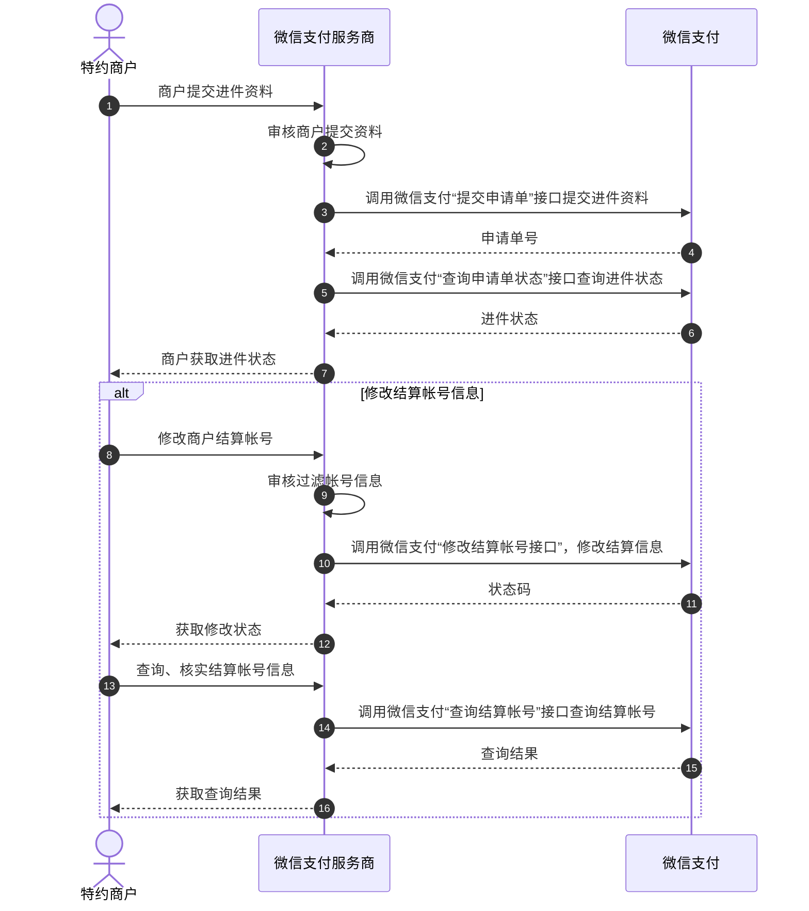
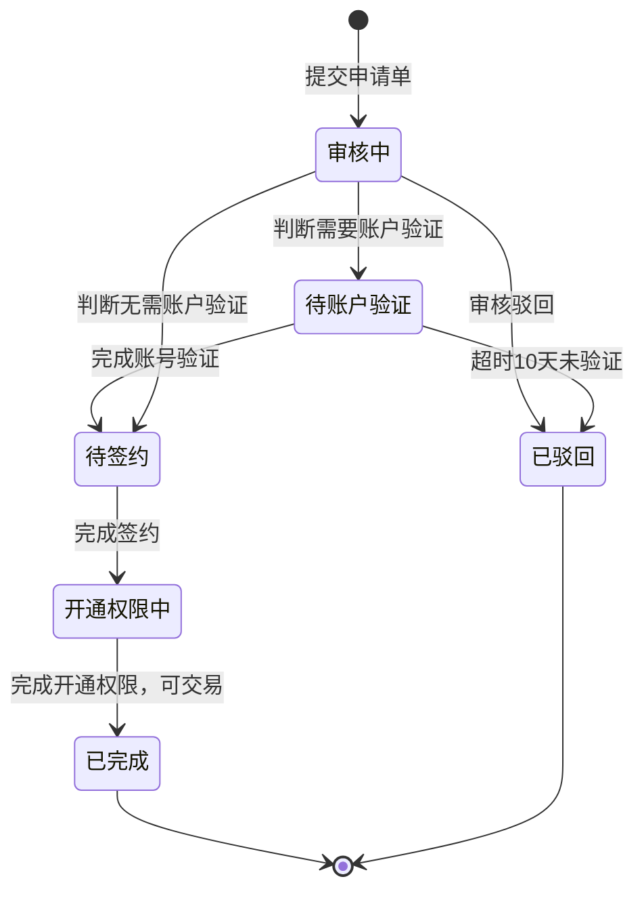

>更新时间：2026.06.09

## 1. 接口规则

为了在保证支付安全的前提下，带给商户简单、一致且易用的开发体验，我们推出了全新的微信支付APIv3接口。该版本API的具体规则请参考[APIv3接口规则](https://pay.weixin.qq.com/doc/v3/merchant/4012081606.md)。

## 2. 开发准备

### 2.1. 搭建和配置开发环境

开发者应当依据自身的编程语言来构建并配置相应的开发环境。

## 3. 快速接入

### 3.1. 业务流程图

业务流程时序图



申请单状态变化如下



重点步骤说明：

步骤3 商户入驻，服务商收集商户资料后，调用[提交申请单](https://pay.weixin.qq.com/doc/v3/partner/4012719997.md)接口，提交创建入驻申请单。

步骤5 创建申请单后，可通过[查询申请单状态](https://pay.weixin.qq.com/doc/v3/partner/4012697168.md)接口，获取特约商户签约链接，让商户扫码确认联系信息，后续申请单进度可通过公众号自动通知超级管理员（简称超管）。

步骤10 进件成功后，若特约商户需修改结算账号时，服务商可调用[修改结算账号](https://pay.weixin.qq.com/doc/v3/partner/4012761102.md)接口来帮助特约商户修改结算信息，修改后通过状态码判断是否修改成功。也可通过调用[查询结算账号](https://pay.weixin.qq.com/doc/v3/partner/4012761113.md)接口来查询核查结算账号信息。

### 3.2. API接入（含示例代码）

文档展示了如何使用微信支付服务端 SDK 快速接入特约商户进件，完成与微信支付对接的部分。

注意

- 文档中的代码示例是用来阐述 API 基本使用方法，代码中的示例参数需替换成商户自己账号及请求参数才能跑通。

- 以下接入步骤仅提供参考，请商户结合自身业务需求进行评估、修改。


#### 3.2.1. 【服务端】提交申请单

步骤说明：服务商收集商户资料后，调用提交申请单接口，提交创建入驻申请单。

JAVA

```
public void ApplymentSubMch() throws Exception {
    //请求URL
    HttpPost httpPost = new HttpPost("https://api.mch.weixin.qq.com/v3/applyment4sub/applyment/");
    // 请求body参数
    String reqdata = "{"
            + "\"business_info\": {"
            + "\"merchant_shortname\":\"上海XXX有限公司\","
            + "\"service_phone\":\"139XXXX\","
            + "\"sales_info\": {"
            + "\"mini_program_info\": {"
            + "\"mini_program_pics\": ["
            + "\"0\":\"F8O5MNAOlYZyxZcLnWXkyk72coZ3CVX3XobPZng-xepKPTrcH_XMfrGGYLi1XFogMG9P25LSUX6gjXU5iPI74YqiRUDfORyw2d76wK3vzuQ\""
            + "],"
            + "\"mini_program_sub_appid\":\"wx76c3f74c108876c2\""
            + "},"
            + "\"mp_info\": {"
            + "\"mp_pics\": ["
            + "\"0\":\"F8O5MNAOlYZyxZcLnWXkys5TBxf0dyfesnyfNuquBMArHRfgCq8hDRdscDpblCcEgvgV5MkVch9IBEX7aatZCmI8k5Wdb_M8a4bYcmlg6V8\""
            + "],"
            + "\"mp_sub_appid\":\"wx85c88c63bd22651f\""
            + "},"
            + "\"sales_scenes_type\": ["
            + "\"0\":\"SALES_SCENES_MP\","
            + "\"1\":\"SALES_SCENES_MINI_PROGRAM\""
            + "]"
            + "}"
            + "},"
            + "\"subject_info\": {"
            + "\"business_license_info\": {"
            + "\"legal_person\":\"江XX\","
            + "\"license_copy\":\"F8O5MNAOlYZyxZcLnWXkysZ5xo8fE3SHJ1pHUe6OJKmNIWtqUVyv4aY2-JLTgjDOSovWaKkBu3AbkjGuQXhesDzREu2pT_Yf_hxlFKPJMwQ\","
            + "\"merchant_name\":\"上海XXX有限公司\","
            + "\"license_number\":\"91310118MA1JXXXX\""
            + "},"
            + "\"subject_type\":\"SUBJECT_TYPE_ENTERPRISE\","
            + "\"identity_info\": {"
            + "\"owner\":true,"
            + "\"id_doc_type\":\"IDENTIFICATION_TYPE_IDCARD\","
            + "\"id_card_info\": {"
            + "\"id_card_copy\":\"F8O5MNAOlYZyxZcLnWXkyvLpqoz7MNRULxju0NqUCtLGBl_vm8Bhj9uAyuLyDART9UsA10spF9gbT3DEoM85HxPQOhMuilK0zLtOxAjPx58\","
            + "\"card_period_end\":\"2035-12-28\","
            + "\"card_period_begin\":\"2015-12-28\","
            + "\"id_card_name\":\"JRMJGA7B7oSVS+krFeaQn4AvYZE2LL9tTwA+XXa9lYJU4AhS+Qheb7fhgo+D+hfa0v+ykU1BVvVo7NpCfgOYQqmYDyYF27Q/p4hB7IoqZLhJUE+hTG45VNoa9ASaKG79Hg+eGz4YTIHFGMFm1ljyg4fd5lGJixCqn38/gCfwm5x6vDOMVkFpqbUdR7klQwReGoG7iSlEpr4gZPqzItcBHiuXidMToKZTX1Lol1Lx52DHk0blcdh1CMRhv+wxQzF0lJMy/WtVyjKuB8daDbLJKTEwDx5KfkTZGHmGiaJnWY0qFX03sXsufvfB0Wj6Z37+nJnV16fplPmdr1/KEHamLw==\","
            + "\"id_card_national\":\"F8O5MNAOlYZyxZcLnWXkyvcmQrkBXCIo2vZGUoM6ER-skL5k6IOhzeJ34tNNUggQIPfJbM_pzdg9jM4pQbkIm84_bKfi2JKNn99xIurNgwI\","
            + "\"id_card_number\":\"V0quwnIu/PLbdQQ3/nzMqjvHtChDqed4Jpc3Iy2lgnFoWVNXguRWBHMYKHaLgLvnxLvO6TciMnrSw13QzUJD4ZnEIiks8gGTd+OCzl5Jl3F+sneQ+Js4akBnCSBQso/SERvi6vUqCeRhX1vtiFsmKtqlL8r/ssrFev4FoJEka5gGME1osTgcpMMTIR8rolIO1oXbl3e8z5RDics5xKH2Ogjzis73yq9M18ap0uRRdLWoX/cxeG3tbU1bi5jZsAU9hGHXs4BKTaHfrslsKIkqXR0f2Jpk7H5qtwAyP8glcALN7gB5DIOmBEIZ5zx2PrDm38CsZHstu0hF8beXV/PG2w==\""
            + "}"
            + "}"
            + "},"
            + "\"business_code\":\"20201126100507000003\","
            + "\"contact_info\": {"
            + "\"contact_name\":\"AD2jwe8eYFYfeoSmBpyRYUawyQgQkUoAajOlHnQM/JzproDF7hikLDouMr5Mb1W5otvdJZYEipG0HzwLpG9NXbqP6SXSpzQFb8fY5cpuXZsIbDy70lAybF0bbxJiJw1PHSd7KpMbu0XHqwlicePLUOw7HCNV6euQsKEvtusiWsaVrNNdKXpj3ONhyAg2ws4ibc56GUVoNll3osmGLPi6/bIn3pD6sjNThgPE9UzRQax0XPwgIpafIewQiVy0GNtv5P33wqPa9pAsdEmaLXNtQr2Ddjw5SYMInen1qbVO8NP0VhuWmYiAjd1WbkNnR+gbwsilBCYYeRuFbKfqatASnA==\","
            + "\"mobile_phone\":\"GLc5+TuqJbxLeQO+CrKeDWF+7lZq9IsidIU4zcMpus4qsE8r1qNyvVMjrZfWLrjOItiQhXqkiKZs0B4M0UWAviWwmBhNWW0BJrauBjZbGZU+pLHC/2eOetdDC4sQqHN7Xw0N4tizqeQNu49n+DbSiv0TL09EcmNUUV9rImfjpVyo77MxKhPvdg3ODwS+IVvY2Tc9q11iBgaPIQ+XwoBaJGth1wdw0GLgEFUmX02TWxjHxq7f5O1RU3LjBlt1O+56ZZYpA+zr+IjQ/TwrIDp+4nk9v1oW2wtHuwrdqKrlLyJ1/zdoqwSddLuGxp8PwSM8CKobQP8TXhJu0S9pwLbNyg==\","
            + "\"contact_id_number\":\"iC35X6SaOx4A4BEJ4fmM2oOkYRO5rEzRh2QRdrxFD3+HwmNjxddsm1LoqfhSiV34DAO2x3Ded3q2c1LJ7NHqa3/IGCDss4FKlgIyiu5AmzQTTYwsobmvVFxeSUXA4PnH/tUTfatJOuj+9Emt7fmnpO9uWeCLIn5CXaaABrXpO4mUu8qPBaoF2jTfbwBm6QiYX58kATyRrIvBRs6VorHJydXkz3P1hCejh8sAYoJXlNHnoajI+NEwiWX9RhwUadYLbMwww68cc7Yzehp3s6an0NWuC76Y4e7FQ/i5D9ZpUvLKUoYfFsZMnHrv/PhLxmv5l8gQs9/IkmOdYfRujKZJwQ==\","
            + "\"contact_email\":\"ggK2ABtJ8bBiBo1iM7I6R2yEvhD6WC96d07gthnPGajc4lBCKpIqXjyNX8B97vc0OilyLRNUcySbT/KUejPyu4x9W6Ok6iS4zcerfKfIQkKs+3JXIMo0bu+GyI5O0fzRrPg1Mek2okfIjVK9wiTNJTzoGyz9twMXEaqqrOTbysyhnkqfrol5dad/TPg8qNWaBO3+Ma/hr1Tr0xeHWkKX3mBySC3NW49HM51x0PvFAwnStHr/8hiGzGpqAA3yJuYdlEwey3Lv+/bMmbTq+AyrYq9xX3q+n0VHuiSnzgICPwQiP4zXsoivA0bm7DSgcP1Oa6MjpGqMOS7AU1dHyak2GQ==\""
            + "},"
            + "\"bank_account_info\": {"
            + "\"account_number\":\"Bfu6CzrRWlVTLZwjEK2CCXG0KRfGoIsbYs9IYmtFcV9FTEVLCcVCRGW6DVE2hMMr7U9tSdo7QqsptXZ7Zhciandyx9kRkY/VmPywurySvCbqpOLbx3AgmQY7H6/Ye542R0uloi6Pdp5FjqY/TdnlDcTS4cqv9iqU0DqKAUt7q+L6jZ8lrSlGFPI/1RkXCGAhlTSZ/iAJYDWzcN/E0cno9BQPYCmEIWldzj7W3Tmhi1eaZYX5mlLWnTOuVmMsRXIehb4y6LCi6T0kS7/c3GOFwlTzHVaaUgFqZhOL00h2G4Cl94uZfuVNO7KTiFaWtV61muEN6JfaSnFwRDSHxhtsRg==\","
            + "\"bank_address_code\":\"310101\","
            + "\"account_name\":\"RVBRWZKlmzrjkDmz4uEkaLQLU5q5xErXGoWhzDNdnQjRlfn1NVHL2EtIE+B0BULFNOHrX61q13lcgo9CDal9YJ/LjZkzAAsivwJZpNSRZbAsNNjqbYiiVhdnxYpwMqtukVgZAFgx0XMovOeSGX1+Dosc2vKJSsxtUw6wJXcZbMjvsX5/xamFTvRIx1J2a/q3ODBJ9URO5O2FDhGwLx8LQnFIv7xUDM3JXw7c6+eNy1OYTVwlj3/MIDQVw2eiPjpG1vC6K6PRwCI4wFZk1QwH99Xa3Wwvf+ek54j7FQTh0N703dK6jjonL5L6Lh9ZsckLx45InkARlPnU0KQpoK5g9w==\","
            + "\"bank_account_type\":\"BANK_ACCOUNT_TYPE_CORPORATE\","
            + "\"account_bank\":\"招商银行\""
            + "},"
            + "\"settlement_info\": {"
            + "\"settlement_id\":\"716\","
            + "\"qualification_type\":\"零售批发/生活娱乐/网上商城/其他\""
            + "}"
            + "}";
    StringEntity entity = new StringEntity(reqdata,"utf-8");
    entity.setContentType("application/json");
    httpPost.setEntity(entity);
    httpPost.setHeader("Accept", "application/json");
    httpPost.setHeader("Wechatpay-Serial", "XXXXXXXXXXXXXX");
    //完成签名并执行请求
    CloseableHttpResponse response = httpClient.execute(httpPost);
    try {
        int statusCode = response.getStatusLine().getStatusCode();
        if (statusCode == 200) { //处理成功
            System.out.println("success,return body = " + EntityUtils.toString(response.getEntity()));
        } else if (statusCode == 204) { //处理成功，无返回Body
            System.out.println("success");
        } else {
            System.out.println("failed,resp code = " + statusCode+ ",return body = " + EntityUtils.toString(response.getEntity()));
            throw new IOException("request failed");
        }
    } finally {
        response.close();
    }
}
```

PHP

```
try {
    $resp = $client->request(
        'POST',
        'https://api.mch.weixin.qq.com/v3/applyment4sub/applyment/', //请求URL
        [
            // JSON请求体
            'json' => [
                "business_info" => [
                    "merchant_shortname" => "上海XXX有限公司",
                    "service_phone" => "139XXXX",
                    "sales_info" => [
                        "mini_program_info" => [
                            "mini_program_pics" => [
                                "0" => "F8O5MNAOlYZyxZcLnWXkyk72coZ3CVX3XobPZng-xepKPTrcH_XMfrGGYLi1XFogMG9P25LSUX6gjXU5iPI74YqiRUDfORyw2d76wK3vzuQ",
                            ],
                            "mini_program_sub_appid" => "wx76c3f74c108876c2",
                        ],
                        "mp_info" => [
                            "mp_pics" => [
                                "0" => "F8O5MNAOlYZyxZcLnWXkys5TBxf0dyfesnyfNuquBMArHRfgCq8hDRdscDpblCcEgvgV5MkVch9IBEX7aatZCmI8k5Wdb_M8a4bYcmlg6V8",
                            ],
                            "mp_sub_appid" => "wx85c88c63bd22651f",
                        ],
                        "sales_scenes_type" => [
                            "0" => "SALES_SCENES_MP",
                            "1" => "SALES_SCENES_MINI_PROGRAM",
                        ],
                    ],
                ],
                "subject_info" => [
                    "business_license_info" => [
                        "legal_person" => "江XX",
                        "license_copy" => "F8O5MNAOlYZyxZcLnWXkysZ5xo8fE3SHJ1pHUe6OJKmNIWtqUVyv4aY2-JLTgjDOSovWaKkBu3AbkjGuQXhesDzREu2pT_Yf_hxlFKPJMwQ",
                        "merchant_name" => "上海XXX有限公司",
                        "license_number" => "91310118MA1JXXXX",
                    ],
                    "subject_type" => "SUBJECT_TYPE_ENTERPRISE",
                    "identity_info" => [
                        "owner" => true,
                        "id_doc_type" => "IDENTIFICATION_TYPE_IDCARD",
                        "id_card_info" => [
                            "id_card_copy" => "F8O5MNAOlYZyxZcLnWXkyvLpqoz7MNRULxju0NqUCtLGBl_vm8Bhj9uAyuLyDART9UsA10spF9gbT3DEoM85HxPQOhMuilK0zLtOxAjPx58",
                            "card_period_end" => "2035-12-28",
                            "card_period_begin" => "2015-12-28",
                            "id_card_name" => "JRMJGA7B7oSVS+krFeaQn4AvYZE2LL9tTwA+XXa9lYJU4AhS+Qheb7fhgo+D+hfa0v+ykU1BVvVo7NpCfgOYQqmYDyYF27Q/p4hB7IoqZLhJUE+hTG45VNoa9ASaKG79Hg+eGz4YTIHFGMFm1ljyg4fd5lGJixCqn38/gCfwm5x6vDOMVkFpqbUdR7klQwReGoG7iSlEpr4gZPqzItcBHiuXidMToKZTX1Lol1Lx52DHk0blcdh1CMRhv+wxQzF0lJMy/WtVyjKuB8daDbLJKTEwDx5KfkTZGHmGiaJnWY0qFX03sXsufvfB0Wj6Z37+nJnV16fplPmdr1/KEHamLw==",
                            "id_card_national" => "F8O5MNAOlYZyxZcLnWXkyvcmQrkBXCIo2vZGUoM6ER-skL5k6IOhzeJ34tNNUggQIPfJbM_pzdg9jM4pQbkIm84_bKfi2JKNn99xIurNgwI",
                            "id_card_number" => "V0quwnIu/PLbdQQ3/nzMqjvHtChDqed4Jpc3Iy2lgnFoWVNXguRWBHMYKHaLgLvnxLvO6TciMnrSw13QzUJD4ZnEIiks8gGTd+OCzl5Jl3F+sneQ+Js4akBnCSBQso/SERvi6vUqCeRhX1vtiFsmKtqlL8r/ssrFev4FoJEka5gGME1osTgcpMMTIR8rolIO1oXbl3e8z5RDics5xKH2Ogjzis73yq9M18ap0uRRdLWoX/cxeG3tbU1bi5jZsAU9hGHXs4BKTaHfrslsKIkqXR0f2Jpk7H5qtwAyP8glcALN7gB5DIOmBEIZ5zx2PrDm38CsZHstu0hF8beXV/PG2w==",
                        ],
                    ],
                ],
                "business_code" => "20201126100507000003",
                "contact_info" => [
                    "contact_name" => "AD2jwe8eYFYfeoSmBpyRYUawyQgQkUoAajOlHnQM/JzproDF7hikLDouMr5Mb1W5otvdJZYEipG0HzwLpG9NXbqP6SXSpzQFb8fY5cpuXZsIbDy70lAybF0bbxJiJw1PHSd7KpMbu0XHqwlicePLUOw7HCNV6euQsKEvtusiWsaVrNNdKXpj3ONhyAg2ws4ibc56GUVoNll3osmGLPi6/bIn3pD6sjNThgPE9UzRQax0XPwgIpafIewQiVy0GNtv5P33wqPa9pAsdEmaLXNtQr2Ddjw5SYMInen1qbVO8NP0VhuWmYiAjd1WbkNnR+gbwsilBCYYeRuFbKfqatASnA==",
                    "mobile_phone" => "GLc5+TuqJbxLeQO+CrKeDWF+7lZq9IsidIU4zcMpus4qsE8r1qNyvVMjrZfWLrjOItiQhXqkiKZs0B4M0UWAviWwmBhNWW0BJrauBjZbGZU+pLHC/2eOetdDC4sQqHN7Xw0N4tizqeQNu49n+DbSiv0TL09EcmNUUV9rImfjpVyo77MxKhPvdg3ODwS+IVvY2Tc9q11iBgaPIQ+XwoBaJGth1wdw0GLgEFUmX02TWxjHxq7f5O1RU3LjBlt1O+56ZZYpA+zr+IjQ/TwrIDp+4nk9v1oW2wtHuwrdqKrlLyJ1/zdoqwSddLuGxp8PwSM8CKobQP8TXhJu0S9pwLbNyg==",
                    "contact_id_number" => "iC35X6SaOx4A4BEJ4fmM2oOkYRO5rEzRh2QRdrxFD3+HwmNjxddsm1LoqfhSiV34DAO2x3Ded3q2c1LJ7NHqa3/IGCDss4FKlgIyiu5AmzQTTYwsobmvVFxeSUXA4PnH/tUTfatJOuj+9Emt7fmnpO9uWeCLIn5CXaaABrXpO4mUu8qPBaoF2jTfbwBm6QiYX58kATyRrIvBRs6VorHJydXkz3P1hCejh8sAYoJXlNHnoajI+NEwiWX9RhwUadYLbMwww68cc7Yzehp3s6an0NWuC76Y4e7FQ/i5D9ZpUvLKUoYfFsZMnHrv/PhLxmv5l8gQs9/IkmOdYfRujKZJwQ==",
                    "contact_email" => "ggK2ABtJ8bBiBo1iM7I6R2yEvhD6WC96d07gthnPGajc4lBCKpIqXjyNX8B97vc0OilyLRNUcySbT/KUejPyu4x9W6Ok6iS4zcerfKfIQkKs+3JXIMo0bu+GyI5O0fzRrPg1Mek2okfIjVK9wiTNJTzoGyz9twMXEaqqrOTbysyhnkqfrol5dad/TPg8qNWaBO3+Ma/hr1Tr0xeHWkKX3mBySC3NW49HM51x0PvFAwnStHr/8hiGzGpqAA3yJuYdlEwey3Lv+/bMmbTq+AyrYq9xX3q+n0VHuiSnzgICPwQiP4zXsoivA0bm7DSgcP1Oa6MjpGqMOS7AU1dHyak2GQ==",
                ],
                "bank_account_info" => [
                    "account_number" => "Bfu6CzrRWlVTLZwjEK2CCXG0KRfGoIsbYs9IYmtFcV9FTEVLCcVCRGW6DVE2hMMr7U9tSdo7QqsptXZ7Zhciandyx9kRkY/VmPywurySvCbqpOLbx3AgmQY7H6/Ye542R0uloi6Pdp5FjqY/TdnlDcTS4cqv9iqU0DqKAUt7q+L6jZ8lrSlGFPI/1RkXCGAhlTSZ/iAJYDWzcN/E0cno9BQPYCmEIWldzj7W3Tmhi1eaZYX5mlLWnTOuVmMsRXIehb4y6LCi6T0kS7/c3GOFwlTzHVaaUgFqZhOL00h2G4Cl94uZfuVNO7KTiFaWtV61muEN6JfaSnFwRDSHxhtsRg==",
                    "bank_address_code" => "310101",
                    "account_name" => "RVBRWZKlmzrjkDmz4uEkaLQLU5q5xErXGoWhzDNdnQjRlfn1NVHL2EtIE+B0BULFNOHrX61q13lcgo9CDal9YJ/LjZkzAAsivwJZpNSRZbAsNNjqbYiiVhdnxYpwMqtukVgZAFgx0XMovOeSGX1+Dosc2vKJSsxtUw6wJXcZbMjvsX5/xamFTvRIx1J2a/q3ODBJ9URO5O2FDhGwLx8LQnFIv7xUDM3JXw7c6+eNy1OYTVwlj3/MIDQVw2eiPjpG1vC6K6PRwCI4wFZk1QwH99Xa3Wwvf+ek54j7FQTh0N703dK6jjonL5L6Lh9ZsckLx45InkARlPnU0KQpoK5g9w==",
                    "bank_account_type" => "BANK_ACCOUNT_TYPE_CORPORATE",
                    "account_bank" => "招商银行",
                ],
                "settlement_info" => [
                    "settlement_id" => "716",
                    "qualification_type" => "零售批发/生活娱乐/网上商城/其他",
                ]
            ],
            'headers' => [
        'Accept' => 'application/json',
        'Wechatpay-Serial' => 'xxxxxxxxxxxxxxxxxxxxxxxxxx',
    ]
        ]
    );
    $statusCode = $resp->getStatusCode();
    if ($statusCode == 200) { //处理成功
        echo "success,return body = " . $resp->getBody()->getContents()."\n";
    } else if ($statusCode == 204) { //处理成功，无返回Body
        echo "success";
    }
} catch (RequestException $e) {
    // 进行错误处理
    echo $e->getMessage()."\n";
    if ($e->hasResponse()) {
        echo "failed,resp code = " . $e->getResponse()->getStatusCode() . " return body = " . $e->getResponse()->getBody() . "\n";
    }
    return;
}
```

重要入参说明：

- business\_code 业务申请编号。

  - 服务商自定义的唯一编号。

  - 每个编号对应一个申请单，每个申请单审核通过后会生成一个微信支付商户号。

  - 若申请单被驳回，可填写相同的“业务申请编号”，即可覆盖修改原申请单信息
- mobile\_phone： 联系手机。

  - 11位数字。

  - 用于接收微信支付的重要管理信息及日常操作验证码。

  - 该字段需进行加密处理，加密方法详见[敏感信息加密](https://pay.weixin.qq.com/doc/v3/partner/4013059044.md)说明。(提醒：必须在HTTP头中上送Wechatpay-Serial)
- bank\_account\_type： 账户类型。

  - 若主体为企业/党政、机关及事业单位/其他组织，可填写：对公银行账户。

  - 若主体为个体户，可选择填写：对公银行账户或经营者个人银行卡。

    枚举值：

    - BANK\_ACCOUNT\_TYPE\_CORPORATE：对公银行账户

    - BANK\_ACCOUNT\_TYPE\_PERSONAL：经营者个人银行卡
- account\_name： 开户名称。

  - 选择“经营者个人银行卡”时，开户名称必须与“经营者证件姓名”一致。

  - 选择“对公银行账户”时，开户名称必须与营业执照/登记证书的“商户名称”一致。

  - 该字段需进行加密处理，加密方法详见[敏感信息加密](https://pay.weixin.qq.com/doc/v3/partner/4013059044.md)说明。(提醒：必须在HTTP头中上送Wechatpay-Serial)

更多参数、响应详情及错误码请参见[提交申请单](https://pay.weixin.qq.com/doc/v3/partner/4012719997.md)接口文档。

#### 3.2.2.【服务端】查询申请单状态

步骤说明：创建申请单后，可通过查询申请单状态接口，获取特约商户签约链接，让商户扫码确认联系信息，后续申请单进度可通过公众号自动通知超级管理员（简称超管）。

JAVA

```
public void QueryApplymentInfo() throws Exception {
    //请求URL
    HttpGet httpGet = new HttpGet("https://api.mch.weixin.qq.com/v3/applyment4sub/applyment/business_code/1900013511_10000");
    httpGet.setHeader("Accept", "application/json");
    //完成签名并执行请求
    CloseableHttpResponse response = httpClient.execute(httpGet);
    try {
        int statusCode = response.getStatusLine().getStatusCode();
        if (statusCode == 200) { //处理成功
            System.out.println("success,return body = " + EntityUtils.toString(response.getEntity()));
        } else if (statusCode == 204) { //处理成功，无返回Body
            System.out.println("success");
        } else {
            System.out.println("failed,resp code = " + statusCode+ ",return body = " + EntityUtils.toString(response.getEntity()));
            throw new IOException("request failed");
        }
    } finally {
        response.close();
    }
}
```

PHP

```
try {
    $resp = $client->request(
        'GET',
        'https://api.mch.weixin.qq.com/v3/applyment4sub/applyment/business_code/1900013511_10000', //请求URL
        [
            'headers' => [ 'Accept' => 'application/json']
        ]
    );
    $statusCode = $resp->getStatusCode();
    if ($statusCode == 200) { //处理成功
        echo "success,return body = " . $resp->getBody()->getContents()."\n";
    } else if ($statusCode == 204) { //处理成功，无返回Body
        echo "success";
    }
} catch (RequestException $e) {
    // 进行错误处理
    echo $e->getMessage()."\n";
    if ($e->hasResponse()) {
        echo "failed,resp code = " . $e->getResponse()->getStatusCode() . " return body = " . $e->getResponse()->getBody() . "\n";
    }
    return;
}
```

重要入参说明：

- business\_code: 业务申请编号。

  - 只能由数字、字母或下划线组成，建议前缀为服务商商户号。

  - 服务商自定义的唯一编号。

  - 每个编号对应一个申请单，每个申请单审核通过后生成一个微信支付商户号。

  - 若申请单被驳回，可填写相同的“业务申请编号”，即可覆盖修改原申请单信息。
- applyment\_id: 申请单号， 微信支付分配的申请单号。


更多参数、响应详情及错误码请参见[查询申请单状态](https://pay.weixin.qq.com/doc/v3/partner/4012697168.md)接口文档

#### 3.2.3. 【服务端】修改结算账号

步骤说明： 进件成功后，若特约商户需修改结算账号时，服务商可调用修改结算账号接口来帮助特约商户修改结算信息。

JAVA

```
public void UpdateSubMchInfo() throws Exception {
    //请求URL
    HttpPost httpPost = new HttpPost("https://api.mch.weixin.qq.com/v3/apply4sub/sub_merchants/190000XXX/modify-settlement");
    // 请求body参数
    String reqdata = "{"
            + "\"account_type\":\"ACCOUNT_TYPE_BUSINESS\","
            + "\"account_bank\":\"工商银行\","
            + "\"bank_address_code\":\"110000\","
            + "\"bank_name\":\"施秉县农村信用合作联社城关信用社\","
            + "\"bank_branch_id\":\"402713354941\","
            + "\"account_number\":\"d+xT+MQCvrLHUVDWv/8MR/dB7TkXM2YYZlokmXzFsWs35NXUot7C0NcxIrUF5FnxqCJHkNgKtxa6RxEYyba1+VBRLnqKG2fSy/Y5qDN08Ej9zHCwJjq52Wg1VG8MRugli9YMI1fI83KGBxhuXyemgS/hqFKsfYGiOkJqjTUpgY5VqjtL2N4l4z11T0ECB/aSyVXUysOFGLVfSrUxMPZy6jWWYGvT1+4P633f+R+ki1gT4WF/2KxZOYmli385ZgVhcR30mr4/G3HBcxi13zp7FnEeOsLlvBmI1PHN4C7Rsu3WL8sPndjXTd75kPkyjqnoMRrEEaYQE8ZRGYoeorwC+w==\""
            + "}";
    StringEntity entity = new StringEntity(reqdata,"utf-8");
    entity.setContentType("application/json");
    httpPost.setEntity(entity);
    httpPost.setHeader("Accept", "application/json");
    httpPost.setHeader("Wechatpay-Serial", "XXXXXXXXXXXX");
    //完成签名并执行请求
    CloseableHttpResponse response = httpClient.execute(httpPost);
    try {
        int statusCode = response.getStatusLine().getStatusCode();
        if (statusCode == 200) { //处理成功
            System.out.println("success,return body = " + EntityUtils.toString(response.getEntity()));
        } else if (statusCode == 204) { //处理成功，无返回Body
            System.out.println("success");
        } else {
            System.out.println("failed,resp code = " + statusCode+ ",return body = " + EntityUtils.toString(response.getEntity()));
            throw new IOException("request failed");
        }
    } finally {
        response.close();
    }
}
```

PHP

```
try {
    $resp = $client->request(
        'POST',
        'https://api.mch.weixin.qq.com/v3/apply4sub/sub_merchants/190000XXX/modify-settlement', //请求URL
        [
            // JSON请求体
            'json' => [
                "account_type" => "ACCOUNT_TYPE_BUSINESS",
                "account_bank" => "工商银行",
                "bank_address_code" => "110000",
                "bank_name" => "施秉县农村信用合作联社城关信用社",
                "bank_branch_id" => "402713354941",
                "account_number" => "d+xT+MQCvrLHUVDWv/8MR/dB7TkXM2YYZlokmXzFsWs35NXUot7C0NcxIrUF5FnxqCJHkNgKtxa6RxEYyba1+VBRLnqKG2fSy/Y5qDN08Ej9zHCwJjq52Wg1VG8MRugli9YMI1fI83KGBxhuXyemgS/hqFKsfYGiOkJqjTUpgY5VqjtL2N4l4z11T0ECB/aSyVXUysOFGLVfSrUxMPZy6jWWYGvT1+4P633f+R+ki1gT4WF/2KxZOYmli385ZgVhcR30mr4/G3HBcxi13zp7FnEeOsLlvBmI1PHN4C7Rsu3WL8sPndjXTd75kPkyjqnoMRrEEaYQE8ZRGYoeorwC+w==",
            ],
            'headers' => [
            'Accept' => 'application/json',
            'Wechatpay-Serial' => 'xxxxxxxxxxxxxxxxxxxxxxxxxx',
    ]
        ]
    );
    $statusCode = $resp->getStatusCode();
    if ($statusCode == 200) { //处理成功
        echo "success,return body = " . $resp->getBody()->getContents()."\n";
    } else if ($statusCode == 204) { //处理成功，无返回Body
        echo "success";
    }
} catch (RequestException $e) {
    // 进行错误处理
    echo $e->getMessage()."\n";
    if ($e->hasResponse()) {
        echo "failed,resp code = " . $e->getResponse()->getStatusCode() . " return body = " . $e->getResponse()->getBody() . "\n";
    }
    return;
}
```

重要入参说明：

- sub\_mchid: 投诉单对应的投诉单号，在投诉通知回调中会返回这个参数

- account\_bank：开户银行，请填写开户银行名称，详细参见[开户银行对照表](https://pay.weixin.qq.com/doc/v3/partner/4012082813.md)。

- account\_number：银行账号。

  - 数字，长度遵循系统支持的开户银行对照表中对公/对私卡号长度要求。

  - 该字段需进行加密处理，加密方法详见[敏感信息加密说明](https://pay.weixin.qq.com/doc/v3/partner/4013059044.md)。(提醒：必须在HTTP头中上送Wechatpay-Serial)

更多参数、响应详情及错误码请参见[修改结算账号](https://pay.weixin.qq.com/doc/v3/partner/4012761102.md)接口文档。

#### 3.2.4. 【服务端】查询结算账户

步骤说明： 服务商调用修改结算账号接口来帮助特约商户修改结算信息，修改后通过状态码判断是否修改成功。也可通过调用查询结算账号接口来查询核查结算账号信息。

JAVA

```
public void QuerySettleMent() throws Exception {
    //请求URL
    HttpGet httpGet = new HttpGet("https://api.mch.weixin.qq.com/v3/apply4sub/sub_merchants/190000XXXX/settlement");
    httpGet.setHeader("Accept", "application/json");
    //完成签名并执行请求
    CloseableHttpResponse response = httpClient.execute(httpGet);
    try {
        int statusCode = response.getStatusLine().getStatusCode();
        if (statusCode == 200) { //处理成功
            System.out.println("success,return body = " + EntityUtils.toString(response.getEntity()));
        } else if (statusCode == 204) { //处理成功，无返回Body
            System.out.println("success");
        } else {
            System.out.println("failed,resp code = " + statusCode+ ",return body = " + EntityUtils.toString(response.getEntity()));
            throw new IOException("request failed");
        }
    } finally {
        response.close();
    }
}
```

PHP

```
try {
    $resp = $client->request(
        'GET',
        'https://api.mch.weixin.qq.com/v3/apply4sub/sub_merchants/190000XXXX/settlement', //请求URL
        [
            'headers' => [ 'Accept' => 'application/json']
        ]
    );
    $statusCode = $resp->getStatusCode();
    if ($statusCode == 200) { //处理成功
        echo "success,return body = " . $resp->getBody()->getContents()."\n";
    } else if ($statusCode == 204) { //处理成功，无返回Body
        echo "success";
    }
} catch (RequestException $e) {
    // 进行错误处理
    echo $e->getMessage()."\n";
    if ($e->hasResponse()) {
        echo "failed,resp code = " . $e->getResponse()->getStatusCode() . " return body = " . $e->getResponse()->getBody() . "\n";
    }
    return;
}
```

重要入参说明：

- sub\_mchid: 特约商户号、请输入本服务商进件、已签约的特约商户号。


更多参数、响应详情及错误码请参见[查询结算账户](https://pay.weixin.qq.com/doc/v3/partner/4012761113.md)接口文档。

## 4. 常见问题

### Q1：调用特约商户进件“提交申请单接口”返回“暂无权限”？

A1：请按照以下几点检查

1. 服务商商户号被处罚，被限制权限，请登录服务商商户平台查看站内信，按照收到的站内信提示申诉解决

2. 请求头中的参数mchid填写错误，该参数只能填写为普通服务商的商户号，不能填写为其他类型的商户号

3. 特约商户进件接口不允许进件小微商户


### Q2：调用特约商户进件“提交申请单接口”返回“身份证号码，与营业执照不匹配，请核对修改”？

A2：请按照以下几点检查

1. 身份证号码字段（id\_card\_number）取值错误，请填写个体户经营者/法定代表人对应身份证的号码

2. 身份证号码字段（id\_card\_number）取值错误，身份证号码的规则是15位数字或17位数字+1位数字\|X，该字段需进行加密处理

3. 请使用办理营业执照的身份证号码


### Q3：调用特约商户进件“提交申请单接口”返回："参数“组织机构代码证照片”是必填项

A3：请仔细检查上传的参数是否有问题，如果传入组织机构代码证的结构（organization\_info），将进行真实校验，请去掉组织机构代码证的结构（organization\_info）

### Q4：调用特约商户进件“提交申请单接口”返回“系统繁忙，请稍后重试”

A4：请按照以下几点检查

1. 系统繁忙，可以稍后重试

2. 请求头中的参数mchid填写错误，该参数只能填写为普通服务商的商户号

3. 在请求参数中，不需要的参数不要上传，不能传空值，空的字段也不能上传


### Q5：查询结算账户API不返回verify\_result字段，是什么原因？

A5：入驻后若没有修改过银行卡，除非是汇款失败，否则不返回verify\_result字段