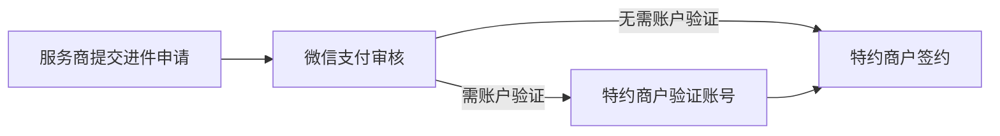

>更新时间：2026.10.20

在正式接入微信支付特约商户进件服务前，你需要进行以下准备步骤：

1. 选择接入模式：普通商户或普通服务商

2. 申请参数：AppID、商户号

3. 特约商户进件流程

## 选择接入模式

商户需要判断自己公司注册区域适用的接入模式和自身实际情况，申请成为普通商户或普通服务商：

- 普通商户自行申请入驻微信支付，无需服务商协助。

- 普通服务商则自身无法作为一个普通商户直接发起交易，其发起交易必须传入相关特约商户商户号的参数信息。

具体接入模式介绍请参考[接入模式](https://pay.weixin.qq.com/doc/v3/merchant/4012068443.md)文档，并按照参考文档完成相应模式的接入。

## 申请参数

请根据自身接入模式分别参考[微信支付接入准备-普通商户](https://pay.weixin.qq.com/doc/v3/merchant/4012071573.md)或[微信支付接入准备-普通服务商](https://pay.weixin.qq.com/doc/v3/partner/4012081990.md)中的[参数申请](https://pay.weixin.qq.com/doc/v3/merchant/4012071573.md) \- [配置API key](https://pay.weixin.qq.com/doc/v3/merchant/4012072195.md) \- [下载并配置商户证书](https://pay.weixin.qq.com/doc/v3/merchant/4012072428.md)三个步骤申请接入参数。

## 特约商户进件流程

进件流程图：

### 服务商提交进件申请

创建申请单

服务商收集商户资料后，调用进件接口创建入驻申请单；

- 个体户、企业、党政机关及事业单位、其他组织等主体；

- 填写资料包括：主体信息、经营信息、结算规则、结算账户、超级管理员。

  - AppID，可在“经营信息”模块，根据指引填写。

  - 优惠费率，可在“结算规则”模块，根据指引填写。

商家核对申请单信息

超级管理员核对联系信息（可在账户验证环节或签约环节操作，不影响审核）

- 创建申请单后，服务商可通过查询申请单状态接口获取“特约商户签约链接”（建议转换为二维码），发给申请单-超级管理员（简称超管）；

- 超管微信扫码后，“微信支付商家助手”公众号发送“申请进展通知”；超管点击消息，并完成“核对联系信息”（如下图），则后续公众号自动推送申请进展给超管，指引超管操作。

### 微信支付审核

服务商可通过[查询申请单状态](https://pay.weixin.qq.com/doc/v3/partner/4012697168.md)接口，查询申请单审核结果，约1-3个工作日，完成审核。

### 特约商户账户验证

审核通过后，将根据申请单情况，判断是否需账户验证

党政、机关及事业单位

| 超级管理员身份 | 账户验证方式 |
| --- | --- |
| / | （1）若填写申请单资料时，选择为“上传盖章证明函”，则无需账户验证； （2）若填写申请单资料时，选择为“汇款验证”，则需汇款验证：商户使用指定户名的银行账户，汇款指定金额至财付通指定银行账户，完成验证。（10天有效期） 附：在【主体资料】模块填写。 |

个体工商户

| 超级管理员身份 | 账户验证方式 |
| --- | --- |
| 法人/经营者 | 无需账户验证 |
| 负责人 | 法人扫码验证：法人微信扫码，完成验证。（10天有效期） |

企业

| 超级管理员身份 | 账户验证方式 |
| --- | --- |
| 法人/经营者 | 无需账户验证 |
| 负责人 | 支持以下方式二选一： 方式1 汇款验证：商户使用指定户名的银行账户，汇款指定金额至财付通指定银行账户，完成验证。（10天有效期） 方式2 法人扫码验证：法人微信扫码，完成验证。（10天有效期） |

其他组织

| 超级管理员身份 | 账户验证方式 |
| --- | --- |
| / | 汇款账户验证：依据指定要求汇款，完成验证。 |

提示

- 10天内未完成验证，将自动驳回申请单。

- 商户汇款后，请等待1-2天，具体以银行到账时间为准。汇款金额，系统会自动退款至商户的汇款银行账户。

服务商发送账户验证链接

当申请单为“待账户验证”状态，服务商可通过查询申请单状态接口获取“签约链接”（账户验证链接与签约链接一致，建议转为二维码），并发给商户号的超级管理员。

商家完成账户验证

超管微信扫码后，“微信支付商家助手”公众号发送“申请进展通知”；超管点击消息，根据页面指引完成账户验证。

提示

- 10天内未完成验证，将自动驳回申请单；

- 完成账户验证后，超管可马上进行签约；

- 若之前超管已核对联系信息，则公众号自动通知引导商户账户验证。

### 特约商户签约

服务商发送签约链接

- 当申请单为“待签约”状态，服务商可通过[查询申请单状态](https://pay.weixin.qq.com/doc/v3/partner/4012697168.md)口获得“商户签约链接”（建议转为二维码），并发给商户超管；

商家完成签约

- 超管扫码后，“微信支付商家助手”公众号发送“申请单进展通知”；超管点击“申请单进展通知”，根据页面指引完成签约。

说明：若之前超管已核对联系信息，则公众号自动通知引导商户签约。

### 开通权限

完成签约后，系统将自动开通权限，约30分钟内完成。

- 小微主体类型，系统授权服务商：付款码支付、JSAPI支付、Native支付。

- 个体户、企业、党政机关及事业单位、其他组织等主体，根据进件选择的经营场景，系统将授权服务商对应的支付权限：

| 经营场景 | 支付权限 |
| --- | --- |
| 线下门店场景 | 付款码支付、JSAPI支付、刷脸支付 |
| 公众号场景 | JSAPI支付 |
| 小程序场景 | JSAPI支付 |
| App场景 | App支付 |
| 互联网网站场景 | JSAPI支付、Native支付 |

- 另默认授权服务商-API退款权限。

### 完成入驻

- 若申请单为“已完成”状态，则该特约商户已完成入驻。

- 若申请单填写了结算银行信息，则商户发起第一笔交易后，微信支付会汇款0.01元至该银行卡，确认该银行信息是否正确。若汇款失败，“微信支付商家助手”公众号将通知引导特约商户修改结算银行卡。另服务商可通过“[查询结算账户API](https://pay.weixin.qq.com/doc/v3/partner/4012761113.md)”，查询汇款验证结果。