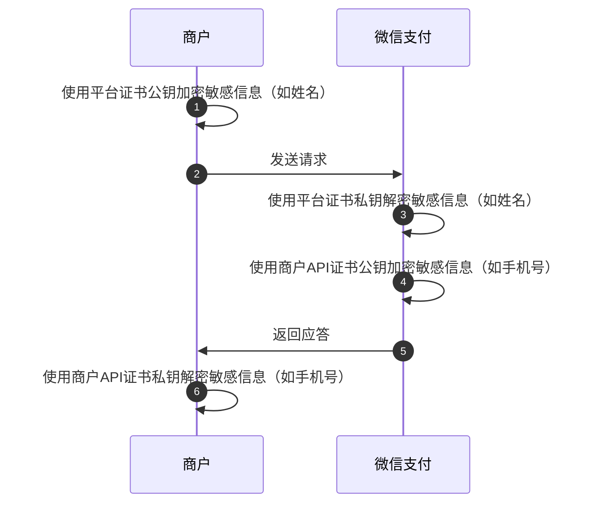
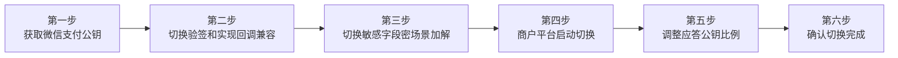
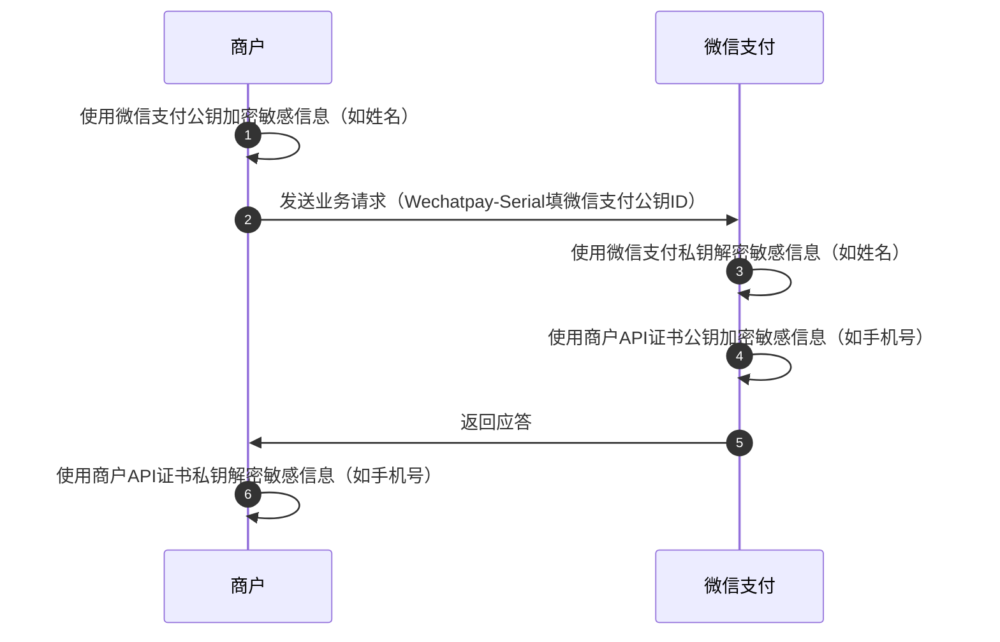

>更新时间：2024.12.12

## 1. 背景

微信支付APIv3支持平台证书和微信支付公钥两种模式构造签名验签，由于平台证书有效期为5年，每5年商户需主动更换一次。为避免更换不及时或更换过程中出现的系统风险影响业务，商户可将平台证书模式切换为微信支付公钥模式。如果你在切换过程中遇到问题可以咨询 [技术支持](https://support.pay.weixin.qq.com/aidevhelper) 寻求帮助。

## 2. 什么情况下需要切换？

（1）无需切换的情况：

- 如果你只使用了微信支付APIv2接口，则无需切换。

- 如果你是新申请的商户号，准备对接微信支付APIv3接口，且是全新开发的支付系统，该系统此前从未对接过平台证书模式，则无需切换，按照微信支付公钥使用说明


（2）需要切换的情况：

- 如果你是微信支付APIv3的商户，且已经使用了微信支付平台证书，请参考本文指引，将平台证书切换成微信支付公钥模式


（3）切换注意事项：

- 【平台证书切换微信支付公钥】的流程不能和【灰度更换新平台证书】的流程同时进行，如果你正在灰度更换新的平台证书，系统将有下面提示，需要停止新平台证书的灰度更换（API安全-平台证书，进入查看平台证书灰度更换情况，请谨慎操作），才能继续进行当前流程。

  

- 平台证书切换到微信支付公钥是以商户号维度切换的，如果你有多个商户号，需要都按照本文指引完成切换。


## 3. 切换过程哪些地方需要修改？

### 3.1 验签场景

场景1: 微信支付应答商户的请求时，商户需要使用平台证书公钥验签。

场景2: 接收微信支付的回调时，商户需要使用平台证书公钥验签。

以上场景都需要将平台证书公钥更换成微信支付公钥

| （1）请求应答场景 | （2）回调场景 |
| --- | --- |
| ```mermaid<br>sequenceDiagram<br>  autonumber<br>  participant p0 as 商户<br>  participant p1 as 微信支付<br>  p0->>p0: 使用商户API证书私钥生成签名<br>  p0->>p1: 发起业务请求<br>  p1->>p1: 使用商户API证书公钥验证签名<br>  p1->>p1: 使用平台证书私钥生成签名<br>  p1->>p0: 返回应答信息<br>  p0->>p0: 使用平台证书公钥验证签名<br>``` | iwiki-document:main |

### 3.2 敏感字段加解密场景

某些场景商户上送一些敏感信息，例如姓名信息，商户需要使用平台证书公钥加密敏感信息，上送给微信支付，确保敏感信息只有微信支付可以解密处理。

该场景也需要将平台证书公钥改成微信支付公钥



## 4. 微信支付SDK的商户如何将平台证书模式切换成公钥模式



### 4.1 获取微信支付公钥

超级管理员或者安全联系人登录商户平台，进入账户中心-API安全页面，点击申请公钥后，可下载微信支付公钥

| （1）账户中心->API安全 | （2）微信支付公钥入口页面 |
| --- | --- |
|  |  |
| （3）下载微信支付公钥 | （4）得到公钥文件和公钥ID（公钥序列号） |
|  |  |

### 4.2 Java SDK 商户如何将平台证书切换成微信支付公钥

- [Java SDK](https://github.com/wechatpay-apiv3/wechatpay-java)版本：0.2.15 及以上版本


#### （1）验签场景如何切换

原平台证书模式使用的是RSAAutoCertificateConfig.Builder()，你需将其换成RSAPublicKeyConfig.Builder()，使用微信支付公钥和公钥ID初始化，可参考使用[微信支付公钥验签](https://github.com/wechatpay-apiv3/wechatpay-java?tab=readme-ov-file#%E4%BD%BF%E7%94%A8%E6%9C%AC%E5%9C%B0%E5%B9%B3%E5%8F%B0%E5%85%AC%E9%92%A5)说明

```
// 可以根据实际情况使用publicKeyFromPath或publicKey加载公钥
Config config =
    new RSAPublicKeyConfig.Builder()
        .merchantId("1900007291") //微信支付的商户号
        .privateKeyFromPath("/Users/yourname/yourpath/apiclient_key.pem") // 商户API证书私钥的存放路径
        .publicKeyFromPath("/Users/yourname/yourpath/pub_key.pem") //微信支付公钥的存放路径
        .publicKeyId("PUB_KEY_ID_00000000000000000000000000000000") //微信支付公钥ID
        .merchantSerialNumber("5157F09EFDC096DE15EBE81A47057A72********") //商户API证书序列号
        .apiV3Key("F09E**") //APIv3密钥
        .build();
```

关键参数详解：

merchantId：微信支付商户号，也是mchid

privateKey ：商户API证书私钥，也就是 apiclient\_key.pem，如何获取参考[什么是商户API证书？如何获取商户API证书？](https://pay.weixin.qq.com/doc/v3/merchant/4013053053.md)

publicKey :微信支付公钥，如何获取参考[获取微信支付公钥](https://pay.weixin.qq.com/doc/v3/partner/4012925289.md#4.1-%E8%8E%B7%E5%8F%96%E5%BE%AE%E4%BF%A1%E6%94%AF%E4%BB%98%E5%85%AC%E9%92%A5)

publicKeyId：微信支付公钥ID，如何获取参考[获取微信支付公钥](https://pay.weixin.qq.com/doc/v3/partner/4012925289.md#4.1-%E8%8E%B7%E5%8F%96%E5%BE%AE%E4%BF%A1%E6%94%AF%E4%BB%98%E5%85%AC%E9%92%A5)

merchantSerialNumber：商户API证书序列号，如何获取[参考查看商户API证书私钥](https://pay.weixin.qq.com/doc/v3/merchant/4013053053.md#%E5%A6%82%E4%BD%95%E6%9F%A5%E7%9C%8B%E5%95%86%E6%88%B7API%E8%AF%81%E4%B9%A6%E5%BA%8F%E5%88%97%E5%8F%B7%EF%BC%9F)序列号

apiV3Key：APIv3密钥，如何获取参考[什么是APIv3密钥？如何获取APIv3密钥](https://pay.weixin.qq.com/doc/v3/merchant/4013053267.md)

注意：

如果你的商户API证书没有过期则无需修改，可直接沿用你当前的商户API证书的私钥、序列号，如果你的商户API证书即将过期，请同步修改，具体参考，[如何更换商户API证书](https://pay.weixin.qq.com/doc/v3/merchant/4013053057.md)

#### （2）回调的兼容处理

平台证书切换到公私钥期间，回调要同时支持使用平台证书和公钥的验签。请参考下文或[回调兼容说明](https://github.com/wechatpay-apiv3/wechatpay-java/blob/main/core/src/main/java/com/wechat/pay/java/core/notification/RSACombinedNotificationConfig.java)。

（1）回调平滑切换时，使用的是RSACombinedNotificationConfig作为 NotificationConfig来处理回调。使用该 NotificationConfig 初始化的 NotificationParser 会持续自动下载微信支付平台证书。

（2）如果已经完成回调的平滑切换，即你的回调比例进度条已经为 100%，应改成使用RSAPublicKeyNotificationConfig，否则你的应答比例会一直有自动下载平台证书的流量，导致比例无法到 100%

RSACombinedNotificationConfig示例如下

```
NotificationConfig config = new RSACombinedNotificationConfig.Builder()
        .merchantId(merchantId)
        .privateKeyFromPath(privateKeyPath)
        .merchantSerialNumber(merchantSerialNumber)
        .publicKeyFromPath(wechatpayPublicKeyPath)
        .publicKeyId(wechatpayPublicKeyId)
        .apiV3Key(apiV3Key)
        .build();
```

RSAPublicKeyNotificationConfig示例如下

```
NotificationConfig config = new RSAPublicKeyNotificationConfig.Builder()
        .publicKeyFromPath(publicKeyPath)
        .publicKeyId(publicKeyId)
        .apiV3Key(apiV3Key)
        .build();
```

#### （3）敏感字段加解密如何切换

可以通过以下方法直接构建加密器 `PrivacyEncryptor` 和解密器 `PrivacyDecryptor`，具体可参考[手动加解密章节](https://github.com/wechatpay-apiv3/wechatpay-java?tab=readme-ov-file#%E6%89%8B%E5%8A%A8%E5%8A%A0%E8%A7%A3%E5%AF%86)

```
// 微信支付公钥
PublicKey wechatPayPublicKey = null; //微信支付公钥
String plaintext = "";
PrivacyEncryptor encryptor = new RSAPrivacyEncryptor(wechatPayPublicKey);
String ciphertext = encryptor.encryptToString(plaintext);
```

### 4.3 PHP SDK 商户如何将平台证书切换成微信支付公钥

- [PHP SDK](https://github.com/wechatpay-apiv3/wechatpay-php)版本：v1.2


此版本开始，SDK提供了统一的 `RSA` 公私钥加载函数 `Rsa::from($thing, $type)`，支持从 `X509` 格式证书、 `PKCS#8` 私钥、 `PKCS#1` 公/私钥、 `SPKI` 公钥文件或者字符串加载RSA公/私钥实例。

（1）从文本加载微信支付平台证书

```
$platformCertificateContent = \file_get_contents('file:///path/to/wechatpay/certificate.pem');
$platformPublicKeyInstance = Rsa::from($platformCertificateContent, Rsa::KEY_TYPE_PUBLIC);
```

（2）从文件加载微信支付平台公钥

```
$platformPublicKeyFileFilePath = 'file:///path/to/wechatpay/publickey.pem';
$platformPublicKeyInstance = Rsa::from($platformPublicKeyFileFilePath, Rsa::KEY_TYPE_PUBLIC);
```

#### （3）Builder初始化兼容

初始化声明的 `certs` 参数，仅需按需配置「微信支付平台证书」文件地址或者「微信支付平台公钥」文件地址，即完全兼容两种模式运行，返回值验签SDK即自动完成，无差异。

```
// 从本地文件中加载「微信支付平台证书」或者「微信支付平台公钥」，用来验证微信支付应答的签名
 $platformCertificateOrPublicKeyFilePath = 'file:///path/to/wechatpay/certificate_or_publickey.pem';
 $platformPublicKeyInstance = Rsa::from($platformCertificateOrPublicKeyFilePath, Rsa::KEY_TYPE_PUBLIC);

// 「微信支付平台证书」的「证书序列号」或者是「微信支付平台公钥ID」
// 「平台证书序列号」及/或「平台公钥ID」可以从 商户平台 -> 账户中心 -> API安全 直接查询到
 $platformCertificateSerialOrPublicKeyId = 'PUB_KEY_ID_00000000000000000000000000000000';

// 构造一个 APIv3 客户端实例
$instance = Builder::factory([
    'mchid'      => $merchantId,
    'serial'     => $merchantCertificateSerial,
    'privateKey' => $merchantPrivateKeyInstance,
    'certs'      => [
       $platformCertificateSerialOrPublicKeyId => $platformPublicKeyInstance,
    ],
]);
```

#### （4）回调通知兼容

微信支付回调通知，会在 `POST` 请求头 `headers` 里，声明 `数据签名` 所使用的平台公钥实例标识，即 `Wechatpay-Serial`, 商户端在接收到请求后，不应差别对待此字段值的构成，例如平台公钥ID的前缀 `PUB_KEY_ID_`。建议商户端可按照此声明字段值，在应用中按照 `key/value` Map形式加载平台公钥实例用以验签。例如：

```
// 预先已知的 平台证书序列号 => 平台证书实例 或者 平台公钥ID => 平台公钥实例 数据结构体
$platformPublicKeyMap = [
    '7132D72A03E93CDDF8C03BBD1F37EEDF********' => $platformCertificateInstance,
    'PUB_KEY_ID_00000000000000000000000000000000' => $platformPublicKeyInstance,
];

// 从回调通知请求头上获取声明的 平台公钥实例标识
$inWechatpaySerial = '';

// 判断预先已知的 `$platformPublicKeyMap` 是否存在，不存在则按照开发文档响应非20x状态码及负载JSON
if (!\array_key_exists($inWechatpaySerial, $platformPublicKeyMap) {
    // 例如：以异常形式「中断」后续程序处理逻辑，交由上层统一做异常处理
    throw new \UnexpectedValueException('未知的wechatpay-serial请求头');
}

// 加载平台公钥实例
$platformPublicKeyInstance = Rsa::from($platformPublicKeyMap[$inWechatpaySerial], Rsa::KEY_TYPE_PUBLIC);
// 其他逻辑按需处理
// ...
```

#### （5）敏感信息加密兼容

仅需在需要加密上送的请求参数里，按需声明所使用的 `平台公钥实例` 对应的是「平台证书序列号」还是「平台公钥ID」即可：

```
    'headers' => [
       'Wechatpay-Serial' => $platformCertificateSerialOrPublicKeyId,
    ],
```

### 4.4 Go SDK 商户如何将平台证书切换成微信支付公钥

- [Go SDK](https://github.com/wechatpay-apiv3/wechatpay-go)版本：0.2.20 及以上版本


#### （1）验签场景如何切换

- 原平台证书使用的是[平台证书验签](https://github.com/wechatpay-apiv3/wechatpay-go?tab=readme-ov-file#%E5%9B%9E%E8%B0%83%E9%80%9A%E7%9F%A5%E7%9A%84%E9%AA%8C%E7%AD%BE%E4%B8%8E%E8%A7%A3%E5%AF%86)，你需要参考以下代码片段完成微信支付公钥和公钥id初始化，可参考使用[微信支付公钥验签名](https://github.com/wechatpay-apiv3/wechatpay-go?tab=readme-ov-file#)说明


```
var (
	wechatpayPublicKeyID       string = "PUB_KEY_ID_00000000000000000000000000000000"          // 微信支付公钥ID，注意微信支付公钥ID带有PUB_KEY_ID_前缀
)

wechatpayPublicKey, err = utils.LoadPublicKeyWithPath("/path/to/wechatpay/pub_key.pem")
if err != nil {
	panic(fmt.Errorf("load wechatpay public key err:%s", err.Error()))
}

// 初始化 Client
opts := []core.ClientOption{
	option.WithWechatPayPublicKeyAuthCipher(
		mchID, //商户号
		mchCertificateSerialNumber, mchPrivateKey,
		wechatpayPublicKeyID, wechatpayPublicKey),
}
client, err := core.NewClient(ctx, opts...)

// 初始化 notify.Handler
handler := notify.NewNotifyHandler(
	mchAPIv3Key,
	verifiers.NewSHA256WithRSAPubkeyVerifier(wechatpayPublicKeyID, *wechatPayPublicKey))
```

wechatpayPublicKeyID ：微信支付公钥ID，如何获取参考[获取微信支付公钥](https://pay.weixin.qq.com/doc/v3/partner/4012925289.md#4.1-%E8%8E%B7%E5%8F%96%E5%BE%AE%E4%BF%A1%E6%94%AF%E4%BB%98%E5%85%AC%E9%92%A5)

wechatpayPublicKey ：微信支付公钥，如何获取参考[获取微信支付公钥](https://pay.weixin.qq.com/doc/v3/partner/4012925289.md#4.1-%E8%8E%B7%E5%8F%96%E5%BE%AE%E4%BF%A1%E6%94%AF%E4%BB%98%E5%85%AC%E9%92%A5)

mchID ：商户号

mchCertificateSerialNumber：商户API证书序列号，如何获取[参考查看商户API证书私钥](https://pay.weixin.qq.com/doc/v3/merchant/4013053053.md#%E5%A6%82%E4%BD%95%E6%9F%A5%E7%9C%8B%E5%95%86%E6%88%B7API%E8%AF%81%E4%B9%A6%E5%BA%8F%E5%88%97%E5%8F%B7%EF%BC%9F)序列号

mchPrivateKey：商户API证书私钥，[什么是商户API证书？如何获取商户API证书？](https://pay.weixin.qq.com/doc/v3/merchant/4013053053.md#%E5%A6%82%E4%BD%95%E6%9F%A5%E7%9C%8B%E5%95%86%E6%88%B7API%E8%AF%81%E4%B9%A6%E5%BA%8F%E5%88%97%E5%8F%B7%EF%BC%9F)

mchAPIv3Key：APIv3密钥，如何获取参考[什么是APIv3密钥？如何获取APIv3密钥](https://pay.weixin.qq.com/doc/v3/merchant/4013053267.md)

#### （2）回调的兼容处理

平台证书切换到公私钥期间，回调要同时支持使用平台证书和公钥的验签。请参考下文，使用微信平台证书访问器和公钥一起初始化 `NotifyHandler`。

```
// 初始化 notify.Handler
handler := notify.NewNotifyHandler(
	mchAPIv3Key,
	verifiers.NewSHA256WithRSACombinedVerifier(certificateVisitor, wechatpayPublicKeyID, *wechatPayPublicKey))
```

#### （3）敏感字段加解密如何切换

使用func EncryptOAEPWithPublicKey 来使用公钥加密

```
package utils

// EncryptOAEPWithPublicKey 使用公钥加密
func EncryptOAEPWithPublicKey(message string, publicKey *rsa.PublicKey) (ciphertext string, err error)
// EncryptOAEPWithCertificate 使用证书中的公钥加密
func EncryptOAEPWithCertificate(message string, certificate *x509.Certificate) (ciphertext string, err error)

// DecryptOAEP 使用私钥解密
func DecryptOAEP(ciphertext string, privateKey *rsa.PrivateKey) (message string, err error)
```

### 4.5 商户平台启动切换

1、公钥灰度和切换都是按照商户号维度进行的，如果你的商户号在多个项目里使用，请确保你这些项目都按照指引的说明，支持了公钥模式，你才可以点击【开始更换】

2、需要超级管理员或者安全联系人登录商户平台，进入账户中心-API安全页面，点击验签方式更换，如下图

3、如若灰度中发现异常或者因为业务排期等问题需要暂时暂停灰度，你可以点击“停止更换”，停止后将全部切换回平台证书，请谨慎操作

特别说明，更换的进度分为2个进度条，其中

1、回调使用公钥的比例：是微信支付控制的，会按照第一天0.1%，第二天1%，第三天 5%，第四天10%，第五天20%，第六天50%，第七天 100% 的进度，自动灰度，商户不可以操作。灰度期间会按照上述比例使用公钥签名，剩余比例用平台证书签名，因此商户需要实现根据回调请求的 wechatpay-serial头来判断当前的回调是使用公钥还是平台证书，并使用对应的公钥或者平台证书验签。

2、应答使用公钥的比例：是商户自己控制的，通过商户的http请求头的Wechatpay-Serial带微信支付公钥ID还是平台证书ID来判断

3、应答使用公钥比例=近7天用微信支付公钥调接口次数/近7天v3接口总调用次数，数据更新频率是1小时，所以当你全量切到微信支付公钥之后还需要等待7天，比例才会变成100%

4、考虑到回调和应答都需灰度时间，因此请计算好你平台证书的过期时间和灰度的时间，避免平台证书过期了但公钥灰度未完成，导致报错

| （1）点击开始更换 | （2）超管输入操作密码和手机验证码 | （3）可以查看到更换进度 |
| --- | --- | --- |
|  |  | 1、回调使用公钥的比例是微信支付控制的，会在7天内按比例灰度到100%，商户不可以操作<br>2、应答使用公钥的比例是商户自己控制的，通过商户的http请求头的Wechatpay-Serial来判别<br>应答使用公钥比例=近7日用微信支付公钥调接口次数/近7日v3接口总调用次数，数据更新频率是小时<br> |

### 4.6 确认切换完成

（1）当你所有业务场景的请求已经携带了公钥ID，且经过7天回调灰度后，你可以在商户平台看到【回调使用公钥比例】和【应答使用公钥比例】都为100%，请确保业务已经覆盖完全，并且点击“确认切换”，至此变更完成。 如果你的回调比例和应答比例不为 100%，可以参考[常见问题](https://pay.weixin.qq.com/doc/v3/partner/4013038589.md)查找解决办法


（2）当你确认切换之后，表示后续你的商户号都将使用微信支付公钥模式验签、加解密敏感信息。

（3）完成切换后，你的http请求头可以不带上Wechatpay-Serial，默认微信支付都会使用微信支付私钥签名

## 5. 没有使用微信支付SDK的商户如何将平台证书切换成微信支付公钥    ```mermaid flowchart LR     C["第三步<br/>切换敏感字段密场景加解"]     D["第四步<br/>商户平台启动切换"]     E["第五步<br/>调整应答公钥比例"]     F["第六步<br/>确认切换完成"]   A["第一步<br/>获取微信支付公钥"] --> B["第二步<br/>切换验签和实现回调兼容"]     B --> C     C --> D     D --> E     E --> F     B@{ w: 212.9, h: 52 }     C@{ w: 219.9, h: 51.8 }     A@{ w: 182.7, h: 53.4 }     D@{ w: 187.3, h: 53.3 }     E@{ w: 172.7, h: 54.7 }     F@{ w: 150, h: 56 } ```

### 5.1 获取微信支付公钥

超级管理员或者安全联系人登录商户平台，进入账户中心-API安全页面，点击申请公钥后，可下载微信支付公钥

| （1）账户中心->API安全 | （2）微信支付公钥入口页面 |
| --- | --- |
|  |  |
| （3）下载微信支付公钥 | （4）得到公钥文件和公钥ID（公钥序列号） |
|  |  |

### 5.2 切换验签和实现回调兼容

| （1）请求应答场景 | （2）回调场景 |
| --- | --- |
| ```mermaid<br>sequenceDiagram<br>  autonumber<br>  participant p0 as 商户<br>  participant p1 as 微信支付<br>  p0->>p0: 使用商户API证书私钥生成签名<br>  p0->>p1: 发起业务请求（Wechatpay-Serial填入微信支付公钥ID）<br>  p1->>p1: 使用商户API证书公钥验证签名<br>  p1->>p1: 根据请求的Wechatpay-Serial选择使用微信支付私钥生成签名<br>  p1->>p0: 返回应答信息<br>  p0->>p0: 使用Wechatpay-Serial对应的微信支付公钥验证签名<br>``` | ```mermaid<br>sequenceDiagram<br>  autonumber<br>  participant p0 as 商户<br>  participant p1 as 微信支付<br>  p1->>p1: 使用APIv3密钥加密回调信息<br>  p1->>p1: 使用微信支付私钥或者平台证书私钥生成签名<br>  p1->>p0: 发送回调信息<br>  p0->>p0: 使用微信支付公钥或者平台证书公钥验证签名<br>  p0->>p0: 使用APIv3密钥解密回调信息<br>  p0->>p1: 返回处理结果<br>``` |

- 第一步：你需要在http请求增加一个Wechatpay-Serial请求头，告知微信支付本次请求将使用微信支付公钥验签，参考[如何获取公钥ID](https://pay.weixin.qq.com/doc/v3/partner/4012925289.md#4.1-%E8%8E%B7%E5%8F%96%E5%BE%AE%E4%BF%A1%E6%94%AF%E4%BB%98%E5%85%AC%E9%92%A5)，携带公钥ID请求头示例如下。


注意：

在切换过程中，不带Wechatpay-Serial请求头，则微信支付将使用平台证书签名

```
curl -X GET \
https://api.mch.weixin.qq.com/v3/xxx \
-H "Authorization: WECHATPAY2-SHA256-RSA2048 mchid=\"1900000001\",..." \
-H "Accept: application/json" \
-H "Wechatpay-Serial: PUB_KEY_ID_00000000000000000000000000000000" // 需要增加Wechatpay-Serial请求头，且注意微信支付公钥ID带有PUB_KEY_ID_前缀
```

- 第二步：微信支付收到带微信支付公钥ID的请求头后，会使用微信支付私钥生成签名，参考以下示例。因此你需要用对应的微信支付公钥验证签名，参考[如何使用微信支付公钥验签](https://pay.weixin.qq.com/doc/v3/merchant/4013053249.md)，


```
Content-Type: application/json; charset=utf-8
Cache-Control: no-cache, must-revalidate
X-Content-Type-Options: nosniff
Request-ID: 0880F1CAB9061075189FCBC055209CEXXXXXX
Content-Language: zh-CN
Wechatpay-Nonce: 7b236aa106a17544dc15642ddaaaaaaa
Wechatpay-Signature: aaaa0D5n+3rQI4Rk0+n4r0j1Fl2QmirVCNkHxjMo2z+oXnQMgnSg4SrP/BV8+MD2mjmA7Pd3JHjQAyNxypgvyolAhABXYPV4tfmgcc1L2YkTM6ooadlm8uLnmyJZx1B45CMSndrWJ1fGViCNeWT5Mi/bAaxjFeTLwKZCHWz11Bp7e7HegvcDqEsw7eeHJdTAbB8cBDdYbW8MqIQvPAeRTvsLJZDkF4jFoKuPA8nzCHSUSpCo9YPVOEUawufs/ozDr5CZowCUiqImv9Ylu1Q0ywhX35qEWqRqJYZaRvb36CWhWuWsq/l1PMJcHQSzEZKGmX14yjeilyG2rihb9aaaa==
Wechatpay-Timestamp: 1731377280
Wechatpay-Serial: PUB_KEY_ID_00000000000000000000000000000000 //微信支付的应答也会带上，Wechatpay-Serial请求头，且注意微信支付公钥ID带有PUB_KEY_ID_前缀
Wechatpay-Signature-Type: WECHATPAY2-SHA256-RSA2048
```

- 第三步：参考上图的回调场景，微信支付会按照比例使用微信支付私钥或平台证书生成签名发送回调信息，因此你的回调需要实现按照微信支付回调请求的请求头的Wechatpay-Serial判断本次回调是需要用平台证书验证签名还是使用微信支付公钥验证签名，参考以下回调请求头示例


（1）使用了平台证书的回调请求头

```
Content-Type: application/json
Wechatpay-Nonce: gWTNBVLvZys67ruVWtY8F4cA20rplzA0
Wechatpay-Timestamp: 1731465272
Wechatpay-Serial: 4DF076AC5A7D968D4A8B0B9C599A74CB4CF8EE8A  //平台证书ID
Wechatpay-Signature: K8aa5KTKSWHYbhLMtUpRJIC2g+9YnCGmEeeGOgz7bQQGFhh7skof/Yi6Vr6OAApoEdipRZ9kIrZ61Ur5mXcRyWyXGiKdk/WXe7muBLSKAJcUHE4i1cV3K0UVXeOsIF3d/k+wCUkpUjHmyyX1wGUFNGFqHhooQj1EZXagGrkpsTUbMK1d9vPrVSFz0i89GEgTYkyuxxLfylfvZL85zUxZOa/4sus72DaGhf04yrFI5R9tFJ75p7p2FPKZuYbGdaehT9R7mrNePW/NYV6I/dzIuHs3ERYWB86LjaK2k0ER3KZKkGeGYXnAMeX/rN/LUZ+fZa1kA7hgoM8cR1pLohdiCg==
Wechatpay-Signature-Type: WECHATPAY2-SHA256-RSA2048
```

（2）使用了微信支付公钥的回调请求头

```
Content-Type: application/json
Wechatpay-Nonce: gWTNBVLvZys67ruVWtY8F4cA20rplzA0
Wechatpay-Timestamp: 1731465272
Wechatpay-Serial: PUB_KEY_ID_0115635139512024101100397200000006  //微信支付的应答也会带上，Wechatpay-Serial请求头，且注意微信支付公钥ID带有PUB_KEY_ID_前缀
Wechatpay-Signature: K8aa5KTKSWHYbhLMtUpRJIC2g+9YnCGmEeeGOgz7bQQGFhh7skof/Yi6Vr6OAApoEdipRZ9kIrZ61Ur5mXcRyWyXGiKdk/WXe7muBLSKAJcUHE4i1cV3K0UVXeOsIF3d/k+wCUkpUjHmyyX1wGUFNGFqHhooQj1EZXagGrkpsTUbMK1d9vPrVSFz0i89GEgTYkyuxxLfylfvZL85zUxZOa/4sus72DaGhf04yrFI5R9tFJ75p7p2FPKZuYbGdaehT9R7mrNePW/NYV6I/dzIuHs3ERYWB86LjaK2k0ER3KZKkGeGYXnAMeX/rN/LUZ+fZa1kA7hgoM8cR1pLohdiCg==
Wechatpay-Signature-Type: WECHATPAY2-SHA256-RSA2048
```

### 5.3 切换敏感字段加解密场景



敏感字段加解密场景，商户在发起请求的时候使用微信支付公钥加密敏感信息，并且在发起请求的商户在http请求头带上Wechatpay-Serial 告知微信支付本次使用的是微信支付公钥加密，可以参考[微信支付公钥加密敏感信息字段](https://pay.weixin.qq.com/doc/v3/merchant/4013053257.md)

```
curl -X GET \
https://api.mch.weixin.qq.com/v3/xxx \
-H "Authorization: WECHATPAY2-SHA256-RSA2048 mchid=\"1900000001\",..." \
-H "Accept: application/json" \
-H "Wechatpay-Serial: PUB_KEY_ID_00000000000000000000000000000000" // 需要增加Wechatpay-Serial请求头，且注意微信支付公钥ID带有PUB_KEY_ID_前缀
```

### 5.4 商户平台点击更换验签方式

1、公钥灰度和切换都是按照商户号维度进行的，如果你的商户号在多个项目里使用，请确保你这些项目都按照指引的说明，支持了公钥模式，你才可以点击【开始更换】

2、需要超级管理员或者安全联系人登录商户平台，进入账户中心-API安全页面，点击验签方式更换，如下图

3、如若灰度中发现异常或者因为业务排期等问题需要暂时暂停灰度，你可以点击“停止更换”，停止后将全部切换回平台证书，请谨慎操作

特别说明，更换的进度分为2个进度条，其中

1、回调使用公钥的比例：是微信支付控制的，会按照第一天0.1%，第二天1%，第三天 5%，第四天10%，第五天20%，第六天50%，第七天 100% 的进度，自动灰度，商户不可以操作。灰度期间会按照上述比例使用公钥签名，剩余比例用平台证书签名，因此商户需要实现根据回调请求的 wechatpay-serial头来判断当前的回调是使用公钥还是平台证书，并使用对应的公钥或者平台证书验签。

2、应答使用公钥的比例：是商户自己控制的，通过商户的http请求头的Wechatpay-Serial带微信支付公钥ID还是平台证书ID来判断

3、应答使用公钥比例=近7天用微信支付公钥调接口次数/近7天v3接口总调用次数，数据更新频率是1小时，所以当你全量切到微信支付公钥之后还需要等待7天，比例才会变成100%

4、考虑到回调和应答都需灰度时间，因此请计算好你平台证书的过期时间和灰度的时间，避免平台证书过期了但公钥灰度未完成，导致报错

| （1）点击开始更换 | （2）超管输入操作密码和手机验证码 | （3）可以查看到更换进度 |
| --- | --- | --- |
|  |  | 1、回调使用公钥的比例是微信支付控制的，会在7天内按比例灰度到100%，商户不可以操作<br>2、应答使用公钥的比例是商户自己控制的，通过商户的http请求头的Wechatpay-Serial来判别<br>应答使用公钥比例=近7天用微信支付公钥调接口次数/v3接口总调用次数，数据更新频率是小时<br> |

### 5.5 确认切换完成

（1）当你所有业务场景的请求已经携带了公钥ID，且经过7天回调灰度后，你可以在商户平台看到【回调使用公钥比例】和【应答使用公钥比例】都为100%，请确保业务已经覆盖完全，并且点击“确认切换”，至此变更完成。


（2）当你点击确认切换之后，表示后续你的商户号都将使用微信支付公钥模式验签、加解密敏感信息。

（3）完成切换后，除了敏感字段加解密场景，你的回调场景、应答场景http请求头可以不带上Wechatpay-Serial，默认微信支付都会使用微信支付私钥签名