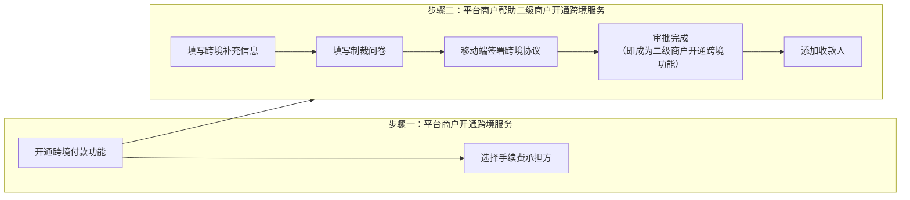

>更新时间：2026.10.20

## 1. 平台收付通简介

平台收付通是基于服务商模式，专为电商行业场景设计打造的支付与结算的解决方案。平台商户协助其下商户入驻成为微信支付二级商户。平台收付通支持将多个二级商户的订单进行合单支付（如电商购物车中的多笔订单合并支付），合单支付款项分别进入到二级商户各自的账户（如需实现二级商户的账期管理，可在下单接口传入分账标识，交易成功后资金将转为冻结状态）；平台在满足业务流程条件下（如确认收货等），可将二级商户的冻结状态的资金解冻，并收取平台佣金。

注意

开通平台收付通产品前，需确保在普通服务商模式下没有已经入驻或处于入驻流程中的子商户。

## 2. 功能介绍

### 2.1 二级商户入驻

通过该接口将平台的二级商户入驻成为微信支付二级商户；

### 2.2. 合单支付

适用于平台型电商，通过该接口可以实现多商户（1- 50个二级商户）商品同时支付的场景，通过在该接口传入需要分账的标识，交易资金分别进入到各二级商户账户中并处于冻结状态，系统默认冻结180天。

调用此接口，用户在收银台先看到平台的信息，点详情可查看各子订单交易的信息。

### 2.3. 普通支付

支持[Native支付](https://pay.weixin.qq.com/doc/v3/partner/4012714902.md)、[App支付](https://pay.weixin.qq.com/doc/v3/partner/4012714669.md)、[JSAPI支付](https://pay.weixin.qq.com/doc/v3/partner/4012714678.md)、[H5支付](https://pay.weixin.qq.com/doc/v3/partner/4012714759.md)、[小程序支付](https://pay.weixin.qq.com/doc/v3/partner/4012714911.md)，适用于无中心化平台的电商SAAS服务商，比如每一个二级商户有一个单独的小店（每个二级商户有单独的小店小程序）。通过在该接口传入需要分账的标识，交易资金进入到单个二级商户账户中并处于冻结状态，系统默认冻结180天。

调用此接口，用户在收银台直接看到的是二级商户信息。

### 2.4. 分账

通过分账接口，根据实际业务场景将交易款项分账到其他业务参与方的账户(如：平台抽取佣金)，目前默认最高分账比例30%；同时通过该接口，实现合单交易冻结资金的解冻，从而实现对二级商户的账期管理和资金分配。

适用于已开通平台收付通的平台及二级商户，平台可通过供应链分账实现对平台二级商户的账期管理和资金分配。

#### 使用场景

- 二级商户账期管理：二级商户直接收款，平台通过供应链分账的冻结解冻能力实现对二级商户账期的管理。

- 平台交易抽成：二级商户直接收款，平台根据二级商户的每笔交易实现服务费的在线抽成。

- 分账给供应商、达人或其他分账方：二级商户直接收款，按每笔交易分账给二级商户上游的供应商、下游分销的达人、或者其他分润方。

#### 开通

- 通过「平台收付通」认证平台商户号，及其二级商户。

#### 产品模型

- 分账发起方： 发起分账的一方，这里指平台。

- 分账方： 交易的直接收款方，平台二级商户。

- 接收方： 接收资金的一方，平台已被默认添加为接收方，二级商户可直接向平台进行分账；其他接收方，平台通过添加分账接收方接口，建立平台维度统一的分账接收方列表，添加成功后，所有二级商户号均可向其分账。接收方可以是微信支付商户或微信支付的个人账户，自2025年9月16日起，平台下的二级商户未被添加为分账接收方，也可接收来自所属平台发起的分账。

#### 功能特点

- 需分账的订单，平台在下单时打上分账标识。

- 周期可控： 平台根据平台运营规则，可对交易订单准实时（支付成功后30s）分账，或按周期延时分账，并完结分账（解冻订单未分账资金）。系统默认最长冻结周期默认180天，若超时仍未发起分账指令，该笔订单的剩余资金将自动解冻。

- 多次分账+多方分账： 同一笔订单最多分账50次，每次分账可最多向50个接收方分账。

- 状态可查+支持回退： 提供接口查询分账结果；若已分账的订单需要退款，对于商户类型的分账接收方，平台可发起分账回退，将已分账资金回退回分账方账户。

### 2.5. 补差

针对平台补贴场景，通过补差接口在分账前将补贴款转入二级商户账户，统一进行分账。

#### 2.5.1. 使用场景

平台营销活动场景：

开展由平台出资的营销活动时，支持平台补差转账给二级商户。场景举例如下：

- 平台向新用户发放由平台出资的满200减20元优惠券，用户A领取了一张20元的优惠券。

- 用户A购买2件商品订单总价200元，使用一张20元的优惠券，实际仅需支付180元。

- 平台可以利用补差接口，将优惠的20元补差给二级商户。二级商户账户一共入账180+20=200元。

- 二级商户可以按200元为分账基数向相关分成方进行分账。

- 用户收到货之后，选择其中1件订单价100元的商品进行退款，此时不满足平台满200减20的用券条件。

- 平台可从二级商户账户退回80元给到用户，并通过补差回退将20元部分或全部退回到平台。

#### 2.5.2. 使用补差接口的优势

- 灵活的补差转账： 支持平台全场、品类、单店、单品牌等范围内的满减、折扣等多种灵活营销方式。平台营销方式与微信支付资金能力配合，只需调用补差接口，将最终的优惠金额补差转账给二级商户即可。

- 减少资金占用： 平台只需要在分账前将补差金额补差给二级商户即可。一方面，避免了用户下单不支付场景下的资金占用；另一方面，对于那些用户支付后很长一段时间才会确认收货和分账的平台而言，减少了从支付到分账环节的资金占用。

- 二级商户收款体验好： 相对于线下将补贴给二级商户的方式，使用微信支付提供的补差能力，可以做到二级商户交易和补差一笔到账，信息流和资金流更加一致，二级商户收款体验更好。

- 灵活的补差退款： 当用户发生退款，需要退回补差的情况下，支持平台根据自己的规则向微信支付发起补差退款指令，将补差金额从二级商户账户补差回退至平台账户。

### 2.6. 退款

通过退款接口将支付款退还给买家。

### 2.7. 余额查询与提现

帮助二级商户发起进行账户余额提现与查询申请，完成账户余额提现；不建议平台利用限制提现进行账期控制，特殊情况下商户可直接到微信支付进行提现，故而造成账期控制无效，账期控制详见分账介绍。

### 2.8 跨境付款

「跨境收付通」是建立在境内「平台收付通」基础上的跨境结算产品，主要解决境内平台需要结算货款给境外供应商的核心问题，可提供“灵活分账、海关报关、资金出境、全球分发”等全链路资金服务

#### 2.8.1 交易流程

#### 2.8.2 交易配置

1. 起结点： 6000CNY

2. 默认开通币种： HKD、USD、EUR、JPY、GBP、CAD、AUD、SGD

3. 每日累计出境限额： 60w CNY

4. 可出境订单时效： 自2023-05-29 00:00:00起，三年内订单均可出境

5. 可出境金额： 计算单笔订单最终进入基本账户可用余额部分的金额，即二级商户刨除分账、退款等支出后实际到账户中的金额

   - 最大可出境金额 = 订单金额（含补差） \- 退款金额 （\- 分出金额）

   - 注意：此计算方式放宽出境金额，未扣除交易手续费。如平台选择由二级商户承担手续费，需提示二级商户在基本账户中预留足额资金，或开通手续费账户，保证足额出境

#### 2.8.3 跨境付款能力优势

1. 全球付款： 支持境内平台向全球主流地区付款，支持批量付款，支付网络覆盖全球

2. 主流币种便捷汇兑： 支持主流币种结算，优势离岸汇率，快速结算满足小额、高频的外汇兑换需求

3. 海关报关一键推单： 连通全国30+海关，支持一键推单至所有海关

#### 2.8.4 收费方式

出境手续费率：0.40%

- 若在开通跨境付款功能时，选择「由平台承担跨境手续费」，将从平台手续费账户中扣除

  - 举例：二级商户A申请出境100RMB，目标币种为港币，将从平台手续费帐户中扣除100\*0.40%手续费后，执行100RMB出境，依据次金融交易日汇率换汇为港币
- 若在开通跨境付款功能时，选择「由二级商户承担跨境手续费」，将从二级商户申请出境的订单金额内扣除

  - 举例：二级商户B申请出境100RMB，目标币种为港币，将从二级商户该笔出境资金内扣除1000.40%手续费后，执行（100-1000.40%）RMB出境，依据次金融交易日汇率换汇为港币

#### 2.8.5 跨境付款接入流程概览

点击查看跨境商户[入驻指引](https://pay.weixin.qq.com/doc/v3/partner/4012086921.md#3.5.-%E4%BA%8C%E7%BA%A7%E5%95%86%E6%88%B7%E6%88%90%E4%B8%BA%E8%B7%A8%E5%A2%83%E5%95%86%E6%88%B7)

如有其他问题，请扫描下方二维码联系客服人员咨询

### 2.9. 账单

平台帮助二级商户获取微信支付账单。

### 2.10. 注销后提现

电商二级商户注销后，平台帮助二级商户将可用余额提现到指定的账户。