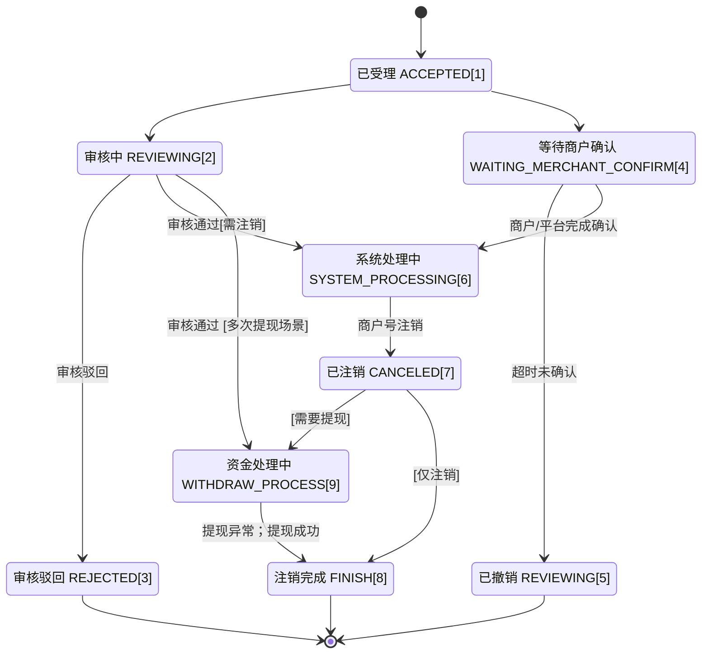

>更新时间：2026.06.11

为了提升电商平台二级商户的退出体验，平台收付通对原有的注销及提现流程进行了深度整合，推出了全新的“注销提现”一体化接口。

相较于传统方案，接入新接口的核心价值在于：

- 流程合二为一： 改变了过去“先注销、后提资”的断点模式。电商平台仅需提交一次申请，系统即可同步执行账户注销与余额全额清退，极大提升了业务闭环效率。

- 实现大幅减纸化，通过商户意愿确认完成清退： 优化了审核逻辑。除营业执照已注销的企业或特殊主体（政府机关、事业单位、社会组织）外，约 80% 的商户无需再提交纸质材料，显著降低了商户的操作成本。

- 解决受限提现难题： 针对因处罚导致无法自助提现的商户，有完整的商户预校验接口可以判断能否清退

通过接入此能力，平台可以为商户提供更加顺畅、高效的退出通道，进一步完善平台的服务生态。

注意：

未来老流程（包括[注销申请](https://pay.weixin.qq.com/doc/v3/partner/4012476217.md)、[注销后提现](https://pay.weixin.qq.com/doc/v3/partner/4012488950.md)两套接口）将不再维护，并且将逐步下线，迁移至新接口[注销提现](https://pay.weixin.qq.com/doc/v3/partner/4013892756.md)，请各大平台按节奏平滑过渡。

## 一、 注销前置资格校验

在引导商户进入注销流程前，应首先通过接口判断商户是否符合注销标准，以便在前端页面精准展示拦截原因。

### 1. 商户注销预校验

可使用商户[商户注销资格校验](https://pay.weixin.qq.com/doc/v3/partner/4016420099.md)接口获取商户实时余额及不可注销原因。

- 主要返回字段：

  - 商户资金账户余额： 获取二级商户号已开通账户的实时余额，此字段仅供参考，如果调用后又有其他资金流水，会导致余额变动。在清退申请提交后，系统将全额清退遗留资金，所有金额将进入商户填写的银行卡。

  - 常见不可发起注销原因：

    - `CONSUMER_COMPLAINT_UNPROCESSED`: 消费者投诉未处理。

    - `HAS_BLOCKING_CONTROL`: 存在不可注销管控。

    - `FUNDS_PENDING_PROCESSING`: 商户资金待处理。

    - `OTHER_REASON`: 其他原因。

## 二、 注销提现发起路径

根据商户类型的不同，接入时需引导至不同的业务分支。

### 1. 业务分类处理

|     |     |     |
| --- | --- | --- |
| 场景分类 | 电商平台判断 | 处理逻辑 |
| 正常商户 | 平台引导商户提取完成所有资金后，进行闭店/换店。 | 状态正常，直接发起资金提现、分账清分，最后再发起注销提现申请，完成商户号注销。 |
| 受限商户 | 微信支付侧管控，无法继续收付款，且需要通过注销提现拿走剩余资金。 | 引导商户发起注销提现申请。 |
| 特殊情形 | 商户需要注销且提现，并属于以下两种情形： 1）特殊主体类型：政府机关、事业单位、社会组织； 2）企业，且商户受到了营业执照注吊撤的管控； 3）注销提现后发生银行退票或异常入金，需要再次发起申请 | 需引导商户提交纸质材料，由微信支付人工审核通过后，进行打款 |

### 2. 特殊情况说明

- 注销后再次提现： 如果发生注销提现退票，商户在注销后可通过新接口再次发起提现。多次发起时仍需一笔清退所有资金，且需提交纸质材料。

## 三、 单据状态机与回调通知

开发者需重点关注注销状态（ `cancel_state`）与提现状态（ `withdraw_state`）的组合，以判断流程是否完结。

### 1. 核心状态流转表

|     |     |     |
| --- | --- | --- |
| 注销提现业务状态（cancel\_state） | 建议处理方式 | 是否终态 |
| `ACCEPTED` (已受理) | 无需处理，等待系统处理。 | 否 |
| `REVIEWING` (审核中) | 不属于特殊情形的商户，未提交纸质材料，机器审核会秒级通过； 特殊情形的商户，已提交纸质材料，等待人工审核。 | 否 |
| `REJECTED` (审批驳回) | 请换单重新提交。 | 是 |
| `WAITING_MERCHANT_CONFIRM`（待商户确认） | 查单接口会返回confirm\_cancel 待商户确认信息，此信息为URL形式，支持平台转化为二维码，请引导商户号员工微信扫码确认。 | 否 |
| `CANCELED` (已注销) | 商户号已注销，如涉及提资，请查看提现状态（withdraw\_state） | 否 |
| `FINISH` (注销完成) | 如不涉及提资，仅注销商户号，最终会进入此状态； 如涉及提资，当银行侧返回成功后，提现成功/提现异常均会走入此状态。如果提现异常，请参考特殊情形3）再次发起提现。 | 是 |

### 2. 回调通知（强烈建议接入）

当系统处理完成后，会触发回调，可参考[合作伙伴订阅-产品介绍](https://pay.weixin.qq.com/doc/v3/partner/4016022264.md)接入回调通知。若发生退票或新增账户付款失败，状态将变更为 `WITHDRAW_EXCEPTION`（提现异常），此时需要人工介入或根据指引处理。

回调通知关键状态：

|     |     |     |
| --- | --- | --- |
| 业务状态 | 备注（回调） | 说明 |
| 已受理（ACCEPTED) |  |  |
| 审核中（REVIEWING） |  |  |
| 审批驳回（REJECTED） |  |  |
| 等待商户确认（WAITING\_MERCHANT\_CONFIRM） |  |  |
| 系统处理中（SYSTEM\_PROCESSING） |  |  |
| 已撤销（REVOKED） |  |  |
| 注销完成（FINISH） |  |  |
| 已注销（CANCELED） | - |  |
| 已注销（CANCELED） | 提现处理中（WITHDRAW\_PROCESSING） |  |
| 注销完成（FINISH） | - | 无提现场景 |
| 注销完成（FINISH） | 提现成功（WITHDRAW\_SUCCEED） |  |
| 注销完成（FINISH） | 提现异常（WITHDRAW\_EXCEPTION） | 发生退票、新增账户付款失败，都可能触发此状态 |

## 四、 资金对账方式

对账分为“微信支付账单”和“银行侧账单”两个维度。

### 1. 微信支付账单对账

电商平台需重点关注以下字段的映射关系：

- 资金流水单号： 对应商户 API 返回的 `{applyment_id}`。

- 业务凭证号： 对应商户 API 请求时传入的商户订单号 `{out_request_no}`。

- 备注： 固定文案为“商户注销提现”。

### 2. 银行侧系统对账

- 备注（remark）： 调用接口时传入的 `remark` 字段（支持 32 位字符串）将传递给银行，展示在收款银行系统中，便于二级商户对账。

## 五、 接口调用要点说明

- 接口幂等性： “注销提现申请”和“意愿确认”接口均支持幂等。使用相同的单号和信息重入将返回成功结果。

- 时间一致性： 申请单查询接口中的 `modify_time`（最后更新时间）与商户资金账单中的“记账时间”无直接关联。

- 资金清退规则： 申请提交后，微信支付会将商户账户内所有遗留资金全额清退。在发起申请前，务必再次调用查询接口确认余额。