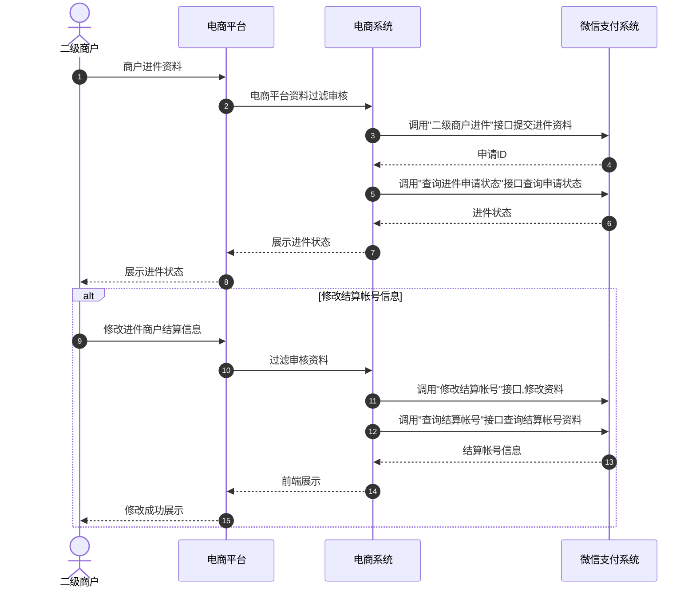

>更新时间：2026.06.16

## 1. 接口规则

为了在保证支付安全的前提下，带给商户简单、一致且易用的开发体验，我们推出了全新的微信支付APIv3接口。该版本API的具体规则请参考[APIv3接口规则](https://pay.weixin.qq.com/doc/v3/merchant/4012081606.md)。

## 2. 开发准备

### 2.1. 搭建和配置开发环境

开发者应当依据自身的编程语言来构建并配置相应的开发环境。

### 2.2. 业务开发配置-二级商户进件

1. 平台需确认是否已开通平台工具箱，详细可前往[平台收付通介绍](https://pay.wechatpay.cn/static/partner_ability/business_payment.shtml)查看。

2. 待进件的二级商户是否符合进件要求，相关要求可以前往[二级商户入驻介绍](https://pay.weixin.qq.com/doc/v3/partner/4012086891.md#2.1-%E4%BA%8C%E7%BA%A7%E5%95%86%E6%88%B7%E5%85%A5%E9%A9%BB)查看。


## 3. 快速接入

### 3.1. 业务流程图-二级商户进件



重要步骤说明：

步骤1 平台通过请求[二级商户进件](https://pay.weixin.qq.com/doc/v3/partner/4012713017.md)接口帮助二级商户提交商户进件资料。进件参数中包含了敏感信息参数，此类参数要求进行加密，详见 [接口规则](https://pay.weixin.qq.com/doc/v3/partner/4012081726.md)。

步骤2 提交进件资料后，平台需通过微信支付返回的微信支付申请单号和业务申请编号来请求[查询申请状态API](https://pay.weixin.qq.com/doc/v3/partner/4012691376.md)接口查询二级商户进件状态。

步骤3 进件成功后，若二级商户需修改结算账号时，平台可通过请求[修改商户结算账号API](https://pay.weixin.qq.com/doc/v3/partner/4012761138.md)接口来帮助二级商户修改账号信息。

步骤4 平台通过请求[查询商户结算账号API](https://pay.weixin.qq.com/doc/v3/partner/4012761142.md)接口来查询修改情况。

### 3.2. API接入-二级商户进件

本文档展示了如何使用微信支付服务端 SDK 快速接入平台收付通产品，完成与微信支付对接的部分。

注意

- 文档中的代码示例是用来阐述 API 基本使用方法，代码中的示例参数需替换成商户自己账号及请求参数才能跑通。

- 以下接入步骤仅提供参考，请商户结合自身业务需求进行评估、修改。


#### 3.2.1.【服务端】二级商户进件申请

步骤说明： 平台，可使用该接口，帮助其二级商户进件成为微信支付商户。

示例代码

JAVA

```
public void Applyments() throws Exception{
  //请求URL
  HttpPost httpPost = new HttpPost("https://api.mch.weixin.qq.com/v3/ecommerce/applyments/");
  // 请求body参数
  String reqdata = "{"
          + "\"organization_type\":\"2\","
          + "\"business_license_info\": {"
          + "\"business_license_copy\":\"47ZC6GC-vnrbEny__Ie_An5-tCpqxucuxi-vByf3Gjm7KE53JXvGy9tqZm2XAUf-4KGprrKhpVBDIUv0OF4wFNIO4kqg05InE4d2I6_H7I4\","
          + "\"business_license_number\":\"123456789012345678\","
          + "\"merchant_name\":\"腾讯科技有限公司\","
          + "\"legal_person\":\"张三\""
          + "},"
          + "\"organization_cert_info\": {"
          + "\"organization_copy\":\"47ZC6GC-vnrbEny__Ie_An5-tCpqxucuxi-vByf3Gjm7KE53JXvGy9tqZm2XAUf-4KGprrKhpVBDIUv0OF4wFNIO4kqg05InE4d2I6_H7I4\","
          + "\"organization_time\":\"[\"2014-01-01\","\"长期\"]\","
          + "\"organization_number\":\"12345679-A\""
          + "},"
          + "\"id_card_info\": {"
          + "\"id_card_copy\":\"jTpGmxUX3FBWVQ5NJTZvlKX_gdU4cRz7z5NxpnFuAxhBTEO_PvWkfSCJ3zVIn001D8daLC-ehEuo0BJqRTvDujqhThn4ReFxikqJ5YW6zFQ\","
          + "\"id_card_national\":\"47ZC6GC-vnrbEny__Ie_An5-tCpqxucuxi-vByf3Gjm7KE53JXvGy9tqZm2XAUf-4KGprrKhpVBDIUv0OF4wFNIO4kqg05InE4d2I6_H7I4\","
          + "\"id_card_name\":\"pVd1HJ6zyvPedzGaV+X3qtmrq9bb9tPROvwia4ibL+F6mfjbzQIzfb3HHLEjZ4YiR/cJiCrZxnAqi+pjeKIEdkwzXRAI7FUhrfPK3SNjaBTEu9GmsugMIA9r3x887Q+ODuC8HH2nzAn7NGpE/e3yiHgWhk0ps5k5DP/2qIdGdONoDzZelrxCl/NWWNUyB93K9F+C1JX2IMttdY+aQ6zBlw0xnOiNW6Hzy7UtC+xriudjD5APomty7/mYNxLMpRSvWKIjOv/69bDnuC4EL5Kz4jBHLiCyOb+tI0m2qhZ9evAM+Jv1z0NVa8MRtelw/wDa4SzfeespQO/0kjiwfqdfg==\","
          + "\"id_card_number\":\"UZFETyabYFFlgvGh6R4vTzDELiPas3jC94/srAbSaPaWSM+1rhGLcsybPLeJdVOpCeDxNBMDK+/N0nOiZZ4ka9+5RgzvA2rJx+NztYUbN209rq0Y/NP50T9yk0m6A4xUoFWgk/8qteRHtP5VHahNhSh8nHo31V33t8edSlN9HJG6diRj7p5JPImDyM1q56+p25edl3+cOtuZtj8TJDl/hB+GaWve9X1WUpkZbKlJgBxp+XhaW707k9XrILvfD+rSGTOeU/ev4/OiEb5W4WPGJ+3iLoQvhnz3+aQZX9+gn9uRzWcHu2Kr17fhsM+MRkgVcwzI2UqhR9iuGTunRPRVFg==\","
          + "\"id_card_valid_time\":\"2026-06-06\""
          + "},"
          + "\"need_account_info\":true,"
          + "\"account_info\": {"
          + "\"bank_account_type\":\"74\","
          + "\"account_name\":\"fTA4TXc8yMOwFCYeGPktOOSbOBei3KA8RAMO9h/5Y0ZMR46viedrDurCbQTC/sCC9BWuG5oeR8flymK/Z4dN0/7XDSDfqT5Nggq9WwTL+OZdMorqTE6Z0G3f3Bi3c+GVvYOCZyVdoinksPEUwyosEtwupM3ufXSZT36DvsS8K9jOBnIXjGaQtP94FFlh58WR0GuEkMt9KT2NuA+fE4KDScRzSZn3TL5Izdt+7anPS6Uh4K7wPnUWHGxCQdZu0G4B4YjP7ync8UeLu4jAkCziq4lngnU3rKfFiqwMtyOA179x15za7+kWmo2hfaC7xumTqXR7/NyRHpFKXURQFcmmw==\","
          + "\"account_bank\":\"工商银行\","
          + "\"bank_address_code\":\"110000\","
          + "\"bank_branch_id\":\"402713354941\","
          + "\"bank_name\":\"施秉县农村信用合作联社城关信用社\","
          + "\"account_number\":\"d+xT+MQCvrLHUVDWv/8MR/dB7TkXM2YYZlokmXzFsWs35NXUot7C0NcxIrUF5FnxqCJHkNgKtxa6RxEYyba1+VBRLnqKG2fSy/Y5qDN08Ej9zHCwJjq52Wg1VG8MRugli9YMI1fI83KGBxhuXyemgS/hqFKsfYGiOkJqjTUpgY5VqjtL2N4l4z11T0ECB/aSyVXUysOFGLVfSrUxMPZy6jWWYGvT1+4P633f+R+ki1gT4WF/2KxZOYmli385ZgVhcR30mr4/G3HBcxi13zp7FnEeOsLlvBmI1PHN4C7Rsu3WL8sPndjXTd75kPkyjqnoMRrEEaYQE8ZRGYoeorwC+w==\""
          + "},"
          + "\"contact_info\": {"
          + "\"contact_type\":\"65\","
          + "\"contact_name\":\"pVd1HJ6zyvPedzGaV+X3qtmrq9bb9tPROvwia4ibL+F6mfjbzQIzfb3HHLEjZ4YiR/cJiCrZxnAqi+pjeKIEdkwzXRAI7FUhrfPK3SNjaBTEu9GmsugMIA9r3x887Q+ODuC8HH2nzAn7NGpE/e3yiHgWhk0ps5k5DP/2qIdGdONoDzZelrxCl/NWWNUyB93K9F+jC1JX2IMttdY+aQ6zBlw0xnOiNW6Hzy7UtC+xriudjD5APomty7/mYNxLMpRSvWKIjOv/69bDnuC4EL5Kz4jBHLiCyOb+tI0m2qhZ9evAM+Jv1z0NVa8MRtelw/wDa4SzfeespQO/0kjiwfqdfg==\","
          + "\"contact_id_card_number\":\"UZFETyabYFFlgvGh6R4vTzDELiPas3jC94/srAbSaPaWSM+1rhGLcsybPLeJdVOpCeDxNBMDK+/N0nOiZZ4ka9+5RgzvA2rJx+NztYUbN209rq0Y/NP50T9yk0m6A4xUoFWgk/8qteRHtP5VHahNhSh8nHo31V33t8edSlN9HJG6diRj7p5JPImDyM1q56+p25edl3+cOtuZtj8TJDl/hB+GaWve9X1WUpkZbKlJgBxp+XhaW707k9XrILvfD+rSGTOeU/ev4/OiEb5W4WPGJ+3iLoQvhnz3+aQZX9+gn9uRzWcHu2Kr17fhsM+MRkgVcwzI2UqhR9iuGTunRPRVFg==\","
          + "\"mobile_phone\":\"Uy5Hb0c5Se/orEbrWze/ROHu9EPAs/CigDlJ2fnyzC1ppJNBOYGyc89xUgZZoPIRnPWsvJ5oevXNdBK3IUz9WHs9iQKpeUksvoLQMsykc8LDu7MMpayKWNVozldcRugH++MltTBKWTkv/oOcwkZattMGgP4CtpbN6djDK1PcAmIDgdFD2ZvCIDCtJg1V/YafUBJdBTvNLXa/jNzjZaypsUn1BRO6fx8aaNn7XyTv7JrfQZE4UDH4gfMFOj8YDqQ+IvDbkuNhaLZExOEz/UcnxeN5mfGr2MdkPrOzF+xJmUZUn1nafZxENrqcBszhYQUlu5zn6o2uZpBhAsQwd3QAjw==\","
          + "\"contact_email\":\"Uy5Hb0c5Se/orEbrWze/ROHu9EPAs/CigDlJ2fnyzC1ppJNBOYGyc89xUgZZoPIRnPWsvJ5oevXNdBK3IUz9WHs9iQKpeUksvoLQMsykc8LDu7MMpayKWNVozldcRugH++MltTBKWTkv/oOcwkZattMGgP4CtpbN6djDK1PcAmIDgdFD2ZvCIDCtJg1V/YafUBJdBTvNLXa/jNzjZaypsUn1BRO6fx8aaNn7XyTv7JrfQZE4UDH4gfMFOj8YDqQ+IvDbkuNhaLZExOEz/UcnxeN5mfGr2MdkPrOzF+xJmUZUn1nafZxENrqcBszhYQUlu5zn6o2uZpBhAsQwd3QAjw==\""
          + "},"
          + "\"sales_scene_info\": {"
          + "\"store_name\":\"爱烧烤\","
          + "\"store_url\":\"http://www.qq.com\","
          + "\"store_qr_code\":\"jTpGmxUX3FBWVQ5NJTZvlKX_gdU4cRz7z5NxpnFuAxhBTEO_PvWkfSCJ3zVIn001D8daLC-ehEuo0BJqRTvDujqhThn4ReFxikqJ5YW6zFQ\""
          + "},"
          + "\"merchant_shortname\":\"爱烧烤\","
          + "\"out_request_no\":\"APPLYMENT_00000000001\","
          + "\"qualifications\":\"[\"jTpGmxUX3FBWVQ5NJTZvlKX_gdU4cRz7z5NxpnFuAxhBTEO_PvWkfSCJ3zVIn001D8daLC-ehEuo0BJqRTvDujqhThn4ReFxikqJ5YW6zFQ\","\"47ZC6GC-vnrbEny__Ie_An5-tCpqxucuxi-vByf3Gjm7KE53JXvGy9tqZm2XAUf-4KGprrKhpVBDIUv0OF4wFNIO4kqg05InE4d2I6_H7I4"]\","
          + "\"business_addition_pics\":\"["jTpGmxUX3FBWVQ5NJTZvlKX_gdU4cRz7z5NxpnFuAxhBTEO_PvWkfSCJ3zVIn001D8daLC-ehEuo0BJqRTvDujqhThn4ReFxikqJ5YW6zFQ","47ZC6GC-vnrbEny__Ie_An5-tCpqxucuxi-vByf3Gjm7KE53JXvGy9tqZm2XAUf-4KGprrKhpVBDIUv0OF4wFNIO4kqg05InE4d2I6_H7I4"]\","
          + "\"business_addition_desc\":\"特殊情况，说明原因\""
          + "}";
  StringEntity entity = new StringEntity(reqdata,"utf-8");
  entity.setContentType("application/json");
  httpPost.setEntity(entity);
  httpPost.setHeader("Accept", "application/json");
  //完成签名并执行请求
  CloseableHttpResponse response = httpClient.execute(httpPost);
  try {
      int statusCode = response.getStatusLine().getStatusCode();
      if (statusCode == 200) { //处理成功
          System.out.println("success,return body = " + EntityUtils.toString(response.getEntity()));
      } else if (statusCode == 204) { //处理成功，无返回Body
          System.out.println("success");
      } else {
          System.out.println("failed,resp code = " + statusCode+ ",return body = " + EntityUtils.toString(response.getEntity()));
          throw new IOException("request failed");
      }
  } finally {
      response.close();
  }
}
```

PHP

```
try {
    $resp = $client-request(
        'POST',
        'https://api.mch.weixin.qq.com/v3/ecommerce/applyments/', //请求URL
        [
            // JSON请求体
            'json' = [
                "organization_type" = "2",
                "business_license_info" = [
                    "business_license_copy" = "47ZC6GC-vnrbEny__Ie_An5-tCpqxucuxi-vByf3Gjm7KE53JXvGy9tqZmAUf-4KGprrKhpVBDIUv0OF4wFNIO4kqg05InE4d2I6_H7I4",
                    "business_license_number" = "123456789012345678",
                    "merchant_name" = "腾讯科技有限公司",
                    "legal_person" = "张三",
                ],
                "organization_cert_info" = [
                    "organization_copy" = "47ZC6GC-vnrbEny__Ie_An5-tCpqxucuxi-vByf3Gjm7KE53JXvGy9tqZm2XAUf-4KprrKhpVBDIUv0OF4wFNIO4kqg05InE4d2I6_H7I4",
                    "organization_time" = [
                        "0" = "2014-01-01",
                        "1" = "长期",
                    ],
                    "organization_number" = "12345679-A",
                ],
                "id_card_info" = [
                    "id_card_copy" = "jTpGmxUX3FBWVQ5NJTZvlKX_gdU4cRz7z5NxpnFuAxhBTEO_PvWkfSCJ3zVIn001D8daLC-ehEuo0BJqRTvDujqhThn4ReFxikqJ5YW6zFQ",
                    "id_card_national" = "47ZC6GC-vnrbEny__Ie_An5-tCpqxucuxi-vByf3Gjm7KE53JXvGy9tqZm2XAUf-4KGprKhpVBDIUv0OF4wFNIO4kqg05InE4d2I6_H7I4",
                    "id_card_name" = "pVd1HJ6zyvPedzGaV+X3qtmrq9bb9tPROvwia4ibL+F6mfjbQIzfb3HHLEjZ4YiR/cJiCrZxnAqi+pjeKIEdkwzXRAI7FUhrPK3SNjaBTEu9GmsugMIA9r3x887Q+ODuC8HH2nzAn7NGpE/e3yiHgWhk0ps5k5DP/2qIdGONoDzZelrxCl/NWWNUyB93K9F+jC1JX2IMttdY+aQ6zBlw0nOiNW6Hzy7UtC+xriudjD5APomty7/mYNxLMpRSvWKIjOv/69bDnuC4EL5Kz4jBHLiCyOb+t0m2qhZ9evAM+Jv1z0NVa8MRtelw/wDa4SzfeespQO/0kjiwfqdfg==",
                    "id_card_number" = "UZFETyabYFFlgvGh6R4vTzDELiPas3jC94/srAbSaPaWSM+1rhLcsybPLeJdVOpCeDxNBMDK+/N0nOiZZ4ka9+5RgzvA2rJx+NztYUbN09rq0Y/NP50T9yk0m6A4xUoFWgk/8qteRHtP5VHahNhSh8nHo31V33t8edSlN9HJG6diRj75JPImDyM1q56+p25edl3+cOtuZtj8TJDl/hB+GaWve9X1WUpkZbKlJgBp+XhaW707k9XrILvfD+rSGTOeU/ev4/OiEb5W4WPGJ+3iLoQvhnz3+aQZX9+gn9uRzcHu2Kr17fhsM+MRkgVcwzI2UqhR9iuGTunRPRVFg==",
                    "id_card_valid_time" = "2026-06-06",
                ],
                "need_account_info" = true,
                "account_info" = [
                    "bank_account_type" = "74",
                    "account_name" = "fTA4TXc8yMOwFCYeGPktOOSbOBei3KA8RAMO9h/5Y0ZM46viedrDurCbQTC/sCC9BWuG5oeR8flymK/Z4dN0/7XDSDfqT5Nggq9WwTL+OdMorqTE6Z0G3f3Bi3c+GVvYOCZyVdoinksPEUwyosEtwupM3ufXSZT36DvsS8K9jOBnIjGaQtP94FFlh58WR0GuEkMt9KT2NuA+fE4KDScRzSZn3TL5Izdt+7anPS6h4K7wPnUWHGxCQdZu0G4B4YjP7ync8UeLu4jAkCziq4lngnU3rKfFiqwMtyOA19x15za7+kWmo2hfaC7xumTqXR7/NyRHpFKXURQFcmmw==",
                    "account_bank" = "工商银行",
                    "bank_address_code" = "110000",
                    "bank_branch_id" = "402713354941",
                    "bank_name" = "施秉县农村信用合作联社城关信用社",
                    "account_number" = "d+xT+MQCvrLHUVDWv/8MR/dB7TkXM2YYZlokmXzFsWs35NXUot7C0NxIrUF5FnxqCJHkNgKtxa6RxEYyba1+VBRLnqKG2fSy/Y5qDN08Ej9zHCwJjq52Wg1VG8MRgli9YMI1fI83KGBxhuXyemgS/hqFKsfYGiOkJqjTUpgY5VqjtL2N4l4z11T0EB/aSyVXUysOFGLVfSrUxMPZy6jWWYGvT1+4P633f+R+ki1gT4WF/2KxZOYmli38ZgVhcR30mr4/G3HBcxi13zp7FnEeOsLlvBmI1PHN4C7Rsu3WL8sPndjXTd75kPkyjqnoMRrEEaYQE8ZRGYoeorwC+w==",
                ],
                "contact_info" = [
                    "contact_type" = "65",
                    "contact_name" = "pVd1HJ6zyvPedzGaV+X3qtmrq9bb9tPROvwia4ibL+F6mfjbzQIzfb3HHLEjZ4YiR/cJiCrZxnAqi+pjeKIEdkwzXRAI7FUhrfPK3SNjaBTEu9GmsugMIA9r3x87Q+ODuC8HH2nzAn7NGpE/e3yiHgWhk0ps5k5DP/2qIdGdONoDzZelrxCl/NWWNUyB93K9F+C1JX2IMttdY+aQ6zBlw0xnOiNW6Hzy7UtC+xriudjD5APomty7/mYNxLMpRSvWKIjO/69bDnuC4EL5Kz4jBHLiCyOb+tI0m2qhZ9evAM+Jv1z0NVa8MRtelw/wDa4SzfeespQO/0kjiwfqdfg==",
                    "contact_id_card_number" = "UZFETyabYFFlgvGh6R4vTzDELiPas3jC94/srAbSaPaSM+1rhGLcsybPLeJdVOpCeDxNBMDK+/N0nOiZZ4ka9+5RgzvA2rJx+NztYUb209rq0Y/NP50T9yk0m6A4xUoFWgk/8qteRHtP5VHahNhSh8nHo31V33t8edSlN9HJG6diRj7pJPImDyM1q56+p25edl3+cOtuZtj8TJDl/hB+GaWve9X1WUpkZbKlJgBxp+Xha707k9XrILvfD+rSGTOeU/ev4/OiEb5W4WPGJ+3iLoQvhnz3+aQZX9+gn9uRWcHu2Kr17fhsM+MRkgVcwzI2UqhR9iuGTunRPRVFg==",
                    "mobile_phone" = "Uy5Hb0c5Se/orEbrWze/ROHu9EPAs/CigDlJ2fnyzC1ppJNBOYGy9xUgZZoPIRnPWsvJ5oevXNdBK3IUz9WHs9iQKpeUksvoLQMsykc8LDMMpayKWNVozldcRugH++MltTBKWTkv/oOcwkZattMGgP4CtpbN6djDK1PcAmIDgdFD2ZvCIDCt1V/YafUBJdBTvNLXa/jNzjZaypsUn1BRO6fx8aaNn7XyTv7JrfQZEDH4gfMFOj8YDqQ+IvDbkuNhaLZExOEz/UcnxeN5mfGr2MdkPzF+xJmUZUn1nafZxENrqcBszhYQUlu5zn6o2uZpBhAsQwd3QAjw==",
                    "contact_email" = "Uy5Hb0c5Se/orEbrWze/ROHu9EPAs/CigDlJ2fnyzC1ppJNBOyc89xUgZZoPIRnPWsvJ5oevXNdBK3IUz9WHs9iQKpeUksvoLQMsykc8LDu7MMpaWNVozldcRugH++MltTBKWTkv/oOcwkZattMGgP4CtpbN6djDK1PcAmIDgdFD2ZvCIDCtJg1YafUBJdBTvNLXa/jNzjZaypsUn1BRO6fx8aaNn7XyTv7JrfQZE4UDH4gfMFOj8YQ+IvDbkuNhaLZExOEz/UcnxeN5mfGr2MdkPrOzF+xJmUZUn1nafZxENrqcBszhYQUlu5zn6o2uZpBhAsQwd3QAjw==",
                ],
                "sales_scene_info" = [
                    "store_name" = "爱烧烤",
                    "store_url" = "http://www.qq.com",
                    "store_qr_code" = "jTpGmxUX3FBWVQ5NJTZvlKX_gdU4cRz7z5NxpnFuAxhBTEO_PvWkfSCJ3In001D8daLC-ehEuo0BJqRTvDujqhThn4ReFxikqJ5YW6zFQ",
                ],
                "merchant_shortname" = "爱烧烤",
                "out_request_no" = "APPLYMENT_00000000001",
                "qualifications" = [
                    "0" = "jTpGmxUX3FBWVQ5NJTZvlKX_gdU4cRz7z5NxpnFuAxhBTEO_PvWkfSCJ3zn001D8daLC-ehEuo0BJqRTvDujqhThn4ReFxikqJ5YW6zFQ","4C6GC-vnrbEny__Ie_An5-tCpqxucuxi-vByf3Gjm7KE53JXvGy9tqZm2XAUfKGprrKhpVBDIUv0OF4wFNIO4kqg05InE4d2I6_H7I4",
                ],
                "business_addition_pics" = [
                    "0" = "jTpGmxUX3FBWVQ5NJTZvlKX_gdU4cRz7z5NxpnFuAxhBTEO_PvWkfSCJ3zVIn001D8daLC-ehEuo0BJqRTvDujqhThn4ReFxikqJ5YW6zFQ","47ZC6GC-vnrbEny__Ie_An5-tCpqxucuxi-vByf3Gjm7KE53JXvGy9tqZm2XAUf-4KGprrKhpVBDIUv0OF4wFNIO4kqg05InE4d2I6_H7I4",
                ],
                "business_addition_desc" = "特殊情况，说明原因",
            ],
            'headers' = [ 'Accept' = 'application/json' ]
        ]
    );
    $statusCode = $resp-getStatusCode();
    if ($statusCode == 200) { //处理成功
        echo "success,return body = " . $resp-getBody()-getContents()."\n";
    } else if ($statusCode == 204) { //处理成功，无返回Body
        echo "success";
    }
} catch (RequestException $e) {
    // 进行错误处理
    echo $e-getMessage()."\n";
    if ($e-hasResponse()) {
        echo "failed,resp code = " . $e-getResponse()-getStatusCode() . " return body = " . $e-getResponse()-getBody() . "\n";
    }
    return;
}
```

更多参数、响应详情及错误码请参见[二级商户进件申请API](https://pay.weixin.qq.com/doc/v3/partner/4012713017.md)接口文档。

#### 3.2.2.【服务端】查询进件申请状态

步骤说明： 平台，可使用该接口，帮助其二级商户查询进件状态。

示例代码

JAVA

```
public void QueryApplyments() throws Exception{
  //请求URL
  HttpGet httpGet = new HttpGet("https://api.mch.weixin.qq.com/v3/ecommerce/applyments/out-request-no/APPLYMENT_00000000001");
  httpGet.setHeader("Accept", "application/json");
  //完成签名并执行请求
  CloseableHttpResponse response = httpClient.execute(httpGet);
  try {
      int statusCode = response.getStatusLine().getStatusCode();
      if (statusCode == 200) { //处理成功
          System.out.println("success,return body = " + EntityUtils.toString(response.getEntity()));
      } else if (statusCode == 204) { //处理成功，无返回Body
          System.out.println("success");
      } else {
          System.out.println("failed,resp code = " + statusCode+ ",return body = " + EntityUtils.toString(response.getEntity()));
          throw new IOException("request failed");
      }
  } finally {
      response.close();
  }
}
```

PHP

```
try {
    $resp = $client-request(
        'GET',
        'https://api.mch.weixin.qq.com/v3/ecommerce/applyments/out-request-no/APPLYMENT_00000000001', //请求URL
        [
            'headers' = [ 'Accept' = 'application/json']
        ]
    );
    $statusCode = $resp-getStatusCode();
    if ($statusCode == 200) { //处理成功
        echo "success,return body = " . $resp-getBody()-getContents()."\n";
    } else if ($statusCode == 204) { //处理成功，无返回Body
        echo "success";
    }
} catch (RequestException $e) {
    // 进行错误处理
    echo $e-getMessage()."\n";
    if ($e-hasResponse()) {
        echo "failed,resp code = " . $e-getResponse()-getStatusCode() . " return body = " . $e-getResponse()-getBody() . "\n";
    }
    return;
}
```

更多参数、响应详情及错误码请参见[查询进件申请状态API](https://pay.weixin.qq.com/doc/v3/partner/4012691376.md)接口文档。

#### 3.2.3.【服务端】修改结算账号

步骤说明： 二级商户结算账号错误或者变更，平台可通过该接口进行修改。

示例代码

JAVA

```
public void UpdataSettlement() throws Exception{
  //请求URL
  HttpPost httpPost = new HttpPost("https://api.mch.weixin.qq.com/v3/apply4sub/sub_merchants/{sub_mchid}/modify-settlement");
  // 请求body参数
  String reqdata = "{"
          + "\"account_type\":\"ACCOUNT_TYPE_BUSINESS\","
          + "\"account_bank\":\"工商银行\","
          + "\"bank_address_code\":\"110000\","
          + "\"bank_name\":\"施秉县农村信用合作联社城关信用社\","
          + "\"bank_branch_id\":\"402713354941\","
          + "\"account_number\":\"d+xT+MQCvrLHUVDWv/8MR/dB7TkXM2YYZlokmXzFsWs35NXUot7C0NcxIrUF5FnxqCJHkNgtxa6RxEYyba1+VBRLnqKG2fSy/Y5qDN08Ej9zHCwJjq52Wg1VG8MRugli9YMI1fI83KGBxhuXyemgS/hqFKsfYGiOJqjTUpgY5VqjtL2N4l4z11T0ECB/aSyVXUysOFGLVfSrUxMPZy6jWWYGvT1+4P633f+R+ki1gT4WF/2KxZOYmi385ZgVhcR30mr4/G3HBcxi13zp7FnEeOsLlvBmI1PHN4C7Rsu3WL8sPndjXTd75kPkyjqnoMRrEEaQE8ZRGYoeorwC+w==\""
          + "}";
  StringEntity entity = new StringEntity(reqdata,"utf-8");
  entity.setContentType("application/json");
  httpPost.setEntity(entity);
  httpPost.setHeader("Accept", "application/json");
  //完成签名并执行请求
  CloseableHttpResponse response = httpClient.execute(httpPost);
  try {
      int statusCode = response.getStatusLine().getStatusCode();
      if (statusCode == 200) { //处理成功
          System.out.println("success,return body = " + EntityUtils.toString(response.getEntity()));
      } else if (statusCode == 204) { //处理成功，无返回Body
          System.out.println("success");
      } else {
          System.out.println("failed,resp code = " + statusCode+ ",return body = " + EntityUtils.toString(response.getEntity()));
          throw new IOException("request failed");
      }
  } finally {
      response.close();
  }
}
```

PHP

```
try {
    $resp = $client-request(
        'POST',
        'https://api.mch.weixin.qq.com/v3/apply4sub/sub_merchants/{sub_mchid}/modify-settlement', //请求URL
        [
            // JSON请求体
            'json' = [
                "account_type" = "ACCOUNT_TYPE_BUSINESS",
                "account_bank" = "工商银行",
                "bank_address_code" = "110000",
                "bank_name" = "施秉县农村信用合作联社城关信用社",
                "bank_branch_id" = "402713354941",
                "account_number" = "d+xT+MQCvrLHUVDWv/8MR/dB7TkXM2YYZlokmXzFsWs35NXUot7C0NcxIrUF5FnxqCJHkNg
Ktxa6RxEYyba1+VBRLnqKG2fSy/Y5qDN08Ej9zHCwJjq52Wg1VG8MRugli9YMI1fI83KGBxhuXyemgS/hqFKsfYGiO
kJqjTUpgY5VqjtL2N4l4z11T0ECB/aSyVXUysOFGLVfSrUxMPZy6jWWYGvT1+4P633f+R+ki1gT4WF/2KxZOYm
li385ZgVhcR30mr4/G3HBcxi13zp7FnEeOsLlvBmI1PHN4C7Rsu3WL8sPndjXTd75kPkyjqnoMRrEEa
YQE8ZRGYoeorwC+w==",
            ],
            'headers' = [ 'Accept' = 'application/json' ]
        ]
    );
    $statusCode = $resp-getStatusCode();
    if ($statusCode == 200) { //处理成功
        echo "success,return body = " . $resp-getBody()-getContents()."\n";
    } else if ($statusCode == 204) { //处理成功，无返回Body
        echo "success";
    }
} catch (RequestException $e) {
    // 进行错误处理
    echo $e-getMessage()."\n";
    if ($e-hasResponse()) {
        echo "failed,resp code = " . $e-getResponse()-getStatusCode() . " return body = " . $e-getResponse()-getBody() . "\n";
    }
    return;
}
```

更多参数、响应详情及错误码请参见[修改结算账号API](https://pay.weixin.qq.com/doc/v3/partner/4012761138.md)接口文档。

#### 3.2.4.【服务端】查询结算账号

步骤说明： 平台可使用该接口，帮助其二级商户查询结算账号。

示例代码

JAVA

```
public void GetSettlement() throws Exception{
  //请求URL
  HttpGet httpGet = new HttpGet("https://api.mch.weixin.qq.com/v3/apply4sub/sub_merchants/1900006491/settlement");
  httpGet.setHeader("Accept", "application/json");
  //完成签名并执行请求
  CloseableHttpResponse response = httpClient.execute(httpGet);
  try {
      int statusCode = response.getStatusLine().getStatusCode();
      if (statusCode == 200) { //处理成功
          System.out.println("success,return body = " + EntityUtils.toString(response.getEntity()));
      } else if (statusCode == 204) { //处理成功，无返回Body
          System.out.println("success");
      } else {
          System.out.println("failed,resp code = " + statusCode+ ",return body = " + EntityUtils.toString(response.getEntity()));
          throw new IOException("request failed");
      }
  } finally {
      response.close();
  }
}
```

PHP

```
try {
    $resp = $client-request(
        'GET',
        'https://api.mch.weixin.qq.com/v3/apply4sub/sub_merchants/1900006491/settlement', //请求URL
        [
            'headers' = [ 'Accept' = 'application/json']
        ]
    );
    $statusCode = $resp-getStatusCode();
    if ($statusCode == 200) { //处理成功
        echo "success,return body = " . $resp-getBody()-getContents()."\n";
    } else if ($statusCode == 204) { //处理成功，无返回Body
        echo "success";
    }
} catch (RequestException $e) {
    // 进行错误处理
    echo $e-getMessage()."\n";
    if ($e-hasResponse()) {
        echo "failed,resp code = " . $e-getResponse()-getStatusCode() . " return body = " . $e-getResponse()-getBody() . "\n";
    }
    return;
}
```

更多参数、响应详情及错误码请参见[查询结算账号API](https://pay.weixin.qq.com/doc/v3/partner/4012761142.md)接口文档。