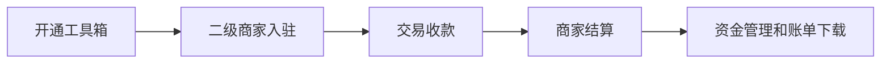
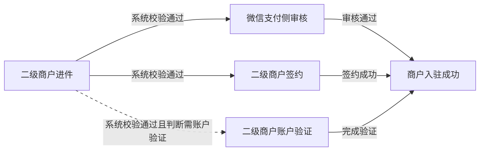
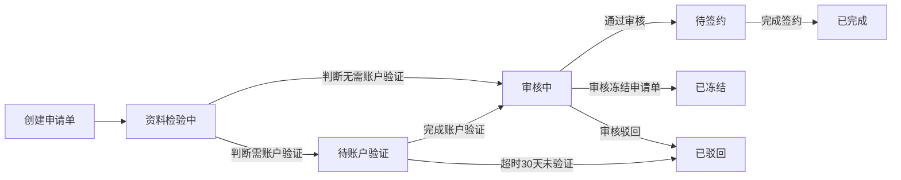
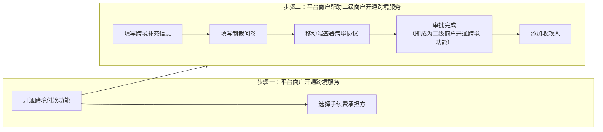

>更新时间：2026.10.20

## 1. 平台收付通产品开通步骤

1、先入驻成为普通服务商，参考[服务商入驻指引](https://kf.qq.com/faq/161220iqeAfA1612202yeURB.html)；

2、再开通平台收付通工具箱，参考下方3.1、开通工具箱（平台收付通工具箱只是一种产品能力，开通后不会有单独商户号）。

## 2. 申请参数

在发起接口请求时，开发者还需获取必要参数，如平台商户号、sp\_appid、证书私钥、公钥等，获取方式详见：[开发必要参数说明](https://pay.weixin.qq.com/doc/v3/partner/4013080340.md)。

## 3. 平台接入指引

平台接入流程示意图：

### 3.1. 开通并配置工具箱

#### 3.1.1. 开通工具箱

平台入驻微信支付平台，在微信支付后台的合作工具箱中找到平台收付通，签署协议后进行申请开通。

开通流程：

1. 提交平台信息和资质材料

2. 微信支付进行平台资质审核

3. 审核通过后，微信支付会根据申请单中的平台行业和经营场景自动开通对应的产品能力

开通支付能力

平台收付通审核通过后，系统会根据平台申请时选择的经营场景自动开通对应的支付能力。

开发者无需单独申请支付产品权限。平台当前支持以下经营场景及对应支付能力：

| 经营场景 | 对应支付能力 | 说明 |
| --- | --- | --- |
| 小程序 | 小程序支付 | 在小程序内发起支付 |
| 公众号 | JSAPI支付 | 在公众号内完成支付 |
| PC网站 | H5支付/Native支付 | H5支付仅支持用户通过手机浏览器访问PC网站中的H5页面时使用 Native支付适用于PC网站场景 |
| APP | APP支付 | 在移动App内调起微信支付 |

平台可根据自身业务场景接入对应支付能力。

开通须知

1. 开通平台收付通产品前，需确保在普通服务商模式下没有已经入驻或处于入驻流程中的子商户。

2. 因平台特殊性，平台将默认关闭平台商户号非必要权限。

3. 开通时可以选择支付手续费由平台承担或者二级商户承担，当由平台承担手续费时，微信支付将给平台开具发票。

平台承担手续费时，将默认开通手续费账户，平台需确保手续费账户余额充足，否则将影响正常结算。

#### 3.1.2. 配置工具箱

开通平台收付通后，平台需要完成商户号和当前电商业务主要场景（如公众号、小程序、App）AppID的线上绑定，方可进行下一步接口对接。

平台收付通模式下支付产品随经营场景自动开通，无需在微信支付产品中心单独申请支付产品。

如果平台在后续业务发展中新增交易场景，无需重新申请微信支付产品权限。平台只需在收付通产品配置页新增经营场景即可。

操作路径：我的工具箱 → 平台收付通 → 产品配置页 → 新增经营场景

提交新增场景申请并完成审核后，系统将自动为平台开通对应的支付能力，并且完成存量商户和新增商户的授权。

所有支付能力管理均在收付通产品配置页完成。

### 3.2. 商户进件

#### 3.2.1. 业务规则

仅支持平台（已开通电商工具箱）使用本接口。

支持进件的商户类型如下所示：

| 类型 | 定义 | 所需资料 |
| --- | --- | --- |
| 小微 | 无营业执照、免办理工商注册登记的商户 | 需提供小微经营者的个人身份证 |
| 个人卖家 | 无营业执照，已持续从事电子商务经营活动满6个月，且期间经营收入累计超过20万元的个人商家（平台需核实已满足上述条件） | 需提供个人卖家的个人身份证 |
| 个体工商户 | 营业执照上的主体类型一般为个体户、个体工商户、个体经营 | 需提供营业执照、经营者证件 |
| 企业 | 营业执照上的主体类型一般为有限公司、有限责任公司 | 需提供营业执照、法人证件、组织机构代码证（未三证合一提供） |
| 党政、机关及事业单位 | 包括国内各级、各类政府机构、事业单位等。如：公安、党团、司法、交通、旅游、工商税务、市政、医疗、教育、学校等机构 | 需提供登记证书、法人证件、组织机构代码证（未三证合一提供） |
| 其他组织 | 不属于企业、政府/事业单位的组织机构，如社会团体、民办非企业、基金会。要求机构已办理组织机构代码证。 | 需提供登记证书、法人证件、组织机构代码证（未三证合一提供） |

提示

- 小微主体

  - 正常日收款额度为10万，若交易良好则自动提升至20-30万/日，若交易异常则自动下降至5万以下/日。

  - 用户使用信用卡向商户付款，单日收款不超过1千，单月收款不超过1万。
- 个人卖家

  - 正常日收款额度为200万，若交易良好则自动提升额度，若交易异常则下降额度；

  - 无信用卡收款额度限制。
- 其他主体类型，没有收款额度限制

#### 3.2.2. 入驻流程

环节说明

审核、签约、账户验证，为三个并行流程。

1. 审核：指微信支付审核申请单资料，1-3个工作日完成；

2. 账户验证：指判断指定条件的商家，需通过指定方式核实开户意愿，详情可看下文。

3. 签约：指商家超级管理员，使用微信打开指定页面，核实签约。

完成上述三个环节，即完成入驻。

最佳实践指引

平台API[创建申请单](https://pay.weixin.qq.com/doc/v3/partner/4012713017.md)后，可等待3秒后，通过查询申请状态API 获取签约链接及账户验证信息（部分商户需验证），立即指引商家完成签约及账户验证，后续等待审核通过即完成入驻。

电商二级商户进件申请单-状态流转：

##### 3.2.2.1. 提交进件申请

- 平台需使用[二级商户进件API](https://pay.weixin.qq.com/doc/v3/partner/4012713017.md)，提交二级商户资料，创建入驻申请单。创建后，系统会在3s内完成基本资料校验。（即“资料校验中”状态，包括：公司名称，法人资料等校验）。

- 创建申请单后，可通过[查询申请状态API](https://pay.weixin.qq.com/doc/v3/partner/4012691469.md)，根据【applyment\_state 申请单状态】和【sign\_state 签约状态】做对应处理。

##### 3.2.2.2. 查询签约链接

###### 3.2.2.2.1. 签约方式

方式一：根据字段【签约状态 sign\_state】判断 （推荐，可极大提高入驻转化率及缩短耗时）。

1. 提交申请单后（约3秒），可查询字段【sign\_state 签约状态】为“未签约”时，则可查询获取签约链接，引导商户的超级管理员完成签约。

   说明：【applyment\_state 申请单状态】为“待账户验证，审核中，待签约”时，【签约状态】可能为“未签约” or “已签约”。

2. 商户完成签约操作后，可查询字段【签约状态】为“已签约”，则商户已完成签约。完成账户验证及审核通过后，则申请单自动扭转为“已完成”状态，并完成入驻流程。

3. 若已签约，然后申请单被驳回，商户修改以下资料，则需重新签约，字段【签约状态】变为 “未签约”

   - 商户主体名称、法人名称；

   - 主体类型；

   - 超级管理员姓名、证件号码；
4. 若查询字段“签约状态”为“不可签约”，则不返回签约链接。

说明：【申请单状态】为“机器校验中，已驳回，已冻结”，则【签约状态】为“不可签约”；

方式二：根据字段【applyment\_state 申请单状态】判断。

- 当申请单状态为“待签约”时，平台需指引二级商户，完成签约。

###### 3.2.2.2.2. 签约逻辑说明

1. 需由管理员进行签约，校验扫码的微信号-绑定银行卡实名信息（姓名+身份证号），是否与申请单-管理员信息（姓名+身份证号）一致。

2. 超级管理员，在签约页面，可查看《微信支付服务协议（平台二级商户）》。

3. 同一服务商下，一个微信号可进件5个小微及个人卖家。

###### 3.2.2.2.3. 判断是否需账户验证

| 主体类型 | 超级管理员身份 | 账户验证方式 |
| --- | --- | --- |
| 小微/个人卖家 | 法人/经营者 | 无需验证，直接进入“审核中”状态 |
| 个体工商户 / 企业 | 法人/经营者 | 无需验证，直接进入“审核中”状态 |
| 个体工商户 / 企业 | 负责人 | 需账户验证，进入“待账户验证”状态 |
| 党政、机关及事业单位 /其他组织 | 法人/经营者 | 需账户验证，进入“待账户验证”状态 |
| 党政、机关及事业单位 /其他组织 | 负责人 | 需账户验证，进入“待账户验证”状态 |

###### 3.2.2.2.4. 二级商户账户验证

当申请单状态为“待账户验证”时，平台需指引二级商户，完成账户验证。

| 类型 | 定义 | 所需资料 |
| --- | --- | --- |
| 个体工商户 / 企业 | 法人/经营者 | 无需账户验证 |
| 个体工商户 / 企业 | 负责人 | 支持以下方式二选一： 1、汇款验证：商户使用指定户名的银行账户，汇款指定金额至财付通指定银行账户，完成验证。（30天有效期） 2、法人扫码：法人微信扫码，完成验证。（需系统校验通过才支持该验证方式，30天效期） |
| 党政、机关及事业单位 /其他组织 | 法人/经营者 | 汇款验证：商户使用指定户名的银行账户，汇款指定金额至财付通指定银行账户，完成验证。（30天有效期） |
| 党政、机关及事业单位 /其他组织 | 负责人 | 汇款验证：商户使用指定户名的银行账户，汇款指定金额至财付通指定银行账户，完成验证。（30天有效期） |

说明

- 账户验证有效期，可通过[《查询申请状态API》](https://pay.weixin.qq.com/doc/v3/partner/4012691469.md)，查看“汇款截止时间”（account\_validation/ deadline）。

- 30天内未完成验证，将自动驳回申请单。

- 若未超过30天，申请单被审核驳回，二级商户可继续进行验证，完成账户验证流程。再次提交申请单，则直接进入“审核中”状态。

- 商户汇款后，请等待1-2天，具体以银行到账时间为准。汇款金额，系统会自动退款至商户的汇款银行账户。

###### 3.2.2.2.5. 微信支付审核

当申请单状态为“审核中”时，1-3个工作日内，完成审核，请等待审核结果。

###### 3.2.2.2.6. 签约说明

当申请单状态为“已完成”时，则申请单完成入驻。平台可通过[查询申请状态API](https://pay.weixin.qq.com/doc/v3/partner/4012691469.md)，查看获取二级商户号。

###### 3.2.2.2.7. 验证结算银行信息

1. 完成入驻后，若申请单填写了结算银行信息，则商户发起第一笔交易后，微信支付会汇款0.01元至该银行卡，确认该银行信息是否正确。

2. 平台可通过“[查询结算账户API](https://pay.weixin.qq.com/doc/v3/partner/4012761142.md)”，查询汇款验证结果，若汇款失败则建议指引二级商户修改结算银行卡。

提示

- 当前仅验证失败时，API返回结果，可每隔1天查询一次，查询3天即可。

### 3.3. 交易收款与退款

平台收付通提供合单/普通支付能力。

合单支付适用于购物车场景的平台，合单支付支持1-50个二级商户的订单一次性同时完成支付。

普通支付适用电商SAAS类服务商，每个二级商户有单独的小店（单独小程序），无跨多店合并支付的场景。

当交易发生一段时间内（一年内），由于买家或者卖家原因需要退款时，二级商户可以通过平台发起订单退款，查询退款状态。

### 3.4. 二级商户结算

基于平台对于二级商户实现账期和平台抽佣、分润等诉求，平台收付通提供分账能力。

二级商户发起交易时，可授权平台传入订单需要分账的标识，交易资金进入二级商户账户并处于冻结状态（默认冻结180天）；平台向微信支付发起分账指令，微信支付根据指令对指定交易订单进行分账处理，并进行交易资金解冻，从而实现二级商户的账期和抽佣、分润等场景；（默认最高分账比例30%）支持一笔订单多次分账，同时支持分账回退功能。

对于平台营销补贴的场景，支持平台补贴资金转入二级商户账户后，再进行统一分账。

### 3.5. 二级商户成为跨境商户

#### 3.5.1. 申请资质

- 需为境内企业

- 需为企业类型商户

- 需在商户在海关总署上【经营类别】显示为：进出口货物收发货人

- 注意：1) 一个二级商户号最多可有一个流程中的入驻申请单；2) 跨境权限需“超管”角色申请，跨境商户入驻可由“超管”及“管理员”角色申请

#### 3.5.2. 审核时效

- 跨境商户入驻：6-7个工作日

- 收款人信息管理：3-5个工作日

#### 3.5.3. 申请流程总览

#### 3.5.4. 步骤一 平台商户开通跨境服务

平台商户开通跨境服务入口：[微信支付 \- 中国领先的第三方支付平台 ｜ 微信支付提供安全快捷的支付方式](https://pay.weixin.qq.com/index.php/core/home/login)

#### 3.5.5. 步骤二 平台商户帮助二级商户开通跨境服务

平台商户帮助二级商户开通跨境服务入口[微信支付 \- 中国领先的第三方支付平台 ｜ 微信支付提供安全快捷的支付方式](https://pay.weixin.qq.com/index.php/core/home/login)

0）所需信息总览

1）填写跨境补充信息

2）填写制裁问卷

3）移动端签署跨境协议

4）审批完成，即成功为二级商户开通跨境功能

5）查看/编辑跨境商户信息

- 状态操作说明：

  - 审批完成、审批中和签约中信息不支持编辑，仅支持查看

  - 审批驳回、签约失败信息支持编辑和查看

如有其他问题，请扫描下方二维码联系客服人员咨询

### 3.6. 资金管理和账单下载

为了便于二级商户资金管理和对账，二级商户可通过平台的对接系统进行微信支付账户余额查询和提现。同时平台收付通也提供账单下载能力。

注意

二级商户可通过该接口进行微信支付账户余额提现，不建议平台利用限制提现进行账期控制，特殊情况下商户可直接到微信支付进行提现，故而造成账期控制无效，账期控制详见分账介绍。

## 4. 获取OpenID

OpenID是微信用户在公众号AppID下的唯一用户标识（AppID不同，则获取到的OpenID就不同），可用于永久标记一个用户。

- [网页授权获取用户OpenID](https://developers.weixin.qq.com/doc/offiaccount/OA_Web_Apps/Wechat_webpage_authorization.html)

- [小程序获取OpenID](https://developers.weixin.qq.com/miniprogram/dev/api/open-api/login/wx.login.html)

- [公众号获取OpenID](https://developers.weixin.qq.com/doc/offiaccount/OA_Web_Apps/Wechat_webpage_authorization.html)

- [App获取OpenID](https://developers.weixin.qq.com/doc/oplatform/Mobile_App/WeChat_Login/Authorized_API_call_UnionID.html)