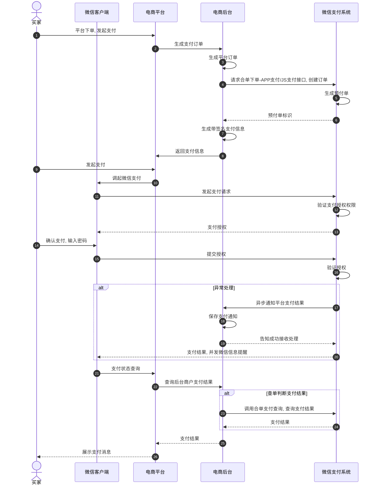

>更新时间：2026.06.10

## 1. 接口规则

为了在保证支付安全的前提下，带给商户简单、一致且易用的开发体验，我们推出了全新的微信支付APIv3接口。该版本API的具体规则请参考[APIv3接口规则](https://pay.weixin.qq.com/doc/v3/merchant/4012081606.md)。

## 2. 开发准备

### 2.1. 搭建和配置开发环境

开发者应当依据自身的编程语言来构建并配置相应的开发环境。

### 2.2. 业务开发配置

合单支付目前支持在微信外H5、App、JSAPI、小程序、Native扫码5个场景使用，下面依次为你介绍这5个场景需求进行的业务开发配置

#### 2.2.1. 微信外H5场景开发配置

开通H5支付权限：前往【[微信支付商户平台](https://pay.weixin.qq.com/index.php/core/home/login?return_url=%2F)—>产品中心—>H5支付—>申请开通】。


设置H5支付域名：登录【[微信支付商户平台](https://pay.weixin.qq.com/index.php/core/home/login?return_url=%2F)—>产品中心—>开发配置—>H5支付】，设置后一般10分钟内生效。


注意

- 域名必须通过ICP备案

- 域名填写格式不包含"HTTP://"或"HTTPS://"


#### 2.2.2. App场景开发配置

##### 一、注册App

App接入微信支付，需要先将商户App在微信开放平台进行注册，登记App开发参数以生成AppID。具体操作步骤如下：

1\. 登录微信开放平台，进入【管理中心 → 移动应用 → 创建移动应用】；


2\. 完成基本信息的录入，商户需要在本步骤提交App对应的下载地址，应用官网，应用水印，icon等业务信息；


3\. 完成平台信息的录入，商户需要在本步骤提交App在Android及iOS端对应的开发参数，包括Android端应用的包名，应用签名，iOS端应用的bundle ID, universal link等；


注意

Android应用包名和签名的相关说明，请参考[Android开发要点说明](https://pay.weixin.qq.com/doc/v3/partner/4012089542.md#%E4%B8%89%E3%80%81Android%E5%BC%80%E5%8F%91%E8%A6%81%E7%82%B9%E8%AF%B4%E6%98%8E)。

4\. 以上信息全部提交完成后，即完成App的注册，商户可在【管理中心 → 移动应用】中，选择具体的应用查看其AppID及已获得的接口能力；


5\. 获取到App的AppID后，需要将该AppID与商户的收款mch\_id进行绑定，商户可登录商户平台后前往【产品中心 -> AppID账号管理】界面中进行AppID的绑定及管理，界面如图所示。


##### 二、iOS开发要点说明

- iOS系统OpenSDK升级指引：


由于苹果公司在iOS13系统回收了查询 App bundleID 的能力，导致微信无法保证授权凭证能正确返回给AppID对应的应用。为此，微信支付强烈要求所有商户尽快升级到OpenSDK1.8.6，并让用户及时更新App，否则安全风险将一直存在。谢谢配合！

详细OpenSDK升级指引请参见：[OpenSDK升级指引](https://developers.weixin.qq.com/doc/oplatform/Mobile_App/Access_Guide/iOS.html)

注意

OpenSDK升级后请一定按照文档要求完成验证工作，确保OpenSDK升级成功。


- 开发配置：


以下项目开发环境以Xcode6.0，运行环境为IOS7.0为例，说明其开发中需要的操作。

###### 1. 项目设置AppID

商户在微信开放平台申请开发App应用后，微信开放平台会生成App的唯一标识AppID。在Xcode中打开项目，设置项目属性中的URL Schemes为您的AppID。如图标红位置所示。


###### 2. 注册AppID

商户App工程中引入微信lib库和头文件，调用API前，需要先向微信注册您的AppID，代码如下：

\[WXApi registerApp：@"wxd930ea5d5a258f4f" withDescription：@"demo 2.0"\];

注意

- OpenSDK前端拉起支付及SDK回调的相关说明，请参考[【客户端】App调起支付](https://pay.weixin.qq.com/doc/v3/partner/4012089542.md#3.2.3.%E3%80%90%E5%AE%A2%E6%88%B7%E7%AB%AF%E3%80%91App%E8%B0%83%E8%B5%B7%E6%94%AF%E4%BB%98)。


##### 三、Android开发要点说明

###### 1.后台设置

商户在微信开放平台申请开发应用后，微信开放平台会生成App的唯一标识AppID。由于需要保证支付安全，需要在开放平台绑定商户应用包名和应用签名，设置好后才能正常发起支付。设置界面在【开放平台】中的栏目【管理中心-> 修改应用 -> 修改开发信息】里面，如图红框内所示。


应用包名：是在App项目配置文件AndroidManifest.xml中声明的package值，例如图中的package="demo.wxpay.tenpay.com"。

应用签名：根据项目的应用包名和编译使用的keystore，可由签名工具生成一个32位的md5串，在调试的手机上安装签名工具后，运行可生成应用签名串，如图所示，绿色串即应用签名。[签名工具下载](https://open.weixin.qq.com/zh_CN/htmledition/res/dev/download/sdk/Gen_Signature_Android.apk)


###### 2.注册AppID

商户App工程中引入微信JAR包，调用API前，需要先向微信注册您的AppID，代码如下：

final IWXAPI msgApi = WXAPIFactory.createWXAPI(context, null);

// 将该App注册到微信

msgApi.registerApp("wxd930ea5d5a258f4f");

#### 2.2.3. JSAPI场景开发配置

##### 设置支付目录

- 支付授权目录说明：

  1. 商户最后请求拉起微信支付收银台的页面地址我们称之为“支付目录”，例如： `https://www.weixin.com/pay.php`。

  2. 商户实际的支付目录必须和在[微信支付商户平台](https://pay.weixin.qq.com/partner/public/home)设置的一致，否则会报错“当前页面的URL未注册”。
- 支付授权目录设置说明：

  - 登录【[微信支付服务商平台](https://pay.weixin.qq.com/partner/public/home)->产品中心->开发配置】，设置后一般5分钟内生效。（配置页见图）
- 支付授权目录校验规则说明：

  1. 如果支付授权目录设置为顶级域名（例如： `https://www.weixin.com/` ），那么只校验顶级域名，不校验后缀；

  2. 如果支付授权目录设置为多级目录，就会进行全匹配，例如设置支付授权目录为 `https://www.weixin.com/abc/123/`，则实际请求页面目录不能为 `https://www.weixin.com/abc/`，也不能为 `https://www.weixin.com/abc/123/pay/`，必须为 `https://www.weixin.com/abc/123/`


##### 设置授权域名

授权域名说明： 开发JSAPI支付时，在JSAPI下单接口中要求必传用户OpenID，而获取OpenID则需要您在公众平台设置获取OpenID的域名，只有被设置过的域名才是一个有效的获取OpenID的域名，否则将获取失败。具体配置页如图2所示

授权域名设置说明： 登录【[微信公众平台](https://mp.weixin.qq.com/)->公众号设置】


#### 2.2.4. 小程序场景开发配置

账号申请指引：

1\. 小程序开通微信支付，即申请或复用微信支付商户号 申请完小程序后，登录[小程序后台](https://mp.weixin.qq.com/)。点击左侧导航栏的微信支付，在页面中进行开通。（开通申请要求小程序已发布上线）


2\. 点击开通按钮后，有2种方式可以获取微信支付能力，新申请微信支付商户号或绑定一个已有的微信支付商户号，请根据你的业务需要和具体情况选择，只能二选一。详见[微信支付商户接入指引](https://kf.qq.com/faq/210423UrIRB7210423by6fQn.html)


服务器配置要求：

1. 小程序访问商户服务都是通过HTTPS,开发部署的时候需要HTTPS服务器。

2. 服务器域名配置。

   - 每个微信小程序需要事先设置通讯域名，小程序只可以跟指定的域名进行网络通信。包括普通 HTTPS 请求（wx.request）、上传文件（wx.uploadFile）、下载文件（wx.downloadFile）和 WebSocket 通信（wx.connectSocket）。

   - 从基础库 2.4.0 开始，网络接口允许与局域网 IP 通信，但要注意 不允许与本机 IP 通信。

注意

- 域名只支持 "HTTPS (wx.request、wx.uploadFile、wx.downloadFile)" 和 "wss (wx.connectSocket)" 协议。

- 域名不能使用 IP 地址（小程序的局域网 IP 除外）或 localhost。

- 可以配置端口，如 `https://myserver.com:8080`，但是配置后只能向 `https://myserver.com:8080/` 发起请求。如果向 `https://myserver.com`、 `https://myserver.com:9091` 等 URL请求则会失败。

- 如果不配置端口。如 `https://myserver.com`，那么请求的 URL 中也不能包含端口，甚至是默认的 443 端口也不可以。如果向 `https://myserver.com:443` 请求则会失败。

- 域名必须经过 ICP 备案。

- 出于安全考虑， `api.weixin.qq.com` 不能被配置为服务器域名，相关API也不能在小程序内调用。 开发者应将 AppSecret 保存到后台服务器中，通过服务器使用 getAccessToken 接口获取access\_token，并调用相关 API。

- 不支持配置父域名，使用子域名。

- 可查阅[小程序网络请求](https://developers.weixin.qq.com/miniprogram/dev/framework/ability/network.html)以了解更多信息。


#### 2.2.5. Native扫码场景开发配置

暂无需特殊配置内容。

## 3. 快速接入

### 3.1. 业务流程图



重要步骤说明：

步骤1 用户在商户侧发起支付请求，商户先通过后台接口[合单下单](https://pay.weixin.qq.com/doc/v3/partner/4012760615.md)接口创建合单支付订单。

步骤2 商户再根据用户发起支付请求的具体场景通过[H5](https://pay.weixin.qq.com/doc/v3/partner/4012091014.md)/[小程序](https://pay.weixin.qq.com/doc/v3/partner/4012091236.md)/[App](https://pay.weixin.qq.com/doc/v3/partner/4012090949.md)/[公众号](https://pay.weixin.qq.com/doc/v3/partner/4012090843.md)页面调起微信支付收银台，完成支付请求。

步骤3 用户支付成功后，商户可接收到[支付结果回调通知](https://pay.weixin.qq.com/doc/v3/partner/4012237246.md)。

步骤4 如果商户长时间未收到回调通知，可通过[合单查询订单](https://pay.weixin.qq.com/doc/v3/partner/4012761049.md)接口主动查询订单支付状态。

### 3.2. API接入（含示例代码）

本文档展示了如何使用微信支付服务端 SDK 快速接入合单支付产品，完成与微信支付对接的部分。

注意

- 文档中的代码示例是用来阐述 API 基本使用方法，代码中的示例参数需替换成商户自己账号及请求参数才能跑通。

- 以下接入步骤仅提供参考，请商户结合自身业务需求进行评估、修改。


#### 3.2.1.【服务端】合单下单

步骤说明： 用户在商户侧选择商品下单购买时，商户系统先调用该接口在微信支付服务后台生成预支付交易单，然后使用我们提供的客户端方法（下文介绍）调起微信支付收银台，即可完成支付。

合单下单接口为了区分用户发起支付的5个场景：微信外H5、App、JSAPI、小程序、Native扫码，我们分别使用了4个不同接口地址对应这5个场景（小程序与公众号合单下单接口地址相同）：

`https://api.mch.weixin.qq.com/v3/combine-transactions/h5` ——微信外H5场景合单下单接口地址。

`https://api.mch.weixin.qq.com/v3/combine-transactions/app` ——App场景合单下单接口地址。

`https://api.mch.weixin.qq.com/v3/combine-transactions/jsapi` ——JSAPI、小程序场景合单下单接口地址。

`https://api.mch.weixin.qq.com/v3/combine-transactions/native` ——Native扫码场景合单下单接口地址。

下面以JSAPI、小程序场景为例，为你展示基础下单接口的请求示例。

示例代码

```

public void CombineJsapiPrepay() throws Exception{

  //请求URL
  HttpPost httpPost = new HttpPost("https://api.mch.weixin.qq.com/v3/combine-transactions/jsapi");
  // 请求body参数
  String reqdata = "{"
          + "\"combine_out_trade_no\":\"1217752501201407033233368018\","
          + "\"combine_mchid\":\"1230000109\","
          + "\"combine_appid\":\"wxd678efh567hg6787\","
          + "\"scene_info\": {"
          + "\"device_id\":\"POS1:1\","
          + "\"payer_client_ip\":\"14.17.22.32\""
          + "},"
          + "\"sub_orders\": ["
          + "{"
          + "\"mchid\":\"1230000109\","
          + "\"attach\":\"深圳分店\","
          + "\"amount\": {"
          + "\"total_amount\":10,"
          + "\"currency\":\"CNY\""
          + "},"
          + "\"out_trade_no\":\"20150806125346\","
          + "\"sub_mchid\":\"1900000109\","
          + "\"description\":\"腾讯充值中心-QQ会员充值\""
          + "}"
          + "],"
          + "\"combine_payer_info\": {"
          + "\"openid\":\"oUpF8uMuAJO_M2pxb1Q9zNjWeS6o\""
          + "},"
          + "\"time_start\":\"2018-06-08T10:34:56+08:00\","
          + "\"time_expire\":\"2018-06-08T10:34:56+08:00\","
          + "\"notify_url\":\"https://yourapp.com/notify\""
          + "}";
  StringEntity entity = new StringEntity(reqdata,"utf-8");
  entity.setContentType("application/json");
  httpPost.setEntity(entity);
  httpPost.setHeader("Accept", "application/json");

  //完成签名并执行请求
  CloseableHttpResponse response = httpClient.execute(httpPost);

  try {
      int statusCode = response.getStatusLine().getStatusCode();
      if (statusCode == 200) { //处理成功
          System.out.println("success,return body = " + EntityUtils.toString(response.getEntity()));
      } else if (statusCode == 204) { //处理成功，无返回Body
          System.out.println("success");
      } else {
          System.out.println("failed,resp code = " + statusCode+ ",return body = " + EntityUtils.toString(response.getEntity()));
          throw new IOException("request failed");
      }
  } finally {
      response.close();
  }
}


```

重要入参说明：

- out\_trade\_no： 商户系统内部订单号，只能是数字、大小写字母\_-\*且在同一个商户号下唯一。

- description： 商品描述。

- notify\_url： 支付回调通知URL，该地址必须为直接可访问的URL，不允许携带查询串。

- total： 订单总金额，单位为分。

- OpenID： OpenID是微信用户在AppID下的唯一用户标识（AppID不同，则获取到的OpenID就不同），可用于永久标记一个用户。OpenID获取方式请参考以下文档[小程序获取OpenID](https://developers.weixin.qq.com/miniprogram/dev/api/open-api/login/wx.login.html)、[公众号获取OpenID](https://developers.weixin.qq.com/doc/offiaccount/OA_Web_Apps/Wechat_webpage_authorization.html)、[App获取OpenID](https://developers.weixin.qq.com/doc/oplatform/Mobile_App/WeChat_Login/Authorized_API_call_UnionID.html)。


更多参数、响应详情及错误码请参见 [合单JSAPI下单](https://pay.weixin.qq.com/doc/v3/partner/4012760615.md)。

#### 3.2.2.【客户端】JSAPI调起支付

步骤说明： 通过合单下单API成功获取预支付交易会话标识（prepay\_id）后，需要通过JSAPI调起支付API来调起微信支付收银台。

注意

- WeixinJSBridge内置对象在其他浏览器中无效。

- 此API需要将请求参数进行签名（参与签名的参数为：AppID、timeStamp、nonceStr、package，参数区分大小写）。


示例代码：

```
function onBridgeReady() {
    WeixinJSBridge.invoke('getBrandWCPayRequest', {
        "appId": "wx2421b1c4370ecxxx",    //公众号ID，由商户传入
        "timeStamp": "1395712654",     //时间戳，自1970年以来的秒数
        "nonceStr": "e61463f8efa94090b1f366cccfbbb444",  //随机串
        "package": "prepay_id=up_wx21201855730335ac86f8c43d1889123400",
        "signType": "RSA",    //微信签名方式：
        "paySign": "oR9d8PuhnIc+YZ8cBHFCwfgpaK9gd7vaRvkYD7rthRAZ\/X+QBhcCYL21N7cHCTUxbQ+EAt6Uy+lwSN22f5YZvI45MLko8Pfso0jm46v5hqcVwrk6uddkGuT+Cdvu4WBqDzaDjnNa5UK3GfE1Wfl2gHxIIY5lLdUgWFts17D4WuolLLkiFZV+JSHMvH7eaLdT9N5GBovBwu5yYKUR7skR8Fu+LozcSqQixnlEZUfyE55feLOQTUYzLmR9pNtPbPsu6WVhbNHMS3Ss2+AehHvz+n64GDmXxbX++IOBvm2olHu3PsOUGRwhudhVf7UcGcunXt8cqNjKNqZLhLw4jq\/xDg==" //微信签名
    },
    function(res) {
        if (res.err_msg == "get_brand_wcpay_request:ok") {
            // 使用以上方式判断前端返回,微信团队郑重提示：
            //res.err_msg将在用户支付成功后返回ok，但并不保证它绝对可靠。
        }
    });
}
if (typeof WeixinJSBridge == "undefined") {
    if (document.addEventListener) {
        document.addEventListener('WeixinJSBridgeReady', onBridgeReady, false);
    } else if (document.attachEvent) {
        document.attachEvent('WeixinJSBridgeReady', onBridgeReady);
        document.attachEvent('onWeixinJSBridgeReady', onBridgeReady);
    }
} else {
    onBridgeReady();
}
```

重要入参说明：

- package： JSAPI下单接口返回的prepay\_id参数值，提交格式如：prepay\_id=\*\*\*。

- signType： 该接口V3版本仅支持RSA。

- paySign： 签名。


paySign生成规则、响应详情及错误码请参见 [JSAPI调起支付](https://pay.weixin.qq.com/doc/v3/partner/4012090843.md)接口文档。

#### 3.2.3.【客户端】App调起支付

步骤说明： 通过App下单API成功获取\*\*预支付交易会话标识（prepay\_id）\*\*后，需要通过OpenSDK来调起微信支付收银台

注意

- 该步骤请使用开放平台的官方OpenSDK，可前往[开放平台资源中心](https://developers.weixin.qq.com/doc/oplatform/Downloads/iOS_Resource.html)下载

- SDK的调用需要携带签名（参与签名的参数为：AppID、partnerid、prepayid、package、noncestr、timestamp，参数区分大小写）。


重要入参说明：

- package： 取固定值Sign=WXPay。

- signType： 该接口V3版本仅支持RSA。

- paySign： 签名。


paySign生成规则、响应详情及错误码请参见[App调起支付](https://pay.weixin.qq.com/doc/v3/partner/4012090949.md)接口文档。

##### iOS SDK调用说明

一、拉起支付

商户服务器生成支付订单，先调用[App下单API](https://pay.weixin.qq.com/doc/v3/partner/4012760622.md)生成预付单，获取到prepay\_id后将参数再次签名传输给App发起支付。以下是调起微信支付的关键代码：

```
PayReq *request = [[[PayReq alloc] init] autorelease];
request.partnerId = @"10000100";
request.prepayId= @"1101000000140415649af9fc314aa427";
request.package = @"Sign=WXPay";
request.nonceStr= @"a462b76e7436e98e0ed6e13c64b4fd1c";
request.timeStamp= @"1397527777";
request.sign= @"582282D72DD2B03AD892830965F428CB16E7A256";
[WXApi sendReq：request]
```

该sign生成字段名列表见[调起支付API](https://pay.weixin.qq.com/doc/v3/partner/4012090949.md)

二、SDK结果回调

照微信SDK Sample，在类实现onResp函数，支付完成后，微信App会返回到商户App并回调onResp函数，开发者需要在该函数中接收通知，判断返回错误码，如果支付成功则去后台查询支付结果再展示用户实际支付结果。注意 一定不能以客户端返回作为用户支付的结果，应以服务器端的接收的支付通知或查询API返回的结果为准。代码示例如下：

```
-(void)onResp：(BaseResp*)resp{
  if ([respisKindOfClass：[PayRespclass]]){
      PayResp*response=(PayResp*)resp;
      switch(response.errCode){
                  caseWXSuccess： //服务器端查询支付通知或查询API返回的结果再提示成功
                           NSlog(@"支付成功");
                  break;
                  default：
                           NSlog(@"支付失败，retcode=%d",resp.errCode);
                  break;
        }
   }
}
```

回调中errCode值列表：

| 名称 | 描述 | 解决方案 |
| --- | --- | --- |
| 0 | 成功 | 展示成功页面 |
| -1 | 错误 | 可能的原因：签名错误、未注册AppID、项目设置AppID不正确、注册的AppID与设置的不匹配、其他异常等。 |
| -2 | 用户取消 | 无需处理。发生场景：用户不支付了，点击取消，返回App。 |

Android SDK调用说明：

##### 一、SDK拉起支付

商户服务器生成支付订单，先调用【[App下单API](https://pay.weixin.qq.com/doc/v3/partner/4012760622.md)】生成预付单，获取到prepay\_id后将参数再次签名传输给App发起支付。以下是调起微信支付的关键代码：

```
IWXAPI api;
PayReq request = new PayReq();
request.appId = "wxd930ea5d5a258f4f";
request.partnerId = "1900000109";
request.prepayId= "1101000000140415649af9fc314aa427",;
request.packageValue = "Sign=WXPay";
request.nonceStr= "1101000000140429eb40476f8896f4c9";
request.timeStamp= "1398746574";
request.sign= "7FFECB600D7157C5AA49810D2D8F28BC2811827B";
api.sendReq(request);
```

该sign生成字段名列表见[调起支付API](https://pay.weixin.qq.com/doc/v3/partner/4012090949.md)

##### 二、支付结果回调

参照微信SDK Sample，在商户包名.wxapi包路径中实现WXPayEntryActivity类(包名或类名不一致会造成无法回调)，在WXPayEntryActivity类中实现onResp函数，支付完成后，微信App会返回到商户App并回调onResp函数，开发者需要在该函数中接收通知，判断返回错误码，如果支付成功则去后台查询支付结果再展示用户实际支付结果。注意一定不能以客户端返回作为用户支付的结果，应以服务器端的接收的支付通知或查询API返回的结果为准。代码示例如下：

```
publicvoidonResp(BaseRespresp){
    if(resp.getType()==ConstantsAPI.COMMAND_PAY_BY_WX){
    Log.d(TAG,"onPayFinish,errCode="+resp.errCode);
    AlertDialog.Builderbuilder=newAlertDialog.Builder(this);
    builder.setTitle(R.string.app_tip);
    }
}
```

回调中errCode值列表：

| 名称 | 描述 | 解决方案 |
| --- | --- | --- |
| 0 | 成功 | 展示成功页面 |
| -1 | 错误 | 可能的原因：签名错误、未注册AppID、项目设置AppID不正确、注册的AppID与设置的不匹配、其他异常等。 |
| -2 | 用户取消 | 无需处理。发生场景：用户不支付了，点击取消，返回App。 |

#### 3.2.4. 【客户端】小程序调起支付API

步骤说明： 通过小程序下单API成功获取预支付交易会话标识（prepay\_id）后，需要通过小程序调起支付API来调起微信支付收银台。

注意

- 此API需要将请求参数进行签名（参与签名的参数为：AppID、timeStamp、nonceStr、package，参数区分大小写）。

- AppID必须为最后拉起收银台的小程序AppID。


示例代码：

```
wx.requestPayment(
{
"timeStamp": "1414561699",
"nonceStr": "5K8264ILTKCH16CQ2502SI8ZNMTM67VS",
"package": "prepay_id=wx201410272009395522657a690389285100",
"signType": "RSA",
"paySign": "oR9d8PuhnIc+YZ8cBHFCwfgpaK9gd7vaRvkYD7rthRAZ\/X+QBhcCYL21N7cHCTUxbQ+EAt6Uy+lwSN22f5YZvI45MLko8Pfso0jm46v5hqcVwrk6uddkGuT+Cdvu4WBqDzaDjnNa5UK3GfE1Wfl2gHxIIY5lLdUgWFts17D4WuolLLkiFZV+JSHMvH7eaLdT9N5GBovBwu5yYKUR7skR8Fu+LozcSqQixnlEZUfyE55feLOQTUYzLmR9pNtPbPsu6WVhbNHMS3Ss2+AehHvz+n64GDmXxbX++IOBvm2olHu3PsOUGRwhudhVf7UcGcunXt8cqNjKNqZLhLw4jq\/xDg==",
"success":function(res){},
"fail":function(res){},
"complete":function(res){}
})
```

重要入参说明：

- package：小程序下单接口返回的prepay\_id参数值，提交格式如：prepay\_id=\*\*\*。

- signType：该接口V3版本仅支持RSA。

- paySign：签名。


paySign生成规则、响应详情及错误码请参见[小程序调起支付API](https://pay.weixin.qq.com/doc/v3/partner/4012091236.md)接口文档。

#### 3.2.5. 【客户端】生成支付二维码

步骤说明： 通过Native下单API成功获取支付二维码链接（code\_url）后，需要在前端（PC网页或POS机具）生成二维码供用户扫描支付。

注意

code\_url对应链接格式：weixin：//weixin://pay.wechatpay.cn/bizpayurl/up?pr=NwY5Mz9&groupid=00。请商户调用第三方库将code\_url生成二维码图片。该模式链接较短，生成的二维码打印到结账小票上的识别率较高。

例如，将weixin：//weixin://pay.wechatpay.cn/bizpayurl/up?pr=NwY5Mz9&groupid=00 生成二维码建下图


更多二维码的相关背景知识可参考

[https://www.thonky.com/qr-code-tutorial/](https://www.thonky.com/qr-code-tutorial/)

[https://coolshell.cn/articles/10590.html](https://coolshell.cn/articles/10590.html)

#### 3.2.6. 【客户端】微信外H5浏览器拉起微信支付中间页

步骤说明： 通过H5下单API成功获取H5下单返回的支付中间页（h5\_url）后，用户需要通过微信外部的浏览器调起微信支付收银台

注意

- h5\_url为拉起微信支付收银台的中间页面，可通过访问该URL来拉起微信客户端，完成支付，h5\_url的有效期为5分钟。

- 微信支付收银台中间页会进行H5权限的校验，安全性检查。

- 正常流程用户支付完成后会返回至发起支付的页面，如需返回至指定页面，则可以在h5\_url后拼接上redirect\_url参数，来指定回调页面。您希望用户支付完成后跳转至 `https://www.wechatpay.com.cn`，则拼接后的地址为h5\_url= `https://wx.tenpay.com/cgi-bin/mmpayweb-bin/checkmweb?prepay_id=wx20161110163838f231619da20804912345&package=1037687096&redirect_url=https%3A%2F%2Fwww.wechatpay.com.cn`。

- 需对redirect\_url进行urlencode处理。

- 由于设置redirect\_url后,回跳指定页面的操作可能发生在：

  - 微信支付中间页调起微信收银台后超过5秒。

  - 用户点击“取消支付”或支付完成后点“完成”按钮。因此无法保证页面回跳时，支付流程已结束，所以商户设置的redirect\_url地址不能自动执行查单操作，应让用户去点击按钮触发查单操作，回跳页面展示效果可参考下图。


更多参数、响应详情及错误码请参见[H5调起支付API](https://pay.weixin.qq.com/doc/v3/partner/4012091014.md)接口文档

#### 3.2.7.【服务端】接收支付结果通知

步骤说明： 当用户完成支付，微信会把相关支付结果将通过异步回调的方式通知商户，商户需要接收处理，并按文档规范返回应答。

注意

- 支付结果通知的地址需要在请求App下单API时传入notify\_url参数中。

- 支付结果通知是以POST 方法访问商户设置的通知URL，通知的数据以JSON 格式通过请求主体（BODY）传输。通知的数据包括了加密的支付结果详情。

- 加密不能保证通知请求来自微信。微信会对发送给商户的通知进行签名，并将签名值放在通知的HTTP头Wechatpay-Signature。商户应当验证签名，以确认请求来自微信，而不是其他的第三方。签名验证的算法请参考 [《微信支付API v3签名验证》](https://pay.weixin.qq.com/doc/v3/partner/4012365870.md#%E9%AA%8C%E8%AF%81%E7%AD%BE%E5%90%8D)。

- 支付通知HTTP应答码为200或204才会当作正常接收，当回调处理异常时，应答的HTTP状态码应为500，或者4xx。

- 商户成功接收到回调通知后应返回成功的HTTP应答码为200或204。

- 同样的通知可能会多次发送给商户系统。商户系统必须能够正确处理重复的通知。

- 后台通知交互时，如果微信收到商户的应答不符合规范或超时，微信会判定本次通知失败，重新发送通知，直到成功为止，但微信不保证通知最终一定能成功。


特别提醒：

- 商户系统对于支付结果通知的内容一定要做签名验证,并校验返回的订单金额是否与商户侧的订单金额一致，防止数据泄露导致出现“假通知”，造成资金损失。

- 当收到通知进行处理时，首先检查对应业务数据的状态，判断该通知是否已经处理过，如果没有处理过再进行处理，如果处理过直接返回结果成功。在对业务数据进行状态检查和处理之前，要采用数据锁进行并发控制，以避免函数重入造成的数据混乱。


更多参数、响应详情及错误码请参见[支付通知API](https://pay.weixin.qq.com/doc/v3/partner/4012237246.md)接口文档。

#### 3.2.8. 【服务端】合单查询订单

步骤说明： 当商户后台、网络、服务器等出现异常，商户系统最终未接收到支付通知时商户可通过查询订单接口核实订单支付状态。

注意

- 查询订单可通过合单商户订单号查询。


示例代码

JAVA

```
public void QueryOrder() throws Exception {
  //请求URL
  URIBuilder uriBuilder = new URIBuilder("https://api.mch.weixin.qq.com/v3/combine-transactions/out-trade-no/P11093730578574");
  uriBuilder.setParameter("mchid", mchId);
  //完成签名并执行请求
  HttpGet httpGet = new HttpGet(uriBuilder.build());
  httpGet.addHeader("Accept", "application/json");
  CloseableHttpResponse response = httpClient.execute(httpGet);
  try {
      int statusCode = response.getStatusLine().getStatusCode();
      if (statusCode == 200) {
          System.out.println("success,return body = " + EntityUtils.toString(response.getEntity()));
      } else if (statusCode == 204) {
          System.out.println("success");
      } else {
          System.out.println("failed,resp code = " + statusCode+ ",return body = " + EntityUtils.toString(response.getEntity()));
          throw new IOException("request failed");
      }
  } finally {
      response.close();
  }
}
```

PHP

```
try {
    $resp = $client->request(
        'GET',
        'https://api.mch.weixin.qq.com/v3/combine-transactions/out-trade-no/P11093730578574', //请求URL
        [
            'headers' => [ 'Accept' => 'application/json']
        ]
    );
    $statusCode = $resp->getStatusCode();
    if ($statusCode == 200) { //处理成功
        echo "success,return body = " . $resp->getBody()->getContents()."\n";
    } else if ($statusCode == 204) { //处理成功，无返回Body
        echo "success";
    }
} catch (RequestException $e) {
    // 进行错误处理
    echo $e->getMessage()."\n";
    if ($e->hasResponse()) {
        echo "failed,resp code = " . $e->getResponse()->getStatusCode() . " return body = " . $e->getResponse()->getBody() . "\n";
    }
    return;
}
```

更多参数、响应详情及错误码请参见[查询订单API](https://pay.weixin.qq.com/doc/v3/partner/4012761049.md)接口文档。

#### 3.2.9. 【服务端】合单关闭订单

步骤说明： 当商户订单支付失败需要生成新单号重新发起支付，要对原订单号调用关单，避免重复支付；系统下单后，用户支付超时，系统退出不再受理，避免用户继续，请调用关单接口。

注意

- 订单生成后不能马上调用关单接口，最短调用时间间隔为5分钟

- 已支付成功的订单不能关闭


示例代码

JAVA

```
public void CombineCloseOrder() throws Exception{
  //请求URL
  HttpPost httpPost = new HttpPost("https://api.mch.weixin.qq.com/v3/combine-transactions/out-trade-no/{combine_out_trade_no}/close");
  // 请求body参数
  String reqdata = "{"
          + "\"combine_appid \":\"wxd678efh567hg6787\","
          + "\"combine_out_trade_no\":\"P20150806125346\","
          + "\"sub_orders\": ["
          + "{"
          + "\"mchid\":\"1900000109\","
          + "\"out_trade_no\":\"20150806125346\","
          + "\"sub_mchid\":\"1230000109\","
          + "\"description\":\"腾讯充值中心-QQ会员充值\""
          + "}"
          + "]"
          + "}";
  StringEntity entity = new StringEntity(reqdata,"utf-8");
  entity.setContentType("application/json");
  httpPost.setEntity(entity);
  httpPost.setHeader("Accept", "application/json");
  //完成签名并执行请求
  CloseableHttpResponse response = httpClient.execute(httpPost);
  try {
      int statusCode = response.getStatusLine().getStatusCode();
      if (statusCode == 200) { //处理成功
          System.out.println("success,return body = " + EntityUtils.toString(response.getEntity()));
      } else if (statusCode == 204) { //处理成功，无返回Body
          System.out.println("success");
      } else {
          System.out.println("failed,resp code = " + statusCode+ ",return body = " + EntityUtils.toString(response.getEntity()));
          throw new IOException("request failed");
      }
  } finally {
      response.close();
  }
}
```

PHP

```
try {
    $resp = $client->request(
        'POST',
        'https://api.mch.weixin.qq.com/v3/combine-transactions/out-trade-no/{combine_out_trade_no}/close', //请求URL
        [
            // JSON请求体
            'json' => [
                "combine_appid " => "wxd678efh567hg6787",
                "combine_out_trade_no" => "P20150806125346",
                "sub_orders" => [
                    [
                        "mchid" => "1900000109",
                        "out_trade_no" => "20150806125346",
                        "sub_mchid" => "1230000109",
                        "description" => "腾讯充值中心-QQ会员充值",
                    ],
                ]
            ],
            'headers' => [ 'Accept' => 'application/json' ]
        ]
    );
    $statusCode = $resp->getStatusCode();
    if ($statusCode == 200) { //处理成功
        echo "success,return body = " . $resp->getBody()->getContents()."\n";
    } else if ($statusCode == 204) { //处理成功，无返回Body
        echo "success";
    }
} catch (RequestException $e) {
    // 进行错误处理
    echo $e->getMessage()."\n";
    if ($e->hasResponse()) {
        echo "failed,resp code = " . $e->getResponse()->getStatusCode() . " return body = " . $e->getResponse()->getBody() . "\n";
    }
    return;
}
```

更多参数、响应详情及错误码请参见[合单关单API](https://pay.weixin.qq.com/doc/v3/partner/4012761093.md)接口文档。

#### 3.2.10. 【服务端】申请交易账单

步骤说明： 微信支付按天提供交易账单文件，商户可以通过该接口获取账单文件的下载地址

示例代码

JAVA

```
public void TradeBill() throws Exception {
  //请求URL
  URIBuilder uriBuilder = new URIBuilder("https://api.mch.weixin.qq.com/v3/bill/tradebill");
  uriBuilder.setParameter("bill_date", "2020-11-09");
  uriBuilder.setParameter("bill_type", "ALL");
  //完成签名并执行请求
  HttpGet httpGet = new HttpGet(uriBuilder.build());
  httpGet.addHeader("Accept", "application/json");
  CloseableHttpResponse response = httpClient.execute(httpGet);
  try {
      int statusCode = response.getStatusLine().getStatusCode();
      if (statusCode == 200) {
          System.out.println("success,return body = " + EntityUtils.toString(response.getEntity()));
      } else if (statusCode == 204) {
          System.out.println("success");
      } else {
          System.out.println("failed,resp code = " + statusCode+ ",return body = " + EntityUtils.toString(response.getEntity()));
          throw new IOException("request failed");
      }
  } finally {
      response.close();
  }
}
```

PHP

```
try {
    $resp = $client->request(
        'GET',
        'https://api.mch.weixin.qq.com/v3/bill/tradebill?bill_date=2019-06-11&sub_mchid=1900000001&bill_type=ALL', //请求URL
        [
            'headers' => [ 'Accept' => 'application/json']
        ]
    );
    $statusCode = $resp->getStatusCode();
    if ($statusCode == 200) { //处理成功
        echo "success,return body = " . $resp->getBody()->getContents()."\n";
    } else if ($statusCode == 204) { //处理成功，无返回Body
        echo "success";
    }
} catch (RequestException $e) {
    // 进行错误处理
    echo $e->getMessage()."\n";
    if ($e->hasResponse()) {
        echo "failed,resp code = " . $e->getResponse()->getStatusCode() . " return body = " . $e->getResponse()->getBody() . "\n";
    }
    return;
}
```

更多参数、响应详情及错误码请参见[申请交易账单API](https://pay.weixin.qq.com/doc/v3/partner/4012760667.md)接口文档。

#### 3.2.11. 【服务端】下载账单

步骤说明： 通过申请交易账单接口获取到账单下载地址（download\_url）后，再通过该接口获取到对应的账单文件，文件内包含交易相关的金额、时间、营销等信息，供商户核对订单、退款、银行到账等情况。

注意

- 账单文件的下载地址的有效时间为30s。

- 强烈建议商户将实际账单文件的哈希值和之前从接口获取到的哈希值进行比对，以确认数据的完整性。


示例代码

```
public void DownloadUrl(String download_url) throws Exception{
  PrivateKey merchantPrivateKey = PemUtil.loadPrivateKey(new ByteArrayInputStream(privateKey.getBytes("utf-8")));
  //初始化httpClient
  //该接口无需进行签名验证、通过withValidator((response) -> true)实现
  httpClient =  WechatPayHttpClientBuilder.create().withMerchant(mchId, mchSerialNo, merchantPrivateKey).withValidator((response) -> true).build();
  //请求URL
  //账单文件的下载地址的有效时间为30s
  URIBuilder uriBuilder = new URIBuilder(download_url);
  HttpGet httpGet = new HttpGet(uriBuilder.build());
  httpGet.addHeader("Accept", "application/json");
  //执行请求
  CloseableHttpResponse response = httpClient.execute(httpGet);
  try {
      int statusCode = response.getStatusLine().getStatusCode();
      if (statusCode == 200) {
          System.out.println("success,return body = " + EntityUtils.toString(response.getEntity()));
      } else if (statusCode == 204) {
          System.out.println("success");
      } else {
          System.out.println("failed,resp code = " + statusCode+ ",return body = " + EntityUtils.toString(response.getEntity()));
          throw new IOException("request failed");
      }
  } finally {
      response.close();
  }
}
```

PHP

```
try {
    $resp = $client->request(
        'GET',
        'https://api.mch.weixin.qq.com/v3/billdownload/file?token=xx', //请求URL
        [
            'headers' => [ 'Accept' => 'application/json']
        ]
    );
    $statusCode = $resp->getStatusCode();
    if ($statusCode == 200) { //处理成功
        echo "success,return body = " . $resp->getBody()->getContents()."\n";
    } else if ($statusCode == 204) { //处理成功，无返回Body
        echo "success";
    }
} catch (RequestException $e) {
    // 进行错误处理
    echo $e->getMessage()."\n";
    if ($e->hasResponse()) {
        echo "failed,resp code = " . $e->getResponse()->getStatusCode() . " return body = " . $e->getResponse()->getBody() . "\n";
    }
    return;
}
```

更多参数、响应详情及错误码请参见[下载账单API](https://pay.weixin.qq.com/doc/v3/partner/4012124894.md)接口文档。