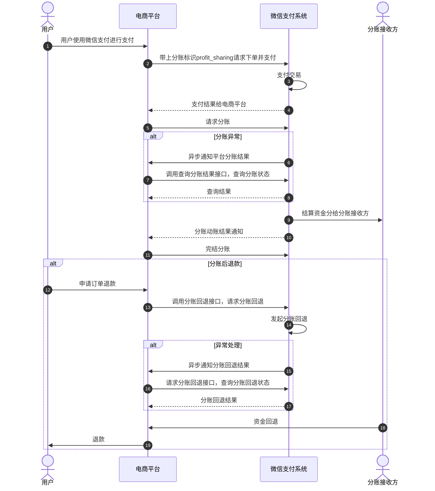

>更新时间：2026.06.10

## 1. 接口规则

为了在保证支付安全的前提下，带给商户简单、一致且易用的开发体验，我们推出了全新的微信支付APIv3接口。该版本API的具体规则请参考[APIv3接口规则](https://pay.weixin.qq.com/doc/v3/merchant/4012081606.md)。

## 2. 开发准备

### 2.1. 搭建和配置开发环境

开发者应当依据自身的编程语言来构建并配置相应的开发环境。

### 2.2. 业务开发配置-分账

需分账的订单，平台在下单时需预先打上分账标识“profit\_sharing”，详细可查看各场景下单API（[普通支付下单](https://pay.weixin.qq.com/doc/v3/partner/4012714678.md)/[合单支付下单](https://pay.weixin.qq.com/doc/v3/partner/4012760615.md)API）。

## 3. 快速接入

### 3.1. 业务流程图-分账



重要步骤说明：

步骤1：平台通过[添加分账接收方API](https://pay.weixin.qq.com/doc/v3/partner/4012477758.md)添加需要分账的分账对象（接收方）；

步骤2：平台预先在[合单支付](https://pay.weixin.qq.com/doc/v3/partner/4012760615.md)/[普通支付](https://pay.weixin.qq.com/doc/v3/partner/4012714678.md)下单API接口中上传分账标识“profit\_sharing”，待订单完成支付后即可调用[请求分账API](https://pay.weixin.qq.com/doc/v3/partner/4012691594.md)接口发起分账请求；

步骤3：请求分账接口采用异步处理模式，即在接收到商户请求后，会先受理请求（受理请求返回的结果非最终分账结果）再异步处理，最终的分账结果需要通过[查询分账结果接口](https://pay.weixin.qq.com/doc/v3/partner/4012477734.md)获取；

步骤4：分账完成后，微信会通过[分账动账通知API](https://pay.weixin.qq.com/doc/v3/partner/4012116672.md)接口，主动通知分账接收方商户；

步骤5：分账发起方商户调用[查询分账结果接口](https://pay.weixin.qq.com/doc/v3/partner/4012477734.md)，主动查询分账结果，根据 `receivers.result` 判断每个接收方的分账结果，如返回 `CLOSED：已关闭`，可根据返回的 `receivers.fail_reason` 分账失败原因参考[分账失败处理指引](https://pay.weixin.qq.com/doc/v3/partner/4015504955.md)进行处理；

步骤6：分账后若产生退款，则需先调用[请求分账回退API](https://pay.weixin.qq.com/doc/v3/partner/4012477737.md) 接口，请求将已经分给分账方的资金回退，再处理退款；

步骤7：分账回退完成后，微信同样会通过[分账动账通知API](https://pay.weixin.qq.com/doc/v3/partner/4012116672.md)接口，主动通知分账回退方商户；

步骤8：分账发起方商户通过[查询分账回退结果API](https://pay.weixin.qq.com/doc/v3/partner/4012477740.md)接口，主动查询分账回退结果；

步骤9：分账结束后，商户需调用[完结分账API](https://pay.weixin.qq.com/doc/v3/partner/4012477745.md)接口结束分账订单。

### 3.2. API接入-分账

本文档展示了如何使用微信支付服务端 SDK 快速接入平台收付通产品，完成与微信支付对接的部分。

注意

- 文档中的代码示例是用来阐述 API 基本使用方法，代码中的示例参数需替换成商户自己账号及请求参数才能跑通。

- 以下接入步骤仅提供参考，请商户结合自身业务需求进行评估、修改。


#### 3.2.1.【服务端】添加分账接收方

步骤说明： 平台可通过此接口添加分账接收方，建立分账接收方列表。后续通过发起分账请求，将平台下的二级商户结算后的资金，分给分账接收方列表中具体的分账接收方。

示例代码

JAVA

```
public void AddProfitsharingReceivers() throws Exception{
  //请求URL
  HttpPost httpPost = new HttpPost("https://api.mch.weixin.qq.com/v3/ecommerce/profitsharing/receivers/add");
  // 请求body参数
  String reqdata = "{"
          + "\"appid\":\"wx8888888888888888\","
          + "\"type\":\"MERCHANT_ID\","
          + "\"account\":\"190001001\","
          + "\"name\":\"张三网络公司\","
          + "\"relation_type\":\"SUPPLIER\""
          + "}";
  StringEntity entity = new StringEntity(reqdata,"utf-8");
  entity.setContentType("application/json");
  httpPost.setEntity(entity);
  httpPost.setHeader("Accept", "application/json");
  //完成签名并执行请求
  CloseableHttpResponse response = httpClient.execute(httpPost);
  try {
      int statusCode = response.getStatusLine().getStatusCode();
      if (statusCode == 200) { //处理成功
          System.out.println("success,return body = " + EntityUtils.toString(response.getEntity()));
      } else if (statusCode == 204) { //处理成功，无返回Body
          System.out.println("success");
      } else {
          System.out.println("failed,resp code = " + statusCode+ ",return body = " + EntityUtils.toString(response.getEntity()));
          throw new IOException("request failed");
      }
  } finally {
      response.close();
  }
}
```

PHP

```
use GuzzleHttp\Exception\RequestException;
use WechatPay\GuzzleMiddleware\WechatPayMiddleware;
use WechatPay\GuzzleMiddleware\Util\PemUtil;
use GuzzleHttp\HandlerStack;
try {
    $resp = $client->request(
        'POST',
        'https://api.mch.weixin.qq.com/v3/ecommerce/profitsharing/receivers/add', //请求URL
        [
            // JSON请求体
            'json' => [
                "appid" => "wx8888888888888888",
                "type" => "MERCHANT_ID",
                "account" => "190001001",
                "name" => "张三网络公司",
                "relation_type" => "SUPPLIER",
            ],
            'headers' => [ 'Accept' => 'application/json' ]
        ]
    );
    $statusCode = $resp->getStatusCode();
    if ($statusCode == 200) { //处理成功
        echo "success,return body = " . $resp->getBody()->getContents()."\n";
    } else if ($statusCode == 204) { //处理成功，无返回Body
        echo "success";
    }
} catch (RequestException $e) {
    // 进行错误处理
    echo $e->getMessage()."\n";
    if ($e->hasResponse()) {
        echo "failed,resp code = " . $e->getResponse()->getStatusCode() . " return body = " . $e->getResponse()->getBody() . "\n";
    }
    return;
}
```

更多参数、响应详情及错误码请参见[添加分账接收方API](https://pay.weixin.qq.com/doc/v3/partner/4012477758.md)接口文档。

#### 3.2.2.【服务端】请求分账

步骤说明： 平台，如有订单需要进行分账，可通过此接口完成。

示例代码

JAVA

```
public void Profitsharing() throws Exception{
  //请求URL
  HttpPost httpPost = new HttpPost("https://api.mch.weixin.qq.com/v3/ecommerce/profitsharing/orders");
  // 请求body参数
  String reqdata = "{"
          + "\"sub_mchid\":\"1900000109\","
          + "\"transaction_id\":\"4208450740201411110007820472\","
          + "\"out_order_no\":\"P20150806125346\","
          + "\"receivers\": ["
          + "{"
          + "\"type\":\"MERCHANT_ID\","
          + "\"receiver_account\":\"1900000110\","
          + "\"receiver_mchid\":\"1900000110\","
          + "\"amount\":100,"
          + "\"description\":\"分给商户1900000110\""
          + "}"
          + "],"
          + "\"finish\":true"
          + "}";
  StringEntity entity = new StringEntity(reqdata,"utf-8");
  entity.setContentType("application/json");
  httpPost.setEntity(entity);
  httpPost.setHeader("Accept", "application/json");
  //完成签名并执行请求
  CloseableHttpResponse response = httpClient.execute(httpPost);
  try {
      int statusCode = response.getStatusLine().getStatusCode();
      if (statusCode == 200) { //处理成功
          System.out.println("success,return body = " + EntityUtils.toString(response.getEntity()));
      } else if (statusCode == 204) { //处理成功，无返回Body
          System.out.println("success");
      } else {
          System.out.println("failed,resp code = " + statusCode+ ",return body = " + EntityUtils.toString(response.getEntity()));
          throw new IOException("request failed");
      }
  } finally {
      response.close();
  }
}
```

PHP

```
try {
    $resp = $client->request(
        'POST',
        'https://api.mch.weixin.qq.com/v3/ecommerce/profitsharing/orders', //请求URL
        [
            // JSON请求体
            'json' => [
                "sub_mchid" => "1900000109",
                "transaction_id" => "4208450740201411110007820472",
                "out_order_no" => "P20150806125346",
                "receivers" => [
                    [
                        "type" => "MERCHANT_ID",
                        "receiver_account" => "1900000110",
                        "receiver_mchid" => "1900000110",
                        "amount" => 100,
                        "description" => "分给商户1900000110",
                    ],
                ],
                "finish" => true,
            ],
            'headers' => [ 'Accept' => 'application/json' ]
        ]
    );
    $statusCode = $resp->getStatusCode();
    if ($statusCode == 200) { //处理成功
        echo "success,return body = " . $resp->getBody()->getContents()."\n";
    } else if ($statusCode == 204) { //处理成功，无返回Body
        echo "success";
    }
} catch (RequestException $e) {
    // 进行错误处理
    echo $e->getMessage()."\n";
    if ($e->hasResponse()) {
        echo "failed,resp code = " . $e->getResponse()->getStatusCode() . " return body = " . $e->getResponse()->getBody() . "\n";
    }
    return;
}
```

更多参数、响应详情及错误码请参见[请求分账API](https://pay.weixin.qq.com/doc/v3/partner/4012691594.md)接口文档。

#### 3.2.3.【服务端】分账动账通知

步骤说明： 此功能仅针对分账接收方，当分账动账金额发生变动时，微信会把相关变动结果发送给需要实时关注的分账接收方。

注意

- 支付结果通知是以POST 方法访问商户设置的通知URL，通知的数据以JSON 格式通过请求主体（BODY）传输。通知的数据包括了加密的支付结果详情。

- 加密不能保证通知请求来自微信。微信会对发送给商户的通知进行签名，并将签名值放在通知的HTTP头Wechatpay-Signature。商户应当验证签名，以确认请求来自微信，而不是其他的第三方。签名验证的算法请参考 [《微信支付API v3签名验证》](https://pay.weixin.qq.com/doc/v3/partner/4012365870.md#%E9%AA%8C%E8%AF%81%E7%AD%BE%E5%90%8D)。

- 支付通知HTTP应答码为200或204才会当作正常接收，当回调处理异常时，应答的HTTP状态码应为500，或者4xx。

- 商户成功接收到回调通知后应返回成功的HTTP应答码为200或204。

- 同样的通知可能会多次发送给商户系统。商户系统必须能够正确处理重复的通知。 推荐的做法是，当商户系统收到通知进行处理时，先检查对应业务数据的状态，并判断该通知是否已经处理。如果未处理，则再进行处理；如果已处理，则直接返回结果成功。在对业务数据进行状态检查和处理之前，要采用数据锁进行并发控制，以避免函数重入造成的数据混乱。


更多参数、响应详情及错误码请参见[分账动账通知API接口文档](https://pay.weixin.qq.com/doc/v3/partner/4012116672.md)。

#### 3.2.4. 【服务端】查询分账结果

步骤说明： 平台可通过此接口实时关注订单的分账请求和分账完结情况。

示例代码

JAVA

```
public void QueryProfitsharing() throws Exception{
  //请求URL
  HttpGet httpGet = new HttpGet("https://api.mch.weixin.qq.com/v3/ecommerce/profitsharing/orders?sub_mchid=1900000109&transaction_id=4208450740201411110007820472&out_order_no=P20150806125346");
  httpGet.setHeader("Accept", "application/json");
  //完成签名并执行请求
  CloseableHttpResponse response = httpClient.execute(httpGet);
  try {
      int statusCode = response.getStatusLine().getStatusCode();
      if (statusCode == 200) { //处理成功
          System.out.println("success,return body = " + EntityUtils.toString(response.getEntity()));
      } else if (statusCode == 204) { //处理成功，无返回Body
          System.out.println("success");
      } else {
          System.out.println("failed,resp code = " + statusCode+ ",return body = " + EntityUtils.toString(response.getEntity()));
          throw new IOException("request failed");
      }
  } finally {
      response.close();
  }
}
```

PHP

```
try {
    $resp = $client->request(
        'GET',
        'https://api.mch.weixin.qq.com/v3/ecommerce/profitsharing/orders?sub_mchid=1900000109&transaction_id=4208450740201411110007820472&out_order_no=P20150806125346', //请求URL
        [
            'headers' => [ 'Accept' => 'application/json']
        ]
    );
    $statusCode = $resp->getStatusCode();
    if ($statusCode == 200) { //处理成功
        echo "success,return body = " . $resp->getBody()->getContents()."\n";
    } else if ($statusCode == 204) { //处理成功，无返回Body
        echo "success";
    }
} catch (RequestException $e) {
    // 进行错误处理
    echo $e->getMessage()."\n";
    if ($e->hasResponse()) {
        echo "failed,resp code = " . $e->getResponse()->getStatusCode() . " return body = " . $e->getResponse()->getBody() . "\n";
    }
    return;
}
```

更多参数、响应详情及错误码请参见 [查询分账结果API接口文档](https://pay.weixin.qq.com/doc/v3/partner/4012477734.md)。

#### 3.2.5. 【服务端】请求分账回退

步骤说明： 订单已经分账，在退款时，可以先调此接口，将已分账的资金从分账接收方的账户回退给分账方，再发起退款。

示例代码

JAVA

```
public void Demo() throws Exception{
  //请求URL
  HttpPost httpPost = new HttpPost("https://api.mch.weixin.qq.com/v3/ecommerce/profitsharing/returnorders");
  // 请求body参数
  String reqdata = "{"
          + "\"sub_mchid\":\"1900000109\","
          + "\"order_id\":\"3008450740201411110007820472\","
          + "\"out_order_no\":\"P20150806125346\","
          + "\"out_return_no\":\"R20190516001\","
          + "\"return_mchid\":\"86693852\","
          + "\"amount\":10,"
          + "\"description\":\"分账回退\""
          + "}";
  StringEntity entity = new StringEntity(reqdata,"utf-8");
  entity.setContentType("application/json");
  httpPost.setEntity(entity);
  httpPost.setHeader("Accept", "application/json");
  //完成签名并执行请求
  CloseableHttpResponse response = httpClient.execute(httpPost);
  try {
      int statusCode = response.getStatusLine().getStatusCode();
      if (statusCode == 200) { //处理成功
          System.out.println("success,return body = " + EntityUtils.toString(response.getEntity()));
      } else if (statusCode == 204) { //处理成功，无返回Body
          System.out.println("success");
      } else {
          System.out.println("failed,resp code = " + statusCode+ ",return body = " + EntityUtils.toString(response.getEntity()));
          throw new IOException("request failed");
      }
  } finally {
      response.close();
  }
}
```

PHP

```
try {
    $resp = $client->request(
        'POST',
        'https://api.mch.weixin.qq.com/v3/ecommerce/profitsharing/returnorders', //请求URL
        [
            // JSON请求体
            'json' => [
                "sub_mchid" => "1900000109",
                "order_id" => "3008450740201411110007820472",
                "out_order_no" => "P20150806125346",
                "out_return_no" => "R20190516001",
                "return_mchid" => "86693852",
                "amount" => 10,
                "description" => "分账回退",
            ],
            'headers' => [ 'Accept' => 'application/json' ]
        ]
    );
    $statusCode = $resp->getStatusCode();
    if ($statusCode == 200) { //处理成功
        echo "success,return body = " . $resp->getBody()->getContents()."\n";
    } else if ($statusCode == 204) { //处理成功，无返回Body
        echo "success";
    }
} catch (RequestException $e) {
    // 进行错误处理
    echo $e->getMessage()."\n";
    if ($e->hasResponse()) {
        echo "failed,resp code = " . $e->getResponse()->getStatusCode() . " return body = " . $e->getResponse()->getBody() . "\n";
    }
    return;
}
```

更多参数、响应详情及错误码请参见[请求分账回退API](https://pay.weixin.qq.com/doc/v3/partner/4012477737.md) 接口文档。

#### 3.2.6. 【服务端】查询分账回退结果

步骤说明： 商户需要核实回退结果，可调用此接口查询回退结果;如果分账回退接口返回状态为处理中，可调用此接口查询回退结果。

示例代码

JAVA

```
public void QueryFallbackProfitsharing() throws Exception{
  //请求URL
  HttpGet httpGet = new HttpGet("https://api.mch.weixin.qq.com/v3/ecommerce/profitsharing/returnorders?sub_mchid=1900000109&out_order_no=P20150806125346&out_return_no=R20190516001");
  httpGet.setHeader("Accept", "application/json");
  //完成签名并执行请求
  CloseableHttpResponse response = httpClient.execute(httpGet);
  try {
      int statusCode = response.getStatusLine().getStatusCode();
      if (statusCode == 200) { //处理成功
          System.out.println("success,return body = " + EntityUtils.toString(response.getEntity()));
      } else if (statusCode == 204) { //处理成功，无返回Body
          System.out.println("success");
      } else {
          System.out.println("failed,resp code = " + statusCode+ ",return body = " + EntityUtils.toString(response.getEntity()));
          throw new IOException("request failed");
      }
  } finally {
      response.close();
  }
}
```

PHP

```
try {
    $resp = $client->request(
        'GET',
        'https://api.mch.weixin.qq.com/v3/ecommerce/profitsharing/returnorders?sub_mchid=1900000109&out_order_no=P20150806125346&out_return_no=R20190516001', //请求URL
        [
            'headers' => [ 'Accept' => 'application/json']
        ]
    );
    $statusCode = $resp->getStatusCode();
    if ($statusCode == 200) { //处理成功
        echo "success,return body = " . $resp->getBody()->getContents()."\n";
    } else if ($statusCode == 204) { //处理成功，无返回Body
        echo "success";
    }
} catch (RequestException $e) {
    // 进行错误处理
    echo $e->getMessage()."\n";
    if ($e->hasResponse()) {
        echo "failed,resp code = " . $e->getResponse()->getStatusCode() . " return body = " . $e->getResponse()->getBody() . "\n";
    }
    return;
}
```

更多参数、响应详情及错误码请参见[查询分账回退结果API](https://pay.weixin.qq.com/doc/v3/partner/4012477740.md) 接口文档。

#### 3.2.7. 【服务端】完结分账

步骤说明： 不需要进行分账的订单，可直接调用本接口将订单的金额全部解冻给二级商户。

示例代码

JAVA

```
public void FinishProfitsharing() throws Exception{
  //请求URL
  HttpPost httpPost = new HttpPost("https://api.mch.weixin.qq.com/v3/ecommerce/profitsharing/finish-order");
  // 请求body参数
  String reqdata = "{"
          + "\"sub_mchid\":\"1900000109\","
          + "\"transaction_id\":\"4208450740201411110007820472\","
          + "\"out_order_no\":\"P20150806125346\","
          + "\"description\":\"分账完结\""
          + "}";
  StringEntity entity = new StringEntity(reqdata,"utf-8");
  entity.setContentType("application/json");
  httpPost.setEntity(entity);
  httpPost.setHeader("Accept", "application/json");
  //完成签名并执行请求
  CloseableHttpResponse response = httpClient.execute(httpPost);
  try {
      int statusCode = response.getStatusLine().getStatusCode();
      if (statusCode == 200) { //处理成功
          System.out.println("success,return body = " + EntityUtils.toString(response.getEntity()));
      } else if (statusCode == 204) { //处理成功，无返回Body
          System.out.println("success");
      } else {
          System.out.println("failed,resp code = " + statusCode+ ",return body = " + EntityUtils.toString(response.getEntity()));
          throw new IOException("request failed");
      }
  } finally {
      response.close();
  }
}
```

PHP

```
try {
    $resp = $client->request(
        'POST',
        'https://api.mch.weixin.qq.com/v3/ecommerce/profitsharing/finish-order', //请求URL
        [
            // JSON请求体
            'json' => [
                "sub_mchid" => "1900000109",
                "transaction_id" => "4208450740201411110007820472",
                "out_order_no" => "P20150806125346",
                "description" => "分账完结",
            ],
            'headers' => [ 'Accept' => 'application/json' ]
        ]
    );
    $statusCode = $resp->getStatusCode();
    if ($statusCode == 200) { //处理成功
        echo "success,return body = " . $resp->getBody()->getContents()."\n";
    } else if ($statusCode == 204) { //处理成功，无返回Body
        echo "success";
    }
} catch (RequestException $e) {
    // 进行错误处理
    echo $e->getMessage()."\n";
    if ($e->hasResponse()) {
        echo "failed,resp code = " . $e->getResponse()->getStatusCode() . " return body = " . $e->getResponse()->getBody() . "\n";
    }
    return;
}
```

更多参数、响应详情及错误码请参见[完结分账API](https://pay.weixin.qq.com/doc/v3/partner/4012477745.md)接口文档。

#### 3.2.8. 【服务端】查询订单剩余待分金额

步骤说明： 分账接口支持对一笔订单进行多次分账，在这过程中，你可以使用该接口查询订单剩余的可进行分账的金额。

示例代码

JAVA

```
public void QueryProfitsharingAmounts() throws Exception{
  //请求URL
  HttpGet httpGet = new HttpGet("https://api.mch.weixin.qq.com/v3/ecommerce/profitsharing/orders/4208450740201411110007820472/amounts");
  httpGet.setHeader("Accept", "application/json");
  //完成签名并执行请求
  CloseableHttpResponse response = httpClient.execute(httpGet);
  try {
      int statusCode = response.getStatusLine().getStatusCode();
      if (statusCode == 200) { //处理成功
          System.out.println("success,return body = " + EntityUtils.toString(response.getEntity()));
      } else if (statusCode == 204) { //处理成功，无返回Body
          System.out.println("success");
      } else {
          System.out.println("failed,resp code = " + statusCode+ ",return body = " + EntityUtils.toString(response.getEntity()));
          throw new IOException("request failed");
      }
  } finally {
      response.close();
  }
}
```

PHP

```
try {
    $resp = $client->request(
        'GET',
        'https://api.mch.weixin.qq.com/v3/ecommerce/profitsharing/orders/4208450740201411110007820472/amounts', //请求URL
        [
            'headers' => [ 'Accept' => 'application/json']
        ]
    );
    $statusCode = $resp->getStatusCode();
    if ($statusCode == 200) { //处理成功
        echo "success,return body = " . $resp->getBody()->getContents()."\n";
    } else if ($statusCode == 204) { //处理成功，无返回Body
        echo "success";
    }
} catch (RequestException $e) {
    // 进行错误处理
    echo $e->getMessage()."\n";
    if ($e->hasResponse()) {
        echo "failed,resp code = " . $e->getResponse()->getStatusCode() . " return body = " . $e->getResponse()->getBody() . "\n";
    }
    return;
}
```

更多参数、响应详情及错误码请参见[查询订单剩余待分金额API](https://pay.weixin.qq.com/doc/v3/partner/4012477751.md)接口文档。

#### 3.2.9. 【服务端】删除分账接收方

步骤说明： 平台发起删除分账接收方请求。删除后，不支持将平台下二级商户结算后的资金，分到该分账接收方。

示例代码

JAVA

```
public void DeleteProfitsharingReceivers() throws Exception{
  //请求URL
  HttpPost httpPost = new HttpPost("https://api.mch.weixin.qq.com/v3/ecommerce/profitsharing/receivers/delete");
  // 请求body参数
  String reqdata = "{"
          + "\"appid\":\"wx8888888888888888\","
          + "\"type\":\"MERCHANT_ID\","
          + "\"account\":\"190001001\""
          + "}";
  StringEntity entity = new StringEntity(reqdata,"utf-8");
  entity.setContentType("application/json");
  httpPost.setEntity(entity);
  httpPost.setHeader("Accept", "application/json");
  //完成签名并执行请求
  CloseableHttpResponse response = httpClient.execute(httpPost);
  try {
      int statusCode = response.getStatusLine().getStatusCode();
      if (statusCode == 200) { //处理成功
          System.out.println("success,return body = " + EntityUtils.toString(response.getEntity()));
      } else if (statusCode == 204) { //处理成功，无返回Body
          System.out.println("success");
      } else {
          System.out.println("failed,resp code = " + statusCode+ ",return body = " + EntityUtils.toString(response.getEntity()));
          throw new IOException("request failed");
      }
  } finally {
      response.close();
  }
}
```

PHP

```
try {
    $resp = $client->request(
        'POST',
        'https://api.mch.weixin.qq.com/v3/ecommerce/profitsharing/receivers/delete', //请求URL
        [
            // JSON请求体
            'json' => [
                "appid" => "wx8888888888888888",
                "type" => "MERCHANT_ID",
                "account" => "190001001",
            ],
            'headers' => [ 'Accept' => 'application/json' ]
        ]
    );
    $statusCode = $resp->getStatusCode();
    if ($statusCode == 200) { //处理成功
        echo "success,return body = " . $resp->getBody()->getContents()."\n";
    } else if ($statusCode == 204) { //处理成功，无返回Body
        echo "success";
    }
} catch (RequestException $e) {
    // 进行错误处理
    echo $e->getMessage()."\n";
    if ($e->hasResponse()) {
        echo "failed,resp code = " . $e->getResponse()->getStatusCode() . " return body = " . $e->getResponse()->getBody() . "\n";
    }
    return;
}
```

更多参数、响应详情及错误码请参见 [删除分账接收方API](https://pay.weixin.qq.com/doc/v3/partner/4012477759.md)接口文档。