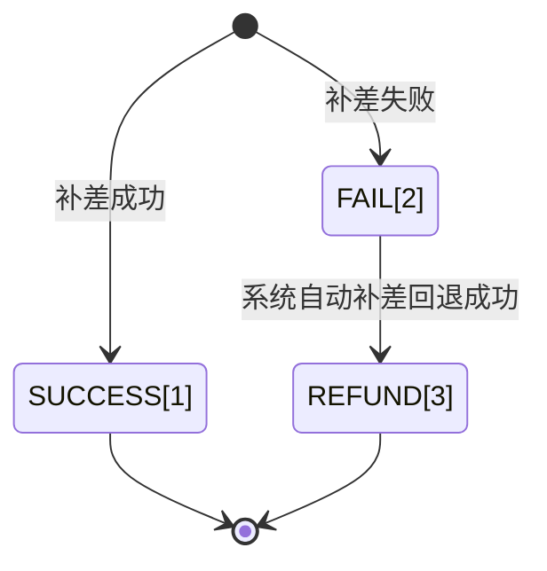
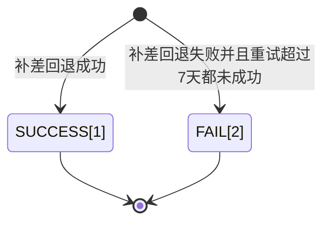

>更新时间：2026.06.10

## 1. 目标

通过本教程的学习，你应该可以通过微信支付补差的API完成补差业务，API操作包括：

- 通过[请求补差](https://pay.weixin.qq.com/doc/v3/partner/4012477631.md)发起订单补差请求

- 通过[取消补差](https://pay.weixin.qq.com/doc/v3/partner/4012477639.md)发起订单补差取消

- 通过[请求补差回退](https://pay.weixin.qq.com/doc/v3/partner/4012477636.md)发起补差回退


## 2. 业务处理流程

### 2.1 请求补差

#### 2.1.1 请求时机

平台商户下单的时候带上分账和补差标识，微信订单支付成功并结算完成后，发起分账前，调用这个接口进行补差。

#### 2.1.2 请求补差条件

- 电商平台下单时传入补差金额

- 账户余额充足

- 补差金额需要和下单的时候的补差金额保持一致(当订单发生用户退款时，该金额可以小于下单填写的补差金额)。

- 一笔订单只能补差一笔


补差单的状态机：



```
package com.java.demo.subsidy;

import com.java.demo.CreateSubsidy; // 使用请求补差接口：https://pay.weixin.qq.com/doc/v3/partner/4012477631
import static com.java.demo.CreateSubsidy.*;
import com.java.utils.WXPayUtility; // 引用微信支付工具库，参考：https://pay.weixin.qq.com/doc/v3/partner/4014985777

public class CreateSubsidyDemo {

  public static void main(String[] argv) {
    // TODO: 请准备商户开发必要参数，参考：https://pay.weixin.qq.com/doc/v3/partner/4013080340
    CreateSubsidy client = new CreateSubsidy(
      "19xxxxxxxx",                    // 商户号，是由微信支付系统生成并分配给每个商户的唯一标识符，商户号获取方式参考 https://pay.weixin.qq.com/doc/v3/partner/4013080340
      "1DDE55AD98Exxxxxxxxxx",         // 商户API证书序列号，如何获取请参考 https://pay.weixin.qq.com/doc/v3/partner/4013058924
      "/path/to/apiclient_key.pem",    // 商户API证书私钥文件路径，本地文件路径
      "PUB_KEY_ID_xxxxxxxxxxxxx",      // 微信支付公钥ID，如何获取请参考 https://pay.weixin.qq.com/doc/v3/partner/4013038589
      "/path/to/wxp_pub.pem"          // 微信支付公钥文件路径，本地文件路径
    );

    SubsidiesCreateRequest request = new SubsidiesCreateRequest();
    // 二级子商户
    request.subMchid = "1900000109";
    // 微信支付订单号，即电商平台下单返回的微信支付订单号
    request.transactionId = "4208450740201411110007820472";
    // 补差金额，默认需要和下单时的补差金额一致，如果该笔订单存在退款，这个金额可以小于下单时的补差金额
    request.amount = 10L;
    // 补差描述信息
    request.description = "测试备注";
    // 商户补差单号，要求平台商户下唯一
    request.outSubsidyNo = "P20150806125347";
    try {
      SubsidiesCreateEntity response = client.run(request);
      // 请求成功，根据返回的状态处理业务逻辑
      if (response.result == CreateStatus.SUCCESS) {
        // 补差成功，商户可以更新自己的业务单据状态
        // ....
      } else if (response.result == CreateStatus.FAIL) {
        // 补差失败，这个非终态，微信支付系统会最终扭转到REFUND状态
        // 商户如果还需要发起补差，可以换单（换outSubsidyNo）重试
      } else if (response.result == CreateStatus.REFUND) {
        // 补差失败，并且已经回退成功
        // 改状态为终态，商户如果没有换单（outSubsidyNo）直接重试，那么还是一直返回REFUND状态
        // 商户如果还需要发起补差，需要换单（换outSubsidyNo）重试
      } else {
        // 非法状态
        throw new RuntimeException("非法的补差单状态");
      }
    } catch (WXPayUtility.ApiException e) {
      // 异常处理逻辑
      if (e.getErrorCode().equals("SYSTEM_ERROR")) {
        // 错误：系统错误
        // 解决方式：稍后原单重试
        // 描述：微信支付系统失败，一定要原单重试，系统失败直接立即重试大概率还会是系统失败，建议等1分钟后再原单重试
      } else if (e.getErrorCode().equals("FREQUENCY_LIMITED")) {
        // 错误：限频报错
        // 解决方式：稍后原单重试
        // 描述： 接口频率限制，直接立即重试大概率还会是系统失败，建议等1分钟后再原单重试
      } else if (e.getErrorCode().equals("NO_AUTH")) {
        // 错误：无分账权限
        // 解决方式：
        //    1. 检查商户是否是被处罚：登录商户平台进入账户中心-违约记录查询是否违约记录，如果有按照上面的指引解决违约记录之后重试
        //    2. 检查二级子商户是否已授权平台商户分账权限：登录商户平台进入产品中心-特约商户授权产品，在特约商户列表中看看该二级商户是否存在并且授权状态为“已授权”，
        //       如果不存在或者授权状态不是“已授权”就需要发起授权邀请，等二级商户审批之后重新查询一遍，授权状态为“已授权”之后再重试
        // 描述：平台商户被处罚或者平台商户和二级子商户没有父子受理关系
      } else if (e.getErrorCode().equals("SIGN_ERROR")) {
        // 错误：签名错误
        // 解决方式：检查平台商户证书序列号，证书私钥文件，公钥ID，公钥文件，同时确认下签名过程是不是按照微信支付的签名方式
        // 描述：签名报错，需要确认签名材料和签名流程是否正确
      } else if (e.getErrorCode().equals("PARAM_ERROR")) {
        // 错误：参数错误
        // 解决方式：按照报错返回的message，重新输入请求参数
        // 描述：参数的类型，长度，或者必填选项没有填写等，大概率是传的微信支付订单号是非法的
      } else if (e.getErrorCode().equals("NOT_ENOUGH")) {
        // 错误：账户余额不足
        // 解决方式：商户充值之后原单重试
        // 描述：商户账户余额不足，导致退款失败，商户充值之后一定要原单重试
      } else if (e.getErrorCode().equals("ORDER_NOT_EXIST")) {
        // 错误：微信支付订单号不存在
        // 解决方式：确认请求参数里面的微信支付订单号，并且这个订单号是属于请求里的二级子商户
        // 描述：微信支付订单号不存在
      } else if (e.getErrorCode().equals("INVALID_REQUEST")) {
        // 错误：请求非法，请求参数正确，但是不符合补差业务规则
        // 解决方式：根据具体message查看具体哪里不符合业务规则，如果可以修改参数达到符合业务规则的修改请求符合业务规则之后再原单重试
        // 描述：不符合业务规则的场景如：
        //        - 补差单创建超过180天了，还在一直重试请求补差
        //        - 该笔订单非分账订单或者非补差订单，不能请求补差
        //        - 该笔订单已经补差过了，不能再进行补差了
        //        - 该商户没有分账权限，不能请求补差
        //        - 该笔订单还未完成结算，需要等一会（建议5分钟）原单重试
        //        - 已经存在了一笔商户补差单号对应的补差单，但是补差单的信息和此次请求的参数不一致
        //        - 请求中的补差金额超过了下单时的补差金额
        //        - 订单没有退款，补差金额不能小于下单时金额
      } else {
        // 其他类型错误：稍等一会后原单重试
      }
      throw e;
    }
  }
}
```

### 2.2 取消补差

#### 2.2.1 取消补差的时机

对带有补差标识的订单，如果不需要补差，可在发起发起分账前，可调用这个接口进行取消补差

此接口采用同步处理模式，即在接收到商户请求后，会实时返回处理结果。

#### 2.2.2 取消补差的条件

订单发生过退款

```
package com.java.demo.subsidy;

import com.java.demo.CancelSubsidy; // 使用取消补差接口：https://pay.weixin.qq.com/doc/v3/partner/4012477639
import static com.java.demo.CancelSubsidy.*;
import com.java.utils.WXPayUtility; // 引用微信支付工具库，参考：https://pay.weixin.qq.com/doc/v3/partner/4014985777

public class CancelSubsidyDemo {

  public static void main(String[] argv) {
    // TODO: 请准备商户开发必要参数，参考：https://pay.weixin.qq.com/doc/v3/partner/4013080340
    CancelSubsidy client = new CancelSubsidy(
      "19xxxxxxxx",                    // 商户号，是由微信支付系统生成并分配给每个商户的唯一标识符，商户号获取方式参考 https://pay.weixin.qq.com/doc/v3/partner/4013080340
      "1DDE55AD98Exxxxxxxxxx",         // 商户API证书序列号，如何获取请参考 https://pay.weixin.qq.com/doc/v3/partner/4013058924
      "/path/to/apiclient_key.pem",    // 商户API证书私钥文件路径，本地文件路径
      "PUB_KEY_ID_xxxxxxxxxxxxx",      // 微信支付公钥ID，如何获取请参考 https://pay.weixin.qq.com/doc/v3/partner/4013038589
      "/path/to/wxp_pub.pem"          // 微信支付公钥文件路径，本地文件路径
    );

    SubsidiesCancelRequest request = new SubsidiesCancelRequest();
    // 二级子商户
    request.subMchid = "1900013401";
    // 微信支付订单号，即电商平台下单返回的微信支付订单号
    request.transactionId = "4208450740201411110007820472";
    // 取消补差描述
    request.description = "订单退款";
    try {
      SubsidiesCancelEntity response = client.run(request);
      // 请求取消补差成功之后，返回的result理论上只有SUCCESS，表示取消补差成功，该笔订单可以发起分账了
      // 如果返回的result不是SUCCESS认为是微信支付系统失败，可以找微信支付助手帮忙定位
    } catch (WXPayUtility.ApiException e) {
      // 异常处理逻辑
      if (e.getErrorCode().equals("SYSTEM_ERROR")) {
        // 错误：系统错误
        // 解决方式：稍后重试
        // 描述：微信支付系统失败，系统失败直接立即重试大概率还会是系统失败，建议等1分钟后再重试
      } else if (e.getErrorCode().equals("FREQUENCY_LIMITED")) {
        // 错误：限频报错
        // 解决方式：稍后原单重试
        // 描述： 接口频率限制，直接立即重试大概率还会是系统失败，建议等1分钟后再重试
      } else if (e.getErrorCode().equals("NO_AUTH")) {
        // 错误：无分账权限
        // 解决方式：
        //    1. 检查商户是否是被处罚：登录商户平台进入账户中心-违约记录查询是否违约记录，如果有按照上面的指引解决违约记录之后重试
        //    2. 检查二级子商户是否已授权平台商户分账权限：登录商户平台进入产品中心-特约商户授权产品，在特约商户列表中看看该二级商户是否存在并且授权状态为“已授权”，
        //       如果不存在或者授权状态不是“已授权”就需要发起授权邀请，等二级商户审批之后重新查询一遍，授权状态为“已授权”之后再重试
        // 描述：平台商户被处罚或者平台商户和二级子商户没有父子受理关系
      } else if (e.getErrorCode().equals("SIGN_ERROR")) {
        // 错误：签名错误
        // 解决方式：检查平台商户证书序列号，证书私钥文件，公钥ID，公钥文件，同时确认下签名过程是不是按照微信支付的签名方式
        // 描述：签名报错，需要确认签名材料和签名流程是否正确
      } else if (e.getErrorCode().equals("PARAM_ERROR")) {
        // 错误：参数错误
        // 解决方式：按照报错返回的message，重新输入请求参数
        // 描述：参数的类型，长度，或者必填选项没有填写等，大概率是传的微信支付订单号是非法的
      } else if (e.getErrorCode().equals("ORDER_NOT_EXIST")) {
        // 错误：微信支付订单号不存在
        // 解决方式：确认请求参数里面的微信支付订单号，并且这个订单号是属于请求里的二级子商户
        // 描述：微信支付订单号不存在
      } else if (e.getErrorCode().equals("INVALID_REQUEST")) {
        // 错误：请求非法，请求参数正确，但是不符合补差业务规则
        // 解决方式：根据具体message查看具体哪里不符合业务规则，如果可以修改参数达到符合业务规则的修改请求符合业务规则之后再原单重试
        // 描述：不符合业务规则的场景如：
        //        - 该笔订单非分账订单或者非补差订单，不能请求取消补差
        //        - 订单不能取消补差，未发生过退款或者已经补差完成了
      } else {
        // 其他类型错误：稍等一会后原单重试
      }
      throw e;
    }
  }
}
```

### 2.3 补差回退

订单发生退款的时候，可以对补差成功的补差单发起回退。

- 补差回退以原补差单位依据，支持多次回退，申请回退总金额不能超过补差金额。

- 此接口采用同步处理模式，即在接收到商户请求后，会实时返回处理结果。

- 一笔微信退款单只允许补差回退一次。

- 一笔微信支付订单最多只能补差回退500次

- 一笔补差单最多只能补差回退50次


补差回退单状态：



```
package com.java.demo.subsidy;

import com.java.demo.CancelSubsidy; // 使用取消补差接口：https://pay.weixin.qq.com/doc/v3/partner/4012477639
import static com.java.demo.CancelSubsidy.*;
import com.java.utils.WXPayUtility; // 引用微信支付工具库，参考：https://pay.weixin.qq.com/doc/v3/partner/4014985777

public class CancelSubsidyDemo {

  public static void main(String[] argv) {
    // TODO: 请准备商户开发必要参数，参考：https://pay.weixin.qq.com/doc/v3/partner/4013080340
    CancelSubsidy client = new CancelSubsidy(
      "19xxxxxxxx",                    // 商户号，是由微信支付系统生成并分配给每个商户的唯一标识符，商户号获取方式参考 https://pay.weixin.qq.com/doc/v3/partner/4013080340
      "1DDE55AD98Exxxxxxxxxx",         // 商户API证书序列号，如何获取请参考 https://pay.weixin.qq.com/doc/v3/partner/4013058924
      "/path/to/apiclient_key.pem",    // 商户API证书私钥文件路径，本地文件路径
      "PUB_KEY_ID_xxxxxxxxxxxxx",      // 微信支付公钥ID，如何获取请参考 https://pay.weixin.qq.com/doc/v3/partner/4013038589
      "/path/to/wxp_pub.pem"          // 微信支付公钥文件路径，本地文件路径
    );

    SubsidiesCancelRequest request = new SubsidiesCancelRequest();
    // 二级子商户
    request.subMchid = "1900013401";
    // 微信支付订单号，即电商平台下单返回的微信支付订单号
    request.transactionId = "4208450740201411110007820472";
    // 取消补差描述
    request.description = "订单退款";
    try {
      SubsidiesCancelEntity response = client.run(request);
      // 请求取消补差成功之后，返回的result理论上只有SUCCESS，表示取消补差成功，该笔订单可以发起分账了
      // 如果返回的result不是SUCCESS认为是微信支付系统失败，可以找微信支付助手帮忙定位
    } catch (WXPayUtility.ApiException e) {
      // 异常处理逻辑
      if (e.getErrorCode().equals("SYSTEM_ERROR")) {
        // 错误：系统错误
        // 解决方式：稍后重试
        // 描述：微信支付系统失败，系统失败直接立即重试大概率还会是系统失败，建议等1分钟后再重试
      } else if (e.getErrorCode().equals("FREQUENCY_LIMITED")) {
        // 错误：限频报错
        // 解决方式：稍后原单重试
        // 描述： 接口频率限制，直接立即重试大概率还会是系统失败，建议等1分钟后再重试
      } else if (e.getErrorCode().equals("NO_AUTH")) {
        // 错误：无分账权限
        // 解决方式：
        //    1. 检查商户是否是被处罚：登录商户平台进入账户中心-违约记录查询是否违约记录，如果有按照上面的指引解决违约记录之后重试
        //    2. 检查二级子商户是否已授权平台商户分账权限：登录商户平台进入产品中心-特约商户授权产品，在特约商户列表中看看该二级商户是否存在并且授权状态为“已授权”，
        //       如果不存在或者授权状态不是“已授权”就需要发起授权邀请，等二级商户审批之后重新查询一遍，授权状态为“已授权”之后再重试
        // 描述：平台商户被处罚或者平台商户和二级子商户没有父子受理关系
      } else if (e.getErrorCode().equals("SIGN_ERROR")) {
        // 错误：签名错误
        // 解决方式：检查平台商户证书序列号，证书私钥文件，公钥ID，公钥文件，同时确认下签名过程是不是按照微信支付的签名方式
        // 描述：签名报错，需要确认签名材料和签名流程是否正确
      } else if (e.getErrorCode().equals("PARAM_ERROR")) {
        // 错误：参数错误
        // 解决方式：按照报错返回的message，重新输入请求参数
        // 描述：参数的类型，长度，或者必填选项没有填写等，大概率是传的微信支付订单号是非法的
      } else if (e.getErrorCode().equals("ORDER_NOT_EXIST")) {
        // 错误：微信支付订单号不存在
        // 解决方式：确认请求参数里面的微信支付订单号，并且这个订单号是属于请求里的二级子商户
        // 描述：微信支付订单号不存在
      } else if (e.getErrorCode().equals("INVALID_REQUEST")) {
        // 错误：请求非法，请求参数正确，但是不符合补差业务规则
        // 解决方式：根据具体message查看具体哪里不符合业务规则，如果可以修改参数达到符合业务规则的修改请求符合业务规则之后再原单重试
        // 描述：不符合业务规则的场景如：
        //        - 该笔订单非分账订单或者非补差订单，不能请求取消补差
        //        - 订单不能取消补差，未发生过退款或者已经补差完成了
      } else {
        // 其他类型错误：稍等一会后原单重试
      }
      throw e;
    }
  }
}
```