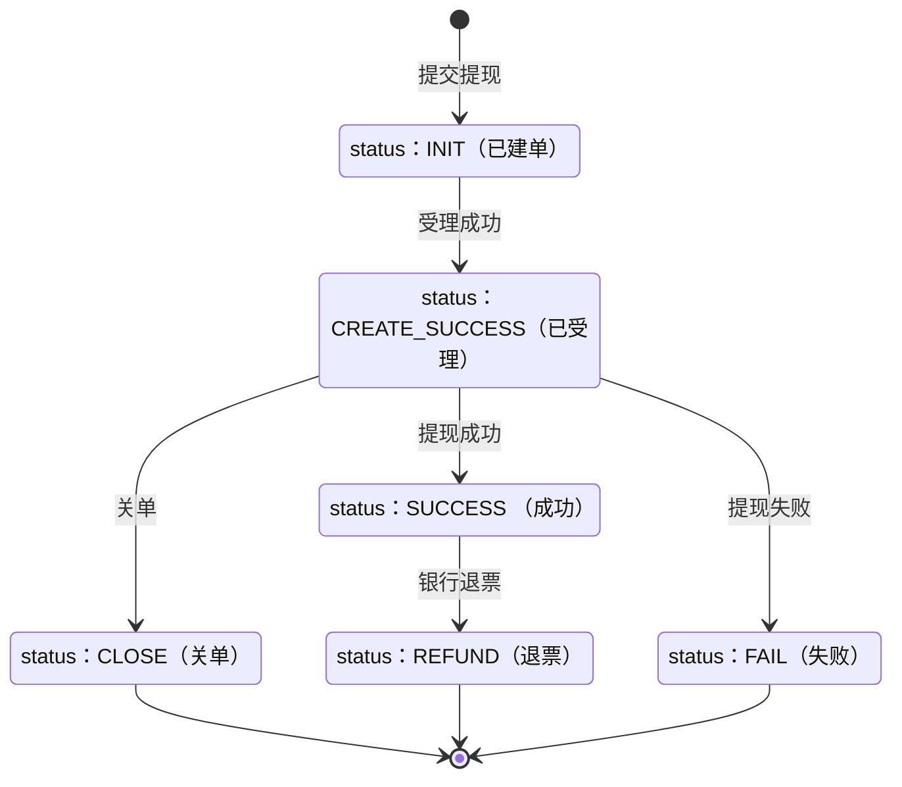
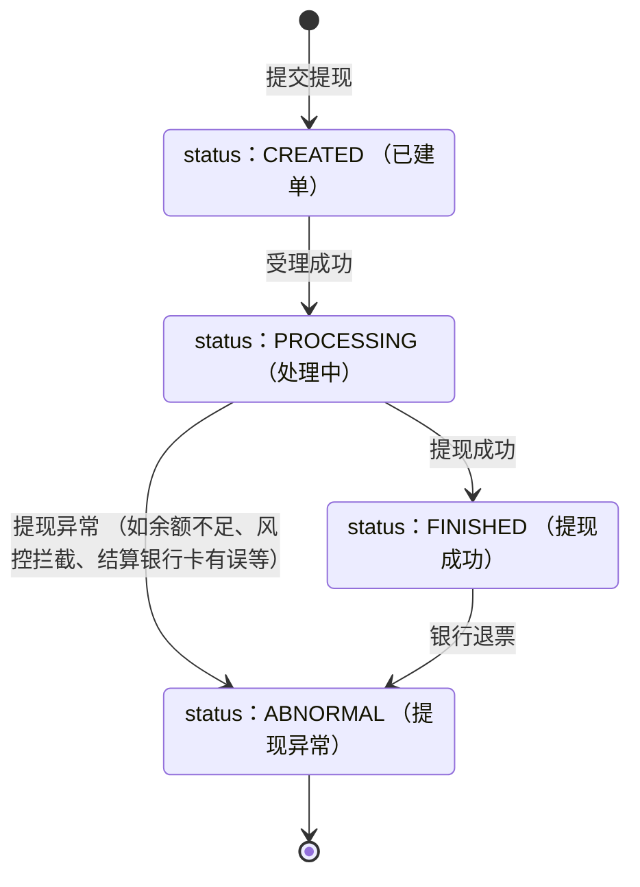

>更新时间：2026.06.10

## 1. 目标

通过本教程的学习，你应该可以：

- 通过[收付通平台预约提现](https://pay.weixin.qq.com/doc/v3/partner/4012476670.md)接口，将收付通平台自身的收入进行预约提现

- 通过[二级商户预约提现](https://pay.weixin.qq.com/doc/v3/partner/4012476652.md)接口，帮助收付通平台二级商户发起账户预约提现申请，完成账户提现

- 通过[二级商户按日终余额预约提现](https://pay.weixin.qq.com/doc/v3/partner/4013328143.md)接口，按前一天日终余额为二级商户发起基本户提现

- 通过[平台查询预约提现状态](https://pay.weixin.qq.com/doc/v3/partner/4012476672.md)接口，查询收付通平台自身的预约提现单状态

- 通过[二级商户查询预约提现状态](https://pay.weixin.qq.com/doc/v3/partner/4012476656.md)接口，查询二级商户的预约提现单状态

- 通过[查询二级商户按日终余额预约提现状态](https://pay.weixin.qq.com/doc/v3/partner/4013328163.md)接口，查询按日终余额预约提现单的状态

- 通过[按日下载提现异常文件](https://pay.weixin.qq.com/doc/v3/partner/4012476678.md)接口，按日查询并下载提现状态为异常的提现单

- 通过接收[商户提现状态变更通知](https://pay.weixin.qq.com/doc/v3/partner/4013049135.md)回调，异步获知预约提现单据的状态变更（提现成功、失败、退票、关单）

- 了解预约提现单据的状态流转规则，正确处理各种状态和错误码


## 2. 业务处理流程

### 2.1 提现流程

收付通平台预约提现/二级商户预约提现单状态流转



二级商户按日终余额预约提现单状态流转



#### 平台自身提现

- 调用收付通平台预约提现接口将平台自身的余额进行提现，系统将在次日发起提现，预计当日到账

- 发起的预约提现时需通过 `notify_url` 设置回调地址（必须为 HTTPS 协议）

- 微信支付会在提现状态发生变更时（成功、失败、退票、关单）异步推送结果

- 商户系统不能仅依赖回调通知，需结合查询接口使用，如出现结果显示异常（提现失败、银行退票）可以调用「按日下载提现异常文件」获取信息

- 当 API 返回错误码为 `SYSTEM_ERROR` 时： 务必不要换单重试，使用原单（所有请求参数保持不变）发起重试


##### 申请收付通平台预约提现

收付通平台通过该接口可将其平台的收入进行预约提现，接口文档参考：[收付通平台预约提现](https://pay.weixin.qq.com/doc/v3/partner/4012476670.md)

```
package withdraw

import (
    "demo/wxpay_utility" // 引用微信支付工具库，参考：https://pay.weixin.qq.com/doc/v3/partner/4015119446
    "errors"
    "fmt"
    "time"
)

// NewMchConfig 创建商户配置
func NewMchConfig() (*wxpay_utility.MchConfig, error) {
    return wxpay_utility.CreateMchConfig(
        "19xxxxxxxx",                 // 商户号，是由微信支付系统生成并分配给每个商户的唯一标识符，商户号获取方式参考 https://pay.weixin.qq.com/doc/v3/partner/4013080340
        "1DDE55AD98Exxxxxxxxxx",      // 商户API证书序列号，如何获取请参考 https://pay.weixin.qq.com/doc/v3/partner/4013058924
        "/path/to/apiclient_key.pem", // 商户API证书私钥文件路径，本地文件路径
        "PUB_KEY_ID_xxxxxxxxxxxxx",   // 微信支付公钥ID，如何获取请参考 https://pay.weixin.qq.com/doc/v3/partner/4013038589
        "/path/to/wxp_pub.pem",       // 微信支付公钥文件路径，本地文件路径
    )
}

// HandleCreateWithdraw 使用收付通平台预约提现接口：收付通平台预约提现，参考：https://pay.weixin.qq.com/doc/v3/partner/4012476670
func HandleCreateWithdraw(config *wxpay_utility.MchConfig) error {
    request := &CreateWithdrawRequest{
        // 商户预约提现单号，由商户自定义生成，必须是字母数字
        OutRequestNo: wxpay_utility.String("20190611222222222200000000012122"),
        // 提现金额，单位：分，不能超过8亿元
        Amount: wxpay_utility.Int64(1),
        // 提现备注，商户对预约提现单的备注
        Remark: wxpay_utility.String("交易提现"),
        // 银行附言，展示在收款银行系统中的附言，由数字、字母、汉字组成（能否成功展示依赖银行系统支持）
        BankMemo: wxpay_utility.String("xx平台提现"),
        // 出款账户类型
        AccountType: WITHDRAWACCOUNTTYPE_BASIC.Ptr(),
        // 提现结果通知地址，异步接收提现结果通知的回调地址，必须为HTTPS协议
        NotifyUrl: wxpay_utility.String("https://yourapp.com/notify"),
    }

    resp, err := CreateWithdraw(config, request)
	if err != nil {
        return handleError(err)
    }

    return handleStatus(resp)
}

func handleError(err error) error {
    var apiError *wxpay_utility.ApiException
    if errors.As(err, &apiError) {
        fmt.Printf("状态码: %d\n", apiError.StatusCode())
        fmt.Printf("错误码: %s\n", apiError.ErrorCode())
        fmt.Printf("错误信息: %s\n", apiError.ErrorMessage())
        switch apiError.ErrorCode() {
        case "PARAM_ERROR":
            // 错误：PARAM_ERROR
            // 描述：参数错误
            // 解决方式：请根据错误提示正确传入参数
        case "INVALID_REQUEST":
            // 错误：INVALID_REQUEST
            // 描述：二级商户未开启预约提现权限 / 商户账户类型不存在或未开通 / HTTP请求不符合微信支付APIv3接口规则
            // 解决方式：请确认电商平台商户号和二级商户商户号是否存在受理关系；请确认二级商户账户类型有效
        case "SIGN_ERROR":
            // 错误：SIGN_ERROR
            // 描述：验证不通过
            // 解决方式：请参阅签名常见问题
        case "ACCOUNT_ERROR":
            // 错误：ACCOUNT_ERROR
            // 描述：二级商户未绑卡
            // 解决方式：二级商户号没有绑定结算银行卡，绑定后重试
        case "ACCOUNT_NOT_VERIFIED":
            // 错误：ACCOUNT_NOT_VERIFIED
            // 描述：二级商户下行打款未成功
            // 解决方式：二级商户号结算银行卡信息有误，修改后重试
        case "CONTRACT_NOT_CONFIRMED":
            // 错误：CONTRACT_NOT_CONFIRMED
            // 描述：二级商户未开启预约提现权限
            // 解决方式：二级商户号预约提现权限已关闭，无法发起提现
        case "NO_AUTH":
            // 错误：NO_AUTH
            // 描述：无接口使用权限
            // 解决方式：请开通商户号相关权限
        case "NOT_ENOUGH":
            // 错误：NOT_ENOUGH
            // 描述：二级商户号账户可用余额不足
            // 解决方式：二级商户号账户可用余额不足
        case "REQUEST_BLOCKED":
            // 错误：REQUEST_BLOCKED
            // 描述：二级商户未开启预约提现权限
            // 解决方式：二级商户号预约提现权限被冻结，无法发起预约提现
        case "ORDER_NOT_EXIST":
            // 错误：ORDER_NOT_EXIST
            // 描述：预约提现单号不存在
            // 解决方式：请检查预约提现单号是否正确
        case "FREQUENCY_LIMITED":
            // 错误：FREQUENCY_LIMITED
            // 描述：频率限制
            // 解决方式：请降低频率后重试
        case "SYSTEM_ERROR":
            // 错误：SYSTEM_ERROR
            // 描述：系统错误
            // 解决方式：系统异常，请使用相同参数稍后重新调用
        default:
            // 其他类型错误
        }
    }
    return err
}

func handleStatus(resp *CreateWithdrawResponse) error {
    if resp.WithdrawId == nil {
        return fmt.Errorf("withdraw_id is nil")
    }
    if resp.OutRequestNo == nil {
        return fmt.Errorf("out_request_no is nil")
    }
    return nil
}
```

##### 查询收付通平台预约提现状态

收付通平台通过该接口查询平台自身预约提现单的当前状态，根据商户预约提现单号查询，接口文档参考：[平台查询预约提现状态](https://pay.weixin.qq.com/doc/v3/partner/4012476672.md)

```
package withdraw

import (
    "demo/wxpay_utility" // 引用微信支付工具库，参考：https://pay.weixin.qq.com/doc/v3/partner/4015119446
    "errors"
    "fmt"
)

// NewMchConfig 创建商户配置
func NewMchConfig() (*wxpay_utility.MchConfig, error) {
    return wxpay_utility.CreateMchConfig(
        "19xxxxxxxx",                 // 商户号，是由微信支付系统生成并分配给每个商户的唯一标识符，商户号获取方式参考 https://pay.weixin.qq.com/doc/v3/partner/4013080340
        "1DDE55AD98Exxxxxxxxxx",      // 商户API证书序列号，如何获取请参考 https://pay.weixin.qq.com/doc/v3/partner/4013058924
        "/path/to/apiclient_key.pem", // 商户API证书私钥文件路径，本地文件路径
        "PUB_KEY_ID_xxxxxxxxxxxxx",   // 微信支付公钥ID，如何获取请参考 https://pay.weixin.qq.com/doc/v3/partner/4013038589
        "/path/to/wxp_pub.pem",       // 微信支付公钥文件路径，本地文件路径
    )
}

// HandleQueryWithdrawByOutRequestNo 使用平台查询预约提现状态接口：收付通平台查询预约提现状态（根据商户预约提现单号查询），参考：https://pay.weixin.qq.com/doc/v3/partner/4012476672
func HandleQueryWithdrawByOutRequestNo(config *wxpay_utility.MchConfig) error {
    request := &QueryWithdrawByOutRequestNoRequest{
        // 商户预约提现单号，由商户自定义生成，必须是字母数字
        OutRequestNo: wxpay_utility.String("20190611222222222200000000012122"),
    }

    resp, err := QueryWithdrawByOutRequestNo(config, request)
    if err != nil {
        return handleError(err)
    }

    return handleStatus(resp)
}

func handleError(err error) error {
    var apiError *wxpay_utility.ApiException
    if errors.As(err, &apiError) {
        fmt.Printf("状态码: %d\n", apiError.StatusCode())
        fmt.Printf("错误码: %s\n", apiError.ErrorCode())
        fmt.Printf("错误信息: %s\n", apiError.ErrorMessage())
        switch apiError.ErrorCode() {
        case "PARAM_ERROR":
            // 错误：PARAM_ERROR
            // 描述：参数错误
            // 解决方式：请根据错误提示正确传入参数
        case "INVALID_REQUEST":
            // 错误：INVALID_REQUEST
            // 描述：二级商户未开启预约提现权限 / HTTP请求不符合微信支付APIv3接口规则
            // 解决方式：请确认电商平台商户号和二级商户商户号是否存在受理关系
        case "SIGN_ERROR":
            // 错误：SIGN_ERROR
            // 描述：验证不通过
            // 解决方式：请参阅签名常见问题
        case "ACCOUNT_ERROR":
            // 错误：ACCOUNT_ERROR
            // 描述：二级商户未绑卡
            // 解决方式：二级商户号没有绑定结算银行卡，绑定后重试
        case "ACCOUNT_NOT_VERIFIED":
            // 错误：ACCOUNT_NOT_VERIFIED
            // 描述：二级商户下行打款未成功
            // 解决方式：二级商户号结算银行卡信息有误，修改后重试
        case "CONTRACT_NOT_CONFIRMED":
            // 错误：CONTRACT_NOT_CONFIRMED
            // 描述：二级商户未开启预约提现权限
            // 解决方式：二级商户号提现权限已关闭，无法发起提现
        case "NO_AUTH":
            // 错误：NO_AUTH
            // 描述：无接口使用权限
            // 解决方式：请开通商户号相关权限
        case "NOT_ENOUGH":
            // 错误：NOT_ENOUGH
            // 描述：二级商户号账户可用余额不足
            // 解决方式：二级商户号账户可用余额不足
        case "REQUEST_BLOCKED":
            // 错误：REQUEST_BLOCKED
            // 描述：二级商户未开启预约提现权限
            // 解决方式：二级商户号预约提现权限被冻结，无法发起预约提现
        case "ORDER_NOT_EXIST":
            // 错误：ORDER_NOT_EXIST
            // 描述：预约提现单号不存在
            // 解决方式：请检查预约提现单号是否正确
        case "FREQUENCY_LIMITED":
            // 错误：FREQUENCY_LIMITED
            // 描述：频率限制
            // 解决方式：请降低频率后重试
        case "SYSTEM_ERROR":
            // 错误：SYSTEM_ERROR
            // 描述：系统错误
            // 解决方式：系统异常，请使用相同参数稍后重新调用
        default:
            // 其他类型错误
        }
    }
    return err
}

func handleStatus(resp *Withdraw) error {
    if resp.Status == nil {
        return fmt.Errorf("status is nil")
    }
    switch *resp.Status {
    case WITHDRAWSTATUS_INIT:
        // 业务单已创建，请使用原单(所有请求参数保持不变)发起重试
    case WITHDRAWSTATUS_CREATE_SUCCESS:
        // 受理成功，等待银行返回最终结果，请重试查询或接入商户回调等待后续状态通知
    case WITHDRAWSTATUS_SUCCESS:
        // 提现成功，但不代表银行入账一定成功，部分情况下可能发生银行退票
    case WITHDRAWSTATUS_FAIL:
        // 提现失败
    case WITHDRAWSTATUS_REFUND:
        // 提现退票，请检查登记的账户信息是否有误，退票后资金会自动退回发起时的商户账户内
    case WITHDRAWSTATUS_CLOSE:
        // 关单
    default:
        return fmt.Errorf("unknown status: %s", *resp.Status)
    }
    if resp.WithdrawId == nil {
        return fmt.Errorf("withdraw_id is nil")
    }
    return nil
}
```

#### 二级商户提现

- 调用二级商户预约提现接口帮助二级商户发起提现申请，系统将在次日发起提现，预计当日到账

- 发起的预约提现时需通过 `notify_url` 设置回调地址（必须为 HTTPS 协议）

- 微信支付会在提现状态发生变更时（成功、失败、退票、关单）异步推送结果

- 商户系统不能仅依赖回调通知，需结合查询接口使用，如出现结果显示异常（提现失败、银行退票）可以调用「按日下载提现异常文件」获取信息

- 当 API 返回错误码为 `SYSTEM_ERROR` 时： 务必不要换单重试，使用原单（所有请求参数保持不变）发起重试


##### 申请二级商户预约提现

收付通平台通过预约提现API帮助二级商户发起账户预约提现申请，完成账户提现，接口文档参考：[二级商户预约提现](https://pay.weixin.qq.com/doc/v3/partner/4012476652.md)

```
package withdraw
import (
    "demo/wxpay_utility" // 引用微信支付工具库，参考：https://pay.weixin.qq.com/doc/v3/partner/4015119446
    "errors"
    "fmt"
    "time"
)
// NewMchConfig 创建商户配置
func NewMchConfig() (*wxpay_utility.MchConfig, error) {
    return wxpay_utility.CreateMchConfig(
        "19xxxxxxxx",                 // 商户号，是由微信支付系统生成并分配给每个商户的唯一标识符，商户号获取方式参考 https://pay.weixin.qq.com/doc/v3/partner/4013080340
        "1DDE55AD98Exxxxxxxxxx",      // 商户API证书序列号，如何获取请参考 https://pay.weixin.qq.com/doc/v3/partner/4013058924
        "/path/to/apiclient_key.pem", // 商户API证书私钥文件路径，本地文件路径
        "PUB_KEY_ID_xxxxxxxxxxxxx",   // 微信支付公钥ID，如何获取请参考 https://pay.weixin.qq.com/doc/v3/partner/4013038589
        "/path/to/wxp_pub.pem",       // 微信支付公钥文件路径，本地文件路径
    )
}
// HandleCreateSubMerchantWithdraw 使用二级商户预约提现接口：二级商户预约提现，参考：https://pay.weixin.qq.com/doc/v3/partner/4012476652
func HandleCreateSubMerchantWithdraw(config *wxpay_utility.MchConfig) error {
    request := &CreateSubMerchantWithdrawRequest{
        // 二级商户号，收付通平台二级商户号，由微信支付生成并下发
        SubMchid: wxpay_utility.String("1900000109"),
        // 商户预约提现单号，由商户自定义生成，必须是字母数字
        OutRequestNo: wxpay_utility.String("20190611222222222200000000012122"),
        // 提现金额，单位：分，不能超过8亿元
        Amount: wxpay_utility.Int64(1),
        // 提现备注，商户对预约提现单的备注
        Remark: wxpay_utility.String("交易提现"),
        // 银行附言，展示在收款银行系统中的附言，由数字、字母、汉字组成（能否成功展示依赖银行系统支持）
        BankMemo: wxpay_utility.String("xx平台提现"),
        // 出款账户类型
        AccountType: WITHDRAWACCOUNTTYPE_BASIC.Ptr(),
        // 提现结果通知地址，异步接收提现结果通知的回调地址，必须为HTTPS协议
        NotifyUrl: wxpay_utility.String("https://yourapp.com/notify"),
    }

  	resp, err := CreateSubMerchantWithdraw(config, request)
    if err != nil {
        return handleError(err)
    }
    return handleStatus(resp)
}
func handleError(err error) error {
    var apiError *wxpay_utility.ApiException
    if errors.As(err, &apiError) {
        fmt.Printf("状态码: %d\n", apiError.StatusCode())
        fmt.Printf("错误码: %s\n", apiError.ErrorCode())
        fmt.Printf("错误信息: %s\n", apiError.ErrorMessage())
        switch apiError.ErrorCode() {
        case "PARAM_ERROR":
            // 错误：PARAM_ERROR
            // 描述：参数错误
            // 解决方式：请根据错误提示正确传入参数
        case "INVALID_REQUEST":
            // 错误：INVALID_REQUEST
            // 描述：二级商户未开启预约提现权限 / 商户账户类型不存在或未开通 / HTTP请求不符合微信支付APIv3接口规则
            // 解决方式：请确认电商平台商户号和二级商户商户号是否存在受理关系；请确认二级商户账户类型有效
        case "SIGN_ERROR":
            // 错误：SIGN_ERROR
            // 描述：验证不通过
            // 解决方式：请参阅签名常见问题
        case "ACCOUNT_ERROR":
            // 错误：ACCOUNT_ERROR
            // 描述：二级商户未绑卡
            // 解决方式：二级商户号没有绑定结算银行卡，绑定后重试
        case "ACCOUNT_NOT_VERIFIED":
            // 错误：ACCOUNT_NOT_VERIFIED
            // 描述：二级商户下行打款未成功
            // 解决方式：二级商户号结算银行卡信息有误，修改后重试
        case "CONTRACT_NOT_CONFIRMED":
            // 错误：CONTRACT_NOT_CONFIRMED
            // 描述：二级商户未开启预约提现权限
            // 解决方式：二级商户号预约提现权限已关闭，无法发起预约提现
        case "NO_AUTH":
            // 错误：NO_AUTH
            // 描述：无接口使用权限
            // 解决方式：请开通商户号相关权限
        case "NOT_ENOUGH":
            // 错误：NOT_ENOUGH
            // 描述：二级商户号账户可用余额不足
            // 解决方式：二级商户号账户可用余额不足
        case "REQUEST_BLOCKED":
            // 错误：REQUEST_BLOCKED
            // 描述：二级商户未开启预约提现权限
            // 解决方式：二级商户号预约提现权限被冻结，无法发起预约提现
        case "ORDER_NOT_EXIST":
            // 错误：ORDER_NOT_EXIST
            // 描述：预约提现单号不存在
            // 解决方式：请检查订单号是否正确
        case "FREQUENCY_LIMITED":
            // 错误：FREQUENCY_LIMITED
            // 描述：频率限制
            // 解决方式：请降低频率后重试
        case "SYSTEM_ERROR":
            // 错误：SYSTEM_ERROR
            // 描述：系统错误
            // 解决方式：系统异常，请使用相同参数稍后重新调用
        default:
            // 其他类型错误
        }
    }
    return err
}
func handleStatus(resp *CreateSubMerchantWithdrawResponse) error {
    if resp.WithdrawId == nil {
        return fmt.Errorf("withdraw_id is nil")
    }
    if resp.SubMchid == nil {
        return fmt.Errorf("sub_mchid is nil")
    }
    if resp.OutRequestNo == nil {
        return fmt.Errorf("out_request_no is nil")
    }
    return nil
}
```

##### 查询二级商户预约提现状态

收付通平台通过该接口查询二级商户预约提现单的当前状态，根据商户预约提现单号查询，接口文档参考：[二级商户查询预约提现状态](https://pay.weixin.qq.com/doc/v3/partner/4012476656.md)

```
package withdraw

import (
    "demo/wxpay_utility" // 引用微信支付工具库，参考：https://pay.weixin.qq.com/doc/v3/partner/4015119446
    "errors"
    "fmt"
)

// NewMchConfig 创建商户配置
func NewMchConfig() (*wxpay_utility.MchConfig, error) {
    return wxpay_utility.CreateMchConfig(
        "19xxxxxxxx",                 // 商户号，是由微信支付系统生成并分配给每个商户的唯一标识符，商户号获取方式参考 https://pay.weixin.qq.com/doc/v3/partner/4013080340
        "1DDE55AD98Exxxxxxxxxx",      // 商户API证书序列号，如何获取请参考 https://pay.weixin.qq.com/doc/v3/partner/4013058924
        "/path/to/apiclient_key.pem", // 商户API证书私钥文件路径，本地文件路径
        "PUB_KEY_ID_xxxxxxxxxxxxx",   // 微信支付公钥ID，如何获取请参考 https://pay.weixin.qq.com/doc/v3/partner/4013038589
        "/path/to/wxp_pub.pem",       // 微信支付公钥文件路径，本地文件路径
    )
}

// HandleQuerySubMerchantByOutRequestNo 使用二级商户查询预约提现状态接口：二级商户查询预约提现状态（根据商户预约提现单号查询），参考：https://pay.weixin.qq.com/doc/v3/partner/4012476656
func HandleQuerySubMerchantByOutRequestNo(config *wxpay_utility.MchConfig) error {
    request := &QuerySubMerchantByOutRequestNoRequest{
        // 二级商户号，收付通平台二级商户号，由微信支付生成并下发
        SubMchid: wxpay_utility.String("1900000109"),
        // 商户预约提现单号，由商户自定义生成，必须是字母数字
        OutRequestNo: wxpay_utility.String("20190611222222222200000000012122"),
    }

    resp, err := QuerySubMerchantByOutRequestNo(config, request)
    if err != nil {
        return handleError(err)
    }

    return handleStatus(resp)
}

func handleError(err error) error {
    var apiError *wxpay_utility.ApiException
    if errors.As(err, &apiError) {
        fmt.Printf("状态码: %d\n", apiError.StatusCode())
        fmt.Printf("错误码: %s\n", apiError.ErrorCode())
        fmt.Printf("错误信息: %s\n", apiError.ErrorMessage())
        switch apiError.ErrorCode() {
        case "PARAM_ERROR":
            // 错误：PARAM_ERROR
            // 描述：参数错误
            // 解决方式：请根据错误提示正确传入参数
        case "INVALID_REQUEST":
            // 错误：INVALID_REQUEST
            // 描述：二级商户未开启预约提现权限 / HTTP请求不符合微信支付APIv3接口规则
            // 解决方式：请确认电商平台商户号和二级商户商户号是否存在受理关系
        case "SIGN_ERROR":
            // 错误：SIGN_ERROR
            // 描述：验证不通过
            // 解决方式：请参阅签名常见问题
        case "ACCOUNT_ERROR":
            // 错误：ACCOUNT_ERROR
            // 描述：二级商户未绑卡
            // 解决方式：二级商户号没有绑定结算银行卡，绑定后重试
        case "ACCOUNT_NOT_VERIFIED":
            // 错误：ACCOUNT_NOT_VERIFIED
            // 描述：二级商户下行打款未成功
            // 解决方式：二级商户号结算银行卡信息有误，修改后重试
        case "CONTRACT_NOT_CONFIRMED":
            // 错误：CONTRACT_NOT_CONFIRMED
            // 描述：二级商户未开启预约提现权限
            // 解决方式：二级商户号提现权限已关闭，无法发起提现
        case "NO_AUTH":
            // 错误：NO_AUTH
            // 描述：无接口使用权限
            // 解决方式：请开通商户号相关权限
        case "NOT_ENOUGH":
            // 错误：NOT_ENOUGH
            // 描述：二级商户号账户可用余额不足
            // 解决方式：二级商户号账户可用余额不足
        case "REQUEST_BLOCKED":
            // 错误：REQUEST_BLOCKED
            // 描述：二级商户未开启预约提现权限
            // 解决方式：二级商户号预约提现权限被冻结，无法发起预约提现
        case "ORDER_NOT_EXIST":
            // 错误：ORDER_NOT_EXIST
            // 描述：预约提现单号不存在
            // 解决方式：请检查预约提现单号是否正确
        case "FREQUENCY_LIMITED":
            // 错误：FREQUENCY_LIMITED
            // 描述：频率限制
            // 解决方式：请降低频率后重试
        case "SYSTEM_ERROR":
            // 错误：SYSTEM_ERROR
            // 描述：系统错误
            // 解决方式：系统异常，请使用相同参数稍后重新调用
        default:
            // 其他类型错误
        }
    }
    return err
}

func handleStatus(resp *SubMerchantWithdraw) error {
    if resp.Status == nil {
        return fmt.Errorf("status is nil")
    }
    switch *resp.Status {
    case WITHDRAWSTATUS_INIT:
        // 业务单已创建，请使用原单(所有请求参数保持不变)发起重试
    case WITHDRAWSTATUS_CREATE_SUCCESS:
        // 受理成功，等待银行返回最终结果，请重试查询或接入商户回调等待后续状态通知
    case WITHDRAWSTATUS_SUCCESS:
        // 提现成功，但不代表银行入账一定成功，部分情况下可能发生银行退票
    case WITHDRAWSTATUS_FAIL:
        // 提现失败
    case WITHDRAWSTATUS_REFUND:
        // 提现退票，请检查登记的账户信息是否有误，退票后资金会自动退回发起时的商户账户内
    case WITHDRAWSTATUS_CLOSE:
        // 关单
    default:
        return fmt.Errorf("unknown status: %s", *resp.Status)
    }
    if resp.WithdrawId == nil {
        return fmt.Errorf("withdraw_id is nil")
    }
    return nil
}
```

##### 申请二级商户按日终余额预约提现

收付通平台通过二级商户按日终余额预约提现API帮助二级商户发起基本户提现，提现金额按前一天日终余额计算，建议在10点以后发起。接口文档参考：[二级商户按日终余额预约提现](https://pay.weixin.qq.com/doc/v3/partner/4013328143.md)

```
package withdraw
import (
    "demo/wxpay_utility" // 引用微信支付工具库，参考：https://pay.weixin.qq.com/doc/v3/partner/4015119446
    "errors"
    "fmt"
    "time"
)
// NewMchConfig 创建商户配置
func NewMchConfig() (*wxpay_utility.MchConfig, error) {
    return wxpay_utility.CreateMchConfig(
        "19xxxxxxxx",                 // 商户号，是由微信支付系统生成并分配给每个商户的唯一标识符，商户号获取方式参考 https://pay.weixin.qq.com/doc/v3/partner/4013080340
        "1DDE55AD98Exxxxxxxxxx",      // 商户API证书序列号，如何获取请参考 https://pay.weixin.qq.com/doc/v3/partner/4013058924
        "/path/to/apiclient_key.pem", // 商户API证书私钥文件路径，本地文件路径
        "PUB_KEY_ID_xxxxxxxxxxxxx",   // 微信支付公钥ID，如何获取请参考 https://pay.weixin.qq.com/doc/v3/partner/4013038589
        "/path/to/wxp_pub.pem",       // 微信支付公钥文件路径，本地文件路径
    )
}
// HandlePlatCreateDayEndBalanceWithdraw 使用二级商户按日终余额预约提现接口：二级商户按日终余额预约提现，参考：https://pay.weixin.qq.com/doc/v3/partner/4013328143
func HandlePlatCreateDayEndBalanceWithdraw(config *wxpay_utility.MchConfig) error {
    request := &PlatCreateDayEndBalanceWithdrawRequest{
        // 二级商户号，收付通平台二级商户号，由微信支付生成并下发
        SubMchid: wxpay_utility.String("1900000109"),
        // 商户提现单号，由商户自定义生成，必须是字母数字
        OutRequestNo: wxpay_utility.String("T20240611222222222200"),
        // 计算提现金额方式，仅当前余额少于日终余额时才有区别，否则均以日终余额计算提现金额
        CalculateAmountType: CALCULATEWITHDRAWAMOUNTTYPE_ONLY_DAY_END_BALANCE.Ptr(),
        // 提现备注，商户对预约提现单的备注
        Remark: wxpay_utility.String("交易提现"),
        // 银行附言，展示在收款银行系统中的附言，由数字、字母、汉字组成（能否成功展示依赖银行系统支持）
        BankMemo: wxpay_utility.String("xx平台提现"),
        // 提现结果通知地址，异步接收提现结果通知的回调地址，必须为HTTPS协议
        NotifyUrl: wxpay_utility.String("https://yourapp.com/notify"),
    }

	resp, err := PlatCreateDayEndBalanceWithdraw(config, request)
	if err != nil {
        return handleError(err)
    }

    return handleStatus(resp)
}
func handleError(err error) error {
    var apiError *wxpay_utility.ApiException
    if errors.As(err, &apiError) {
        fmt.Printf("状态码: %d\n", apiError.StatusCode())
        fmt.Printf("错误码: %s\n", apiError.ErrorCode())
        fmt.Printf("错误信息: %s\n", apiError.ErrorMessage())
        switch apiError.ErrorCode() {
        case "PARAM_ERROR":
            // 错误：PARAM_ERROR
            // 描述：参数错误
            // 解决方式：请根据错误提示正确传入参数
        case "INVALID_REQUEST":
            // 错误：INVALID_REQUEST
            // 描述：二级商户未开启预约提现权限 / 商户账户类型不存在或未开通 / HTTP请求不符合微信支付APIv3接口规则
            // 解决方式：请确认电商平台商户号和二级商户商户号是否存在受理关系；请确认二级商户账户类型有效
        case "SIGN_ERROR":
            // 错误：SIGN_ERROR
            // 描述：验证不通过
            // 解决方式：请参阅签名常见问题
        case "ACCOUNT_ERROR":
            // 错误：ACCOUNT_ERROR
            // 描述：二级商户未绑卡
            // 解决方式：二级商户号没有绑定结算银行卡，绑定后重试
        case "ACCOUNT_NOT_VERIFIED":
            // 错误：ACCOUNT_NOT_VERIFIED
            // 描述：二级商户下行打款未成功
            // 解决方式：二级商户号结算银行卡信息有误，修改后重试
        case "CONTRACT_NOT_CONFIRMED":
            // 错误：CONTRACT_NOT_CONFIRMED
            // 描述：二级商户未开启预约提现权限
            // 解决方式：二级商户号预约提现权限已关闭，无法发起预约提现
        case "NO_AUTH":
            // 错误：NO_AUTH
            // 描述：无接口使用权限
            // 解决方式：请开通商户号相关权限
        case "NOT_ENOUGH":
            // 错误：NOT_ENOUGH
            // 描述：二级商户号账户可用余额不足
            // 解决方式：二级商户号账户可用余额不足
        case "REQUEST_BLOCKED":
            // 错误：REQUEST_BLOCKED
            // 描述：二级商户未开启预约提现权限
            // 解决方式：二级商户号预约提现权限被冻结，无法发起预约提现
        case "ORDER_NOT_EXIST":
            // 错误：ORDER_NOT_EXIST
            // 描述：预约提现单号不存在
            // 解决方式：请检查订单号是否正确
        case "FREQUENCY_LIMITED":
            // 错误：FREQUENCY_LIMITED
            // 描述：频率限制
            // 解决方式：请降低频率后重试
        case "SYSTEM_ERROR":
            // 错误：SYSTEM_ERROR
            // 描述：系统错误
            // 解决方式：系统异常，请使用相同参数稍后重新调用
        default:
            // 其他类型错误
        }
    }
    return err
}
func handleStatus(resp *WithdrawEntity) error {
    if resp.Status == nil {
        return fmt.Errorf("status is nil")
    }
    switch *resp.Status {
        // 返回正常时不存在‘已创建’状态
    case WITHDRAWENTITYSTATUS_PROCESSING:
        // 处理中，等待银行返回结果，最终结果请重试查询
    case WITHDRAWENTITYSTATUS_FINISHED:
        // 已完成，向银行付款完成且收到银行反馈为成功，但不代表银行入账一定成功，部分情况下可能发生银行退票
    case WITHDRAWENTITYSTATUS_ABNORMAL:
        // 提现异常，存在向银行付款失败或银行退票情况
    default:
        return fmt.Errorf("unknown status: %s", *resp.Status)
    }
    if resp.WithdrawId == nil {
        return fmt.Errorf("withdraw_id is nil")
    }
    return nil
}
```

##### 查询二级商户按日终余额预约提现状态

收付通平台通过该接口查询二级商户按日终余额预约提现单的当前状态，接口文档参考：[查询二级商户按日终余额预约提现状态](https://pay.weixin.qq.com/doc/v3/partner/4013328163.md)

```
package withdraw

import (
    "demo/wxpay_utility" // 引用微信支付工具库，参考：https://pay.weixin.qq.com/doc/v3/partner/4015119446
    "errors"
    "fmt"
)

// NewMchConfig 创建商户配置
func NewMchConfig() (*wxpay_utility.MchConfig, error) {
    return wxpay_utility.CreateMchConfig(
        "19xxxxxxxx",                 // 商户号，是由微信支付系统生成并分配给每个商户的唯一标识符，商户号获取方式参考 https://pay.weixin.qq.com/doc/v3/partner/4013080340
        "1DDE55AD98Exxxxxxxxxx",      // 商户API证书序列号，如何获取请参考 https://pay.weixin.qq.com/doc/v3/partner/4013058924
        "/path/to/apiclient_key.pem", // 商户API证书私钥文件路径，本地文件路径
        "PUB_KEY_ID_xxxxxxxxxxxxx",   // 微信支付公钥ID，如何获取请参考 https://pay.weixin.qq.com/doc/v3/partner/4013038589
        "/path/to/wxp_pub.pem",       // 微信支付公钥文件路径，本地文件路径
    )
}

// HandlePlatQueryDayEndBalanceWithdraw 使用查询二级商户按日终余额预约提现状态接口：查询二级商户按日终余额预约提现状态，参考：https://pay.weixin.qq.com/doc/v3/partner/4013328163
func HandlePlatQueryDayEndBalanceWithdraw(config *wxpay_utility.MchConfig) error {
    request := &PlatQueryDayEndBalanceWithdrawRequest{
        // 二级商户号，收付通平台二级商户号，由微信支付生成并下发
        SubMchid: wxpay_utility.String("1900000109"),
        // 商户提现单号，由商户自定义生成，必须是字母数字
        OutRequestNo: wxpay_utility.String("T20240611222222222200"),
    }

    resp, err := PlatQueryDayEndBalanceWithdraw(config, request)
    if err != nil {
        return handleError(err)
    }

    return handleStatus(resp)
}

func handleError(err error) error {
    var apiError *wxpay_utility.ApiException
    if errors.As(err, &apiError) {
        fmt.Printf("状态码: %d\n", apiError.StatusCode())
        fmt.Printf("错误码: %s\n", apiError.ErrorCode())
        fmt.Printf("错误信息: %s\n", apiError.ErrorMessage())
        switch apiError.ErrorCode() {
        case "PARAM_ERROR":
            // 错误：PARAM_ERROR
            // 描述：参数错误
            // 解决方式：请根据错误提示正确传入参数
        case "INVALID_REQUEST":
            // 错误：INVALID_REQUEST
            // 描述：二级商户未开启预约提现权限 / HTTP请求不符合微信支付APIv3接口规则
            // 解决方式：请确认电商平台商户号和二级商户商户号是否存在受理关系
        case "SIGN_ERROR":
            // 错误：SIGN_ERROR
            // 描述：验证不通过
            // 解决方式：请参阅签名常见问题
        case "ACCOUNT_ERROR":
            // 错误：ACCOUNT_ERROR
            // 描述：二级商户未绑卡
            // 解决方式：二级商户号没有绑定结算银行卡，绑定后重试
        case "ACCOUNT_NOT_VERIFIED":
            // 错误：ACCOUNT_NOT_VERIFIED
            // 描述：二级商户下行打款未成功
            // 解决方式：二级商户号结算银行卡信息有误，修改后重试
        case "CONTRACT_NOT_CONFIRMED":
            // 错误：CONTRACT_NOT_CONFIRMED
            // 描述：二级商户未开启预约提现权限
            // 解决方式：二级商户号提现权限已关闭，无法发起提现
        case "NO_AUTH":
            // 错误：NO_AUTH
            // 描述：无接口使用权限
            // 解决方式：请开通商户号相关权限
        case "NOT_ENOUGH":
            // 错误：NOT_ENOUGH
            // 描述：二级商户号账户可用余额不足
            // 解决方式：二级商户号账户可用余额不足
        case "REQUEST_BLOCKED":
            // 错误：REQUEST_BLOCKED
            // 描述：二级商户未开启预约提现权限
            // 解决方式：二级商户号预约提现权限被冻结，无法发起预约提现
        case "ORDER_NOT_EXIST":
            // 错误：ORDER_NOT_EXIST
            // 描述：预约提现单号不存在
            // 解决方式：请检查预约提现单号是否正确
        case "FREQUENCY_LIMITED":
            // 错误：FREQUENCY_LIMITED
            // 描述：频率限制
            // 解决方式：请降低频率后重试
        case "SYSTEM_ERROR":
            // 错误：SYSTEM_ERROR
            // 描述：系统错误
            // 解决方式：系统异常，请使用相同参数稍后重新调用
        default:
            // 其他类型错误
        }
    }
    return err
}

func handleStatus(resp *WithdrawEntity) error {
    if resp.Status == nil {
        return fmt.Errorf("status is nil")
    }
    switch *resp.Status {
    case WITHDRAWENTITYSTATUS_CREATED:
        // 已创建，该状态下请使用原单(所有请求参数保持不变)发起重试提现
    case WITHDRAWENTITYSTATUS_PROCESSING:
        // 处理中，等待银行返回结果，最终结果请重试查询
    case WITHDRAWENTITYSTATUS_FINISHED:
        // 已完成，向银行付款完成且收到银行反馈为成功，但不代表银行入账一定成功，部分情况下可能发生银行退票
    case WITHDRAWENTITYSTATUS_ABNORMAL:
        // 提现异常，存在向银行付款失败或银行退票情况
    default:
        return fmt.Errorf("unknown status: %s", *resp.Status)
    }
    if resp.WithdrawId == nil {
        return fmt.Errorf("withdraw_id is nil")
    }
    return nil
}
```

### 2.2 下载异常文件

#### 按日下载提现异常文件

收付通平台通过「查询预约提现状态」接口或「商户提现状态变更通知」接口返回的结果显示异常（提现失败、银行退票）时可调用「按日下载提现异常文件」接口，通过该接口按日查询并下载提现状态为异常的提现单，提现异常包括提现失败和银行退票。每日09:00开始可以下载前一日的提现异常文件，支持下载90天内提现状态变为提现异常的提现单文件。接口文档参考：[按日下载提现异常文件](https://pay.weixin.qq.com/doc/v3/partner/4012476678.md)

```
package withdraw

import (
    "bytes"
    "demo/wxpay_utility" // 引用微信支付工具库，参考：https://pay.weixin.qq.com/doc/v3/partner/4015119446
    "errors"
    "fmt"
    "io"
    "net/http"
    "net/url"
    "os"
)

// NewMchConfig 创建商户配置
func NewMchConfig() (*wxpay_utility.MchConfig, error) {
    return wxpay_utility.CreateMchConfig(
        "19xxxxxxxx",                 // 商户号，是由微信支付系统生成并分配给每个商户的唯一标识符，商户号获取方式参考 https://pay.weixin.qq.com/doc/v3/partner/4013080340
        "1DDE55AD98Exxxxxxxxxx",      // 商户API证书序列号，如何获取请参考 https://pay.weixin.qq.com/doc/v3/partner/4013058924
        "/path/to/apiclient_key.pem", // 商户API证书私钥文件路径，本地文件路径
        "PUB_KEY_ID_xxxxxxxxxxxxx",   // 微信支付公钥ID，如何获取请参考 https://pay.weixin.qq.com/doc/v3/partner/4013038589
        "/path/to/wxp_pub.pem",       // 微信支付公钥文件路径，本地文件路径
    )
}

// HandleQueryWithdrawBill 使用按日下载提现异常文件接口：按日下载提现异常文件，参考：https://pay.weixin.qq.com/doc/v3/partner/4012476678
func HandleQueryWithdrawBill(config *wxpay_utility.MchConfig) error {
    request := &QueryWithdrawBillRequest{
        // 账单日期，格式YYYY-MM-DD，建议输入昨日日期
        BillDate: wxpay_utility.String("2019-08-17"),
        // 账单类型，NO_SUCC：包括提现失败和提现退票账单
        BillType: WITHDRAWBILLTYPE_NO_SUCC.Ptr(),
        // 压缩格式，GZIP：返回格式为.gzip的压缩包账单
        TarType: TARTYPE_GZIP.Ptr(),
    }

    resp, err := QueryWithdrawBill(config, request)
    if err != nil {
        return handleError(err)
    }

    return handleStatus(config, resp)
}

func handleError(err error) error {
    var apiError *wxpay_utility.ApiException
    if errors.As(err, &apiError) {
        fmt.Printf("状态码: %d\n", apiError.StatusCode())
        fmt.Printf("错误码: %s\n", apiError.ErrorCode())
        fmt.Printf("错误信息: %s\n", apiError.ErrorMessage())
        switch apiError.ErrorCode() {
        case "PARAM_ERROR":
            // 错误：PARAM_ERROR
            // 描述：参数错误
            // 解决方式：请根据错误提示正确传入参数
        case "INVALID_REQUEST":
            // 错误：INVALID_REQUEST
            // 描述：请求的账单日期已过期 / HTTP请求不符合微信支付APIv3接口规则
            // 解决方式：请检查bill_date，并重新调用
        case "SIGN_ERROR":
            // 错误：SIGN_ERROR
            // 描述：验证不通过
            // 解决方式：请参阅签名常见问题
        case "NO_STATEMENT_EXIST":
            // 错误：NO_STATEMENT_EXIST
            // 描述：请求的账单文件不存在
            // 解决方式：请检查当前商户号请求的微信支付账户在指定日期是否有资金操作
        case "STATEMENT_CREATING":
            // 错误：STATEMENT_CREATING
            // 描述：请求的账单正在生成中
            // 解决方式：请先检查当前商户号的微信支付账户在指定日期内是否有资金操作，若有，则在T+1日上午10点后再重新下载
        case "NO_AUTH":
            // 错误：NO_AUTH
            // 描述：当前商户号没有使用该接口的权限
            // 解决方式：请确认是否已经开通相关权限
        case "SYSTEM_ERROR":
            // 错误：SYSTEM_ERROR
            // 描述：系统错误
            // 解决方式：系统异常，请使用相同参数稍后重新调用
        default:
            // 其他类型错误
        }
    }
    return err
}

func handleStatus(config *wxpay_utility.MchConfig, resp *QueryBillEntity) error {
    if resp.DownloadUrl == nil {
        return fmt.Errorf("download_url is nil")
    }
    if resp.HashValue == nil {
        return fmt.Errorf("hash_value is nil")
    }

    // 使用 download_url 下载文件
    data, err := downloadBillFile(config, *resp.DownloadUrl)
    if err != nil {
        return fmt.Errorf("下载账单文件失败: %w", err)
    }

    // 根据 hash_type 和 hash_value 校验文件内容
    if err := verifyBillFileHash(data, resp.HashType, *resp.HashValue); err != nil {
        return fmt.Errorf("账单文件校验失败: %w", err)
    }

    // 校验通过，将文件保存到本地（按需修改保存路径）
    outputPath := "withdraw_bill.csv.gz"
    if err := os.WriteFile(outputPath, data, 0644); err != nil {
        return fmt.Errorf("保存账单文件失败: %w", err)
    }
    fmt.Printf("账单文件已保存到: %s\n", outputPath)

    return nil
}

// downloadBillFile 通过 download_url 下载账单文件
//
// 下载账单需要进行二次签名：以V3接口规则对 download_url 生成签名信息，
// 并通过 Authorization 请求头携带。响应头中不包含微信支付签名，跳过验签流程。
// 参考：https://pay.weixin.qq.com/doc/v3/partner/4013080597
func downloadBillFile(config *wxpay_utility.MchConfig, downloadUrl string) ([]byte, error) {
    // 解析 download_url，提取用于签名的 path + query 部分
    parsedURL, err := url.Parse(downloadUrl)
    if err != nil {
        return nil, fmt.Errorf("解析 download_url 失败: %w", err)
    }
    canonicalURL := parsedURL.RequestURI()

    // 以V3接口规则生成签名（GET 请求 body 为空）
    authorization, err := wxpay_utility.BuildAuthorization(
        config.MchId(),
        config.CertificateSerialNo(),
        config.PrivateKey(),
        http.MethodGet,
        canonicalURL,
        nil,
    )
    if err != nil {
        return nil, fmt.Errorf("生成签名失败: %w", err)
    }

    httpReq, err := http.NewRequest(http.MethodGet, downloadUrl, nil)
    if err != nil {
        return nil, fmt.Errorf("构建HTTP请求失败: %w", err)
    }
    httpReq.Header.Set("Accept", "application/json")
    httpReq.Header.Set("Authorization", authorization)
    httpReq.Header.Set(wxpay_utility.WechatPaySerial, config.WechatPayPublicKeyId())

    httpResp, err := http.DefaultClient.Do(httpReq)
    if err != nil {
        return nil, fmt.Errorf("HTTP请求失败: %w", err)
    }
    defer httpResp.Body.Close()

    data, err := io.ReadAll(httpResp.Body)
    if err != nil {
        return nil, fmt.Errorf("读取响应体失败: %w", err)
    }

    if httpResp.StatusCode < 200 || httpResp.StatusCode >= 300 {
        return nil, wxpay_utility.NewApiException(httpResp.StatusCode, httpResp.Header, data)
    }
    return data, nil
}

// verifyBillFileHash 根据 hash_type 校验文件内容的哈希值
func verifyBillFileHash(data []byte, hashType *WithDrawBillHashType, expectedHash string) error {
    var actualHash string
    var err error

    ht := WITHDRAWBILLHASHTYPE_SHA1
    if hashType != nil {
        ht = *hashType
    }

    switch ht {
    case WITHDRAWBILLHASHTYPE_SHA1:
        actualHash, err = wxpay_utility.GenerateSHA1FromStream(bytes.NewReader(data))
    default:
        return fmt.Errorf("不支持的哈希类型: %s", ht)
    }
    if err != nil {
        return fmt.Errorf("计算哈希值失败: %w", err)
    }

    if actualHash != expectedHash {
        return fmt.Errorf("哈希值不匹配: 期望 %s, 实际 %s", expectedHash, actualHash)
    }
    fmt.Println("文件哈希校验通过")
    return nil
}
```

### 2.3 回调通知处理

#### 商户提现状态变更通知

收付通平台在调用预约提现API时通过 `notify_url` 参数设置回调地址，当提现状态发生变更（提现成功、失败、退票、关单）时，微信支付会通过 POST 请求向该地址发送回调通知；商户系统需在5秒内完成验签并应答，应当先应答成功（返回 200/204）再处理后续业务逻辑（推荐异步处理），以避免应答超时。回调文档参考：[商户提现状态变更通知](https://pay.weixin.qq.com/doc/v3/partner/4013049135.md)

```
package notify

import (
    "demo/wxpay_utility" // 引用微信支付工具库，参考：https://pay.weixin.qq.com/doc/v3/partner/4015119446
    "encoding/json"
    "fmt"
    "io"
    "net/http"
)

// WithdrawNotify 商户提现状态变更通知内容，参考：https://pay.weixin.qq.com/doc/v3/partner/4013049135
// resource 中 ciphertext 解密后字段，覆盖收付通平台预约提现、二级商户预约提现、平台商户给二级商户按日终余额预约提现三种场景：
//   - 平台预约提现：对应「平台查询预约提现状态」的返回 body
//   - 二级商户预约提现：对应「二级商户查询预约提现状态」的返回 body
//   - 平台商户给二级商户按日终余额预约提现：对应「平台商户查询二级商户的按日终余额预约提现状态」的返回 body
type WithdrawNotify struct {
    // 收付通平台商户号（仅二级商户、按日终余额预约提现场景返回）
    SpMchid string `json:"sp_mchid,omitempty"`
    // 二级商户号（仅二级商户、按日终余额预约提现场景返回）
    SubMchid string `json:"sub_mchid,omitempty"`
    // 预约提现单状态
    // 普通预约提现状态：INIT-业务单已创建，CREATE_SUCCESS-受理成功，SUCCESS-提现成功，FAIL-提现失败，REFUND-提现退票，CLOSE-关单
    // 按日终余额预约提现状态：CREATED-已创建，PROCESSING-处理中，FINISHED-已完成，ABNORMAL-提现异常
    Status string `json:"status"`
    // 微信支付预约提现单号
    WithdrawId string `json:"withdraw_id"`
    // 商户预约提现单号
    OutRequestNo string `json:"out_request_no"`
    // 提现金额，单位为「分」（普通预约提现场景）
    Amount int64 `json:"amount,omitempty"`
    // 提现总金额，单位为「分」（按日终余额预约提现场景）
    TotalAmount int64 `json:"total_amount,omitempty"`
    // 提现成功金额，单位为「分」（按日终余额预约提现场景）
    SuccessAmount int64 `json:"success_amount,omitempty"`
    // 提现失败金额，单位为「分」（按日终余额预约提现场景）
    FailAmount int64 `json:"fail_amount,omitempty"`
    // 提现退票金额，单位为「分」（按日终余额预约提现场景）
    RefundAmount int64 `json:"refund_amount,omitempty"`
    // 单据创建时间，遵循 rfc3339 标准格式
    CreateTime string `json:"create_time"`
    // 最后一次状态变更时间，遵循 rfc3339 标准格式
    UpdateTime string `json:"update_time"`
    // 提现失败/异常原因
    Reason string `json:"reason,omitempty"`
    // 提现备注
    Remark string `json:"remark,omitempty"`
    // 银行附言
    BankMemo string `json:"bank_memo,omitempty"`
    // 出款账户类型：BASIC-基本账户，FEES-手续费账户，OPERATION-运营账户
    AccountType string `json:"account_type,omitempty"`
    // 异常解决方案（平台预约提现场景）
    Solution string `json:"solution,omitempty"`
    // 出款账号（仅银行卡尾号）
    AccountNumber string `json:"account_number,omitempty"`
    // 出款账户银行名
    AccountBank string `json:"account_bank,omitempty"`
    // 出款账户开户行
    BankName string `json:"bank_name,omitempty"`
}

// HandleWithdrawNotify 处理商户提现状态变更通知，参考：https://pay.weixin.qq.com/doc/v3/partner/4013049135
// 当商户提现单据状态发生变更时（提现成功、失败、退票、关单），微信支付会通过此回调通知商户。
func HandleWithdrawNotify(config *wxpay_utility.MchConfig, request *http.Request) error {
    // 商户APIv3密钥，如何获取请参考 https://pay.weixin.qq.com/doc/v3/partner/4012081991
    const apiv3Key = "your apiv3 key"

    // 读取微信支付通知的请求体
    notifyBody, err := io.ReadAll(request.Body) // 微信支付通知的原始字符串
    if err != nil {
        fmt.Println(err)
        return err
    }
    headers := &request.Header
    notification, err := wxpay_utility.ParseNotification(
        config.WechatPayPublicKeyId(),
        config.WechatPayPublicKey(),
        apiv3Key,
        headers,
        notifyBody,
    )
    if err != nil {
        fmt.Println(err)
        return err
    }

    // 解析商户提现回调内容
    withdrawNotify := &WithdrawNotify{}
    if err = json.Unmarshal([]byte(notification.Plaintext), withdrawNotify); err != nil {
        fmt.Println(err)
        return err
    }

    // 处理商户提现的事件和单据状态
    switch notification.EventType {
    case "MCHWITHDRAW.CHANGE":
        // 商户提现状态变更通知，处理单据状态
        switch withdrawNotify.Status {
        case "CREATE_SUCCESS":
            // 受理成功，等待银行返回最终结果，请重试查询或接入商户回调等待后续状态通知
            return nil
        case "SUCCESS":
            // 提现成功，但不代表银行入账一定成功，部分情况下可能发生银行退票
            return nil
        case "FAIL":
            // 提现失败，请根据 reason 字段确认失败原因后再决定是否重新发起
            return nil
        case "REFUND":
            // 提现退票，请检查登记的账户信息是否有误，退票后资金会自动退回发起时的商户账户内
            return nil
        case "CLOSE":
            // 关单，提现单已被关闭
            return nil

        case "PROCESSING":
            // 按日终余额预约提现处理中，请等待回调通知或主动查询结果
            return nil
        case "FINISHED":
            // 按日终余额预约提现已完成
            return nil
        case "ABNORMAL":
            // 按日终余额预约提现异常（包含提现失败/银行退票），请根据 reason 字段确认异常原因
            return nil
        default:
            // 状态非法，报错返回
            return fmt.Errorf("unknown status: %s", withdrawNotify.Status)
        }
    default:
        // 不关心的事件类型，打印日志后忽略
        fmt.Printf("unknown event type: %s, ignore\n", notification.EventType)
        return nil
    }
}

// WriteSuccessResponse 给微信支付回调返回成功应答
// 验签通过后，返回HTTP状态码200，无需返回应答报文，参考：https://pay.weixin.qq.com/doc/v3/partner/4013049135
func WriteSuccessResponse(w http.ResponseWriter) {
    w.WriteHeader(http.StatusOK)
}

// WriteFailResponse 给微信支付回调返回失败应答
// 验签不通过时，返回HTTP状态码4XX/5XX，并返回JSON格式的错误信息，参考：https://pay.weixin.qq.com/doc/v3/partner/4013049135
func WriteFailResponse(w http.ResponseWriter, code string, message string) {
    w.Header().Set("Content-Type", "application/json")
    w.WriteHeader(http.StatusBadRequest)
    resp := map[string]string{
        "code":    code,
        "message": message,
    }
    jsonBytes, err := json.Marshal(resp)
    if err != nil {
        fmt.Println(err)
        return
    }
    if _, err = w.Write(jsonBytes); err != nil {
        fmt.Println(err)
    }
}

// WithdrawNotifyHandler 商户提现状态变更通知HTTP入口，参考：https://pay.weixin.qq.com/doc/v3/partner/4013049135
// 应当先应答成功（返回200/204）再处理后续业务逻辑，推荐异步处理，以避免应答超时
func WithdrawNotifyHandler(config *wxpay_utility.MchConfig) http.HandlerFunc {
    return func(w http.ResponseWriter, r *http.Request) {
        if err := HandleWithdrawNotify(config, r); err != nil {
            WriteFailResponse(w, "FAIL", "处理通知失败")
            return
        }

        // 先应答成功，再异步处理后续业务逻辑
        WriteSuccessResponse(w)
    }
}
```