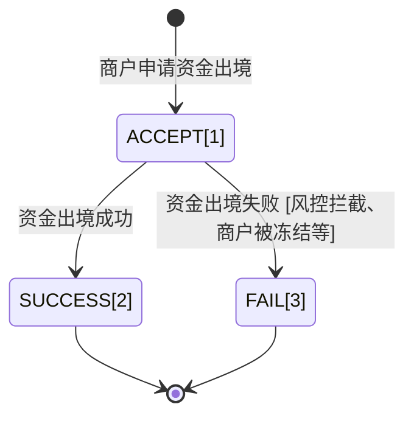

>更新时间：2026.06.10

## 1. 目标

通过本教程的学习，你应该可以通过微信支付跨境付款的API完成跨境付款业务，API操作包括：

- 通过[查询订单剩余可出境余额](https://pay.weixin.qq.com/doc/v3/partner/4012476109.md)查询可出境金额

- 通过[申请资金出境](https://pay.weixin.qq.com/doc/v3/partner/4012476113.md)发起资金出境申请，并且能处理资金出境申请返回的结果

- 通过[查询出境结果](https://pay.weixin.qq.com/doc/v3/partner/4012476127.md)查询出境结果，并且能通过查询返回的结果来处理出境业务

- 通过[获取购付汇账单文件下载链接](https://pay.weixin.qq.com/doc/v3/partner/4012476132.md)获取账单下载链接，通过这个链接可以下载购付汇账单文件


## 2. 业务处理流程

### 2.1 出境

在交易发生的3年内，可以根据订单发起资金出境，发起资金出境的流程正常是：

1. 先通过[查询订单剩余可出境余额](https://pay.weixin.qq.com/doc/v3/partner/4012476109.md)查询可出境金额

2. 通过[申请资金出境](https://pay.weixin.qq.com/doc/v3/partner/4012476113.md)发起资金出境申请，申请最大的出境金额是步骤1返回的剩余可出境金额

3. 通过[查询出境结果](https://pay.weixin.qq.com/doc/v3/partner/4012476127.md)查询出境结果，步骤2中的申请资金出境成功不代表出境成功，只有查询出境结果返回成功才算成功


资金出境单据状态机：



```
package com.java.demo.funds2oversea;

import com.java.demo.GetAvailableAbroadAmount; // 使用查询订单剩余可出境余额接口：https://pay.weixin.qq.com/doc/v3/partner/4012476109
import static com.java.demo.GetAvailableAbroadAmount.*;
import com.java.demo.CreateOrder; // 使用申请资金出境接口：https://pay.weixin.qq.com/doc/v3/partner/4012476113
import static com.java.demo.CreateOrder.*;
import com.java.demo.QueryOrder; // 使用查询出境结果接口：https://pay.weixin.qq.com/doc/v3/partner/4012476127
import static com.java.demo.QueryOrder.*;
import com.java.utils.WXPayUtility; // 引用微信支付工具库，参考：https://pay.weixin.qq.com/doc/v3/partner/4014985777
import java.util.ArrayList;

public class Funds2OverseaDemo {

  public static void main(String[] argv) {
    Funds2OverseaDemo oversea = new Funds2OverseaDemo();
    // 步骤1： 查询剩余可出境余额
    long availableAbroadAmount = oversea.getAvailableAbroadAmount();
    if (availableAbroadAmount == 0) {
      // 没有可出境余额了，不能发起了
      // 没有可出境余额的原因有：
      // 1. 这笔订单已经出境过了，把可出境余额都用完了
      // 2. 这笔订单发生过退款，把对应的出境余额退完了
      // 3. 这笔订单是分账订单，分账的还没有解冻给二级子商户，只有解冻给二级子商户的钱才能发起出境
      // ...
      return;
    }

    // 步骤2：申请资金出境
    // 申请资金出境的金额不能大于步骤1返回的剩余可出境余额
    oversea.applyDeparture();

    // 步骤3：查询资金出境结果
    // 上面的步骤2受理资金出境成功之后，只是表示微信支付受理资金出境成功，不能代表一定会出境成功，真正出境时可能会失败导致关单，所以就需要查询资金出境单确认资金出境结果
    // 商户可以周期性的查询出境单据，也可以通过每天下载了购付汇账单来确定哪些出境单出境成功
    oversea.QueryDeparture();
  }

  // 步骤1： 查询剩余可出境余额
  public long getAvailableAbroadAmount() {
    // TODO: 请准备商户开发必要参数，参考：https://pay.weixin.qq.com/doc/v3/partner/4013080340
    GetAvailableAbroadAmount client = new GetAvailableAbroadAmount(
      "19xxxxxxxx",                    // 商户号，是由微信支付系统生成并分配给每个商户的唯一标识符，商户号获取方式参考 https://pay.weixin.qq.com/doc/v3/partner/4013080340
      "1DDE55AD98Exxxxxxxxxx",         // 商户API证书序列号，如何获取请参考 https://pay.weixin.qq.com/doc/v3/partner/4013058924
      "/path/to/apiclient_key.pem",    // 商户API证书私钥文件路径，本地文件路径
      "PUB_KEY_ID_xxxxxxxxxxxxx",      // 微信支付公钥ID，如何获取请参考 https://pay.weixin.qq.com/doc/v3/partner/4013038589
      "/path/to/wxp_pub.pem"          // 微信支付公钥文件路径，本地文件路径
    );

    GetAvailableAbroadAmountRequest request = new GetAvailableAbroadAmountRequest();
    request.transactionId = "4208450740201411110007820472";  // 需要查询剩余可出境余额的订单
    request.subMchid = "1900000109";                         // 对应的二级子商户
    try {
      GetAvailableAbroadAmountResponse response = client.run(request);
      return response.availableAbroadAmount;
    } catch (WXPayUtility.ApiException e) {
      // 异常处理逻辑
      if (e.getErrorCode().equals("SYSTEM_ERROR")) {
        // 错误：系统错误
        // 解决方式：稍后重试
        // 描述：微信支付系统失败，系统失败直接立即重试大概率还会是系统失败，建议等1分钟后再重试
      } else if (e.getErrorCode().equals("FREQUENCY_LIMITED")) {
        // 错误：限频报错
        // 解决方式：稍后重试
        // 描述： 接口频率限制，直接立即重试大概率还会是系统失败，建议等1分钟后再重试
      } else if (e.getErrorCode().equals("NO_AUTH")) {
        // 错误：无资金出境权限
        // 解决方式：
        //    1. 检查商户是否是被处罚：登录商户平台进入账户中心-违约记录查询是否违约记录，如果有按照上面的指引解决违约记录之后重试
        //    2. 检查二级子商户是否已授权平台商户资金出境权限：登录商户平台进入产品中心-特约商户授权产品，在特约商户列表中看看该二级商户是否存在并且授权状态为“已授权”，
        //       如果不存在或者授权状态不是“已授权”就需要发起授权邀请，等二级商户审批之后重新查询一遍，授权状态为“已授权”之后再重试
        // 描述：平台商户被处罚或者平台商户和二级子商户没有父子受理关系
      } else if (e.getErrorCode().equals("SIGN_ERROR")) {
        // 错误：签名错误
        // 解决方式：检查平台商户证书序列号，证书私钥文件，公钥ID，公钥文件，同时确认下签名过程是不是按照微信支付的签名方式
        // 描述：签名报错，需要确认签名材料和签名流程是否正确
      } else if (e.getErrorCode().equals("PARAM_ERROR")) {
        // 错误：参数错误
        // 解决方式：按照报错返回的message，重新输入请求参数
        // 描述：参数的类型，长度，或者必填选项没有填写等，大概率是传的微信支付订单号是非法的
      } else if (e.getErrorCode().equals("INVALID_REQUEST")) {
        // 错误：请求非法，请求参数正确，但是不符合出境业务规则
        // 解决方式：根据具体message查看具体哪里不符合业务规则，如果可以修改参数达到符合业务规则的修改请求符合业务规则之后再原单重试
        // 描述：不符合业务规则的场景如：
        //        - 交易时间超过3年，不允许发起出境
      } else {
        // 其他类型错误：稍等一会后原单重试
      }
      throw e;
    }
  }

  // 步骤2：申请资金出境
  public void applyDeparture() {
    // TODO: 请准备商户开发必要参数，参考：https://pay.weixin.qq.com/doc/v3/partner/4013080340
    CreateOrder client = new CreateOrder(
      "19xxxxxxxx",                    // 商户号，是由微信支付系统生成并分配给每个商户的唯一标识符，商户号获取方式参考 https://pay.weixin.qq.com/doc/v3/partner/4013080340
      "1DDE55AD98Exxxxxxxxxx",         // 商户API证书序列号，如何获取请参考 https://pay.weixin.qq.com/doc/v3/partner/4013058924
      "/path/to/apiclient_key.pem",    // 商户API证书私钥文件路径，本地文件路径
      "PUB_KEY_ID_xxxxxxxxxxxxx",      // 微信支付公钥ID，如何获取请参考 https://pay.weixin.qq.com/doc/v3/partner/4013038589
      "/path/to/wxp_pub.pem"          // 微信支付公钥文件路径，本地文件路径
    );

    CreateOrderRequest request = new CreateOrderRequest();
    // 商户出境单号，唯一定义出境标识，只能由数字，大小写字母_-组成。要求同一个平台商户下唯一
    request.outOrderId = "merchant_1123123";
    // 二级子商户
    request.subMchid = "123456";
    // 微信支付订单号
    request.transactionId = "4208450740201411110007820472";
    // 出境人民币金额，单位：分
    request.amount = 10L;
    // 境外收款币种
    request.foreignCurrency = "USD";

    // 商品信息，不能超过10个
    request.goodsInfo = new ArrayList<>();
    {
      GoodsInfo item0 = new GoodsInfo();
      // 商品名称（不能包含','、'|'字符）
      item0.goodsName = "橘子";
      // 商品类目（不能包含','、'|'字符）
      item0.goodsCategory = "家用电器";
      // 商品单价
      item0.goodsUnitPrice = 1L;
      // 商品数量
      item0.goodsQuantity = 1L;
      request.goodsInfo.add(item0);
    };

    // 卖家信息
    request.sellerInfo = new SellerInfo();
    // 境外卖家经营主体名称
    request.sellerInfo.overseaBusinessName = "香港xxxx公司";
    // 境外卖家店铺名称
    request.sellerInfo.overseaShopName = "香港xxx公司xxx店铺";
    // 卖家ID
    request.sellerInfo.sellerId = "id2123123123";

    // 物流信息（仅在预售场景且定金订单需单独出境时，该字段可不填；其他场景下，该字段必填）
    request.expressInfo = new ExpressInfo();
    // 物流单号
    request.expressInfo.courierNumber = "curier_number_1231";
    // 物流商名称
    request.expressInfo.expressCompanyName = "国际xxx物流";

    // 收款人信息
    request.payeeInfo = new PayeeInfo();
    // 收款人识别号（在接入微信支付资金出境服务时，由微信支付分配的收款人识别号）
    request.payeeInfo.payeeId = "ID123112312";

    // 预售信息（要求：定金与尾款对应的订单均需在三年（1096天）内，且定金支付人与尾款支付人需一致）
    request.presaleInfo = new PresaleInfo();
    // 订单类型，DEPOSIT：定金订单；BALANCE：尾款订单
    request.presaleInfo.type = PresaleOrderType.DEPOSIT;
    // 预售订单人民币总金额，单位：分
    request.presaleInfo.totalAmount = 10L;
    // 关联定金微信支付订单号（尾款订单出境时（type为BALANCE），必须填写关联的定金订单的微信支付订单号。）
    request.presaleInfo.depositTransactionId = "4208450740201411110007820473";
    // 关联尾款微信支付订单号（定金订单出境时（type为DEPOSIT），需要填写关联的尾款订单的微信支付订单号。）
    request.presaleInfo.balanceTransactionId = "4208450740201411110007820474";

    try {
      CreateOrder.Order response = client.run(request);
      // TODO: 请求成功，继续业务逻辑
      // ...
    } catch (WXPayUtility.ApiException e) {
      // 异常处理逻辑
      if (e.getErrorCode().equals("SYSTEM_ERROR")) {
        // 错误：系统错误
        // 解决方式：稍后原单重试
        // 描述：微信支付系统失败，一定要原单重试，系统失败直接立即重试大概率还会是系统失败，建议等1分钟后再重试
      } else if (e.getErrorCode().equals("FREQUENCY_LIMITED")) {
        // 错误：限频报错
        // 解决方式：稍后原单重试
        // 描述： 接口频率限制，一定要原单重试，直接立即重试大概率还会是系统失败，建议等1分钟后再重试
      } else if (e.getErrorCode().equals("NO_AUTH")) {
        // 错误：无资金出境权限
        // 解决方式：
        //    1. 检查商户是否是被处罚：登录商户平台进入账户中心-违约记录查询是否违约记录，如果有按照上面的指引解决违约记录之后原单重试
        //    2. 检查二级子商户是否已授权平台商户资金出境权限：登录商户平台进入产品中心-特约商户授权产品，在特约商户列表中看看该二级商户是否存在并且授权状态为“已授权”，
        //       如果不存在或者授权状态不是“已授权”就需要发起授权邀请，等二级商户审批之后重新查询一遍，授权状态为“已授权”之后再原单重试
        // 描述：平台商户被处罚或者平台商户和二级子商户没有父子受理关系
      } else if (e.getErrorCode().equals("SIGN_ERROR")) {
        // 错误：签名错误
        // 解决方式：检查平台商户证书序列号，证书私钥文件，公钥ID，公钥文件，同时确认下签名过程是不是按照微信支付的签名方式
        // 描述：签名报错，需要确认签名材料和签名流程是否正确
      } else if (e.getErrorCode().equals("PARAM_ERROR")) {
        // 错误：参数错误
        // 解决方式：按照报错返回的message，重新输入请求参数
        // 描述：参数的类型，长度，或者必填选项没有填写等
      }  else if (e.getErrorCode().equals("NOT_ENOUGH")) {
        // 错误：账户余额不足
        // 解决方式：商户充值之后原单重试
        // 描述：商户账户余额不足，导致退款失败，商户充值之后一定要原单重试
      } else if (e.getErrorCode().equals("INVALID_REQUEST")) {
        // 错误：请求非法，请求参数正确，但是不符合出境业务规则
        // 解决方式：根据具体message查看具体哪里不符合业务规则，如果可以修改参数达到符合业务规则的修改请求符合业务规则之后再原单重试
        // 描述：不符合业务规则的场景如：
        //        - 交易时间超过3年，不允许发起出境
        //        - 商户被风控拦截，不能进行资金操作
        //        - 商品名称，商品类目等有敏感词，请求被拦截
        //        - 剩余可出境余额不足

      } else {
        // 其他类型错误：稍等一会后原单重试
      }
      throw e;
    }
  }

  // 步骤3：查询资金出境结果
  public void QueryDeparture() {
    // TODO: 请准备商户开发必要参数，参考：https://pay.weixin.qq.com/doc/v3/partner/4013080340
    QueryOrder client = new QueryOrder(
      "19xxxxxxxx",                    // 商户号，是由微信支付系统生成并分配给每个商户的唯一标识符，商户号获取方式参考 https://pay.weixin.qq.com/doc/v3/partner/4013080340
      "1DDE55AD98Exxxxxxxxxx",         // 商户API证书序列号，如何获取请参考 https://pay.weixin.qq.com/doc/v3/partner/4013058924
      "/path/to/apiclient_key.pem",    // 商户API证书私钥文件路径，本地文件路径
      "PUB_KEY_ID_xxxxxxxxxxxxx",      // 微信支付公钥ID，如何获取请参考 https://pay.weixin.qq.com/doc/v3/partner/4013038589
      "/path/to/wxp_pub.pem"          // 微信支付公钥文件路径，本地文件路径
    );

    QueryOrderRequest request = new QueryOrderRequest();
    // 商户出境单号（步骤2中的outOrderId）
    request.outOrderId = "merchant123123";
    // 二级子商户号
    request.subMchid = "1231231";
    // 微信支付订单号（步骤2中的transactionId）
    request.transactionId = "4208450740201411110007820472";
    try {
      QueryOrder.Order response = client.run(request);
      // 根据资金出境单状态决定处理流程
      // 单据状态为SUCCESS和FAIL为终态，只有到了FAIL状态的单才需要换单（换outOrderId）重新申请出境，否则都要原单重试申请出境
      if (response.result.equals("ACCEPT")) {
        // 资金出境单还是受理状态，建议格一段时间再进行查询
        // ...
      } else if (response.result.equals("SUCCESS")) {
        // 资金出境单出境成功
        // 商户可以更新自己的业务单据状态
        // 正常情况从ACCEPT状态到SUCCESS需要两个金融日历
        // UpdateDeparture2Succ();
      } else if (response.result.equals("FAIL")) {
        // 资金出境单出境失败
        // 可以根据failReason来判断失败原因，根据失败原因解决之后，假如还需要申请出境，这里就需要换单（换outOrderId)，重新申请出境
        // 1. MCHID_FROZEN: 商户已冻结，登录商户平台查看商户是不是已经被处罚或者商户已经注销了
        // 2. DEAL_TIMEOUT: 单据已过期，微信支付订单超过3年，不允许出境
        // 3. TRADE_SUIT：交易订单被交易投诉冻结，订单有争议，被用户投诉，该笔订单已被投诉冻结，登录商户平台查询该订单状态，并按对应提示解决
        // 4. DEPARTURE_AMOUNT_NO_ENOUGH：剩余可出境金额不足，该笔订单剩余可出境金额不足，可以通过查询剩余可出境余额，修改出境金额之后换单重新申请出境
        // 5. BASIC_AMOUNT_NO_ENOUGH：商户基本户余额不足，商户需要充值之后换单重试
        // 6. PAYMENT_NOT_SUPPORT_DEPARTURE：该笔订单不支持出境，该笔订单是非大陆钱包支付的订单，不支持出境
        // 7. OUT_ORDER_ID_DUPLICATE：同一个out_order_id用于不同的支付订单，同一个outOrderId对应了不同的transactionId，商户自行检查所有的出境单
        // 8. RISK_CONTROL：订单被风控拦截（大概率是支付用户非实名）
        // 9. SYSTEM_ERROR：系统失败，微信支付系统系统失败，可以自行微信支付助手查询具体原因
        // 10.FEE_ACCOUNT_NOT_OPEN：电商平台承担手续费但是未开通手续费账户或者手续费账户被处罚，平台商户登录商户平台检查是否是未开通手续费账户或者手续费账户被处罚
        // 11. PAYER_ACCOUNT_ABNORMAL：资金出境方账户异常，二级子商户被风控拦截，登录商户平台查询原因并按指示解决后换单重试
        // 12. GOODS_INFO_ILLEGAL: 资金出境申请商品信息非法，商品名称或者商品类目包含非法字符（比如','、'|'等）
        // 13. FOREIGN_CURRENCY_NOT_SUPPORT: 不支持的币种类型，请换币种重试，目前仅支持八大币种：USD、HKD、JPY、EUR、GBP、CAD、AUD、SGD
        // 14. PAYEE_INFO_ILLEGAL：校验收款人信息失败
        // 15. PRESALE_INFO_ILLEGAL：资金出境申请预售信息非法，可能原因：1）预售定金超限额（小于1000元且不超过总额20%）；2）预售关联单还未操作出境；3）预售尾款和历史定金出境额超过总金额

        // 商户根据错误原因解决问题之后，可以换单重新发起申请出境
        applyDeparture();
      } else {
        // 非法的资金出境单状态
        throw new RuntimeException("非法资金出境单状态");
      }

    } catch (WXPayUtility.ApiException e) {
      // 异常处理逻辑
      if (e.getErrorCode().equals("SYSTEM_ERROR")) {
        // 错误：系统错误
        // 解决方式：稍后重试
        // 描述：微信支付系统失败，系统失败直接立即重试大概率还会是系统失败，建议等1分钟后再重试
      } else if (e.getErrorCode().equals("FREQUENCY_LIMITED")) {
        // 错误：限频报错
        // 解决方式：稍后重试
        // 描述： 接口频率限制，直接立即重试大概率还会是系统失败，建议等1分钟后再重试
      } else if (e.getErrorCode().equals("NO_AUTH")) {
        // 错误：无资金出境权限
        // 解决方式：
        //    1. 检查商户是否是被处罚：登录商户平台进入账户中心-违约记录查询是否违约记录，如果有按照上面的指引解决违约记录之后重试
        //    2. 检查二级子商户是否已授权平台商户资金出境权限：登录商户平台进入产品中心-特约商户授权产品，在特约商户列表中看看该二级商户是否存在并且授权状态为“已授权”，
        //       如果不存在或者授权状态不是“已授权”就需要发起授权邀请，等二级商户审批之后重新查询一遍，授权状态为“已授权”之后再重试
        // 描述：平台商户被处罚或者平台商户和二级子商户没有父子受理关系
      } else if (e.getErrorCode().equals("SIGN_ERROR")) {
        // 错误：签名错误
        // 解决方式：检查平台商户证书序列号，证书私钥文件，公钥ID，公钥文件，同时确认下签名过程是不是按照微信支付的签名方式
        // 描述：签名报错，需要确认签名材料和签名流程是否正确
      } else if (e.getErrorCode().equals("NOT_FOUND")) {
        // 错误：资金出境单不存在
        // 解决方式：确定outOrderId和transactionId输入是否正确
        // 描述：资金出境单未受理成功
      } else if (e.getErrorCode().equals("PARAM_ERROR")) {
        // 错误：参数错误
        // 解决方式：按照报错返回的message，重新输入请求参数
        // 描述：参数的类型，长度，或者必填选项没有填写等
      } else if (e.getErrorCode().equals("INVALID_REQUEST")) {
        // 错误：请求非法，请求参数正确，但是不符合出境业务规则
        // 解决方式：根据具体message查看具体哪里不符合业务规则，如果可以修改参数达到符合业务规则的修改请求符合业务规则之后再重试
      } else {
        // 其他类型错误：稍等一会后原单重试
      }
      throw e;
    }
  }
}

```

### 2.2 账单

有关账单的说明：

- 购付汇账单中提供的是前一天购付汇完成、最终出境成功的账单，还未完成出境或出境失败的出境单不会出现在账单中。注：在出境请求被受理之后，预计购汇时间为T+1（其中T为受理日期）。

- 通过下载链接获取到的账单文件为资金出境购付汇账单，出账日期为T+1，即当天下载的是前一天购付汇完成的出境成功账单。

- 一般在上午10点后可以下载到前一天的账单，实际账单下载的情况请关注错误码提示。

- 提示，下载三个月前或更早的历史数据时下载速度可能会变慢。

- 账单中涉及金额的字段单位为“元”。


注意 ：

- 账单文件的下载地址的有效时间为30s;

- 强烈建议商户将实际账单文件的哈希值和之前从接口获取到的哈希值进行比对，以确认数据的完整性。


账单文件数据示例：


```
package com.java.demo.funds2oversea;

import com.java.demo.QueryDownloadInfo; // 使用获取购付汇账单文件下载链接接口：https://pay.weixin.qq.com/doc/v3/partner/4012476132
import static com.java.demo.QueryDownloadInfo.*;
import com.java.utils.WXPayUtility; // 引用微信支付工具库，参考：https://pay.weixin.qq.com/doc/v3/partner/4014985777

public class Funds2OverseaBillDemo {

  public static void main(String[] argv) {
    // TODO: 请准备商户开发必要参数，参考：https://pay.weixin.qq.com/doc/v3/partner/4013080340
    QueryDownloadInfo client = new QueryDownloadInfo(
      "19xxxxxxxx",                    // 商户号，是由微信支付系统生成并分配给每个商户的唯一标识符，商户号获取方式参考 https://pay.weixin.qq.com/doc/v3/partner/4013080340
      "1DDE55AD98Exxxxxxxxxx",         // 商户API证书序列号，如何获取请参考 https://pay.weixin.qq.com/doc/v3/partner/4013058924
      "/path/to/apiclient_key.pem",    // 商户API证书私钥文件路径，本地文件路径
      "PUB_KEY_ID_xxxxxxxxxxxxx",      // 微信支付公钥ID，如何获取请参考 https://pay.weixin.qq.com/doc/v3/partner/4013038589
      "/path/to/wxp_pub.pem"          // 微信支付公钥文件路径，本地文件路径
    );

    QueryDownloadInfoRequest request = new QueryDownloadInfoRequest();
    // 账单日期，格式为：YYYY-MM-DD
    request.billDate = "2021-01-01";
    // 二级子商户，非必填
    // 若填写，则返回的账单链接为该子商户的账单
    // 否则，则返回的账单链接为该平台商户下所有子商户的账单
    request.subMchid = "19000000001";
    try {
      BillDownloadInfoEntity response = client.run(request);
      // 通过返回的download_url请求URL即可下载对应的账单文件
    } catch (WXPayUtility.ApiException e) {
      // 异常处理逻辑
      if (e.getErrorCode().equals("SYSTEM_ERROR")) {
        // 错误：系统错误
        // 解决方式：稍后原单重试
        // 描述：微信支付系统失败，一定要原单重试，系统失败直接立即重试大概率还会是系统失败，建议等1分钟后再重试
      } else if (e.getErrorCode().equals("FREQUENCY_LIMITED")) {
        // 错误：限频报错
        // 解决方式：稍后原单重试
        // 描述： 接口频率限制，一定要原单重试，直接立即重试大概率还会是系统失败，建议等1分钟后再重试
      } else if (e.getErrorCode().equals("NO_AUTH")) {
        // 错误：无资金出境权限
        // 解决方式：
        //    1. 检查商户是否是被处罚：登录商户平台进入账户中心-违约记录查询是否违约记录，如果有按照上面的指引解决违约记录之后原单重试
        //    2. 检查二级子商户是否已授权平台商户资金出境权限：登录商户平台进入产品中心-特约商户授权产品，在特约商户列表中看看该二级商户是否存在并且授权状态为“已授权”，
        //       如果不存在或者授权状态不是“已授权”就需要发起授权邀请，等二级商户审批之后重新查询一遍，授权状态为“已授权”之后再原单重试
        // 描述：平台商户被处罚或者平台商户和二级子商户没有父子受理关系
      } else if (e.getErrorCode().equals("SIGN_ERROR")) {
        // 错误：签名错误
        // 解决方式：检查平台商户证书序列号，证书私钥文件，公钥ID，公钥文件，同时确认下签名过程是不是按照微信支付的签名方式
        // 描述：签名报错，需要确认签名材料和签名流程是否正确
      } else if (e.getErrorCode().equals("PARAM_ERROR")) {
        // 错误：参数错误
        // 解决方式：按照报错返回的message，重新输入请求参数
        // 描述：参数的类型，长度，或者必填选项没有填写等
      } else if (e.getErrorCode().equals("NO_STATEMENT_EXIST")) {
        // 错误：请求的账单文件不存在
        // 解决方式：确认请求的商户和日期正不正确，并且确定改日期下有出境成功的单才有账单
        // 描述：账单文件不存在
      } else if (e.getErrorCode().equals("STATEMENT_CREATING")) {
        // 错误：账单生成中，若请求的日期当天确有账单数据，请在上午10点后再重新下
        // 解决方式：等十点后再重试
        // 描述：账单文件还未生成成功，等到指定的时间再下载
      } else if (e.getErrorCode().equals("INVALID_REQUEST")) {
        // 错误：请求非法，请求参数正确，但是不符合出境业务规则
        // 解决方式：根据具体message查看具体哪里不符合业务规则，如果可以修改参数达到符合业务规则的修改请求符合业务规则之后再原单重试

      } else {
        // 其他类型错误：稍等一会后原单重试
      }
      throw e;
    }
  }
}
```