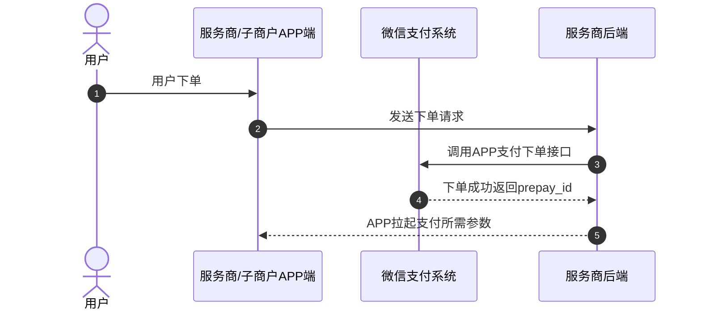
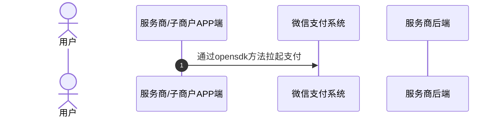
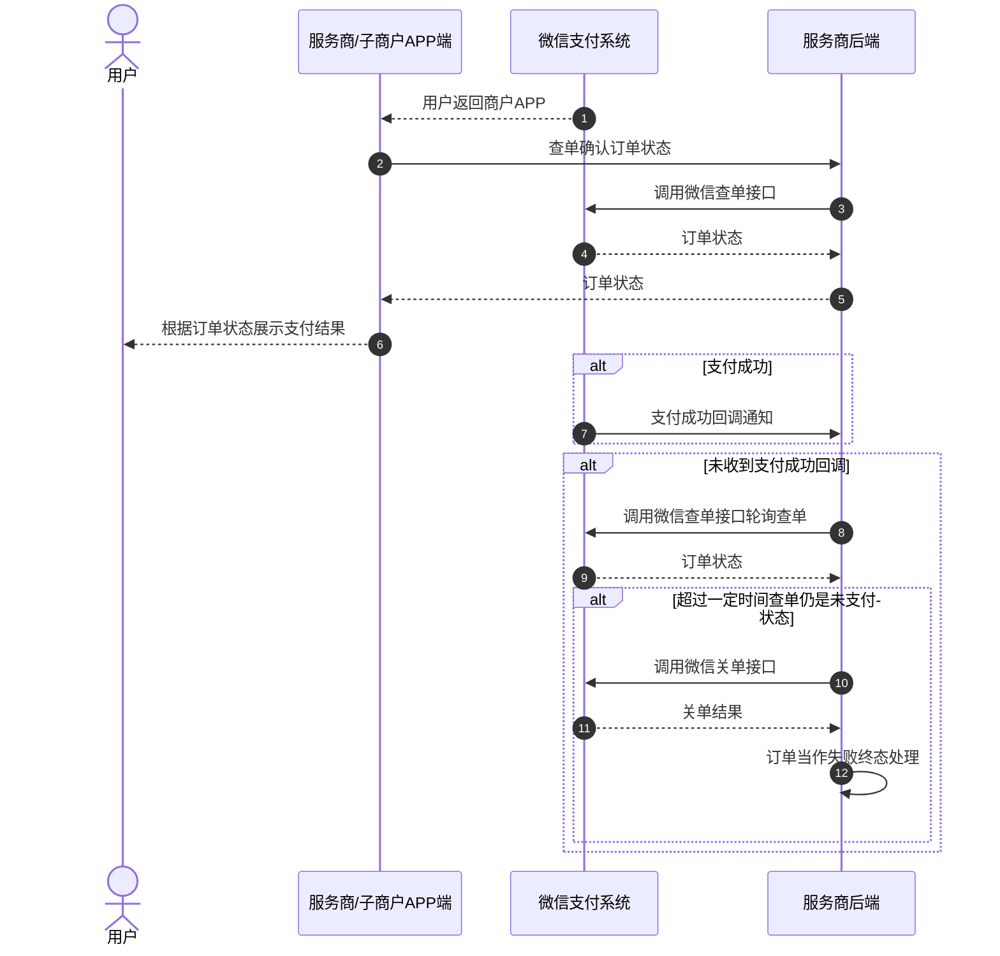
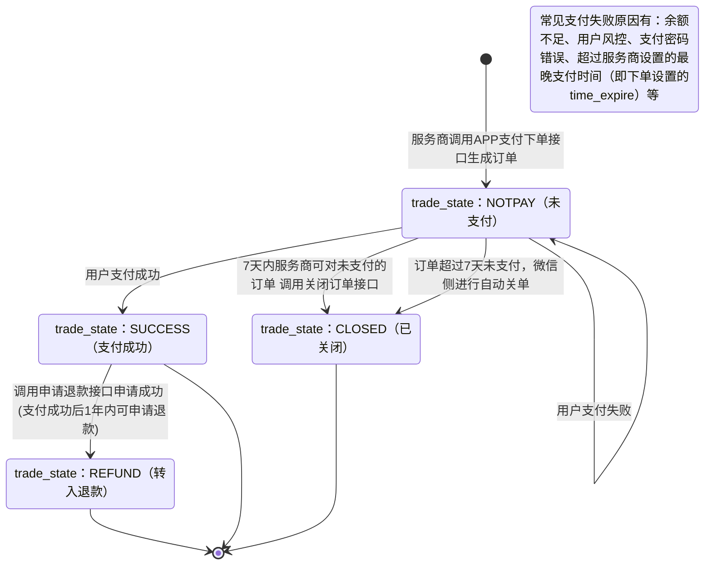

>更新时间：2026.06.09

## 1、开发前准备

### 1.1、设置安全联系人

微信支付日常安全监测发现技术异常时，会向安全联系人和超级管理员发送风险提醒。请商户超级管理员尽快设置技术同事为安全联系人，确保能及时接收异常信息评估业务风险，详见[安全联系人设置指引](https://pay.weixin.qq.com/doc/v3/partner/4012083124.md)。

### 1.2、熟悉微信支付接口规则

正式进入开发前，开发者需要先阅读[基本规则](https://pay.weixin.qq.com/doc/v3/partner/4012081726.md)、[开发参数申请和配置](https://pay.weixin.qq.com/doc/v3/partner/4012081990.md)了解调用微信支付接口的基本规则和签名规则。

### 1.3、准备开发参数

在发起接口请求时，开发者还需传入一些必要参数，如服务商商户号、子商户号（也叫特约商户号）、sp\_appid、证书私钥、公钥等，获取方式详见：[服务商模式开发必要参数说明](https://pay.weixin.qq.com/doc/v3/partner/4013080340.md)。

注意：

在开发的过程中，请将应答的HTTP头Request-ID值打印到日志中。Request-ID作为[请求的唯一标识](https://pay.weixin.qq.com/doc/v3/partner/4012081726.md#%E8%AF%B7%E6%B1%82%E7%9A%84%E5%94%AF%E4%B8%80%E6%A0%87%E8%AF%86)，在调用接口遇到问题时，可向微信侧提供该值用于快速定位到请求记录，协助排查问题原因。

## 2、整体业务开发流程概览

- 服务商在后台调用[APP支付下单](https://pay.weixin.qq.com/doc/v3/partner/4013080231.md)接口获取预支付ID（prepay\_id）后，在服务商/子商户APP中通过微信[OpenSDK](https://developers.weixin.qq.com/doc/oplatform/Mobile_App/Access_Guide/Android.html)提供的sendReq方法实现[APP调起支付](https://pay.weixin.qq.com/doc/v3/partner/4013080233.md)，跳转到微信，并唤起微信支付收银台。

- 当用户在收银台完成支付后点击“返回商家”按钮，或中途取消支付，页面会从收银台跳转到服务商/子商户APP内，同时服务商/子商户APP前端将收到[OpenSDK](https://developers.weixin.qq.com/doc/oplatform/Mobile_App/Access_Guide/Android.html)发送的onResp回调，此时服务商在后台需调用[查询订单API](https://pay.weixin.qq.com/doc/v3/partner/4013080235.md)接口确认订单状态，并根据订单状态进行相应的业务逻辑处理（在商户页面向用户展示查询到的订单支付状态、在商户内部系统更新订单状态等），如果订单支付成功，微信支付系统还会发送[支付成功回调通知](https://pay.weixin.qq.com/doc/v3/partner/4013080237.md)给服务商。具体的支付回调和查单的实现方案，服务商可以参考[支付回调和查单实现指引](https://pay.weixin.qq.com/doc/v3/partner/4012082568.md)。

- 最后服务商可通过[下载交易账单](https://pay.weixin.qq.com/doc/v3/partner/4013080242.md)进行对账。需要退款的订单，也可调用[退款接口](https://pay.weixin.qq.com/doc/v3/partner/4013080238.md)完成退款。


## 3、详细步骤说明

### 3.1、商户下单

服务商需要通过调用[APP支付下单API](https://pay.weixin.qq.com/doc/v3/partner/4013080231.md)接口下单并获取预支付ID（prepay\_id）。



下单接口关键参数说明：

`sub_mchid`：子商户的商户号，也是订单对应的收款商户号，在订单支付成功后，订单收款的资金将进入该子商户的基本账户内。

`sub_appid`：若用户是在子商户的APP端下单，需要在该参数内传子商户APP对应的appid。若是在服务商的APP端下单，该参数可以不传。

`time_expire`：支付结束时间。若传递该参数，则用户只能在订单设置的支付结束时间 `time_expire` 之前进行支付，超过支付结束时间后，用户支付将收到："订单已超过商户设置的最晚支付成功时间，请重新发起支付"的提示，服务商需对订单进行关单处理。若不传该参数，默认订单支付有效期为7天，用户可在7天内进行支付，超出7天，订单将被关闭。

`prepay_id`：预支付交易会话标识。调起支付时需要使用的参数， `prepay_id` 有效期为2小时，超过2小时，服务商需要使用原下单参数重新请求下单接口，获取新的 `prepay_id`。

`profit_sharing`：订单分账标识，如果订单在支付成功后需要进行分账，必须传参数值为 `true`。如果无需分账，可以不传该参数，或传 `false`。

### 3.2、商户调起支付

服务商调起支付前，需根据不同客户端系统接入对应的OpenSDK（推荐使用最新版本，具体请参考[OpenSDK接入指南](https://pay.weixin.qq.com/doc/v3/partner/4013369798.md)），然后通过OpenSDK的sendReq方法调起微信支付页面，具体请参考[APP调起支付](https://pay.weixin.qq.com/doc/v3/partner/4013080233.md)

注意：

- 开发微信支付接入Android系统的OpenSDK时，需要实现WXPayEntryActivity类，否则可能支付完成后，无法从微信内返回到商户APP，参考如下代码。

- Android13开始Intent过滤器会屏蔽不匹配的intent，存在无法返回商户APP的问题，解决方法：在manifest中，去除WXPayEntryActivity的intent-filter。

- 请严格遵循 OpenSDK 接入指引（《[安卓](https://developers.weixin.qq.com/doc/oplatform/Mobile_App/Access_Guide/Android.html)/[IOS](https://developers.weixin.qq.com/doc/oplatform/Mobile_App/Access_Guide/iOS.html)/[鸿蒙](https://developers.weixin.qq.com/doc/oplatform/Mobile_App/Access_Guide/ohos.html)接入指引》）接入SDK 以及配置开发环境。其中，IOS务必按指引 4.1 节（通过 CocoaPods 集成）配置“URL scheme”：若未配置，商户 APP 跳转微信小程序时可能出现 universal link 校验不通过的报错。


```
<activity
    android:name=".wxapi.WXPayEntryActivity"
    android:label="@string/app_name"
    android:theme="@android:style/Theme.Translucent.NoTitleBar"
    android:exported="true"
    android:taskAffinity="填写你的包名"
    android:launchMode="singleTask">
</activity>
```



调起支付关键参数说明：

`appId`：需要实际调起支付的APP的appid对应，并且为下单时传入的服务商的 `sp_appid` 或子商户的 `sub_appid`。

- 若是在服务商的APP中调起支付，则调起支付时的 `appId` 需与下单时的 `sp_appid` 一致。

- 若是在子商户的APP中调起支付，则调起支付时的 `appId` 需与下单时的 `sub_appid` 一致。


### 3.3、用户支付

用户在微信收银台完成支付/取消支付，返回服务商/子商户APP后，服务商/子商户APP前端将收到opensdk发送的onResp回调，此时服务商需要调[查询订单API](https://pay.weixin.qq.com/doc/v3/partner/4013080235.md)接口确认订单状态，并根据订单状态向用户展示支付结果。

同时，如果用户支付成功，微信支付系统会向服务商发送[支付成功回调](https://pay.weixin.qq.com/doc/v3/partner/4013080237.md)。未收到回调时，服务商也可调用[查询订单API](https://pay.weixin.qq.com/doc/v3/partner/4013080235.md)接口确认订单状态。具体实现方案商户可以参考[支付回调和查单实现指引](https://pay.weixin.qq.com/doc/v3/partner/4012082568.md)。

若服务商需要限制用户支付的时间，有以下两种方式：

1、下单时通过 `time_expire` 参数，设置订单的支付结束时间，超过设置的结束时间后，服务商进行关单处理。

2、服务商在自己的系统内进行倒计时，超过有效期，进行关单处理。

若因特殊原因需在用户可支付时间范围内关闭订单，服务商可通过调用[查询订单API](https://pay.weixin.qq.com/doc/v3/partner/4013080235.md)接口确认订单状态，若订单仍是未支付状态，服务商可以调用[关闭订单API](https://pay.weixin.qq.com/doc/v3/partner/4013080236.md)接口关单，关单后可以将订单当作失败终态处理。



### 3.4、商户对账

详细参考：[账单产品介绍](https://pay.weixin.qq.com/doc/v3/partner/4013080592.md)

### 3.5、订单退款

详细参考：[退款产品介绍](https://pay.weixin.qq.com/doc/v3/partner/4013080622.md)

## 4、普通支付订单状态流转图



1、服务商调用[APP支付下单](https://pay.weixin.qq.com/doc/v3/partner/4013080231.md)接口下单成功后，服务商可以调用[查询订单](https://pay.weixin.qq.com/doc/v3/partner/4013080235.md)接口来确认订单状态，详情请参考[支付回调和查单实现指引](https://pay.weixin.qq.com/doc/v3/partner/4012082568.md)。

2、当订单状态处于未支付(trade\_state：NOTPAY)时，用户可对订单进行支付，若用户支付失败，订单状态不变。

3、7天内服务商可对无需继续支付的订单（例如用户超过服务商系统内部规定的支付时间，或超过服务商下单设置的最晚支付时间（time\_expire）的订单）调用[关单接口](https://pay.weixin.qq.com/doc/v3/partner/4013080236.md)，使订单关闭，或超过7天后由微信侧自动关单。关单后，订单状态会从未支付(trade\_state：NOTPAY)流转为已关闭(trade\_state：CLOSED)。

4、当用户成功支付订单时，订单状态会从未支付(trade\_state：NOTPAY)流转为支付成功(trade\_state：SUCCESS)。

5、当订单状态为支付成功(trade\_state：SUCCESS)时，如果用户需要退款，服务商可调用[申请退款接口](https://pay.weixin.qq.com/doc/v3/partner/4013080238.md)(仅支持支付成功后1年内的订单)，退款申请成功后，订单状态会从支付成功(trade\_state：SUCCESS)流转为转入退款(trade\_state：REFUND)，退款状态可通过[查询退款单接口](https://pay.weixin.qq.com/doc/v3/partner/4013080239.md)进行确认。

6、以下三个状态为终态

- trade\_state：CLOSED

- trade\_state：SUCCESS

- trade\_state：REFUND