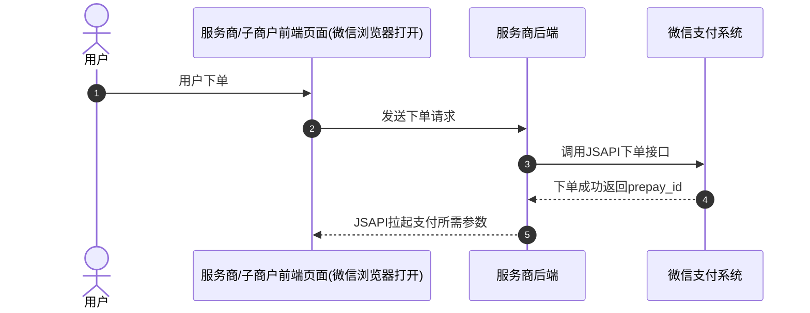
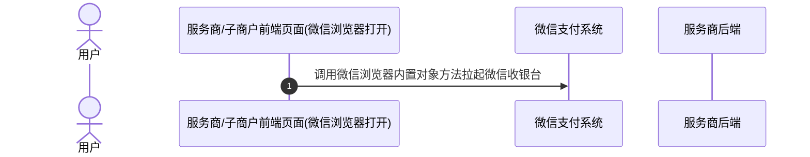
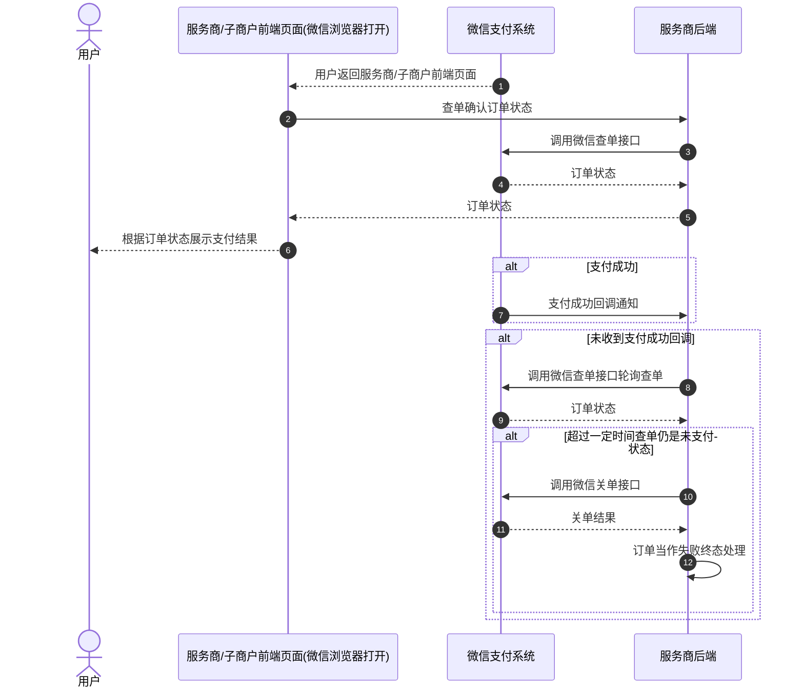
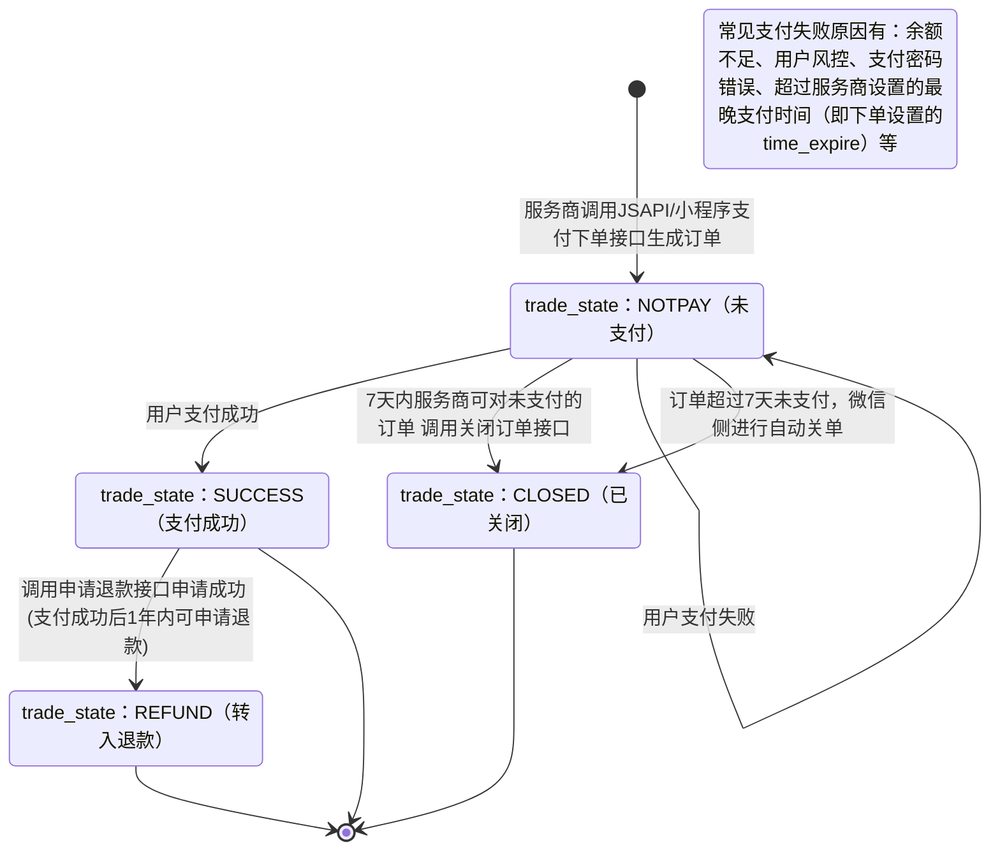

>更新时间：2026.10.13

## 1、接口接入清单

本节列出服务商 JSAPI 支付须接入的接口。

### 1.1、必接接口

以下接口必须接入，缺一即视为接入不完整。「二选一」的两个查单接口至少接入一个。

| 接口 | 接入要求 | 说明 |
| --- | --- | --- |
| JSAPI下单 | 必接 | 生成订单并获取预支付交易会话标识 `prepay_id`。与分账、代金券、电子发票等业务相关的字段见 1.3、可选能力对接说明 |
| JSAPI调起支付 | 必接 | 调起微信收银台 |
| 商户订单号查询订单 | 二选一 | 按商户订单号确认支付状态。与下一行至少接其中一个；两个都不接将无法确认订单支付状态 |
| 微信支付订单号查询订单 | 二选一 | 按微信支付订单号确认支付状态。已存储 `transaction_id` 并以其为查单主键时用本接口 |
| 支付成功回调通知 | 必接 | 接收订单支付成功的异步通知 |
| 关闭订单 | 必接 | 关闭无需继续支付的订单，避免用户在商户侧已废弃的订单上支付造成资金损失 |

### 1.2、推荐接入接口

退款接口推荐接入，以便在系统内发起退款。除非项目不由本系统发起退款、只在服务商平台人工操作，可以不接入。

账单类接口推荐接入，以便通过交易账单发现微信支付成功但本地未成功的差异。除非项目本身不做接口对账，可以不接入。

某一类若不接入，需要让用户确认；未经用户确认，不得跳过。

| 接口 | 接入要求 | 说明 |
| --- | --- | --- |
| 申请退款 | 推荐接入 | 发起订单退款。不接时，退款只能在服务商平台人工操作。接入时，下面三个退款接口须一并接入 |
| 退款结果回调通知 | 推荐接入 | 接收退款单状态变更的异步通知 |
| 查询单笔退款（按商户退款单号） | 推荐接入 | 确认退款的实际处理结果 |
| 发起异常退款 | 推荐接入 | 退款状态为 `ABNORMAL`（用户银行卡作废或冻结，导致原路退款银行卡失败）时，通过本接口完成该笔退款。不处理则资金停留在退款中间账户 |
| 申请所有/单个子商户交易账单 | 推荐接入 | 用于 T+1 对账。不接时，微信支付成功但本地未成功等差异无法自动发现。T+1 日上午 10 点后下载交易账单，与本地订单逐笔核对。本接口只返回下载链接，不返回账单数据 |
| 申请服务商资金账单 | 按需 | 需核对服务商账户资金变动流水（结算、手续费、退款出款等）时接入。本接口只返回下载链接，不返回账单数据 |
| 下载账单 | 接入对账时必接 | 接入申请交易账单或申请资金账单中任一接口时必须接入。只调用申请账单接口拿不到账单数据 |

### 1.3、可选能力对接说明

下表为下单接口中与分账、代金券、电子发票相关的字段。接入相应业务时，这些字段须在下单时一并传入，下单后无法补传。未接入相应业务时，对应字段可不传。是否接入分账、代金券、电子发票，需要让用户逐项确认；未经用户确认，不得省略对应字段。相关产品文档在用户确认接入该业务后另行查阅。

| 接口 | 字段 | 关联业务 | 传值说明 |
| --- | --- | --- | --- |
| JSAPI下单 | `settle_info.profit_sharing` | 分账 | 传 `true` 后该笔订单才能分账，资金进入子商户基本账户的不可用余额；不传或传 `false`，资金进入子商户可用余额，后续无法分账 |
| JSAPI下单 | `goods_tag` | 代金券 | 创券时若配置了订单优惠标记，下单必须传入已配置的标记之一，否则无法用券；券未配置标记时可不传 |
| JSAPI下单 | `support_fapiao` | 电子发票 | 传 `true` 且已在服务商平台或微信公众平台开通电子发票后，支付成功消息和支付详情页才会出现开票入口 |

## 2、详细步骤说明

### 2.1、服务商下单

服务商通过调用[JSAPI下单](https://pay.weixin.qq.com/doc/v3/partner/4012738519.md)接口生成订单并获取预支付ID。

下单接口关键参数说明：

`sub_mchid`：子商户的商户号，也是订单对应的收款商户号，在订单支付成功后，订单收款的资金将进入该子商户的基本账户内。

`openid`：用户在服务商下单的sp\_appid下唯一标识，获取方式详见[参数说明](https://pay.weixin.qq.com/doc/v3/partner/4012081935.md)。

`sub_openid`：用户在服务商下单的sub\_appid下唯一标识，获取方式详见[参数说明](https://pay.weixin.qq.com/doc/v3/partner/4012081935.md)。

`time_expire`：支付结束时间。若传递该参数，则用户只能在订单设置的支付结束时间 `time_expire` 之前进行支付，超过支付结束时间后，用户支付将收到："订单已超过商户设置的最晚支付成功时间，请重新发起支付"的提示，服务商需对订单进行关单处理。若不传该参数，默认订单支付有效期为7天，用户可在7天内进行支付，超出7天，订单将被关闭。

`prepay_id`：预支付交易会话标识。调起支付时需要使用的参数， `prepay_id` 有效期为2小时，超过2小时，服务商需要使用原下单参数重新请求下单接口，获取新的 `prepay_id`。

`profit_sharing`：订单分账标识，如果订单在支付成功后需要进行分账，必须传参数值为 `true`。如果无需分账，可以不传该参数，或传 `false`。

注意

如果订单是通过前端按钮触发的下单，需要对按钮进行防抖处理，防止用户重复点击，避免产生重复支付，造成资金损失。

如下图所示：

| 图一 | 图二 |
| --- | --- |
|  |  |

### 2.2、服务商调起支付

服务商调起支付前，请确保已在[服务商平台](https://pay.weixin.qq.com/index.php/partner/public/home)配置好JSAPI支付授权目录（只有[配置了JSAPI支付授权目录](https://pay.weixin.qq.com/doc/v3/partner/4013335127.md)的网页才能调起支付），然后通过调用微信浏览器内置对象方法来调起微信收银台，具体请参考[JSAPI调起支付](https://pay.weixin.qq.com/doc/v3/partner/4012069855.md)

### 2.3、用户支付结果确认（查单、支付成功回调通知）

用户在微信收银台完成支付/取消支付，返回服务商/子商户前端页面后，微信浏览器内置对象方法会收到回调，此时服务商需要调[查询订单API](https://pay.weixin.qq.com/doc/v3/partner/4012739008.md)接口确认订单状态，并根据订单状态向用户展示支付结果。

同时，如果用户支付成功，微信支付系统会向服务商发送[支付成功回调](https://pay.weixin.qq.com/doc/v3/partner/4012085146.md)。未收到回调时，服务商也可调用[查询订单API](https://pay.weixin.qq.com/doc/v3/partner/4012739008.md)接口确认订单状态。具体实现方案服务商可以参考[支付回调和查单实现指引](https://pay.weixin.qq.com/doc/v3/partner/4012082568.md)。

若服务商需要限制用户支付的时间，有以下两种方式：

1、下单时通过 `time_expire` 参数，设置订单的支付结束时间，超过设置的结束时间后，服务商进行关单处理。

2、服务商在自己的系统内进行倒计时，超过有效期，进行关单处理。

若因特殊原因需在用户可支付时间范围内关闭订单，服务商可通过调用[查询订单API](https://pay.weixin.qq.com/doc/v3/partner/4012739008.md)接口确认订单状态，若订单仍是未支付状态，服务商可以调用[关闭订单API](https://pay.weixin.qq.com/doc/v3/partner/4012739019.md)接口关单，关单后可以将订单当作失败终态处理。

### 2.4、商户对账（申请交易账单、申请资金账单、下载账单）

申请账单、下载账单，以及和本地订单核对，详细参考：[账单开发指引](https://pay.weixin.qq.com/doc/v3/partner/4013080593.md)

### 2.5、订单退款（退款申请、退款结果回调通知、查询单笔退款、发起异常退款）

退款步骤、退款单状态和注意事项，详细参考：[退款开发指引](https://pay.weixin.qq.com/doc/v3/partner/4013080623.md)

## 3、普通支付订单状态流转图

1、服务商调用[JSAPI下单](https://pay.weixin.qq.com/doc/v3/partner/4012738519.md)接口下单成功后，服务商可以调用[查询订单](https://pay.weixin.qq.com/doc/v3/partner/4012739008.md)接口来确认订单状态，详情请参考[支付回调和查单实现指引](https://pay.weixin.qq.com/doc/v3/partner/4012082568.md)。

2、当订单状态处于未支付(trade\_state：NOTPAY)时，用户可对订单进行支付，若用户支付失败，订单状态不变。

3、7天内服务商可对无需继续支付的订单（例如用户超过服务商系统内部规定的支付时间，或超过服务商下单设置的最晚支付时间（time\_expire）的订单）调用[关单接口](https://pay.weixin.qq.com/doc/v3/partner/4012739019.md)，使订单关闭，或超过7天后由微信侧自动关单。关单后，订单状态会从未支付(trade\_state：NOTPAY)流转为已关闭(trade\_state：CLOSED)。

4、当用户成功支付订单时，订单状态会从未支付(trade\_state：NOTPAY)流转为支付成功(trade\_state：SUCCESS)。

5、当订单状态为支付成功(trade\_state：SUCCESS)时，如果用户需要退款，服务商可调用[申请退款接口](https://pay.weixin.qq.com/doc/v3/partner/4012739034.md)(仅支持支付成功后1年内的订单)，退款申请成功后，订单状态会从支付成功(trade\_state：SUCCESS)流转为转入退款(trade\_state：REFUND)，退款状态可通过[查询退款单接口](https://pay.weixin.qq.com/doc/v3/partner/4012739043.md)进行确认。

6、以下三个状态为终态

- trade\_state：CLOSED

- trade\_state：SUCCESS

- trade\_state：REFUND

## 4、单业务注意事项

本节按环节列出接入服务商 JSAPI 支付时须遵守的约束。

### 下单

| 事项 | 说明 |
| --- | --- |
| `payer.sp_openid` 与 `payer.sub_openid` 二选一必填，且须与实际调起支付的用户一致 | 下单传入的 openid 所属用户与实际调起支付的用户不一致时，提示「下单账号与支付账号不一致，请核实后再支付」。见 [常见问题](https://pay.weixin.qq.com/doc/v3/partner/4013334850.md) |
| openid 须由本次下单使用的 appid 获取 | 使用 `sp_appid` 时传 `payer.sp_openid`，使用 `sub_appid` 时传 `payer.sub_openid`。不匹配时报「appid与openid不匹配」或「sub\_appid和sub\_openid不匹配」。见 [常见问题](https://pay.weixin.qq.com/doc/v3/partner/4013334850.md) |
| openid 须由后端获取，不用页面提交的值 | 回调页拿到 `code` 后交给后端，由后端换取 openid。 `secret` 和 `access_token` 不得传到页面。见 [微信网页授权](https://developers.weixin.qq.com/doc/service/guide/h5/auth.md) |
| 下单必须传入公网可访问的 `notify_url` | `notify_url` 须为公网可访问地址。传入内网地址或地址错误时，收不到支付成功回调。见 [回调通知注意事项](https://pay.weixin.qq.com/doc/v3/partner/4012082570.md) |
| 前端下单按钮须防抖，服务端须防止同一笔业务重复下单 | 前端对同一笔业务重复提交时，服务端应识别为同一次下单，而不是再受理一笔新单。 `prepay_id` 未满 2 小时，用原参数调起；已满 2 小时，用原 `out_trade_no` 和原参数重新下单。见 [JSAPI下单](https://pay.weixin.qq.com/doc/v3/partner/4012738519.md) |
| `prepay_id` 有效期 2 小时 | `prepay_id` 有效期 2 小时。超过后须用原下单参数重新请求下单接口，不得用已过期的 `prepay_id` 调起。见 [JSAPI下单](https://pay.weixin.qq.com/doc/v3/partner/4012738519.md) |
| 无权限时须核验服务商 JSAPI 权限、子商户授权及 AppID 绑定 | 服务商须已开通 JSAPI 支付，子商户须已授权，且 `sp_appid` 已与 `sp_mchid` 绑定。使用 `sub_appid` 时还须完成与 `sub_mchid` 的绑定。见 [开发接入准备](https://pay.weixin.qq.com/doc/v3/partner/4012069853.md) |
| 不传 `time_expire` 时，支付有效期默认为 7 天 | `time_expire` 用于限制用户能完成支付的最后时限。不传时，用户可在 7 天内支付，超出 7 天订单将被关闭。见本文「3.1、服务商下单」 |

### 调起支付

| 事项 | 说明 |
| --- | --- |
| 须从微信内置浏览器调起 | 必须在微信内置浏览器中调起。从外部浏览器打开再调起时，提示「为保障支付安全，暂不支持从外部进入微信网页并完成支付」。见 [常见问题](https://pay.weixin.qq.com/doc/v3/partner/4013334850.md) |
| 调起参数 `appId` 须为下单时的 `sp_appid` 或 `sub_appid` | `appId` 填写下单时传入的 `sp_appid` 或 `sub_appid`，且当前实际调起支付的公众号 appid 必须是二者之一。否则无法调起。见 [JSAPI调起支付](https://pay.weixin.qq.com/doc/v3/partner/4012069855.md) |
| 支付授权目录须为支付页面所在目录 | 授权目录为支付页面 URL 去掉文件名后的目录，且以 `/` 结尾。服务商为全体子商户配置，或为该子商户单独配置，其中一处与当前页面匹配即可调起。目录不一致时无法调起。见 [配置JSAPI支付授权目录](https://pay.weixin.qq.com/doc/v3/partner/4013335127.md) |
| 网页授权域名与支付授权目录分别配置 | 网页授权域名在公众平台配置，用于获取 openid。支付授权目录在服务商平台配置，用于拉起支付。只配支付授权目录时，获取 openid 仍会失败。见 [开发接入准备](https://pay.weixin.qq.com/doc/v3/partner/4012069853.md) |
| `package` 格式为 `prepay_id=` 拼接下单返回的 `prepay_id` | `package` 取下单返回的 `prepay_id`，格式为 `prepay_id=` 后直接接该值，不是只传 `prepay_id` 本身。见 [JSAPI调起支付](https://pay.weixin.qq.com/doc/v3/partner/4012069855.md) |

### 支付回调、查单

支付回调、查单注意事项，见[支付回调和查单实现指引](https://pay.weixin.qq.com/doc/v3/partner/4012082568.md)。

### 退款

退款注意事项，见[开发指引](https://pay.weixin.qq.com/doc/v3/partner/4013080623.md)。

### 对账

对账注意事项，见[开发指引](https://pay.weixin.qq.com/doc/v3/partner/4013080593.md)。