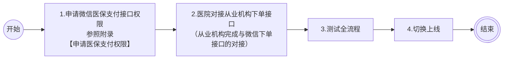

>更新时间：2026.09.18

## 一、接入流程

### （一）情况一：首次接入微信移动医保支付

详细步骤说明

1.权限申请

1.1 医疗机构申请接入省医保移动支付

接入申请分为测试环境和正式环境，需先申请测试环境的使用，测试环境调通并提交省医保局和国家医保局验收通过后，再申请正式环境。详细指引请参考[申请医保支付权限](https://pay.weixin.qq.com/doc/v3/partner/4016824701.md)

1.2 申请微信医保支付权限

权限申请包含「医院立项」、「申请微信移动医保支付接口权限」两部分内容，可同步进行，请参考[申请医保支付权限](https://pay.weixin.qq.com/doc/v3/partner/4016824701.md)

2.接口对接

部分医疗机构涉及 HIS 系统及公众号／小程序的改造，请根据自身实际情况完成对接。本阶段需对接三类接口：

2.1 对接局方（医保局）接口

医疗机构需完成以下局方接口的对接，包括不限于：

- 【6201】费用明细上传

- 【6202】预结算支付下单

- 【6203】 医保退费

- 【6301】  医保订单结算结果查询

- 【6302】 医保结算结果通知

2.2 对接腾讯免密授权接口

详见[用户授权接入文档](https://docs.qq.com/doc/DV3JYRG1xelhKTWdz)

2.3 对接微信支付下单接口

从业机构对接微信支付下单接口，医院公众号/小程序厂商对接从业机构接口。详见[开发指引](https://pay.weixin.qq.com/doc/v3/partner/4016824703.md)和[医保支付API接口](https://pay.weixin.qq.com/doc/v3/partner/4018300080.md)

3.全流程测试

3.1 开始测试前的信息准备工作

测试前需先备齐测试环境所需的配置信息。详见[测试及环境切换](https://pay.weixin.qq.com/doc/v3/partner/4021774021.md)

3.2 完成全流程测试并提交测试环境验收录屏至医保局

完成支付和退款全流程测试工作。测试环境联调完成后，需整理相关材料，通过国家医疗保障局线上平台申请正式环境权限。详见[测试及环境切换](https://pay.weixin.qq.com/doc/v3/partner/4021774021.md)

4.正式环境切换

切换至正式环境并完成支付和退款的全流程验证，正式上线。详见[测试及环境切换](https://pay.weixin.qq.com/doc/v3/partner/4021774021.md)

### （二）情况二：历史已接入微信移动医保支付，本次迁移至新接口

详细步骤说明

1.权限申请

需申请微信移动医保支付接口权限，请参考[申请医保支付权限](https://pay.weixin.qq.com/doc/v3/partner/4016824701.md)

2.接口对接

从业机构对接微信支付下单接口，医院公众号/小程序厂商对接从业机构接口。详见[开发指引](https://pay.weixin.qq.com/doc/v3/partner/4016824703.md)和[医保自费混合收款下单](https://pay.weixin.qq.com/doc/v3/partner/4018300080.md)

3.切换上线

接口对接完成后，完成支付和退款的全流程验证，正式切换上线。

## 二、各方分工说明

| 配合方 | 涉及工作 |
| --- | --- |
| 定点医院系统 | 1、对接标准接口； 2、对接腾讯医保电子凭证授权能力； 3、对接医保移动支付中台，进行费用明细上传等操作。 |
| 从业机构 | 1、为定点医院提供聚合支付接口（自费部分）； 2、实现混合医保支付下单接口，并提供给定点医院； 3、接收微信医保系统支付结果通知，并提供给定点医院； 4、提供账单给定点医院进行对账。 |
| 腾讯医保系统 | 1、为定点医院提供医保电子凭证用户授权能力； 2、为定点医院提供医保移动支付标准能力； 3、实现未激活的用户在授权时可进行医保电子凭证激活； 4、实现医保用户的“医保+自费”混合一站式支付； 5、为医院提供消息通知服务。 |
| 医保移动支付中台 | 1、为定点医院下发密钥，开通相关权限； 2、为微信渠道开通线上授权权限； 3、为微信渠道开通支付权限； 4、与医院联调费用明细上传等业务。 |

## 三、其他参数准备

### 1、设置安全联系人

微信支付日常安全监测发现技术异常时，会向安全联系人和超级管理员发送风险提醒。请商户超级管理员尽快设置技术同事为安全联系人，确保能及时接收异常信息评估业务风险，详见[安全联系人设置指引](https://pay.weixin.qq.com/doc/v3/partner/4012083124.md)。

### 2、熟悉微信支付接口规则

正式进入开发前，开发者需要先阅读[基本规则](https://pay.weixin.qq.com/doc/v3/partner/4012081726.md)、[mchid与appid申请](https://pay.weixin.qq.com/doc/v3/partner/4012081990.md)了解调用微信支付接口的基本规则和签名规则。

### 3、准备开发参数

在发起接口请求时，开发者还需传入一些必要参数，如服务商商户号、子商户号（也叫特约商户号）、sp\_appid、证书私钥、公钥等，获取方式详见：[开发必要参数说明](https://pay.weixin.qq.com/doc/v3/partner/4013080340.md)。

注意

在开发的过程中，请将应答的HTTP头Request-ID值打印到日志中。Request-ID作为[请求的唯一标识](https://pay.weixin.qq.com/doc/v3/partner/4012081726.md#%E8%AF%B7%E6%B1%82%E7%9A%84%E5%94%AF%E4%B8%80%E6%A0%87%E8%AF%86)，在调用接口遇到问题时，可向微信侧提供该值用于快速定位到请求记录，协助排查问题原因。