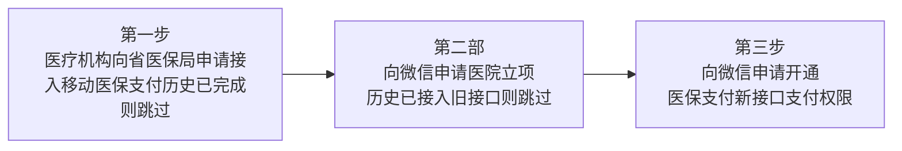

>更新时间：2026.10.26

## 概览

医疗机构接入微信移动医保支付，整体流程分为三大核心步骤：

1. 医疗机构申请接入省移动医保支付。

2. 向微信申请医院立项。

3. 向微信申请开通医保支付新接口的支付权限。



## 1、医疗机构申请接入省移动医保支付

### 1.1 概述

医疗机构申请接入省医保移动支付，需通过国家医保服务平台线上办理。申请分为测试环境与正式环境两个阶段：

- ​测试环境​：需先申请测试环境权限，完成联调测试并通过验收。

- 正式环境​：测试环境验收通过后，方可提交正式环境使用申请。


### 1.2 申请流程

详细流程见链接：[医药机构医保移动支付接入申请操作指南](https://docs.qq.com/pdf/DV3NuRkFEYXVFUWtz)

1.2.1. 登录[国家医保服务平台单位网厅](https://fuwu.nhsa.gov.cn)，点击【单位服务】栏目下的申报入口，或页面右上角【单位登录】，进入登录页面。按照对应的流程注册和登录，选择对应的服务进行申请。


```mermaid
swimlane-beta TD
  subgraph Customer[注册]
  end
  subgraph System[单位账号登录]
    B[单位登录]
  end
    subgraph SG1[经办人账号登录]
    end
    C[单位注册]
    C@{ parent: Customer }
    C
    D[绑定经办人]
    D@{ parent: Customer }
    C --> D
    E[注册完成]
    E@{ parent: Customer }
    D --> E
    E --> B
    F[单位管理首页]
    F@{ parent: System }
    B --> F
    G[资质认证]
    G@{ parent: System }
    F --> G
    H[新增经办人]
    H@{ parent: System }
    G --> H
    I[经办人授权 ]
    I@{ parent: System }
    H --> I
    J[单位登出]
    J@{ parent: System }
    I --> J
    K[经办人登陆]
    K@{ parent: SG1 }
    I --> K
    L[经办人单位管理页面]
    L@{ parent: SG1 }
    K --> L
    M[选择办理业务的单位]
    M@{ parent: SG1 }
    L --> M
    N["业务查询/办理"]
    N@{ parent: SG1 }
    M --> N
    O[经办人登出]
    O@{ parent: SG1 }
    N --> O
    O
    C
    A([开始])
    A@{ parent: Customer }
    A
    A --> C
    P([结束])
    P@{ parent: SG1 }
    O --> P
```

1.2.2. 医保移动支付进行申请时，要填入申请的应用名称、线上业务类型、第三方渠道（微信）等信息进行在线申请。提交在线申请后，市-省-国家局进行审批通过后，下载反馈单，可获取到对应的业务参数机构渠道认证编码、线上业务类型编码（如果是支付使用，用04107）、第三方渠道应用名称、应用ID和应用密钥等。

## 2、医院立项

医院需通过邮件方式提交立项申请。具体请参见：[操作流程](https://docs.qq.com/doc/DV1BwTVZBQXNLSkpU)

在填写立项申请参数时，请注意以下事项：

- 服务范围​：若医院面向全省或全国用户提供医保移动支付服务，则省份填写“XX省全省”或“全国”。

- 支付模式选择​：如选择“通用医保码”模式，其实现方式为由医院生成二维码，用户主动扫码后获取待结算订单并完成支付。

- 医保支付场景​：门诊服务包含普通门诊和特门。若支持特门，请在“医保支付场景”中选择对应项；若暂不支持，则选择“诊间”场景。


## 3、申请接入微信移动医保支付

### 3.1 申请前提

- 医保支付权限：商户号主体已在医保局官网申请移动医保支付权限

- MA绑定关系：商户号与appid已绑定MA关系

- appid主体对应关系：申请拉起医保支付的appid（即小程序/公众号对应账号）需为对应医疗机构主体；若非对应医疗机构主体，请提供「当地卫健委或相关单位的说明」；

- 开户意愿确认：商户号已通过微信支付商户开户意愿确认；

- 商户号状态：申请商户号为医院正常收款商户号，不存在无法收款等情况。


### 3.2 申请流程

3.2.1 从业机构开通权限并发起授权邀请

受理路径：产品中心-产品大全-特约商户授权产品-开通【服务商医保移动支付】，产品权限仅需开通一次，后续直接邀请医院子商户即可

|  |  |
| :-- | :-- |

邀请商户：产品详情-搜索子商户-发起邀请，创建【服务商医保移动支付申请单】


3.2.2 商户超管收到通知确认授权

- 查看邀请：子商户超管-打开微信-搜索【微信支付商家助手】公众号，查看【功能授权进展通知】

- 同意授权：点击【功能授权进展通知】跳转小程序-点击【下一步】-同意授权。有权限操作的超管是开户意愿确认（实名认证）时填写的联系人。


注意

若未完成开户意愿确认（未认证），请按照[操作指引](https://docs.qq.com/doc/DVGtzdnJ5dGJIYkFu)完成操作

|  |  |  |
| :-- | :-- | :-- |

- 申请信息填写：点击【同意授权】时，跳转医保移动支付权限申请页面

  - 若商户未提交过医保移动支付权限申请单，则进入申请信息填写页面

    

  - 若商户已提交过医保移动支付权限申请单，则根据单据审核状态点击【完成】或【重新填写】进入【修改开通医保移动支付权限资料】页。


3.2.3 产品权限申请页面快速指引

| 产品权限申请页（示例） | 填写指引 |
| --- | --- |
| <br> | 1.银行/机构商户号：从业机构号<br>2.银行/机构商户简称：从业机构简称<br>3.银行/机构商户名称：从业机构全称<br>4.商户号：间连子商户商户号<br>5.商户简称：间连子商户简称<br>6.商户全称：间连子商户商户全称<br>以上商户信息均为系统自动拉取，无需填写，请核实是否准确<br>7.APPID：必填<br>8.APPID1：选填,填写的APPID需与商户存在绑定关系（向医保局申请接入移动支付微信应用渠道对应的APPID）<br>9.医保审批证明：医保局申请单截图,大小小于5M<br><br>10.医药机构截图：医药机构公示截图,截图请务必与申请主体一致,大小小于5M<br><br>11.补充说明：选填，特殊情况在此说明<br>12.产品开通申请函：必填，需勾选后提交 |

- 权限要求：仅允许间连子商户超管进入，上传图片大小需小于5M

- 超管修改：具体参见[操作指引](https://kf.qq.com/faq/240123ueqQJJ240123jyym2i.html)

- 超管查询：联系对接的从业机构运营同学或医疗健康助手查询，联系方式：Wechatpay\_BDzhushou ，邮箱：https://doc.weixin.qq.com/doc/wxpay\_operation@tencent.com

- APPID查询：

  - 公众号：登录[公众平台](http://mp.weixin.qq.com) --开发（下滑左侧菜单）--基本配置--公众号开发信息，即可查到AppID

  - 小程序：登录[小程序平台](http://mp.weixin.qq.com) --开发---开发设置--开发者ID，即可查到AppID

  - 应用：登录[开放平台](http://open.weixin.qq.com) --管理中心--移动应用或其他应用类型--查看，即可查到AppIDpID
- 审核结果通知：审核结果会通过【商家助手公众号】给间连子商户超管发送【功能授权进展通知】。


|  |  |
| :-- | :-- |

3.2.4 间连医保支付（已绑定医保父）线下申请新增APPID指引

| 邮件标题： | 【医保支付（间联）】-商户名称-2025XXXX（申请日期） |
| --- | --- |
| 主送： | wxpay\_operation@tencent.com |
| 抄送： | yuxiwang@tencent.com;xiaomaowang@tencent.com;caihangliu@tencent.com<br>shirlyychen@tencent.com；yukiyywan@tencent.com；joycehan@tencent.com；mikedu@tencent.com；musksun@tencent.com |
| 正文： | Hi ，<br>以下商户申请医保内部绑定，历史已完成医保父绑定，已审核确认申请材料无误，申请新增appid，辛苦配置，谢谢。<br>粘贴申请表格 |
| 附件： | 1、[商户基本信息表](https://docs.qq.com/sheet/DRURkamN6VEVtaWZ6?tab=BB08J2)<br>2、商户在医保局的申请单详情截图（文件以“序号+商户号+商户名+申请单”命名）<br><br>3、定点机构公示截图（文件以“序号+商户号+商户名+公示”命名）<br><br>截图请务必与示例一致 |