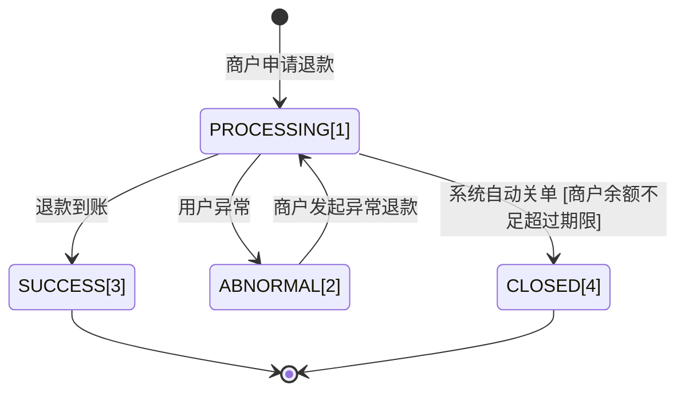

>更新时间：2026.06.10

## 1. 目标

通过本教程的学习，你应该可以：

- 可以通过[发起退款](https://pay.weixin.qq.com/doc/v3/partner/4013080625.md)

- 可以通过[查询退款结果](https://pay.weixin.qq.com/doc/v3/partner/4013080626.md)

- 如果退款异常时，可以通过[发起异常退款退款](https://pay.weixin.qq.com/doc/v3/partner/4013080627.md)

- 可以接收微信支付退款结果并解析退款结果

- 退款时可以处理好错误码


## 2. 业务处理流程

### 2.1 申请退款

当交易发生之后一段时间内，由于买家或者卖家的原因需要退款时，卖家可以通过退款接口将支付款退还给买家，微信支付将在收到退款请求并且验证成功之后，按照退款规则将支付款按原路退到买家账户上。

申请退款需要3类信息：

- 商户信息

  - 子商户号
- 原支付订单信息

  - 微信支付订单号或者商户订单号

  - 原订单金额
- 退款信息

  - 商户退款单号：标识该服务商商户下的退款单，同一个服务商商户下不同商户退款单号表示不同的退款单

  - 退款原因

  - 退款金额

  - 退款出资信息

  - 退款回调URL

  - 退款商品信息

```
package com.java.partner.refund;

import com.java.demo.Create; // 使用合作伙伴申请退款接口：https://pay.weixin.qq.com/doc/v3/partner/4013080625
import static com.java.demo.Create.*;
import com.java.utils.WXPayUtility; // 引用微信支付工具库，参考：https://pay.weixin.qq.com/doc/v3/partner/4014985777
import java.util.ArrayList;

public class CreateRefundDemo {
  // TODO: 请准备商户开发必要参数，参考：https://pay.weixin.qq.com/doc/v3/partner/4013080340
  // 商户号，是由微信支付系统生成并分配给每个商户的唯一标识符，商户号获取方式参考
  // https://pay.weixin.qq.com/doc/v3/partner/4013080340
  private static String mchid = "19xxxxxxxx";
  // 商户API证书序列号，如何获取请参考 https://pay.weixin.qq.com/doc/v3/partner/4013058924
  private static String certificateSerialNo = "1DDE55AD98Exxxxxxxxxx";
  // 商户API证书私钥文件路径，本地文件路径
  private static String privateKeyFilePath = "/path/to/apiclient_key.pem";
  // 微信支付公钥ID，如何获取请参考 https://pay.weixin.qq.com/doc/v3/partner/4013038589
  private static String wechatPayPublicKeyId = "PUB_KEY_ID_xxxxxxxxxxxxx";
  // 微信支付公钥文件路径，本地文件路径
  private static String wechatPayPublicKeyFilePath = "/path/to/wxp_pub.pem";

  public static void main(String[] args) {
    Create ceateRefund = new Create(
      mchid,
      certificateSerialNo,
      privateKeyFilePath,
      wechatPayPublicKeyId,
      wechatPayPublicKeyFilePath
    );

    CreateRequest createRefundRequest = new CreateRequest();
    // 商户信息
    createRefundRequest.subMchid = "1900000109";

    // 原支付订单信息
    createRefundRequest.transactionId = "4200000020202506035017900000";
    createRefundRequest.amount = new AmountReq();
    createRefundRequest.amount.total = 800L;

    // 退款信息
    // 商户退款单号生成方式商户视实际情况生成，需要保证服务商商户下全局唯一
    createRefundRequest.outRefundNo = "4200000020202506035017900000_1";
    createRefundRequest.reason = "成团退差价";
    createRefundRequest.amount.refund = 200L;

    // 退款成功，退款关闭，退款异常时需要微信支付通知商户商户，可以加上回调URL，退款到这几个状态时会调用这个URL通知商户
    createRefundRequest.notifyUrl = "https://weixin.qq.com";

    // 退款资金来源
    // 1. 对于出行预付押金退款
    // - 不填写表示已结退款，从出行商户基本户出资退款
    // - 填写UNSETTLED，表示未结退款，从押金账户出资退款
    // 2.
    // 对于子商户为老资金流的商户（老资金流也叫旧资金流，旧资金流如何区分见：https://kf.qq.com/faq/161223N7fi2E161223EvY3Ir.html）
    // - 不填写表示未结退款，从未结账户出资退款
    // - 填写AVAILABLE，表示从可用余额出资退款
    // createRefundRequest.fundsAccount = ReqFundsAccount.AVAILABLE;

    // 退款商品信息
    createRefundRequest.goodsDetail = new ArrayList<>();
    {
      GoodsDetail goodDetail = new GoodsDetail();
      goodDetail.merchantGoodsId = "1217752501201407033233368018";
      goodDetail.wechatpayGoodsId = "1001";
      goodDetail.goodsName = "iPhone6s 16G";
      goodDetail.unitPrice = 528800L;
      goodDetail.refundAmount = 528800L;
      goodDetail.refundQuantity = 1L;
      createRefundRequest.goodsDetail.add(goodDetail);
    }
    ;

    Refund refund;
    try {
      refund = ceateRefund.run(createRefundRequest);
    } catch (WXPayUtility.ApiException e) {
      // 申请退款处理异常处理逻辑
      if (e.getErrorCode().equals("SYSTEM_ERROR")) {
        // 错误：系统错误
        // 解决方式：稍后原单重试
        // 描述：微信支付系统失败，一定要原单重试，系统失败直接立即重试大概率还会是系统失败，建议等1分钟后再重试
      } else if (e.getErrorCode().equals("FREQUENCY_LIMITED")) {
        // 错误：限频报错
        // 解决方式：稍后原单重试
        // 描述： 退款接口频率限制，一定要原单重试，直接立即重试大概率还会是系统失败，建议等1分钟后再重试
      } else if (e.getErrorCode().equals("MCH_NOT_EXISTS")) {
        // 错误：子商户不存在
        // 解决方式：检查输入的子商户号是否填写正确，修改正确之后原单重试
        // 描述：输入子商户账户不存在，需要填写存在的账户之后重试
      } else if (e.getErrorCode().equals("USER_ACCOUNT_ABNORMAL")) {
        // 错误：用户账户异常
        // 解决方式：退款受理失败，商户可以自行处理退款，也可以登录商户平台进入交易中心发起异常退款
        // 描述：用户注销或者被管控了，这笔订单已经不能发起退款，这个错误就不需要重试了
      } else if (e.getErrorCode().equals("NOT_ENOUGH")) {
        // 错误：账户余额不足
        // 解决方式：商户充值之后原单重试
        // 描述：商户账户余额不足，导致退款失败，商户充值之后一定要原单重试
      } else if (e.getErrorCode().equals("NO_AUTH")) {
        // 错误：无退款权限
        // 解决方式：
        // 1. 检查商户是否是被处罚：登录商户平台进入账户中心-违约记录查询是否违约记录，如果有按照上面的指引解决违约记录之后原单重试
        // 2.
        // 检查子商户是否已授权服务商商户API退款权限：登录商户平台进入产品中心-特约商户授权产品，在特约商户列表中看看该子商户是否存在并且授权状态为“已授权”，
        // 如果不存在或者授权状态不是“已授权”就需要发起授权邀请，等子商户审批之后重新查询一遍，授权状态为“已授权”之后再原单重试
        // 描述：服务商商户被处罚或者服务商商户和子商户没有父子受理关系
      } else if (e.getErrorCode().equals("SIGN_ERROR")) {
        // 错误：签名错误
        // 解决方式：检查服务商商户证书序列号，证书私钥文件，公钥ID，公钥文件，同时确认下签名过程是不是按照微信支付的签名方式
        // 描述：签名报错，需要确认签名材料和签名流程是否正确
      } else if (e.getErrorCode().equals("PARAM_ERROR")) {
        // 错误：参数错误
        // 解决方式：按照报错返回的message，重新输入请求参数
        // 描述：参数的类型，长度，或者必填选项没有填写等
      } else if (e.getErrorCode().equals("INVALID_REQUEST")) {
        // 错误：请求非法，请求参数正确，但是不符合退款业务规则
        // 解决方式：根据具体message查看具体哪里不符合业务规则，如果可以修改参数达到符合业务规则的修改请求符合业务规则之后再原单重试
        // 描述：不符合业务规则的场景如：
        // - 交易时间超过365天，不允许发起退款
        // - 一笔订单退款次数已经超过50次了，这笔订单不允许发起新的退款
        // - 申请退款的金额超过了这笔订单剩余可退金额，不允许申请退款
      } else {
        // 其他类型错误：稍等一会后原单重试
      }

    }
  }
}
```

### 2.2 查询退款

上面申请退款成功之后，说明微信支付成功受理了这笔退款，并不是已经退款到账，商户可以通过查询退款接口查询退款结果

退款单的状态机：



```
package com.java.partner.refund;

import com.java.demo.Create; // 使用合作伙伴申请退款接口：https://pay.weixin.qq.com/doc/v3/partner/4013080625
import static com.java.demo.Create.*;
import com.java.demo.QueryByOutRefundNo; // 使用合作伙伴查询单笔退款（按商户退款单号）接口，见：https://pay.weixin.qq.com/doc/v3/partner/4013080626
import static com.java.demo.QueryByOutRefundNo.*;
import com.java.demo.CreateAbnormalRefund; // 使用合作伙伴发起异常退款接口，见：https://pay.weixin.qq.com/doc/v3/partner/4013080627
import static com.java.demo.CreateAbnormalRefund.*;
import com.java.utils.WXPayUtility; // 引用微信支付工具库，参考：https://pay.weixin.qq.com/doc/v3/partner/4014985777
import java.util.ArrayList;

public class QueryRefundDemo {
  // TODO: 请准备商户开发必要参数，参考：https://pay.weixin.qq.com/doc/v3/partner/4013080340
  // 商户号，是由微信支付系统生成并分配给每个商户的唯一标识符，商户号获取方式参考
  // https://pay.weixin.qq.com/doc/v3/partner/4013080340
  private static String mchid = "19xxxxxxxx";
  // 商户API证书序列号，如何获取请参考 https://pay.weixin.qq.com/doc/v3/partner/4013058924
  private static String certificateSerialNo = "1DDE55AD98Exxxxxxxxxx";
  // 商户API证书私钥文件路径，本地文件路径
  private static String privateKeyFilePath = "/path/to/apiclient_key.pem";
  // 微信支付公钥ID，如何获取请参考 https://pay.weixin.qq.com/doc/v3/partner/4013038589
  private static String wechatPayPublicKeyId = "PUB_KEY_ID_xxxxxxxxxxxxx";
  // 微信支付公钥文件路径，本地文件路径
  private static String wechatPayPublicKeyFilePath = "/path/to/wxp_pub.pem";

  public static void main(String[] args) {
    QueryByOutRefundNo client = new QueryByOutRefundNo(
      mchid,
      certificateSerialNo,
      privateKeyFilePath,
      wechatPayPublicKeyId,
      wechatPayPublicKeyFilePath
    );

    QueryByOutRefundNoRequest request = new QueryByOutRefundNoRequest();
    request.outRefundNo = "4200000020202506035017900000_1";
    request.subMchid = "1900000109";
    try {
      QueryByOutRefundNo.Refund refund = client.run(request);
      switch (refund.status) {
        case SUCCESS:
          // 终态：退款成功（退款到账）
          // 更新商户自己的业务单据状态为成功
          // UpdateRefund2Succ();
          break;
        case CLOSED:
          // 终态：退款关闭
          // 更新商户自己的业务单据状态为关闭
          // UpdateRefund2Closed();
          // 如果还需要退款，需要换单（换outRefundNo）重新申请退款
          Create createRefund = new Create(
            mchid,
            certificateSerialNo,
            privateKeyFilePath,
            wechatPayPublicKeyId,
            wechatPayPublicKeyFilePath
          );

          CreateRequest createRefundRequest = new CreateRequest();
          // 其他参数和之前申请退款参数一样，只改商户退款单号
          createRefundRequest.outRefundNo = "4200000020202506035017900000_2";
          createRefund.run(createRefundRequest);

          break;
        case PROCESSING:
          // 非终态：退款处理中 - 还未到账，需要隔一段时间再来查询
          break;
        case ABNORMAL:
          // 非终态：退款异常 - 用户异常、用户被管控等原因不能原路退
          // 可以用两种处理方式：
          // 1. 商户登录商户平台进入交易中心发起异常退款，把钱退到用户指定的银行卡或者商户的银行
          // 2. 请求异常退款API
          // TODO: 请准备商户开发必要参数，参考：https://pay.weixin.qq.com/doc/v3/partner/4013080340
          CreateAbnormalRefund createAbnormalRefund = new CreateAbnormalRefund(
            mchid,
            certificateSerialNo,
            privateKeyFilePath,
            wechatPayPublicKeyId,
            wechatPayPublicKeyFilePath
          );
          CreateAbnormalRefundRequest abnormalRefundRequest = new CreateAbnormalRefundRequest();
          abnormalRefundRequest.refundId = refund.refundId;
          abnormalRefundRequest.subMchid = "1900000109";
          abnormalRefundRequest.outRefundNo = "4200000020202506035017900000_1";
          abnormalRefundRequest.type = AbnormalReceiveType.USER_BANK_CARD;
          abnormalRefundRequest.bankType = "ICBC_DEBIT";
          abnormalRefundRequest.bankAccount = createAbnormalRefund.encrypt("请填 用户的银行卡号");
          abnormalRefundRequest.realName = createAbnormalRefund.encrypt("请填 收款用户姓名");
          CreateAbnormalRefund.Refund abnormalRefund = createAbnormalRefund.run(abnormalRefundRequest);
          // 发起异常退款成功之后，退款单会进入退款中，还是需要通过查单接口查询退款单的状态
          break;
        default:
          // 非法状态
          throw new IllegalArgumentException("微信支付退款单状态非法");
      }
    } catch (WXPayUtility.ApiException e) {
      // 查询退款处理异常处理逻辑
      if (e.getErrorCode().equals("RESOURCE_NOT_EXISTS")) {
        // 错误：退款单不存在
        // 解决方式：原参数申请退款
        // 描述：退款受理没成功，原参数发起退款申请即可
      } else if (e.getErrorCode().equals("SYSTEM_ERROR")) {
        // 错我：系统错误
        // 解决方式：稍后原单重试
        // 描述：微信支付系统失败，直接立即重试大概率还会是系统失败，建议等1分钟后再重试
      } else if (e.getErrorCode().equals("FREQUENCY_LIMITED")) {
        // 错误：限频报错
        // 处理逻辑：稍后原单重试
        // 描述： 退款接口频率限制，直接立即重试大概率还会是系统失败，建议等1分钟后再重试
      } else if (e.getErrorCode().equals("MCH_NOT_EXISTS"))  {
        // 错误：子商户不存在
        // 处理逻辑：检查输入的子商户号是否填写正确，修改正确之后原单重试
        // 描述：输入子商户账户不存在，需要填写存在的账户之后重试
      } else if (e.getErrorCode().equals("NO_AUTH")) {
        // 错误：无退款权限
        // 处理逻辑：检查服务商商户是否退款权限，服务商商户和子商户是否有父子受理关系，需要开通服务商商户的退款权限和添加子商户的父子受理权限才能发起退款
        // 描述：服务商商户无退款权限或者服务商商户和子商户没有父子受理关系
      } else if (e.getErrorCode().equals("SIGN_ERROR")) {
        // 错误：签名错误
        // 处理逻辑：检查服务商商户证书序列号，证书私钥文件，公钥ID，公钥文件，同时确认下签名过程是不是按照微信支付的签名方式
        // 描述：签名报错，需要确认签名材料和签名流程是否正确
      } else if (e.getErrorCode().equals("PARAM_ERROR")) {
        // 错误：参数错误
        // 处理逻辑：按照报错返回的message，重新输入请求参数
        // 描述：参数的类型，长度，或者必填选项没有填写等
      } else {
        // 其他类型错误：稍等一会后原单重试
      }
    }
  }
}
```

### 2.3 退款结果通知

如果商户申请退款时设置了notifyUrl，或者在商户平台-交易中心-交易管理-退款管理-退款配置 中设置了通知URL，那么退款状态变更为SUCCESS、CLOSED或者ABNORMAL后会通过HTTP POST方法回调到这个URL上

如果退款申请是设置了notifyUrl，同时退款配置中也设置了通知URL，已退款申请的URL为准

```
package com.java.partner.refund;

import com.java.utils.WXPayUtility; // 引用微信支付工具库，参考：https://pay.weixin.qq.com/doc/v3/partner/4014985777
import com.java.utils.WXPayUtility.Notification;
import java.security.PublicKey;
import okhttp3.Headers;
import okhttp3.Response;
import com.google.gson.annotations.SerializedName;

public class RefundNotifyDemo {
  // TODO: 请准备商户开发必要参数，参考：https://pay.weixin.qq.com/doc/v3/partner/4013080340
  // 商户号，是由微信支付系统生成并分配给每个商户的唯一标识符，商户号获取方式参考
  // https://pay.weixin.qq.com/doc/v3/partner/4013080340
  private static String mchid = "19xxxxxxxx";
  // 商户API证书序列号，如何获取请参考 https://pay.weixin.qq.com/doc/v3/partner/4013058924
  private static String certificateSerialNo = "1DDE55AD98Exxxxxxxxxx";
  // 商户API证书私钥文件路径，本地文件路径
  private static String privateKeyFilePath = "/path/to/apiclient_key.pem";
  // 微信支付公钥ID，如何获取请参考 https://pay.weixin.qq.com/doc/v3/partner/4013038589
  private static String wechatPayPublicKeyId = "PUB_KEY_ID_xxxxxxxxxxxxx";
  // 微信支付公钥文件路径，本地文件路径
  private static String wechatPayPublicKeyFilePath = "/path/to/wxp_pub.pem";
  // 商户APIv3密钥，如何获取请参考 https://pay.weixin.qq.com/doc/v3/partner/4013059095
  private static String apiv3Key = "your apiv3 key";

  public static class RefundAmount {
    @SerializedName("total")
    public Long total;

    @SerializedName("refund")
    public Long refund;

    @SerializedName("payer_total")
    public Long payerTotal;

    @SerializedName("payer_refund")
    public Long payerRefund;
  }

  public static class Refund {
    @SerializedName("sp_mchid")
    public String spMchid;

    @SerializedName("sub_mchid")
    public String subMchid;

    @SerializedName("out_trade_no")
    public String outTradeNo;

    @SerializedName("transaction_id")
    public String transactionId;

    @SerializedName("out_refund_no")
    public String outRefundNo;

    @SerializedName("refund_id")
    public String refundId;

    @SerializedName("refund_status")
    public String refundStatus;

    @SerializedName("success_time")
    public String successTime;

    @SerializedName("user_received_account")
    public String userReceivedAccount;

    @SerializedName("amount")
    public RefundAmount amount;
  }

  public void refundNotify(Response httpResponse) {
    String refundNotifyStr = WXPayUtility.extractBody(httpResponse); // 微信支付退款通知的原始字符串
    Headers headers = httpResponse.headers(); // 微信支付退款通知的Headers
    PublicKey wechatPayPublicKey = WXPayUtility.loadPublicKeyFromPath(wechatPayPublicKeyFilePath);

    Notification notification = WXPayUtility.parseNotification(
        apiv3Key,
        wechatPayPublicKeyId, wechatPayPublicKey, headers,
        refundNotifyStr);

    // 检查这个ID是否已经处理过了，ID是微信支付系统生成的唯一ID，每个ID只需要处理一次
    // CheckIfIdProcessed(notification.getId());

    // 解析退款单
    Refund refund = WXPayUtility.fromJson(notification.getResource().getCiphertext(), Refund.class);

    // 处理退款事件
    switch (notification.getEventType()) {
      case "REFUND.SUCCESS":
        // 退款成功， 理论上退款单的状态是成功态，这里多做一次校验
        if (refund.refundStatus.equals("SUCCESS")) {
          // 退款成功， 处理退款成功逻辑
          // UpdateRefund2Succ();
        } else {
          // 退款单状态非法，报错返回
          throw new IllegalArgumentException("退款单状态非法");
        }
        break;
      case "REFUND.ABNORMAL":
        // 退款异常， 理论上退款单的状态应该是异常态，这里多做一次校验
        if (refund.refundStatus.equals("ABNORMAL")) {
          // 退款异常， 处理退款异常逻辑
          // 可以和查单发现退款单异常处理逻辑一样，可以用两种处理方式：
          // 1. 商户登录商户平台进入交易中心发起异常退款，把钱退到用户指定的银行卡或者商户的银行
          // 2. 请求异常退款API
          // UpdateRefund2Abnormal();
        } else {
          // 退款单状态非法，报错返回
          throw new IllegalArgumentException("退款单状态非法");
        }
        break;
      case "REFUND.CLOSED":
        // 退款关闭， 理论上退款单的状态应该是关闭态，这里多做一次校验
        if (refund.refundStatus.equals("CLOSED")) {
          // 退款关闭， 处理退款关闭逻辑
          // 可以和查单发现退款单关闭处理逻辑一样（如果还需要退款，需要换单之后重新发起退款）
          // UpdateRefund2Closed();
        } else {
          // 退款单状态非法，报错返回
          throw new IllegalArgumentException("退款单状态非法");
        }
        break;
      default:
        // 非法事件类型，报错返回
        throw new IllegalArgumentException("退款事件非法");
    }

  }

}

```