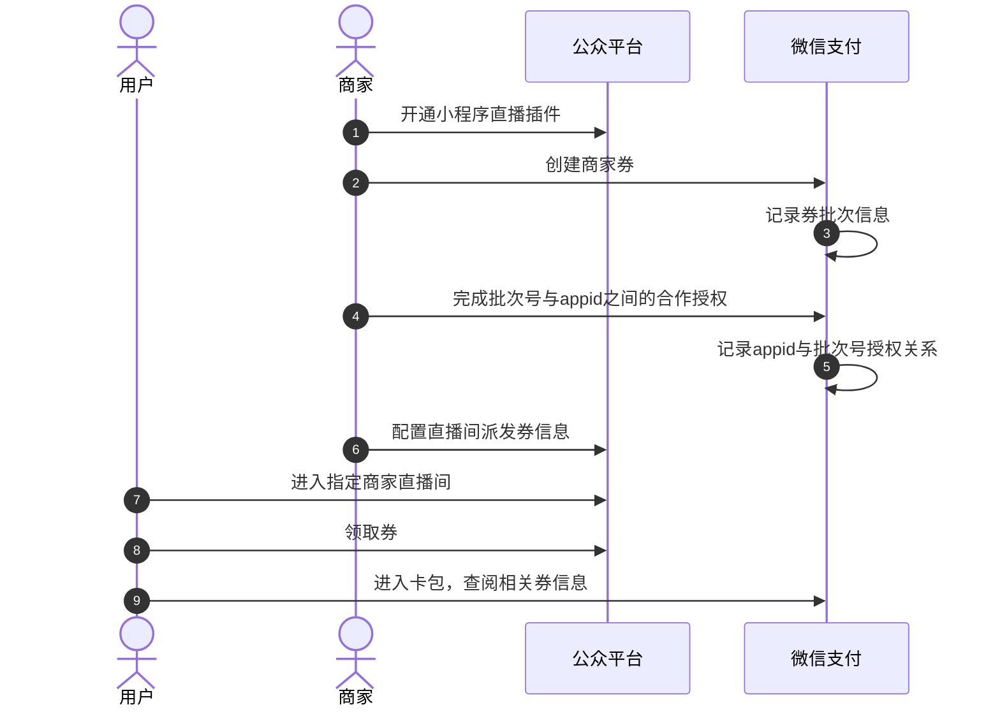

>更新时间：2026.10.19

## 1. 接口规则

为了在保证支付安全的前提下，带给商户简单、一致且易用的开发体验，我们推出了全新的微信支付APIv3接口。该版本API的具体规则请参考[APIv3接口规则](https://pay.weixin.qq.com/doc/v3/merchant/4012081606.md)。

## 2. 开发准备

### 2.1. 搭建和配置开发环境

开发者应当依据自身的编程语言来构建并配置相应的开发环境。

### 3. 快速接入

#### 3.1. 业务流程图



重点步骤说明：

步骤1.4 商户调用《[建立合作关系](https://pay.weixin.qq.com/doc/v3/partner/4012381469.md)》接口，将指定优惠券批次（支付券或商家券）授权给指定AppID。

步骤2.1 用户在商家小程序直播间，可领取对应优惠券；（优惠券领取后，自动插入用户微信卡包）。

#### 3.2. API接入（含示例代码）

文档展示了如何使用微信支付服务端 SDK 快速接入委托营销产品，完成与微信支付对接的部分。

注意

- 文档中的代码示例是用来阐述 API 基本使用方法，代码中的示例参数需替换成商户自己账号及请求参数才能跑通。

- 以下接入步骤仅提供参考，请商户结合自身业务需求进行评估、修改。


#### 3.2.1. 【服务端】建立合作关系

步骤说明： 该接口主要为商户提供营销资源的授权能力，可授权给其他商户或小程序，方便商户间的互利合作。

Java

```
示例代码
public void BuildRelations() throws Exception{
    //请求URL
    HttpPost httpPost = new HttpPost("https://api.mch.weixin.qq.com/v3/marketing/partnerships/build");
    // 请求body参数
    String reqdata = "{"
            + "\"authorized_data\": {"
            + "\"business_type\":\"FAVOR_STOCK\","
            + "\"stock_id\":\"2433405\""
            + "},"
            + "\"partner\": {"
            + "\"appid\":\"wx4e1916a585d1f4e9\","
            + "\"type\":\"APPID\""
            + "}"
            + "}";
    StringEntity entity = new StringEntity(reqdata,"utf-8");
    entity.setContentType("application/json");
    httpPost.setEntity(entity);
    httpPost.setHeader("Accept", "application/json");
    httpPost.setHeader("Idempotency-Key","12345");
    //完成签名并执行请求
    CloseableHttpResponse response = httpClient.execute(httpPost);
    try {
        int statusCode = response.getStatusLine().getStatusCode();
        if (statusCode == 200) { //处理成功
            System.out.println("success,return body = " + EntityUtils.toString(response.getEntity()));
        } else if (statusCode == 204) { //处理成功，无返回Body
            System.out.println("success");
        } else {
            System.out.println("failed,resp code = " + statusCode+ ",return body = " + EntityUtils.toString(response.getEntity()));
            throw new IOException("request failed");
        }
    } finally {
        response.close();
    }
}
```

PHP

```
示例代码
  try {
    $resp = $client->request(
        'POST',
        'https://api.mch.weixin.qq.com/v3/marketing/partnerships/build', //请求URL
        [
            // JSON请求体
            'json' => [
                "authorized_data" => [
                    "business_type" => "FAVOR_STOCK",
                    "stock_id" => "2433405",
                ],
                "partner" => [
                    "appid" => "wx4e1916a585d1f4e9",
                    "type" => "APPID",
                ]
            ],
            'headers' => [
                'Accept' => 'application/json',
                'Idempotency-Key' => '12345'
            ]
        ]
    );
    $statusCode = $resp->getStatusCode();
    if ($statusCode == 200) { //处理成功
        echo "success,return body = " . $resp->getBody()->getContents()."\n";
    } else if ($statusCode == 204) { //处理成功，无返回Body
        echo "success";
    }
} catch (RequestException $e) {
    // 进行错误处理
    echo $e->getMessage()."\n";
    if ($e->hasResponse()) {
        echo "failed,resp code = " . $e->getResponse()->getStatusCode() . " return body = " . $e->getResponse()->getBody() . "\n";
    }
    return;
}
```

重要入参说明：

- type： 合作方类别，枚举值：

  - AppID：合作方为AppID

  - MERCHANT：合作方为商户
- business\_type： 授权业务类别，枚举值：

  - FAVOR\_STOCK：代金券批次

  - BUSIFAVOR\_STOCK：商家券批次

更多参数、响应详情及错误码请参见[建立合作关系](https://pay.weixin.qq.com/doc/v3/partner/4012381469.md)接口文档。

#### 3.2.2. 【服务端】查询合作关系列表

步骤说明： 该接口主要为商户提供合作关系列表的查询能力。

Java

```
示例代码
public void QueryRelations() throws Exception{
    //请求URL
    HttpGet httpGet = new HttpGet("https://api.mch.weixin.qq.com/v3/marketing/partnerships?authorized_data=%7b%22business_type%22%3a%22BUSIFAVOR_STOCK%22%7d&partner=%7b%22type%22%3a%22APPID%22%7d&offset=0&limit=5");
    httpGet.setHeader("Accept", "application/json");
    //完成签名并执行请求
    CloseableHttpResponse response = httpClient.execute(httpGet);
    try {
        int statusCode = response.getStatusLine().getStatusCode();
        if (statusCode == 200) { //处理成功
            System.out.println("success,return body = " + EntityUtils.toString(response.getEntity()));
        } else if (statusCode == 204) { //处理成功，无返回Body
            System.out.println("success");
        } else {
            System.out.println("failed,resp code = " + statusCode+ ",return body = " + EntityUtils.toString(response.getEntity()));
            throw new IOException("request failed");
        }
    } finally {
        response.close();
    }
}
```

PHP

```
示例代码
  try {
    $resp = $client->request(
        'GET',
        'https://api.mch.weixin.qq.com/v3/marketing/partnerships?authorized_data=%7b%22business_type%22%3a%22BUSIFAVOR_STOCK%22%7d&partner=%7b%22type%22%3a%22APPID%22%7d&offset=0&limit=5', //请求URL
        [
            'headers' => [ 'Accept' => 'application/json']
        ]
    );
    $statusCode = $resp->getStatusCode();
    if ($statusCode == 200) { //处理成功
        echo "success,return body = " . $resp->getBody()->getContents()."\n";
    } else if ($statusCode == 204) { //处理成功，无返回Body
        echo "success";
    }
} catch (RequestException $e) {
    // 进行错误处理
    echo $e->getMessage()."\n";
    if ($e->hasResponse()) {
        echo "failed,resp code = " . $e->getResponse()->getStatusCode() . " return body = " . $e->getResponse()->getBody() . "\n";
    }
    return;
}
```

重要入参说明：

- business\_type： 授权业务类别，枚举值：

  - FAVOR\_STOCK：代金券批次

  - BUSIFAVOR\_STOCK：商家券批次

更多参数、响应详情及错误码请参见[查询合作关系列表](https://pay.weixin.qq.com/doc/v3/partner/4012381479.md)接口文档。

### 4. 常见问题

#### Q：调用建立合作关系接口返回“AppID与mchid不匹配”

A：请按照以下几点检查：

- AppID或mch\_id填写错误，请确认AppID和mch\_id是否正确。

- AppID与mch\_id未绑定，请绑定后再调用接口，绑定步骤请参考《[绑定指引](https://kf.qq.com/faq/1801116VJfua1801113QVNVz.html)》文档。


#### Q：调用建立合作关系接口返回“商户号不存在”

A：商户号不存在，请确认请求头中的商户号是否正确或者是否有空格。

#### Q：查询合作关系列表API返回“签名错误或签名信息不完整”

A：请按照以下几点检查：

- 签名与生成Authorization用的同一个时间戳跟随机串。

- 构造签名串时，里面的URL不需要ToLowCase()，不用UrlEncode()，商户请求的URL后缀是什么，签名用的URL后缀就是什么。

- 查询订单使用的是GET，构建签名串时，里面的请求报文为空且需要换行符。

- 检查证书和商户号是否正确，如为服务商模式，则需使用服务商的相关证书。签名相关问题请参考《[接口规则](https://pay.weixin.qq.com/doc/v3/partner/4012082324.md)》文档。


#### Q：调用建立合作关系接口返回“商户证书序列号有误。请使用签名私钥匹配的证书序列号”

A：请求头中的API证书序列号错误，请排查确认。证书序列号查看路径：【[服务商平台](https://pay.weixin.qq.com/partner/public/home)->API安全->API证书->查看证书】。

#### Q：调用建立合作关系接口返回“HTTP头缺少Accept或User-Agent”

A：HTTP头缺少Accept或User-Agent，请根据V3接口规则内容进行排查。