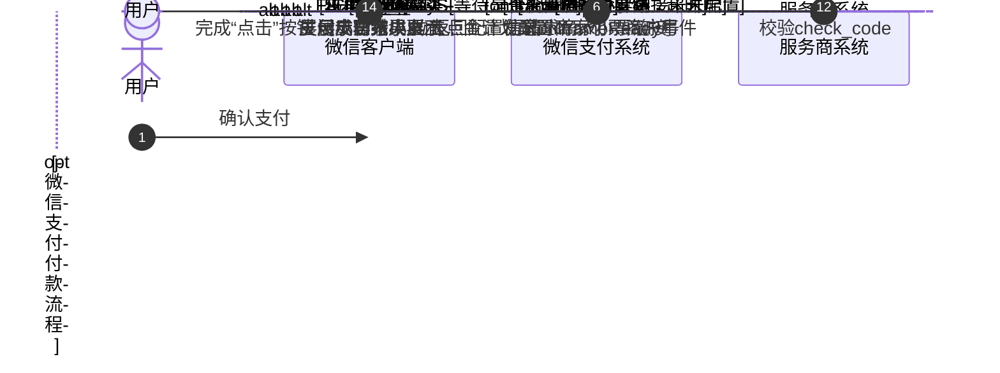

>更新时间：2026.06.09

## 1. 接口规则

为了在保证支付安全的前提下，带给商户简单、一致且易用的开发体验，我们推出了全新的微信支付APIv3接口。该版本API的具体规则请参考[APIv3接口规则](https://pay.weixin.qq.com/doc/v3/merchant/4012081606.md)。

## 2. 开发准备

### 2.1. 搭建和配置开发环境

开发者应当依据自身的编程语言来构建并配置相应的开发环境。

### 2.2. 业务开发配置

#### 2.2.1. 服务商开通点金计划

操作路径：【登录[微信服务商平台](https://pay.weixin.qq.com/partner/public/home)→ 服务商功能 → 点金计划】，点击申请开通即可。

#### 2.2.2. 开通官方小票配置

若仅为特约商户开通点金计划，未开通商家小票功能，该商户JSAPI支付后会展示官方小票样式。

操作路径：【登录[微信服务商平台](https://pay.weixin.qq.com/partner/public/home)→ 服务商功能 → 点金计划】，在“特约商户管理” 模块中，打开“点金计划”开关。

开通官方小票后的页面展示如下图：


点击申请开通后进入开通流程，根据指引签署承诺函并填写业务联络人，即可提交申请并开通。

注意

- 服务商也可通过“默认开通”按钮为全量特约商户开通点金计划。如下图所示，在特约商户管理列表 右上角有“默认开通点金计划”开关，打开后，只要特约商户产生jsapi支付，微信支付将自动为其 开通点金计划，无需服务商操作开通。（注：打开该开关后，有jsapi支付的特约商户均会自动开通点金计划，不可单个关闭。若特约商户 无jsapi支付，则不会为其自动打开点金计划。其中，若某些特约商户需使用“商家小票”功能，服务商/渠道商需在点金计划管理页面上或通过API额外为其打开商家小票功能开关。）

- 微信支付侧提供“点金计划管理API”，供服务商为特约商户批量开通点金计划，具体请查看 点金计划管理API。（注：主动关闭点金计划后，需间隔24 小时方可再次开通）


#### 2.2.3. 开通商家小票配置

若为特约商户开通点金计划时，已开通了商家小票功能且已按开发文档完成接入，该商户JSAPI支付后会展示商家小票样式。

##### 服务商维度配置商家小票链接

配置路径：【登录[微信支付服务商平台](https://pay.weixin.qq.com/partner/public/home)→ 服务商功能 → 点金计划】。在“商家小票链接配置” 模块中，点击“添加商家小票链接”：


##### 特约商户维度配置独立商家小票链接

配置路径：【登录[微信支付服务商平台](https://pay.weixin.qq.com/partner/public/home)→ 服务商功能 → 点金计划】。在“特约商户管理” 模块中，点击“更多”添加“配置特约商户商家小票链接”：


提示

- 完成商家小票链接配置后，服务商还需为特约商户打开商家小票的开关。

- 配置完商家小票链接后，才会出现商家小票功能开关。

- 服务商为特约商户打开“商家小票”开关后，还需为其打开“点金计划”开关，若特约商户的“点金计划”未开通，即使 “商家小票”功能开通，其JSAPI 支付后也不会展示点金计划页面和商家小票内容。


#### 2.2.4. 使用“商家小票调试工具”进行调试

说明： 为了保证商家小票在点金计划页面展示的兼容性、完整性，平台还提供了便捷的商家小票调试工具供服务商进行调试。服务商可通过商家小票调试工具，使用所选链接和真实订单号对点金计划页面的数据交互流程、前端JSAPI 的使用进行调试。

商家小票调试工具路径： 【登录微信支付[服务商平台](https://pay.weixin.qq.com/partner/public/home)→ 服务商功能 → 点金计划】在“商家小票链接配置” 模块右边，点击“商家小票调试工具”


## 3. 快速接入

### 3.1. 业务流程图



重点步骤说明：

步骤5 已打开特约商户的商家小票及点金计划开关

步骤11 商家小票页面需调用父页面“onIframeReady”事件的jsapi，请查看[《商家小票开发指引》](https://kf.qq.com/faq/2505216JzUzM250521Q3EbQN.html)。

在商家小票页面渲染完成后，调用父页面的“onIframeReady”事件的JSAPI，并且从加载商家小票页面开始到调用“onIframeReady”事件的JSAPI之间的用时不可超过3s，否则会提示无法获取订单信息。

### 3.2. API接入（含示例代码）

文档展示了如何使用微信支付服务端 SDK 快速接入点金计划产品，完成与微信支付对接的部分。

注意

- 文档中的代码示例是用来阐述 API 基本使用方法，代码中的示例参数需替换成商户自己账号及请求参数才能跑通。

- 以下接入步骤仅提供参考，请商户结合自身业务需求进行评估、修改。


#### 3.2.1. 【服务端】点金计划管理

步骤说明： 服务商使用此接口为特约商户开通或关闭点金计划。

示例代码

JAVA

```
public void GoldPlanStatus() throws Exception{
    //请求URL
    HttpPost httpPost = new HttpPost("https://api.mch.weixin.qq.com/v3/goldplan/merchants/changegoldplanstatus");
    // 请求body参数
    String reqdata = "{"
            + "\"sub_mchid\":\"1234567890\","
            + "\"operation_type\":\"OPEN\""
            + "}";
    StringEntity entity = new StringEntity(reqdata,"utf-8");
    entity.setContentType("application/json");
    httpPost.setEntity(entity);
    httpPost.setHeader("Accept", "application/json");

    //完成签名并执行请求
    CloseableHttpResponse response = httpClient.execute(httpPost);

    try {
        int statusCode = response.getStatusLine().getStatusCode();
        if (statusCode == 200) { //处理成功
            System.out.println("success,return body = " + EntityUtils.toString(response.getEntity()));
        } else if (statusCode == 204) { //处理成功，无返回Body
            System.out.println("success");
        } else {
            System.out.println("failed,resp code = " + statusCode+ ",return body = " + EntityUtils.toString(response.getEntity()));
            throw new IOException("request failed");
        }
    } finally {
        response.close();
    }
}
```

PHP

```
try {
    $resp = $client->request(
        'POST',
        'https://api.mch.weixin.qq.com/v3/goldplan/merchants/changecustompagestatus', //请求URL
        [
            // JSON请求体
            'json' => [
                "sub_mchid" => "1234567890",
                "operation_type" => "OPEN",
            ],
            'headers' => [ 'Accept' => 'application/json' ]
        ]
    );
    $statusCode = $resp->getStatusCode();
    if ($statusCode == 200) { //处理成功
        echo "success,return body = " . $resp->getBody()->getContents()."\n";
    } else if ($statusCode == 204) { //处理成功，无返回Body
        echo "success";
    }
} catch (RequestException $e) {
    // 进行错误处理
    echo $e->getMessage()."\n";
    if ($e->hasResponse()) {
        echo "failed,resp code = " . $e->getResponse()->getStatusCode() . " return body = " . $e->getResponse()->getBody() . "\n";
    }
    return;
}
```

重要入参说明：

- sub\_mchid：特约商户号，开通或关闭点金计划的特约商户商户号，由微信支付生成并下发。

- operation\_type：操作类型， 开通或关闭点金计划的动作，枚举值：

  - OPEN：表示开通点金计划。

  - CLOSE：表示关闭点金计划。

更多参数、响应详情及错误码请参见[点金计划管理](https://pay.weixin.qq.com/doc/v3/partner/4012473796.md)接口文档。

#### 3.2.2. 【服务端】商家小票管理

步骤说明： 服务商使用此接口为特约商户开通或关闭商家小票功能。

示例代码

JAVA

```
public void CustomPageStatus() throws Exception{
    //请求URL
    HttpPost httpPost = new HttpPost("https://api.mch.weixin.qq.com/v3/goldplan/merchants/changecustompagestatus");
    // 请求body参数
    String reqdata = "{"
            + "\"sub_mchid\":\"1234567890\","
            + "\"operation_type\":\"OPEN\""
            + "}";
    StringEntity entity = new StringEntity(reqdata,"utf-8");
    entity.setContentType("application/json");
    httpPost.setEntity(entity);
    httpPost.setHeader("Accept", "application/json");

    //完成签名并执行请求
    CloseableHttpResponse response = httpClient.execute(httpPost);

    try {
        int statusCode = response.getStatusLine().getStatusCode();
        if (statusCode == 200) { //处理成功
            System.out.println("success,return body = " + EntityUtils.toString(response.getEntity()));
        } else if (statusCode == 204) { //处理成功，无返回Body
            System.out.println("success");
        } else {
            System.out.println("failed,resp code = " + statusCode+ ",return body = " + EntityUtils.toString(response.getEntity()));
            throw new IOException("request failed");
        }
    } finally {
        response.close();
    }
}
```

PHP

```
try {
    $resp = $client->request(
        'POST',
        'https://api.mch.weixin.qq.com/v3/goldplan/merchants/changecustompagestatus', //请求URL
        [
            // JSON请求体
            'json' => [
                "sub_mchid" => "1234567890",
                "operation_type" => "OPEN",
            ],
            'headers' => [ 'Accept' => 'application/json' ]
        ]
    );
    $statusCode = $resp->getStatusCode();
    if ($statusCode == 200) { //处理成功
        echo "success,return body = " . $resp->getBody()->getContents()."\n";
    } else if ($statusCode == 204) { //处理成功，无返回Body
        echo "success";
    }
} catch (RequestException $e) {
    // 进行错误处理
    echo $e->getMessage()."\n";
    if ($e->hasResponse()) {
        echo "failed,resp code = " . $e->getResponse()->getStatusCode() . " return body = " . $e->getResponse()->getBody() . "\n";
    }
    return;
}
```

重要入参说明：

- sub\_mchid：特约商户号，开通或关闭点金计划的特约商户商户号，由微信支付生成并下发。

- operation\_type：开通或关闭“商家自定义小票”的动作，枚举值：

  - OPEN：表示开通点金计划

  - CLOSE：表示关闭点金计划

更多参数、响应详情及错误码请参见[商家小票管理](https://pay.weixin.qq.com/doc/v3/partner/4012473788.md)接口文档。

#### 3.2.3. 【服务端】同业过滤标签管理

步骤说明： 服务商使用此接口为特约商户配置同业过滤标签，防止特约商户支付后出现同行业的广告内容。

示例代码

JAVA

```
public void AdvertisingFilter() throws Exception{
  // 加载商户私钥（privateKey：私钥字符串）
  PrivateKey merchantPrivateKey = PemUtil
          .loadPrivateKey(new ByteArrayInputStream(privateKey.getBytes("utf-8")));

  // 加载平台证书（mchId：商户号,mchSerialNo：商户证书序列号,apiV3Key：V3秘钥）
  AutoUpdateCertificatesVerifier verifier = new AutoUpdateCertificatesVerifier(
          new WechatPay2Credentials(mchId, new PrivateKeySigner(mchSerialNo, merchantPrivateKey)),apiV3Key.getBytes("utf-8"));

  CloseableHttpClient httpClient = HttpClients.createDefault();
  // 初始化httpClient
  httpClient = WechatPayHttpClientBuilder.create()
          .withMerchant(mchId, mchSerialNo, merchantPrivateKey)
          .withValidator(new WechatPay2Validator(verifier)).build();

  //请求URL
  HttpPost httpPost = new HttpPost("https://api.mch.weixin.qq.com/v3/goldplan/merchants/set-advertising-industry-filter");
  // 请求body参数
  String reqdata = "{"
          + "\"sub_mchid\":\"1900000109\","
          + "\"advertising_industry_filters\": ["
          + "\"SOFTWARE\","
          + "\"SECURITY\","
          + "\"LOVE_MARRIAGE\""
          + "]"
          + "}";
  StringEntity entity = new StringEntity(reqdata,"utf-8");
  entity.setContentType("application/json");
  httpPost.setEntity(entity);
  httpPost.setHeader("Accept", "application/json");

  //完成签名并执行请求
  CloseableHttpResponse response = httpClient.execute(httpPost);

  try {
      int statusCode = response.getStatusLine().getStatusCode();
      if (statusCode == 200) { //处理成功
          System.out.println("success,return body = " + EntityUtils.toString(response.getEntity()));
      } else if (statusCode == 204) { //处理成功，无返回Body
          System.out.println("success");
      } else {
          System.out.println("failed,resp code = " + statusCode+ ",return body = " + EntityUtils.toString(response.getEntity()));
          throw new IOException("request failed");
      }
  } finally {
      response.close();
  }
}
```

PHP

```
try {
    $resp = $client->request(
        'POST',
        'https://api.mch.weixin.qq.com/v3/goldplan/merchants/set-advertising-industry-filter', //请求URL
        [
            // JSON请求体
            'json' => [
                "sub_mchid" => "1900000109",
                "advertising_industry_filters" => [
                    "0" => "SOFTWARE",
                    "1" => "SECURITY",
                    "2" => "LOVE_MARRIAGE",
                ]
            ],
            'headers' => [ 'Accept' => 'application/json' ]
        ]
    );
    $statusCode = $resp->getStatusCode();
    if ($statusCode == 200) { //处理成功
        echo "success,return body = " . $resp->getBody()->getContents()."\n";
    } else if ($statusCode == 204) { //处理成功，无返回Body
        echo "success";
    }
} catch (RequestException $e) {
    // 进行错误处理
    echo $e->getMessage()."\n";
    if ($e->hasResponse()) {
        echo "failed,resp code = " . $e->getResponse()->getStatusCode() . " return body = " . $e->getResponse()->getBody() . "\n";
    }
    return;
}
```

重要入参说明：

- sub\_mchid：特约商户号，开通或关闭点金计划的特约商户商户号，由微信支付生成并下发。

- advertising\_industry\_filters：同业过滤标签值，特约商户同业过滤的同业过滤标签值，同业过滤标签最少传一个，最多三个。如已设置同业过滤标签，再次请求传入，视为新增，将覆盖原有同业标签配置。枚举值：

  - E\_COMMERCE：综合电商平台

  - LOVE\_MARRIAGE：婚恋

  - POTOGRAPHY：摄影摄像机构及服务

  - EDUCATION：教育

  - FINANCE：金融

  - TOURISM：旅游

  - SKINCARE：护肤彩妆

更多参数、响应详情及错误码请参见[同业过滤标签管理](https://pay.weixin.qq.com/doc/v3/partner/4012473784.md)接口文档。

#### 3.2.4. 【服务端】开通广告展示

步骤说明： 服务商使用此接口为特约商户开通或关闭点金计划。

示例代码

JAVA

```
public void OpenAdvShow() throws Exception{
    //请求URL
    HttpPatch  httpPatch  = new HttpPatch("https://api.mch.weixin.qq.com/v3/goldplan/merchants/open-advertising-show");
    // 请求body参数
    String reqdata = "{"
            + "\"sub_mchid\":\"1900000109\","
            + "\"advertising_industry_filters\": ["
            + "\"0\":\"SOFTWARE\","
            + "\"1\":\"SECURITY\","
            + "\"2\":\"LOVE_MARRIAGE\""
            + "]"
            + "}";
    StringEntity entity = new StringEntity(reqdata,"utf-8");
    entity.setContentType("application/json");
    httpPatch.setEntity(entity);
    httpPatch.setHeader("Accept", "application/json");

    //完成签名并执行请求
    CloseableHttpResponse response = httpClient.execute(httpPatch);

    try {
        int statusCode = response.getStatusLine().getStatusCode();
        if (statusCode == 200) { //处理成功
            System.out.println("success,return body = " + EntityUtils.toString(response.getEntity()));
        } else if (statusCode == 204) { //处理成功，无返回Body
            System.out.println("success");
        } else {
            System.out.println("failed,resp code = " + statusCode+ ",return body = " + EntityUtils.toString(response.getEntity()));
            throw new IOException("request failed");
        }
    } finally {
        response.close();
    }
}
```

PHP

```
try {
    $resp = $client->request(
        'PATCH',
        'https://api.mch.weixin.qq.com/v3/goldplan/merchants/open-advertising-show', //请求URL
        [
            // JSON请求体
            'json' => [
                "sub_mchid" => "1900000109",
                "advertising_industry_filters" => [
                    "0" => "SOFTWARE",
                    "1" => "SECURITY",
                    "2" => "LOVE_MARRIAGE",
                ]
            ],
            'headers' => [ 'Accept' => 'application/json' ]
        ]
    );
    $statusCode = $resp->getStatusCode();
    if ($statusCode == 200) { //处理成功
        echo "success,return body = " . $resp->getBody()->getContents()."\n";
    } else if ($statusCode == 204) { //处理成功，无返回Body
        echo "success";
    }
} catch (RequestException $e) {
    // 进行错误处理
    echo $e->getMessage()."\n";
    if ($e->hasResponse()) {
        echo "failed,resp code = " . $e->getResponse()->getStatusCode() . " return body = " . $e->getResponse()->getBody() . "\n";
    }
    return;
}
```

重要入参说明：

- sub\_mchid：特约商户号，开通或关闭点金计划的特约商户商户号，由微信支付生成并下发。

- advertising\_industry\_filters：同业过滤标签值，特约商户同业过滤的同业过滤标签值，同业过滤标签最少传一个，最多三个。 如已设置同业过滤标签，再次请求传入，视为新增，将覆盖原有同业标签配置。枚举值：

  - E\_COMMERCE：综合电商平台

  - LOVE\_MARRIAGE：婚恋

  - POTOGRAPHY：摄影摄像机构及服务

  - EDUCATION：教育

  - FINANCE：金融

  - TOURISM：旅游

  - SKINCARE：护肤彩妆

  - FOOD：食品

  - SPORT：运动户外

  - JEWELRY\_WATCH：珠宝钟表

更多参数、响应详情及错误码请参见[开通广告展示](https://pay.weixin.qq.com/doc/v3/partner/4012473794.md)接口文档。

#### 3.2.5. 【服务端】关闭广告展示

步骤说明： 使用此接口为特约商户的点金计划页面关闭广告展示功能。

示例代码

JAVA

```
public void CloseAdvShow() throws Exception{
    //请求URL
    HttpPost httpPost = new HttpPost("https://api.mch.weixin.qq.com/v3/goldplan/merchants/close-advertising-show");
    // 请求body参数
    String reqdata = "{"
            + "\"sub_mchid\":\"1900000109\""
            + "}";
    StringEntity entity = new StringEntity(reqdata,"utf-8");
    entity.setContentType("application/json");
    httpPost.setEntity(entity);
    httpPost.setHeader("Accept", "application/json");

    //完成签名并执行请求
    CloseableHttpResponse response = httpClient.execute(httpPost);

    try {
        int statusCode = response.getStatusLine().getStatusCode();
        if (statusCode == 200) { //处理成功
            System.out.println("success,return body = " + EntityUtils.toString(response.getEntity()));
        } else if (statusCode == 204) { //处理成功，无返回Body
            System.out.println("success");
        } else {
            System.out.println("failed,resp code = " + statusCode+ ",return body = " + EntityUtils.toString(response.getEntity()));
            throw new IOException("request failed");
        }
    } finally {
        response.close();
    }
}
```

PHP

```
try {
    $resp = $client->request(
        'POST',
        'https://api.mch.weixin.qq.com/v3/goldplan/merchants/close-advertising-show', //请求URL
        [
            // JSON请求体
            'json' => [
                "sub_mchid" => "1900000109",
            ],
            'headers' => [ 'Accept' => 'application/json' ]
        ]
    );
    $statusCode = $resp->getStatusCode();
    if ($statusCode == 200) { //处理成功
        echo "success,return body = " . $resp->getBody()->getContents()."\n";
    } else if ($statusCode == 204) { //处理成功，无返回Body
        echo "success";
    }
} catch (RequestException $e) {
    // 进行错误处理
    echo $e->getMessage()."\n";
    if ($e->hasResponse()) {
        echo "failed,resp code = " . $e->getResponse()->getStatusCode() . " return body = " . $e->getResponse()->getBody() . "\n";
    }
    return;
}
```

重要入参说明：

- sub\_mchid：特约商户号，开通或关闭点金计划的特约商户商户号，由微信支付生成并下发。


更多参数、响应详情及错误码请参见[关闭广告展示](https://pay.weixin.qq.com/doc/v3/partner/4012473781.md)接口文档。

## 4. 常见问题

### Q：为特约商户开通/关闭点金计划后，多久后会生效？

A：为特约商户开通后，5分钟内其支付回调页会替换为点金计划页面。

### Q：为什么看不到“商家小票”开关？

A：需要在商家小票链接配置模块，添加商家小票链接，才会在特约商户管理模块出现“商家小票”开关。

### Q：调试商家小票时出现“无法获取订单信息”页面，是什么原因导致的？

A：调试时需确认以下事项：

- 已打开特约商户的商家小票及点金计划开关；

- 商家小票页面需调用父页面“onIframeReady事件”的jsapi，具体请查看商家小票开发指引；

- 从加载商家小票到调用JSAPI之间的用时不可超过3s；

- 调试时，扫描二维码的微信号和支付该笔测试订单的微信号需为同一个；

- 商家小票页面可正常访问。


### Q：服务商返佣具体怎么计算？10003”

A：返佣奖励（元）=eCPM（元）/1000 \*支付后广告曝光量 。其中：

- eCPM是广告每千次曝光的收益金额。

- 用户支付后快速离开页面或弱网等情况会导致部分订单无法曝光广告。


#### Q：特约商户开通了点金计划后，支付后页面的展示形式？

A：开通点金计划之后，用户在支付完成页点击“完成”后，只会展示点金计划页面，不会再展示服务商的支付回调页。无须担心业务内容被阻断，可通过点金计划页面的“商家小票”功能嵌入商家的服务性内容（例如取餐码、停车剩余时长等）。