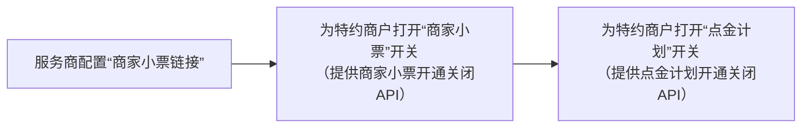

>更新时间：2026.10.20

在正式接入微信支付点金计划服务前，你需要进行以下准备步骤：

1. 选择接入模式：普通商户或普通服务商

2. 申请参数：AppID、商户号

3. 申请权限

## 1. 确认接入模式

商户需要判断自己公司注册区域适用的接入模式和自身实际情况，申请成为普通商户或普通服务商：

- 普通商户自行申请入驻微信支付，无需服务商协助。

- 普通服务商则自身无法作为一个普通商户直接发起交易，其发起交易必须传入相关特约商户商户号的参数信息。

具体接入模式介绍请参考[接入模式](https://pay.weixin.qq.com/doc/v3/merchant/4012068443.md)文档，并按照参考文档完成相应模式的接入。

## 2. 申请参数

请根据自身接入模式分别参考[微信支付接入准备-普通商户](https://pay.weixin.qq.com/doc/v3/merchant/4012071573.md)或[微信支付接入准备-普通服务商](https://pay.weixin.qq.com/doc/v3/partner/4012081990.md)中的[参数申请](https://pay.weixin.qq.com/doc/v3/merchant/4012071573.md) \- [配置API key](https://pay.weixin.qq.com/doc/v3/merchant/4012072195.md) \- [下载并配置商户证书](https://pay.weixin.qq.com/doc/v3/merchant/4012072428.md)三个步骤申请接入参数。

## 3. 申请权限

### 3.1. 服务商开通点金计划

操作路径：【登录[微信服务商平台](https://pay.weixin.qq.com/partner/public/home)→ 服务商功能 → 点金计划】，点击申请开通即可。

点击申请开通后进入开通流程，根据指引签署承诺函并填写业务联络人，即可提交申请并开通。

服务商完成点金计划开通后，即可为特约商户开通官方小票或商家小票。接下来将分别介绍官方小票和商家小票开通指引。

### 3.2. 官方小票功能开通

官方小票是指平台自动生成的电子账单，仅展示订单金额等基础信息。若特约商户无需为用户展示如：

取餐码、剩余停车时长等服务性内容，则仅开通官方小票即可。官方小票示意图如下：

在点金计划管理页面的特约商户管理列表中选择特约商户，并在“点金计划”栏下打开开关即可。直接打开“点金计划”开关后，该特约商户的点金计划页面将展示官方小票。

服务商也可通过“默认开通”按钮为全量特约商户开通点金计划。如下图所示，在特约商户管理列表 右上角有“默认开通点金计划”开关，打开后，只要特约商户产生jsapi支付，微信支付将自动为其 开通点金计划，无需服务商操作开通。

提示

打开该开关后，有jsapi支付的特约商户均会自动开通点金计划，不可单个关闭。若特约商户无jsapi支付权限，则不会为其自动打开点金计划。其中，若某些特约商户需使用“商家小票”功能，服务商/渠道商需在点金计划管理页面上或通过API额外为其打开商家小票功能开关。

此外，微信支付侧提供“点金计划管理API”，供服务商为特约商户批量开通点金计划，具体请查看 [点金计划管理API](https://pay.weixin.qq.com/doc/v3/partner/4012473796.md)。

提示

主动关闭点金计划后，需间隔24 小时方可再次开通。

### 3.3. 商家小票功能开通

“商家小票”是指商家为用户提供的订单详情，可展示不同业务场景下的服务性内容，例如取餐码、 剩余停车时长等。开通商家小票功能后，即可将商家页面嵌入到点金计划页面中。商家小票示意图如 下：

商家小票的开通步骤如下：

提示

先为特约商户打开“商家小票”开关，再打开“点金计划”开关， 是为了保证在开通点金计划后，特约商户JSAPI 支付后的页面可立即展示商家小票，避免开通时间差导致商家部分订单展示了官方小票的情况。

点金计划页面上方为商家小票提供了一个Iframe 框架，服务商在点金计划管理页面配置“商家小票链接”后，商家小票链接会嵌入该Iframe 框架内，同时，点金计划页面会与服务商交互订单信息，服务商获取订单信息并校验通过后，为用户展示对应的服务性内容即可。

- 服务商维度配置商家小票链接

操作路径：【登录[微信支付服务商平台](https://pay.weixin.qq.com/partner/public/home)→ 服务商功能 → 点金计划】。在“商家小票链接配置” 模块中，点击“添加商家小票链接”：

添加一个链接：商家小票链接仅支持HTTPS 协议，同时需通过ICP 备案的验证，且应保证该链接线上可访问。

下载验证文件，验证链接所有权：

将从添加商家小票链接页面下载的验证文件放置在要填写的链接目录下，以证明对该链接的所有权。放置完毕并确保该路径可访问后，填写链接并点击“提交”，微信支付后台会进行验证文件的查验，查验通过后即提交成功。

提示

将验证文件放置在所填链接的目录或根目录均可。

使用“商家小票调试工具”进行调试：为了保证商家小票在点金计划页面展示的兼容性、完整性，平台还提供了便捷的商家小票调试工具供服务商进行调试。服务商可通过商家小票调试工具，使用所选链接和真实订单号对点金计划页面的数据交互流程、前端JSAPI 的使用进行调试。

- 特约商户维度配置独立商家小票链接

部分特约商户（例如：医院、学校等类型）有特殊的域名要求，服务商可为这些特约商户配置独立的商家小票链接。配置后，这些特约商户的点金计划页面将通过所特约商户维度的独立链接进行订单数据交互。未配置特约商户独立商家小票链接的，将依然使用服务商维度的商家小票链接。

特约商户维度独立的商家小票链接入口如下，具体步骤与上述服务商维度配置相同：

完成商家小票链接配置后，服务商还需为特约商户打开商家小票的开关。

提示

配置完商家小票链接后，才会出现商家小票功能开关。

在特约商户管理列表中选择特约商户，在“商家小票”栏下打开开关即可。

同时，平台提供“商家小票管理API”，供服务商为特约商户批量开通/关闭商家小票功能，具体请查看[商家小票管理API](https://pay.weixin.qq.com/doc/v3/partner/4012473788.md)。

服务商为特约商户打开“商家小票”开关后，还需为其打开“点金计划”开关，若特约商户的“点金计划”未开通，即使 “商家小票”功能开通，其JSAPI 支付后也不会展示点金计划页面和商家小票内容。