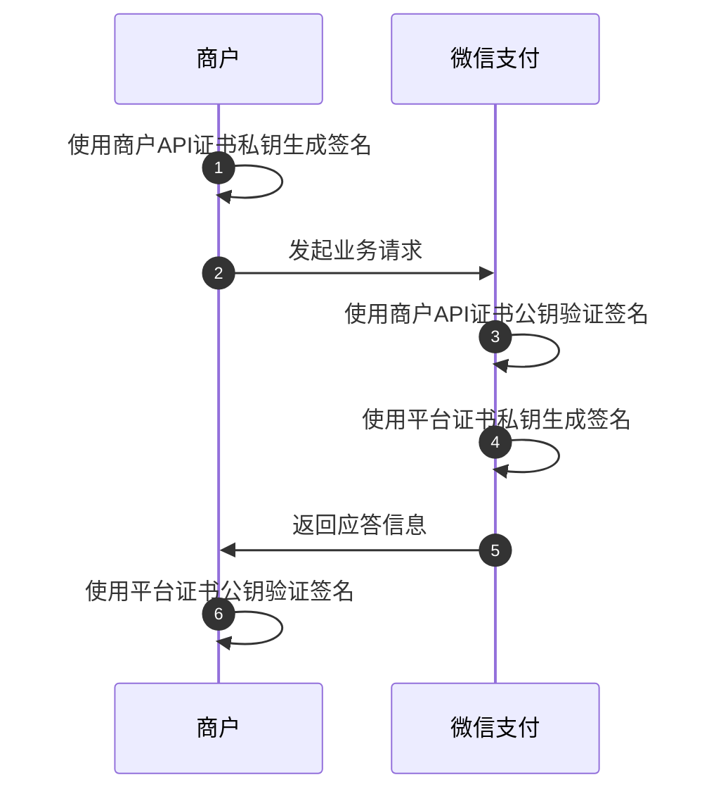
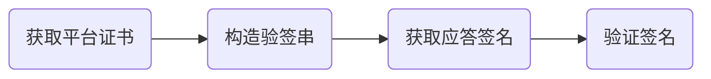

>更新时间：2024.11.29

注意：

该文档中的示例不可直接使用，需替换为真实的请求信息


## 概述

在微信支付API v3的所有请求应答场景，开发者都需要进行签名验签。如果你是第一次接入微信支付API v3接口，请仔细阅读以下系列文档，并跟着示例操作一次，这将有效帮忙你理解签名验签机制，解决签名验签报错。

1、所有请求商户都需要使用【商户API证书私钥】对请求进行签名，微信支付会在收到请求后使用【商户API证书公钥】进行签名的验证。如果签名验证不通过，微信支付API v3将会拒绝处理请求，并返回401 Unauthorized。

2、所有应答，微信支付都会使用平台证书私钥签名，商户需要使用平台证书公钥验证签名.（文件下载接口和首次下载平台证书除外）



本文介绍如何验证签名，计算签名部分文档说明请参考[操作指引-如何生成请求签名](https://pay.weixin.qq.com/doc/v3/merchant/4012365334.md)。

1、微信支付在 API 应答的 HTTP 头部 Wechatpay-Signature 中提供了应答签名。商户应验证应答签名，以确保数据来自微信支付且未经第三方篡改。

2、在通知回调的 HTTP 头部中，微信支付会包含回调报文的签名。商户必须验证回调的签名，以确保回调由微信支付发送。

请参考以下内容，自行验证签名，并遵循指引防止重放攻击，以及应对签名探测流量。

验证签名分为获取平台证书、构造验签串、获取应答签名、验证签名共4步



## 1、获取平台证书

### 1.1 首次下载证书

第一次获取平台证书需要通过证书工具，请按照以下3个步骤操作

（1）[点击这里](https://github.com/EliasZzz/CertificateDownloader/releases)下载jar包

（2）执行以下命令

```
java -jar CertificateDownloader.jar -k ${apiV3key} -m ${mchId} -f ${mchPrivateKeyFilePath} -s ${mchSerialNo} -o ${outputFilePath}
```

你会得到平台证书，文件名类似于wechatpay\_123456777B4A9CC78902B44B65E04B9751CE12.pem。

参数说明

- apiV3key：是指APIv3密钥，在账号中心->API安全->APIv3密钥中设置，如何获取APIv3密钥具体操作参考这里

- mchId：是指商户号

- mchPrivateKeyFilePath：商户API证书私钥存放的路径，你需要获取商户API证书私钥（apiclient\_key.pem），并保存到某个路径。如何获取商户API证书私钥具体操作参考这里

- mchSerialNo：商户API证书的序列号，如何查看序列号请参考证书相关问题

- outputFilePath：平台证书保存的路径，开发者自定义


（3）验证证书有效性

第一次下载证书后，我们强烈建议参考[如何通过证书信任链验证平台证书](https://pay.weixin.qq.com/doc/v3/merchant/4012069411.md#%E5%A6%82%E4%BD%95%E9%80%9A%E8%BF%87%E8%AF%81%E4%B9%A6%E4%BF%A1%E4%BB%BB%E9%93%BE%E9%AA%8C%E8%AF%81%E5%B9%B3%E5%8F%B0%E8%AF%81%E4%B9%A6%EF%BC%9F)，验证证书的真实性。

### 1.2 二次获取平台证书

除了首次下载证书需要通过以上方式，后续下载证书请使用微信支付平台证书下载接口

## 2. 构造验签名串

### 2.1 构造验签串前的检查

- 您应先检查 HTTP 头 Wechatpay-Serial 的内容是否跟商户当前所持有的微信支付平台证书的序列号一致。若不一致，请重新获取证书。否则，签名的私钥和证书不匹配，将验证失败。

- [重放攻击](https://zh.wikipedia.org/zh-hans/%E9%87%8D%E6%94%BE%E6%94%BB%E5%87%BB)是指攻击者截取报文及其签名，并以恶意或欺诈目的重新传输数据的一种攻击手段。为了降低此类攻击的风险，微信支付在 HTTP 头Wechatpay-Timestamp中提供了生成签名的时间戳。若微信支付需要重新发送某个通知回调，我们也会重新生成相应的时间戳和签名。在验证签名之前，商户系统应检查时间戳是否已过期。我们建议商户系统允许最多5分钟的时间偏差。如果时间戳与当前时间的偏差超过5分钟，您应拒绝处理当前的响应或回调通知。


提示

您应当采用网络时间协议（NTP）等机制实现商户系统的时钟同步，保证时间准确。

### 2.2开始构造验签串

以某次native下单接口的应答为例

```
Server: nginx
Date: Mon, 05 Aug 2024 09:33:41 GMT
Content-Type: application/json; charset=utf-8
Content-Length: 52
Connection: keep-alive
Keep-Alive: timeout=8
Cache-Control: no-cache, must-revalidate
X-Content-Type-Options: nosniff
Request-ID: 08F5B8C2B506102C18FDDFEEA30620BE821E28EDC405-0
Content-Language: zh-CN
Wechatpay-Nonce: d824f2e086d3c1df967785d13fcd22ef
Wechatpay-Signature: mfI1CPqvBrgcXfgXMFjdNIhBf27ACE2YyeWsWV9ZI7T7RU0vHvbQpu9Z32ogzc+k8ZC5n3kz7h70eWKjgqNdKQF0eRp8mVKlmfzMLBVHbssB9jEZEDXThOX1XFqX7s7ymia1hoHQxQagPGzkdWxtlZPZ4ZPvr1RiqkgAu6Is8MZgXXrRoBKqjmSdrP1N7uxzJ/cjfSiis9FiLjuADoqmQ1P7p2N876YPAol7Rn0+GswwAwxldbdLrmVSjfytfSBJFqTMHn4itojgxSWWN1byuckQt8hSTEv/Lg97QoeGniYP17T80pJeQyL3b+295FPHSO2AtvCgyIbKMZ0BALilAA==
Wechatpay-Timestamp: 1722850421
Wechatpay-Serial: 4DF076AC5A7D968D4A8B0B9C599A74CB4CF8EE8A
Wechatpay-Signature-Type: WECHATPAY2-SHA256-RSA2048

{"code_url":"weixin://wxpay/bizpayurl?pr=JyC91EIz1"}
```

（1）请从应答或通知回调中获取以下信息：

- HTTP 头 Wechatpay-Timestamp 中的应答时间戳

- HTTP 头 Wechatpay-Nonce 中的应答随机串

- 应答报文主体（Response Body），请使用原始报文主体执行验签。如果您使用了某个框架，要确保它不会篡改报文主体。对报文主体的任何篡改都会导致验证失败。


（2）然后，请按照以下规则构造应答的验签名串。签名串共有三行，行尾以\\n 结束，包括最后一行。\\n 为换行符（ASCII 编码值为 0x0A）。若应答报文主体为空（如 HTTP 状态码为 204 No Content），最后一行仅为一个 \\n 换行符。

```
应答时间戳\n
应答随机串\n
应答报文主体\n
```

则验签名串为

```
1722850421\n
d824f2e086d3c1df967785d13fcd22ef\n
{"code_url":"weixin://wxpay/bizpayurl?pr=JyC91EIz1"}\n
```

## 3.获取应答签名

微信支付的应答签名通过 HTTP 头 Wechatpay-Signature 传递。（请注意，示例可能存在换行，实际数据应在一行）

```
Wechatpay-Signature: mfI1CPqvBrgcXfgXMFjdNIhBf27ACE2YyeWsWV9ZI7T7RU0vHvbQpu9Z32ogzc+k8ZC5n3kz7h70eWKjgqNdKQF0eRp8mVKlmfzMLBVHbssB9jEZEDXThOX1XFqX7s7ymia1hoHQxQagPGzkdWxtlZPZ4ZPvr1RiqkgAu6Is8MZgXXrRoBKqjmSdrP1N7uxzJ/cjfSiis9FiLjuADoqmQ1P7p2N876YPAol7Rn0+GswwAwxldbdLrmVSjfytfSBJFqTMHn4itojgxSWWN1byuckQt8hSTEv/Lg97QoeGniYP17T80pJeQyL3b+295FPHSO2AtvCgyIbKMZ0BALilAA==
```

使用 base64 解码 Wechatpay-Signature 字段值，得到应答签名。

提示

某些代理服务器或 CDN 服务提供商，在转发时可能会“过滤”微信支付扩展的 HTTP 头，导致应用层无法获取微信支付的签名信息。商户遇到这种情况时，我们建议尝试调整代理服务器配置，或者通过直连的方式访问微信支付的服务器和接收通知回调。

## 4.验证签名

很多编程语言的签名验证函数支持对验签名串和签名进行签名验证。强烈建议商户调用该类函数，使用微信支付平台公钥对验签名串和签名进行 SHA256 with RSA 签名验证。

下面展示使用命令行演示如何进行验签。这里已经获取了平台证书并保存为 1900009191\_wxp\_cert.pem，你可以直接将以下平台证书公钥保存到本地用于操作验证。

1、首先，从微信支付平台证书导出微信支付平台公钥。

```
$ openssl x509 -in 1900009191_wxp_cert.pem -pubkey -noout > 1900009191_wxp_pub.pem
$ cat 1900009191_wxp_pub.pem
```
```
-----BEGIN PUBLIC KEY-----
MIIBIjANBgkqhkiG9w0BAQEFAAOCAQ8AMIIBCgKCAQEAwXNI6sdlknHBnK8Fu2U6
Cwor9qY747jP8KAfeBMeveEt1TqaHkLfaSD07trZLhGpfs8/AHqjhgSMO1O10YQW
OrrJ4hjIWPKqxbgrYMkBQc+mwdiWp4W3ByCqxBRagCveCXRWCmuJYovl9H/bsDI0
iGbpVtEOghJtfciisYSgxcLufUDTRkvwxjIBK1pCRjk33jJ5YTBWTHMRtMAOcFLN
F6hdEYdX8SPsgHHeLZ5Lv2T/686w1xtgCHef/sd4uSfWmyzsalQdHG/e4IyYmrhx
+O3VBoNDzE3nx23bFeV/RVNCG7cV6VhmYokJNHa/erIPkEmEFID6A5wQOXuxUkmJ
WwIDAQAB
-----END PUBLIC KEY-----
```

提示

Java支持使用证书初始化签名对象，详见 [initVerify(Certificate)](https://docs.oracle.com/javase/8/docs/api/java/security/Signature.html#initVerify-java.security.cert.Certificate-)，并不需要先导出公钥。

2、然后，使用 base64 解码应答签名，将保存为文件 signature.txt 。（以下命令行均在一行）

```
openssl base64 -d <<< 'mfI1CPqvBrgcXfgXMFjdNIhBf27ACE2YyeWsWV9ZI7T7RU0vHvbQpu9Z32ogzc+k8ZC5n3kz7h70eWKjgqNdKQF0eRp8mVKlmfzMLBVHbssB9jEZEDXThOX1XFqX7s7ymia1hoHQxQagPGzkdWxtlZPZ4ZPvr1RiqkgAu6Is8MZgXXrRoBKqjmSdrP1N7uxzJ/cjfSiis9FiLjuADoqmQ1P7p2N876YPAol7Rn0+GswwAwxldbdLrmVSjfytfSBJFqTMHn4itojgxSWWN1byuckQt8hSTEv/Lg97QoeGniYP17T80pJeQyL3b+295FPHSO2AtvCgyIbKMZ0BALilAA==' > signature.txt
```

3、最后，验证签名，得到验签结果，请确认你的结果和文档的结果一致，如果验签结果是Verification Failure，请确认是否获取到了正确的平台证书的公钥或者验签串是否有严格按照文档格式换行

```
$ openssl dgst -sha256 -verify 1900009191_wxp_pub.pem -signature signature.txt << EOF
1722850421
d824f2e086d3c1df967785d13fcd22ef
{"code_url":"weixin://wxpay/bizpayurl?pr=JyC91EIz1"}
EOF
```
```
Verified OK
```

## 5. 应对签名探测流量

为了确保商户系统的安全，微信支付会在极少数应答或通知回调中生成错误签名，以探测商户系统是否正确地验证了签名。

商户系统不应对探测流量进行特殊处理，而应将其视为正常的应答或通知回调，并对其签名进行验证。

在排查问题时，您可以通过查看签名值中的 WECHATPAY/SIGNTEST/ 前缀快速判断是否为探测流量。所有用于探测目的的签名值都会包含此前缀。

在验签失败的情况下，我们建议商户系统采取以下措施：

- 如果应答的签名验证失败，商户系统应舍弃该应答。为了提高用户体验，商户系统可以适当地重试，或者让用户重新发起请求。微信支付不会针对重试请求发起探测。

- 若通知回调的签名验证失败，商户系统应返回失败（即应答 4xx 或 5xx 的状态码），等待微信支付携带正确签名重新发送通知回调。


如果你有关于签名探测任何疑问，请通过[在线技术咨询](https://support.pay.weixin.qq.com/aidevhelper)联系我们的技术支持。

## 6.文件/图片下载接口的验签说明

文件下载接口需要跳过验签流程，以下载账单接口为例，下载账单分两步：第一步，请求下载账单接口，微信支付返回一个下载账单的URL

第二步，商户通过第一步获取的url 去下载账单，下载账单返回的是账单文件，响应的信息请求头中不包含微信接口响应的签名值，因此需要跳过验签的流程

第三步，商户将实际账单文件的哈希值和之前从接口获取到的哈希值进行比对，以确认数据的完整性。