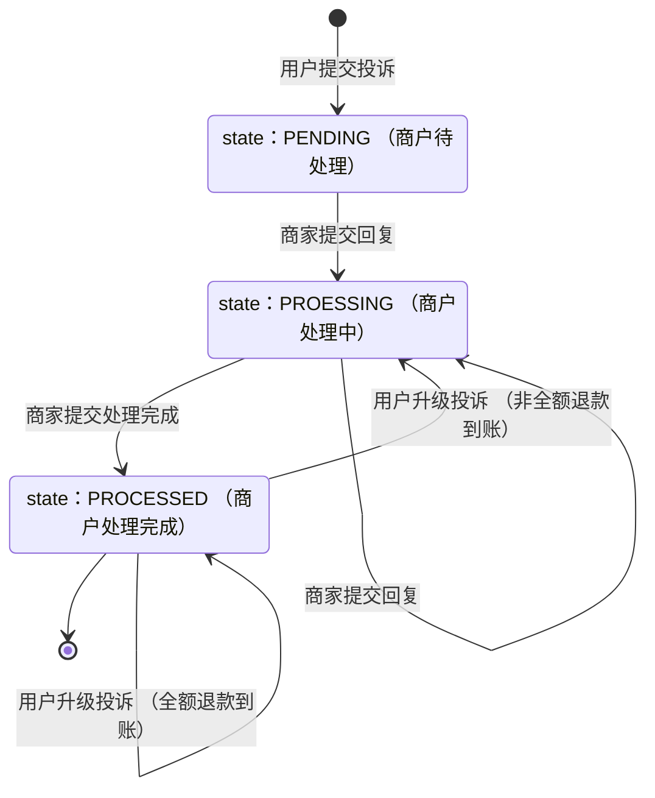

>更新时间：2026.10.21

## 1. 目标

通过本教程的学习，你应该可以：

- 查询投诉单列表

- 查询某个投诉单的具体内容及协商历史（包括图片）

- 创建/更新/删除和查看投诉地址，并接入投诉通知回调接口，实时获取投诉信息

- 回复用户的投诉（包括图片），反馈处理完成，更新退款审批结果


本文档Demo中使用的WXPayUtility工具类可通过[Java](https://pay.weixin.qq.com/doc/v3/merchant/4014931831.md)文档获得。

## 2. 前置流程

当有新的投诉事件发生、投诉状态发生变化时服务会主动推送回调到回调地址，因此需要提前创建回调地址，详情见[创建投诉通知回调地址](https://pay.weixin.qq.com/doc/v3/merchant/4012458679.md)

### 2.1 创建投诉回调通知地址

该接口的参数、响应详情及错误码请参见[创建投诉通知回调地址](https://pay.weixin.qq.com/doc/v3/merchant/4012458679.md)接口文档。

```
package com.java.complaint;

// 使用商户平台通用投诉接口：https://pay.weixin.qq.com/doc/v3/merchant/4012458679
import com.java.demo.CreateComplaintNotifications;
import com.java.demo.CreateComplaintNotifications.CreateComplaintNotificationsRequest;
import com.java.demo.CreateComplaintNotifications.CreateComplaintNotificationsResponse;
import com.java.utils.WXPayUtility;

public class CreateComplaintNotificationsExample {
    public static void main(String[] args) {
        // 请准备商户开发必要参数，参考：https://pay.weixin.qq.com/doc/v3/merchant/4013070756
        CreateComplaintNotifications client = new CreateComplaintNotifications(
                "19xxxxxxxx", // 商户号，是由微信支付系统生成并分配给每个商户的唯一标识符，商户号获取方式参考
                              // https://pay.weixin.qq.com/doc/v3/merchant/4013070756
                "1DDE55AD98Exxxxxxxxxx", // 商户API证书序列号，如何获取请参考 https://pay.weixin.qq.com/doc/v3/merchant/4013053053
                "/path/to/apiclient_key.pem", // 商户API证书私钥文件路径，本地文件路径
                "PUB_KEY_ID_xxxxxxxxxxxxx", // 微信支付公钥ID，如何获取请参考 https://pay.weixin.qq.com/doc/v3/merchant/4013038816
                "/path/to/wxp_pub.pem" // 微信支付公钥文件路径，本地文件路径
        );

        CreateComplaintNotificationsRequest request = new CreateComplaintNotificationsRequest();
        // 通知地址，仅支持HTTPS
        request.url = "https://www.xxx.com/notify";
        try {
            CreateComplaintNotificationsResponse response = client.run(request);

            // 请求成功，可查看该商户是否注册成功，及成功注册的url
            String mchid = response.mchid;
            String url = response.url;
        } catch (WXPayUtility.ApiException e) {
            // 请求失败，根据状态码执行不同的逻辑
            if (e.getErrorCode().equals("PARAM_ERROR")) {
                // 错误：参数错误
                // 解决方式：按照报错返回的message，需要根据接口文档对参数进行校对和修正，然后重新发起请求
            } else if (e.getErrorCode().equals("INVALID_REQUEST")) {
                // 错误：请求非法，请求参数正确，但是不符合业务规则
                // 解决方式：请参阅
                // https://pay.weixin.qq.com/doc/v3/merchant/4012081709，如果可以修改参数达到符合业务规则的修改请求符合业务规则之后再原单重试
            } else if (e.getErrorCode().equals("SIGN_ERROR")) {
                // 错误：签名错误
                // 解决方式：检查平台商户公钥ID，公钥文件，同时确认下签名过程是不是按照微信支付的签名方式
            } else if (e.getErrorCode().equals("SYSTEM_ERROR")) {
                // 错误：系统错误
                // 解决方式：稍后原单重试
            } else if (e.getErrorCode().equals("NO_AUTH")) {
                // 错误：商户信息不合法
                // 解决方式：登录商户平台核对，传入正确信息
            } else if (e.getErrorCode().equals("FREQUENCY_LIMITED")) {
                // 错误：频率超限
                // 解决方式：请求量不要超过接口调用频率限制
            } else {
                // 其他错误，稍等一会重试
            }
        }
    }
}

```

### 2.2 查询投诉回调通知地址

该接口的参数、响应详情及错误码请参见[查询投诉通知回调地址](https://pay.weixin.qq.com/doc/v3/merchant/4012459014.md)接口文档。

```
package com.java.complaint;

// 使用商户平台通用投诉接口：https://pay.weixin.qq.com/doc/v3/merchant/4012459014
import com.java.demo.QueryComplaintNotifications;
import com.java.demo.QueryComplaintNotifications.QueryComplaintNotificationsResponse;
import com.java.utils.WXPayUtility;

public class QueryComplaintNotificationsExample {

    public static void main(String[] args) {
        // 请准备商户开发必要参数，参考：https://pay.weixin.qq.com/doc/v3/merchant/4013070756
        QueryComplaintNotifications client = new QueryComplaintNotifications(
                "19xxxxxxxx", // 商户号，是由微信支付系统生成并分配给每个商户的唯一标识符，商户号获取方式参考
                              // https://pay.weixin.qq.com/doc/v3/merchant/4013070756
                "1DDE55AD98Exxxxxxxxxx", // 商户API证书序列号，如何获取请参考 https://pay.weixin.qq.com/doc/v3/merchant/4013053053
                "/path/to/apiclient_key.pem", // 商户API证书私钥文件路径，本地文件路径
                "PUB_KEY_ID_xxxxxxxxxxxxx", // 微信支付公钥ID，如何获取请参考 https://pay.weixin.qq.com/doc/v3/merchant/4013038816
                "/path/to/wxp_pub.pem" // 微信支付公钥文件路径，本地文件路径
        );

        try {
            QueryComplaintNotificationsResponse response = client.run();

            // 请求成功，继续业务逻辑
        } catch (WXPayUtility.ApiException e) {
            // 请求失败，根据状态码执行不同的逻辑
            if (e.getErrorCode().equals("PARAM_ERROR")) {
                // 错误：参数错误
                // 解决方式：按照报错返回的message，需要根据接口文档对参数进行校对和修正，然后重新发起请求
            } else if (e.getErrorCode().equals("INVALID_REQUEST")) {
                // 错误：请求非法，请求参数正确，但是不符合业务规则
                // 解决方式：请参阅
                // https://pay.weixin.qq.com/doc/v3/merchant/4012081709，如果可以修改参数达到符合业务规则的修改请求符合业务规则之后再原单重试
            } else if (e.getErrorCode().equals("SIGN_ERROR")) {
                // 错误：签名错误
                // 解决方式：检查平台商户公钥ID，公钥文件，同时确认下签名过程是不是按照微信支付的签名方式
            } else if (e.getErrorCode().equals("SYSTEM_ERROR")) {
                // 错误：系统错误
                // 解决方式：稍后原单重试
            } else if (e.getErrorCode().equals("NO_AUTH")) {
                // 错误：商户信息不合法
                // 解决方式：登录商户平台核对，传入正确信息
            } else if (e.getErrorCode().equals("FREQUENCY_LIMITED")) {
                // 错误：频率超限
                // 解决方式：请求量不要超过接口调用频率限制
            } else if (e.getErrorCode().equals("RESOURCE_NOT_EXISTS")) {
                // 错误：查询的通知回调不存在
                // 解决方式：请检查是否已创建通知回调
            } else {
                // 其他错误，稍等一会重试
            }
        }
    }
}

```

### 2.3 更新投诉通知回调地址

该接口的参数、响应详情及错误码请参见[更新投诉通知回调地址](https://pay.weixin.qq.com/doc/v3/merchant/4012459282.md)接口文档。

```
package com.java.complaint;

// 使用商户平台通用投诉接口：https://pay.weixin.qq.com/doc/v3/merchant/4012459282
import com.java.demo.UpdateComplaintNotifications;
import com.java.demo.UpdateComplaintNotifications.UpdateComplaintNotificationsRequest;
import com.java.demo.UpdateComplaintNotifications.UpdateComplaintNotificationsResponse;
import com.java.utils.WXPayUtility;

public class UpdateComplaintNotificationsExample {

    public static void main(String[] args) {
        // 请准备商户开发必要参数，参考：https://pay.weixin.qq.com/doc/v3/merchant/4013070756
        UpdateComplaintNotifications client = new UpdateComplaintNotifications(
                "19xxxxxxxx", // 商户号，是由微信支付系统生成并分配给每个商户的唯一标识符，商户号获取方式参考
                              // https://pay.weixin.qq.com/doc/v3/merchant/4013070756
                "1DDE55AD98Exxxxxxxxxx", // 商户API证书序列号，如何获取请参考 https://pay.weixin.qq.com/doc/v3/merchant/4013053053
                "/path/to/apiclient_key.pem", // 商户API证书私钥文件路径，本地文件路径
                "PUB_KEY_ID_xxxxxxxxxxxxx", // 微信支付公钥ID，如何获取请参考 https://pay.weixin.qq.com/doc/v3/merchant/4013038816
                "/path/to/wxp_pub.pem" // 微信支付公钥文件路径，本地文件路径
        );

        UpdateComplaintNotificationsRequest request = new UpdateComplaintNotificationsRequest();
        request.url = "https://www.xxx.com/notify";
        try {
            UpdateComplaintNotificationsResponse response = client.run(request);

            // 请求成功，继续业务逻辑
        } catch (WXPayUtility.ApiException e) {
            // 请求失败，根据状态码执行不同的逻辑
            if (e.getErrorCode().equals("PARAM_ERROR")) {
                // 错误：参数错误
                // 解决方式：按照报错返回的message，需要根据接口文档对参数进行校对和修正，然后重新发起请求
            } else if (e.getErrorCode().equals("INVALID_REQUEST")) {
                // 错误：请求非法，请求参数正确，但是不符合业务规则
                // 解决方式：请参阅
                // https://pay.weixin.qq.com/doc/v3/merchant/4012081709，如果可以修改参数达到符合业务规则的修改请求符合业务规则之后再原单重试
            } else if (e.getErrorCode().equals("SIGN_ERROR")) {
                // 错误：签名错误
                // 解决方式：检查平台商户公钥ID，公钥文件，同时确认下签名过程是不是按照微信支付的签名方式
            } else if (e.getErrorCode().equals("SYSTEM_ERROR")) {
                // 错误：系统错误
                // 解决方式：稍后原单重试
            } else if (e.getErrorCode().equals("NO_AUTH")) {
                // 错误：商户信息不合法
                // 解决方式：登录商户平台核对，传入正确信息
            } else if (e.getErrorCode().equals("FREQUENCY_LIMITED")) {
                // 错误：频率超限
                // 解决方式：请求量不要超过接口调用频率限制
            } else if (e.getErrorCode().equals("RESOURCE_NOT_EXISTS")) {
                // 错误：查询的通知回调不存在
                // 解决方式：请检查是否已创建通知回调
            } else {
                // 其他错误，稍等一会重试
            }
        }
    }
}

```

### 2.4 删除投诉通知回调地址

该接口的参数、响应详情及错误码请参见[删除投诉通知回调地址](https://pay.weixin.qq.com/doc/v3/merchant/4012460452.md)接口文档。

```
package com.java.complaint;

// 使用商户平台通用投诉接口：https://pay.weixin.qq.com/doc/v3/merchant/4012460452
import com.java.demo.DeleteComplaintNotifications;
import com.java.utils.WXPayUtility;

public class DeleteComplaintNotificationsExample {

    public static void main(String[] args) {
        // 请准备商户开发必要参数，参考：https://pay.weixin.qq.com/doc/v3/merchant/4013070756
        DeleteComplaintNotifications client = new DeleteComplaintNotifications(
                "19xxxxxxxx", // 商户号，是由微信支付系统生成并分配给每个商户的唯一标识符，商户号获取方式参考
                              // https://pay.weixin.qq.com/doc/v3/merchant/4013070756
                "1DDE55AD98Exxxxxxxxxx", // 商户API证书序列号，如何获取请参考 https://pay.weixin.qq.com/doc/v3/merchant/4013053053
                "/path/to/apiclient_key.pem", // 商户API证书私钥文件路径，本地文件路径
                "PUB_KEY_ID_xxxxxxxxxxxxx", // 微信支付公钥ID，如何获取请参考 https://pay.weixin.qq.com/doc/v3/merchant/4013038816
                "/path/to/wxp_pub.pem" // 微信支付公钥文件路径，本地文件路径
        );

        try {
            client.run();

            // 请求成功，继续业务逻辑
        } catch (WXPayUtility.ApiException e) {
            // 请求失败，根据状态码执行不同的逻辑
            if (e.getErrorCode().equals("PARAM_ERROR")) {
                // 错误：参数错误
                // 解决方式：按照报错返回的message，需要根据接口文档对参数进行校对和修正，然后重新发起请求
            } else if (e.getErrorCode().equals("INVALID_REQUEST")) {
                // 错误：请求非法，请求参数正确，但是不符合业务规则
                // 解决方式：请参阅
                // https://pay.weixin.qq.com/doc/v3/merchant/4012081709，如果可以修改参数达到符合业务规则的修改请求符合业务规则之后再原单重试
            } else if (e.getErrorCode().equals("SIGN_ERROR")) {
                // 错误：签名错误
                // 解决方式：检查平台商户公钥ID，公钥文件，同时确认下签名过程是不是按照微信支付的签名方式
            } else if (e.getErrorCode().equals("SYSTEM_ERROR")) {
                // 错误：系统错误
                // 解决方式：稍后原单重试
            } else if (e.getErrorCode().equals("NO_AUTH")) {
                // 错误：商户信息不合法
                // 解决方式：登录商户平台核对，传入正确信息
            } else if (e.getErrorCode().equals("FREQUENCY_LIMITED")) {
                // 错误：频率超限
                // 解决方式：请求量不要超过接口调用频率限制
            } else if (e.getErrorCode().equals("RESOURCE_NOT_EXISTS")) {
                // 错误：查询的通知回调不存在
                // 解决方式：请检查是否已创建通知回调
            } else {
                // 其他错误，稍等一会重试
            }
        }
    }
}

```

## 3. 业务处理流程-处理投诉消息

在收到投诉通知回调后，可以根据回调报文的内容查看投诉单相关的信息，然后处理投诉：

- 咨询单初始状态为“待处理”，商家需及时回复用户，与用户充分沟通。

- 回复用户后咨询单状态转为“处理中”，只有处于“处理中“的状态才可点击处理完成。

- 商家确认投诉已妥善处理后可执行结单操作。用户咨询分为「退款申请」和「普通咨询」，这两类咨询对应的结单方式有所不同：

  - 「普通咨询」时：与用户充分沟通后可选择是否对用户发起退款，确认解决问题后需操作“处理完成”来结单。

  - 「退款申请」时：判断用户需求合理时，可发起“同意退款”来结单；充分沟通后判断用户需求不合理时可发起“驳回退款”来结单。
- 在商户待处理和处理中的状态下，用户也可以发起升级投诉。在商户处理完成状态下，在商家全额退款到账后不可发起升级投诉，否则仍可以发起升级投诉。


「普通咨询」的投诉单状态机：



「退款申请」的投诉单状态机：

```mermaid
stateDiagram-v2
  state "state：PENDING （商户待处理）" as S0
  state "state：PROESSING （商户处理中）" as S1
  state "state：PROCESSED （商户处理完成）" as S2
  [*] --> S0 : 用户提交投诉
  S0 --> S1 : 场景1：商家提交回复; 场景2：商家同意退款（非退款到账且未同意/驳回过）
  S1 --> S2 : 场景1：商家提交处理完成； 场景2：退款到账； 场景3：商家驳回退款（非退款到账且未同意/驳回过）
  S2 --> S1 : 用户升级投诉 （非全额退款到账）
  S2 --> [*] : 用户升级投诉 （全额退款到账）
  S0 --> S2 : 场景1：用户提交投诉（用户提交表单阶段商家存在退款）； 场景2：退款到账事件； 场景3：商家驳回退款（非退款到账且未同意/驳回过）
  S1 --> S1 : 场景1：商家提交回复; 场景2：商家同意退款（非退款到账且未同意/驳回过）
```



### 3.1 商户投诉单获取

商户投诉单获取分为被动获取和主动获取：

- 被动获取：新的投诉事件发生、投诉状态发生变化时投诉通知回调主动通知商户投诉单号和动作类型，投诉单详情需按单号反查。

- 主动获取：商户主动调用[查询投诉单详情](https://pay.weixin.qq.com/doc/v3/merchant/4012533436.md)或[查询投诉单列表](https://pay.weixin.qq.com/doc/v3/merchant/4012533431.md)接口查询投诉单详情，流水和投诉单列表。


#### 3.1.1 投诉通知回调

当用户产生新投诉且投诉状态已变更时，微信支付会通过投诉回调通知接口发送通知至商户创建的回调通知URL。服务商、渠道商，会收到所有子商户的投诉信息推送。

收到通知回调后，需要依次经过验签，解密的步骤，详情可参考[投诉通知回调](https://pay.weixin.qq.com/doc/v3/merchant/4012289719.md)，并进行应答：

- 验签通过：商户需告知微信支付接收回调成功，HTTP应答状态码需返回200或204，无需返回应答报文。

- 验签不通过：商户需告知微信支付接收回调失败，HTTP应答状态码需返回5XX或4XX，同时需返回应答报文。


为了保证业务信息的安全性，微信支付将业务信息进行了AES-256-GCM加密，并通过参数resource将加密信息回调给商户，商户需要进行解密后才能获取到业务信息。

```
package com.java.complaint;

import java.security.PublicKey;

import com.google.gson.annotations.SerializedName;
import com.java.utils.WXPayUtility;
import com.java.utils.WXPayUtility.Notification;

import okhttp3.Headers;

public class Callback {

    public static class CallbackData {
        @SerializedName("complaint_id")
        public String complaint_id;

        @SerializedName("action_type")
        public String action_type;
    }

    public static class CallbackResponse {
        @SerializedName("http_code")
        public int http_code;

        @SerializedName("code")
        public String code;

        @SerializedName("message")
        public String message;
    }

    public Callback() {
        this.wechatPayPublicKeyId = "PUB_KEY_ID_xxxxxxxxxxxxx"; // 微信支付公钥ID，如何获取请参考
                                                                // https://pay.weixin.qq.com/doc/v3/merchant/4013038816
        String wechatPayPublicKeyPath = "/path/to/wxp_pub.pem"; // 微信支付公钥文件路径，本地文件路径
        this.wechatPayPublicKey = WXPayUtility.loadPublicKeyFromPath(wechatPayPublicKeyPath);

        this.apiv3AesKey = "CF3xxxxxxxxxxxxxxxxxxxxxxxxxxxxx"; // APIv3密钥，如何获取请参考
                                                               // https://pay.weixin.qq.com/doc/v3/merchant/4013053267
    }

    public CallbackResponse callback(Headers headers, String reqBody) {
        try {
            // 解密
            Notification notification = WXPayUtility.parseNotification(apiv3AesKey, wechatPayPublicKeyId,
                    wechatPayPublicKey, headers, reqBody);
            String data = notification.getPlaintext();
            CallbackData callbackData = WXPayUtility.fromJson(data, CallbackData.class);

            // 获取其中的字段并处理。
            String complaint_id = callbackData.complaint_id;
            String action_type = callbackData.action_type;

            // 成功，响应：200，无响应体
            CallbackResponse response = new CallbackResponse();
            response.http_code = 200;
            return response;
        } catch (Exception e) {
            e.printStackTrace();
            // 失败，响应：5xx或4xx，响应：
            // {
            // "code": "FAIL",
            // "message": "失败"
            // }
            CallbackResponse response = new CallbackResponse();
            response.http_code = 500;
            response.code = "FAIL";
            response.message = "失败";
            return response;
        }
    }

    private String wechatPayPublicKeyId;
    private PublicKey wechatPayPublicKey;
    private String apiv3AesKey;
}
```

#### 3.1.2 查询投诉单列表

商户可通过调用此接口，查询指定时间段的所有用户投诉信息，以分页输出查询结果，该接口的参数、响应详情及错误码请参见[查询投诉单列表](https://pay.weixin.qq.com/doc/v3/merchant/4012533431.md)接口文档。

```
package com.java.complaint;

// 使用商户平台通用投诉接口：https://pay.weixin.qq.com/doc/v3/merchant/4012533431
import com.java.demo.ListComplaintsV2;
import com.java.demo.ListComplaintsV2.ListComplaintsV2Request;
import com.java.demo.ListComplaintsV2.ListComplaintsV2Response;
import com.java.utils.WXPayUtility;

public class QueryComplaintListExample {
    public static void main(String[] args) {

        // 请准备商户开发必要参数，参考：https://pay.weixin.qq.com/doc/v3/merchant/4013070756
        ListComplaintsV2 client = new ListComplaintsV2(
                "19xxxxxxxx", // 商户号，是由微信支付系统生成并分配给每个商户的唯一标识符，商户号获取方式参考
                              // https://pay.weixin.qq.com/doc/v3/merchant/4013070756
                "1DDE55AD98Exxxxxxxxxx", // 商户API证书序列号，如何获取请参考 https://pay.weixin.qq.com/doc/v3/merchant/4013053053
                "/path/to/apiclient_key.pem", // 商户API证书私钥文件路径，本地文件路径
                "PUB_KEY_ID_xxxxxxxxxxxxx", // 微信支付公钥ID，如何获取请参考 https://pay.weixin.qq.com/doc/v3/merchant/4013038816
                "/path/to/wxp_pub.pem" // 微信支付公钥文件路径，本地文件路径
        );

        ListComplaintsV2Request request = new ListComplaintsV2Request();

        // 需要查询的被诉商户号，起止日期，分页大小和分页开始位置
        // 注意：起止日期之间的范围不能超过30天，仅能查询该商户下的投诉单
        // 分页大小最大为50
        request.limit = 10L;
        request.offset = 0L;
        request.beginDate = "2025-07-01";
        request.endDate = "2025-07-01";
        request.complaintedMchid = "163xxxxxxx";
        try {
            ListComplaintsV2Response response = client.run(request);
            // 请求成功，继续业务逻辑

        } catch (WXPayUtility.ApiException e) {
            // 请求失败，根据状态码执行不同的逻辑
            if (e.getErrorCode().equals("PARAM_ERROR")) {
                // 错误：参数错误
                // 解决方式：按照报错返回的message，需要根据接口文档对参数进行校对和修正，然后重新发起请求
            } else if (e.getErrorCode().equals("INVALID_REQUEST")) {
                // 错误：请求非法
                // 解决方式：请参阅
                // https://pay.weixin.qq.com/doc/v3/merchant/4012081709，如果可以修改参数达到符合业务规则的修改请求符合业务规则之后再原单重试
                // 如果request.limit超限制，会收到错误消息：当前查询结果数据量过大，请缩小limit后重试
            } else if (e.getErrorCode().equals("SIGN_ERROR")) {
                // 错误：签名错误
                // 解决方式：检查平台商户公钥ID，公钥文件，同时确认下签名过程是不是按照微信支付的签名方式
            } else if (e.getErrorCode().equals("SYSTEM_ERROR")) {
                // 错误：系统错误
                // 解决方式：稍后原单重试
            } else if (e.getErrorCode().equals("NO_AUTH")) {
                // 错误：商户信息不合法，或无权限访问该投诉单
                // 解决方式：登录商户平台核对，传入正确信息
            } else if (e.getErrorCode().equals("FREQUENCY_LIMITED")) {
                // 错误：频率超限
                // 解决方式：请求量不要超过接口调用频率限制
            } else {
                // 其他错误，稍等一会重试
            }
        }
    }
}

```

#### 3.1.3 查询某个投诉单的具体内容和协商历史（包含图片）

在上一步中可以获取指定的投诉单 `complaint_id` ，此时商户可以调用API主动查询相关信息：

- 商户可参照该Demo中的 `equeryComplaint` 函数查询指定投诉单的用户投诉详情，包含投诉关联订单信息、支付分服务单信息、投诉的问题类型、问题描述、投诉人联系方式等信息，方便商户处理投诉，更多用户投诉单详情字段可参考[查询投诉单详情](https://pay.weixin.qq.com/doc/v3/merchant/4012533436.md)。

- 也可参照该Demo中的 `queryNegotiationHistory` 函数查询指定投诉单的用户与商户的协商历史，以分页输出查询结果，方便商户根据处理历史来制定后续处理方案，更多用户协商历史字段可参考[查询投诉单协商历史](https://pay.weixin.qq.com/doc/v3/merchant/4012533439.md)。


此外，商家也可以定期主动去查询投诉单的信息和协商历史，同样是调用这两个接口。

```
package com.java.complaint;

import java.util.List;

// 使用商户平台通用投诉接口：https://pay.weixin.qq.com/doc/v3/merchant/4012533436
import com.java.demo.QueryComplaintV2;
import com.java.demo.QueryComplaintV2.ComplaintInfo;
import com.java.demo.QueryComplaintV2.ComplaintMedia;
import com.java.demo.QueryComplaintV2.QueryComplaintV2Request;
// 使用商户平台通用投诉接口：https://pay.weixin.qq.com/doc/v3/merchant/4012533439
import com.java.demo.QueryNegotiationHistoryV2;
import com.java.demo.QueryNegotiationHistoryV2.ComplaintNegotiationHistoryWithLogId;
import com.java.demo.QueryNegotiationHistoryV2.QueryNegotiationHistoryV2Request;
import com.java.demo.QueryNegotiationHistoryV2.QueryNegotiationHistoryV2Response;
import com.java.utils.WXPayUtility;

public class QueryComplaintExample {
    public static void main(String[] args) {
        // 填写查询的投诉单号，分页大小和分页开始位置
        String complaint_id = "2002018xxxxxxxxxxxxxxxxxxxx";
        Long limit = 10L;
        Long offset = 0L;

        QueryComplaintExample example = new QueryComplaintExample();
        // 查询具体内容，填写投诉单号
        example.queryComplaint(complaint_id);
        // 查询协商历史，填写投诉单号，分页大小和分页开始位置
        // 分页大小最大为300
        example.queryNegotiationHistory(complaint_id, limit, offset);
    }

    QueryComplaintExample() {

        // 请准备商户开发必要参数，参考：https://pay.weixin.qq.com/doc/v3/merchant/4013070756
        this.mchid = "19xxxxxxxx"; // 商户号，是由微信支付系统生成并分配给每个商户的唯一标识符，商户号获取方式参考
                                   // https://pay.weixin.qq.com/doc/v3/merchant/4013070756
        this.certificateSerialNo = "1DDE55AD98Exxxxxxxxxx"; // 商户API证书序列号，如何获取请参考
                                                            // https://pay.weixin.qq.com/doc/v3/merchant/4013053053
        this.privateKeyFilePath = "/path/to/apiclient_key.pem"; // 商户API证书私钥文件路径，本地文件路径
        this.wechatPayPublicKeyId = "PUB_KEY_ID_xxxxxxxxxxxxx"; // 微信支付公钥ID，如何获取请参考
                                                                // https://pay.weixin.qq.com/doc/v3/merchant/4013038816
        this.wechatPayPublicKeyFilePath = "/path/to/wxp_pub.pem"; // 微信支付公钥文件路径，本地文件路径
    }

    private void queryComplaint(String complaintId) {
        QueryComplaintV2 client = new QueryComplaintV2(
                this.mchid,
                this.certificateSerialNo,
                this.privateKeyFilePath,
                this.wechatPayPublicKeyId,
                this.wechatPayPublicKeyFilePath);

        QueryComplaintV2Request request = new QueryComplaintV2Request();

        // 填写查询的投诉单号
        request.complaintId = complaintId;
        try {
            ComplaintInfo response = client.run(request);
            // 请求成功，继续业务逻辑
            List<ComplaintMedia> complaintMediaList = response.complaintMediaList;
            if (complaintMediaList != null && complaintMediaList.size() > 0) {
                // 根据媒体列表请求图片数据，可根据业务考虑异步处理
                for (ComplaintMedia complaintMedia : complaintMediaList) {
                    // 获取的media_url形如：https://api.mch.weixin.qq.com/v3/merchant-service/images/xxxxx
                    List<String> media_urls = complaintMedia.mediaUrl;
                    for (String media_url : media_urls) {
                        // 提取URL最后的media_id部分
                        if (media_url != null && !media_url.isEmpty()) {
                            String[] parts = media_url.split("/");
                            String lastPart = parts[parts.length - 1];
                            System.out.println("media_id: " + lastPart);
                        }
                        // 请求图片数据，请参考https://pay.weixin.qq.com/doc/v3/merchant/4012467251
                    }
                }
            }

        } catch (WXPayUtility.ApiException e) {
            // 请求失败，根据状态码执行不同的逻辑
            if (e.getErrorCode().equals("PARAM_ERROR")) {
                // 错误：参数错误
                // 解决方式：按照报错返回的message，需要根据接口文档对参数进行校对和修正，然后重新发起请求
            } else if (e.getErrorCode().equals("INVALID_REQUEST")) {
                // 错误：请求非法
                // 解决方式：请参阅
                // https://pay.weixin.qq.com/doc/v3/merchant/4012081709，如果可以修改参数达到符合业务规则的修改请求符合业务规则之后再原单重试
            } else if (e.getErrorCode().equals("SIGN_ERROR")) {
                // 错误：签名错误
                // 解决方式：检查平台商户公钥ID，公钥文件，同时确认下签名过程是不是按照微信支付的签名方式
            } else if (e.getErrorCode().equals("SYSTEM_ERROR")) {
                // 错误：系统错误
                // 解决方式：稍后原单重试
            } else if (e.getErrorCode().equals("NO_AUTH")) {
                // 错误：商户信息不合法，或无权访问该投诉单
                // 解决方式：登录商户平台核对，传入正确信息
            } else if (e.getErrorCode().equals("FREQUENCY_LIMITED")) {
                // 错误：频率超限
                // 解决方式：请求量不要超过接口调用频率限制
            } else {
                // 其他错误，稍等一会重试
            }
        }
    }

    private void queryNegotiationHistory(String complaintId, Long limit, Long offset) {
        QueryNegotiationHistoryV2 client = new QueryNegotiationHistoryV2(
                this.mchid,
                this.certificateSerialNo,
                this.privateKeyFilePath,
                this.wechatPayPublicKeyId,
                this.wechatPayPublicKeyFilePath);

        QueryNegotiationHistoryV2Request request = new QueryNegotiationHistoryV2Request();
        // 需要查询的投诉单号，分页大小和分页开始位置
        request.complaintId = complaintId;
        request.limit = limit;
        request.offset = offset;
        try {
            QueryNegotiationHistoryV2Response response = client.run(request);

            // 请求成功，继续业务逻辑
            for (ComplaintNegotiationHistoryWithLogId log : response.data) {
                if (log.complaintMediaList != null && log.complaintMediaList.mediaUrl != null
                        && log.complaintMediaList.mediaUrl.size() > 0) {
                    for (String imageUrl : log.complaintMediaList.mediaUrl) {
                        // 提取URL最后的media_id部分
                        if (imageUrl != null && !imageUrl.isEmpty()) {
                            String[] parts = imageUrl.split("/");
                            String lastPart = parts[parts.length - 1];
                            System.out.println("image_id: " + lastPart);
                        }
                        // 请求图片数据，请参考https://pay.weixin.qq.com/doc/v3/merchant/4012467251
                    }
                }
            }

        } catch (WXPayUtility.ApiException e) {
            // 请求失败，根据状态码执行不同的逻辑
            if (e.getErrorCode().equals("PARAM_ERROR")) {
                // 错误：参数错误
                // 解决方式：按照报错返回的message，需要根据接口文档对参数进行校对和修正，然后重新发起请求
            } else if (e.getErrorCode().equals("INVALID_REQUEST")) {
                // 错误：请求非法
                // 解决方式：请参阅
                // https://pay.weixin.qq.com/doc/v3/merchant/4012081709，如果可以修改参数达到符合业务规则的修改请求符合业务规则之后再原单重试
                // 如果request.limit超限制，会收到错误消息：当前查询结果数据量过大，请缩小limit后重试
            } else if (e.getErrorCode().equals("SIGN_ERROR")) {
                // 错误：签名错误
                // 解决方式：检查平台商户公钥ID，公钥文件，同时确认下签名过程是不是按照微信支付的签名方式
            } else if (e.getErrorCode().equals("SYSTEM_ERROR")) {
                // 错误：系统错误
                // 解决方式：稍后原单重试
            } else if (e.getErrorCode().equals("NO_AUTH")) {
                // 错误：商户信息不合法，或无权访问该投诉单
                // 解决方式：登录商户平台核对，传入正确信息
            } else if (e.getErrorCode().equals("FREQUENCY_LIMITED")) {
                // 错误：频率超限
                // 解决方式：请求量不要超过接口调用频率限制
            } else {
                // 其他错误，稍等一会重试
            }
        }
    }

    private final String mchid;
    private final String certificateSerialNo;
    private final String privateKeyFilePath;
    private final String wechatPayPublicKeyId;
    private final String wechatPayPublicKeyFilePath;
}

```

### 3.2 回复用户（包含图片）

在回复用户之前，可以先调用[图片上传接口](https://pay.weixin.qq.com/doc/v3/merchant/4012467250.md)接口上传图片，获得media\_id。

注意：上传图片获取到的media\_id 不能直接

用于下载图片，需要将图片通过回复用户后，[查询投诉单协商历史](https://pay.weixin.qq.com/doc/v3/merchant/4012533439.md)获取到图片URL 后，用获取的URL下载图片，并且URL不能做任何编码动作需要原样使用。

接下来，可以带着media\_id回复用户：

```
package com.java.complaint;

import java.util.ArrayList;

// 使用商户平台通用投诉接口：https://pay.weixin.qq.com/doc/v3/merchant/4012467254
import com.java.demo.ResponseComplaintV2;
import com.java.demo.ResponseComplaintV2.MiniProgramJumpInfo;
import com.java.demo.ResponseComplaintV2.ResponseComplaintV2Request;
import com.java.utils.WXPayUtility;

public class ResponseComplaintExample {

        public static void main(String[] args) {
        // 请准备商户开发必要参数，参考：https://pay.weixin.qq.com/doc/v3/merchant/4013070756
        ResponseComplaintV2 client = new ResponseComplaintV2(
          "19xxxxxxxx",                    // 商户号，是由微信支付系统生成并分配给每个商户的唯一标识符，商户号获取方式参考 https://pay.weixin.qq.com/doc/v3/merchant/4013070756
          "1DDE55AD98Exxxxxxxxxx",         // 商户API证书序列号，如何获取请参考 https://pay.weixin.qq.com/doc/v3/merchant/4013053053
          "/path/to/apiclient_key.pem",    // 商户API证书私钥文件路径，本地文件路径
          "PUB_KEY_ID_xxxxxxxxxxxxx",      // 微信支付公钥ID，如何获取请参考 https://pay.weixin.qq.com/doc/v3/merchant/4013038816
          "/path/to/wxp_pub.pem"           // 微信支付公钥文件路径，本地文件路径
        );

        ResponseComplaintV2Request request = new ResponseComplaintV2Request();
        // 投诉单号，商户号，回复内容，回复图片（已上传好的media_id，最多四张）
        request.complaintId = "200201xxxxxxxxxxxxxxxxxxxx";
        request.complaintedMchid = "1900xxxxx1";
        request.responseContent = "已与用户沟通解决";
        request.responseImages = new ArrayList<>();
        {
            request.responseImages.add("aabbccdd"); // 在传入图片前应当先上传图片，请参考：https://pay.weixin.qq.com/doc/v3/merchant/4012467250
        }

        // 注意，这里仅对部分商户开放，如有需要请联系对接的行业运营进行咨询
        // 商户可以在下述内容中二选一填入请求：
		// 1. 跳转链接 + 文案（缺一不可）
        request.jumpUrl = "https://www.xxx.com/notify";
        request.jumpUrlText = "查看订单详情";
        // 2. 小程序信息
        request.miniProgramJumpInfo = new MiniProgramJumpInfo();
        request.miniProgramJumpInfo.appid = "example_appid";
        request.miniProgramJumpInfo.path = "example_path";
        request.miniProgramJumpInfo.text = "example_text";

        try {
            client.run(request);

            // 请求成功，继续业务逻辑
        } catch (WXPayUtility.ApiException e) {
            // 请求失败，根据状态码执行不同的逻辑
            if (e.getErrorCode() == "PARAM_ERROR") {
                // 错误：参数错误
                // 解决方式：按照报错返回的message，需要根据接口文档对参数进行校对和修正，然后重新发起请求
            } else if (e.getErrorCode() == "INVALID_REQUEST") {
                // 错误：请求非法，请求参数正确，但是不符合业务规则
                // 解决方式：请参阅 https://pay.weixin.qq.com/doc/v3/merchant/4012081709，如果可以修改参数达到符合业务规则的修改请求符合业务规则之后再原单重试
            } else if (e.getErrorCode() == "SIGN_ERROR") {
                // 错误：签名错误
                // 解决方式：检查平台商户公钥ID，公钥文件，同时确认下签名过程是不是按照微信支付的签名方式
            } else if (e.getErrorCode() == "SYSTEM_ERROR") {
                // 错误：系统错误
                // 解决方式：稍后原单重试
            } else if (e.getErrorCode() == "NO_AUTH") {
                // 错误：商户信息不合法，或无权访问投诉单
                // 解决方式：登录商户平台核对，传入正确信息
            } else if (e.getErrorCode() == "FREQUENCY_LIMITED") {
                // 错误：频率超限
                //解决方式：请求量不要超过接口调用频率限制
            }else {
                //其他错误，稍等一会重试
            }
        }
    }
}
```

### 3.3 反馈处理完成

在确保和用户反馈已处理完成的情况下，可以调用此接口，标识反馈投诉单已处理完成，投诉单进入已完成状态，反馈处理完成接口的字段详情可参考[反馈处理完成](https://pay.weixin.qq.com/doc/v3/merchant/4012467255.md)。

注意：反馈处理完成接口与回复用户接口之间，建议间隔一段时间调用（5s 或者10s），避免并发对同一个投诉单做操作，导致接口调用失败。

```
package com.java.complaint;

// 使用商户平台通用投诉接口：https://pay.weixin.qq.com/doc/v3/merchant/4012467255
import com.java.demo.CompleteComplaintV2;
import com.java.demo.CompleteComplaintV2.CompleteComplaintV2Request;
import com.java.utils.WXPayUtility;

public class CompleteComplaintExample {

    public static void main(String[] args) {
        // 请准备商户开发必要参数，参考：https://pay.weixin.qq.com/doc/v3/merchant/4013070756
        CompleteComplaintV2 client = new CompleteComplaintV2(
                "19xxxxxxxx", // 商户号，是由微信支付系统生成并分配给每个商户的唯一标识符，商户号获取方式参考
                              // https://pay.weixin.qq.com/doc/v3/merchant/4013070756
                "1DDE55AD98Exxxxxxxxxx", // 商户API证书序列号，如何获取请参考 https://pay.weixin.qq.com/doc/v3/merchant/4013053053
                "/path/to/apiclient_key.pem", // 商户API证书私钥文件路径，本地文件路径
                "PUB_KEY_ID_xxxxxxxxxxxxx", // 微信支付公钥ID，如何获取请参考 https://pay.weixin.qq.com/doc/v3/merchant/4013038816
                "/path/to/wxp_pub.pem" // 微信支付公钥文件路径，本地文件路径
        );

        CompleteComplaintV2Request request = new CompleteComplaintV2Request();
        request.complaintId = "2002018xxxxxxxxxxxxxxxxxxxx";
        request.complaintedMchid = "190xxxxxxx";
        try {
            client.run(request);

            // 请求成功，继续业务逻辑
        } catch (WXPayUtility.ApiException e) {
            // 请求失败，根据状态码执行不同的逻辑
            if (e.getErrorCode().equals("PARAM_ERROR")) {
                // 错误：参数错误
                // 解决方式：按照报错返回的message，需要根据接口文档对参数进行校对和修正，然后重新发起请求
            } else if (e.getErrorCode().equals("INVALID_REQUEST")) {
                // 错误：请求非法，请求参数正确，但是不符合业务规则
                // 解决方式：请参阅
                // https://pay.weixin.qq.com/doc/v3/merchant/4012081709，如果可以修改参数达到符合业务规则的修改请求符合业务规则之后再原单重试
            } else if (e.getErrorCode().equals("SIGN_ERROR")) {
                // 错误：签名错误
                // 解决方式：检查平台商户公钥ID，公钥文件，同时确认下签名过程是不是按照微信支付的签名方式
            } else if (e.getErrorCode().equals("SYSTEM_ERROR")) {
                // 错误：系统错误
                // 解决方式：稍后原单重试
            } else if (e.getErrorCode().equals("NO_AUTH")) {
                // 错误：商户信息不合法，或无权访问投诉单
                // 解决方式：登录商户平台核对，传入正确信息
            } else if (e.getErrorCode().equals("FREQUENCY_LIMITED")) {
                // 错误：频率超限
                // 解决方式：请求量不要超过接口调用频率限制
            } else {
                // 其他错误，稍等一会重试
            }
        }
    }
}

```

### 3.4 更新退款审批结果

针对“申请退款单”，需要商户明确返回是否可退款的审批结果。全额退款后，用户仅可继续留言，不可以继续投诉，更多关于更新退款审批结果接口的字段详情可参考[更新退款审批结果](https://pay.weixin.qq.com/doc/v3/merchant/4012467256.md)。

```
package com.java.complaint;

// 使用商户平台通用投诉接口：https://pay.weixin.qq.com/doc/v3/merchant/4012467256
import com.java.demo.UpdateRefundProgress;
import com.java.demo.UpdateRefundProgress.Action;
import com.java.demo.UpdateRefundProgress.UpdateRefundProgressRequest;
import com.java.utils.WXPayUtility;

public class UpdateRefundProgressExample {

    public static void main(String[] args) {
        // 请准备商户开发必要参数，参考：https://pay.weixin.qq.com/doc/v3/merchant/4013070756
        UpdateRefundProgress client = new UpdateRefundProgress(
                "19xxxxxxxx", // 商户号，是由微信支付系统生成并分配给每个商户的唯一标识符，商户号获取方式参考
                              // https://pay.weixin.qq.com/doc/v3/merchant/4013070756
                "1DDE55AD98Exxxxxxxxxx", // 商户API证书序列号，如何获取请参考 https://pay.weixin.qq.com/doc/v3/merchant/4013053053
                "/path/to/apiclient_key.pem", // 商户API证书私钥文件路径，本地文件路径
                "PUB_KEY_ID_xxxxxxxxxxxxx", // 微信支付公钥ID，如何获取请参考 https://pay.weixin.qq.com/doc/v3/merchant/4013038816
                "/path/to/wxp_pub.pem" // 微信支付公钥文件路径，本地文件路径
        );

        UpdateRefundProgressRequest request = new UpdateRefundProgressRequest();
        // 若根据用户描述，核实可以退款，审批动作传入“APPROVE”，同意退款，并给出一个预计退款时间。传入“同意退款”后，需要额外调退款接口发起原路退款。退款到账后，投诉单的状态将自动扭转为“处理完成”。
        request.action = Action.APPROVE;
        request.complaintId = "200201xxxxxxxxxxxxxxxxxxx";
        request.launchRefundDay = 3L; // 同意退款传入：预计发起退款时间
        request.remark = "已处理完成"; // 任何需要向微信支付客服反馈的信息，用户不可见

        // 若根据用户描述，核实不能退款，审批动作传入“REJECT”，拒绝退款，并给出拒绝退款原因和举证。驳回退款后，投诉单的状态将自动扭转为“处理完成”。
        // request.action = Action.REJECT;
        // request.complaintId = "200201xxxxxxxxxxxxxxxxxxx";
        // request.rejectReason = "拒绝退款"; // 拒绝退款传入：拒绝原因
        // request.rejectMediaList = new ArrayList<>(); // 拒绝退款传入：拒绝举证
        // {
        // // 可以提前上传图片，这里填写media_id，最多上传4张图片凭证
        // request.rejectMediaList.add("aabbccdd");
        // }
        // request.remark = "已处理完成"; // 任何需要向微信支付客服反馈的信息，用户不可见
        try {
            client.run(request);
            // 请求成功，继续业务逻辑
        } catch (WXPayUtility.ApiException e) {
            // 请求失败，根据状态码执行不同的逻辑
            if (e.getErrorCode().equals("PARAM_ERROR")) {
                // 错误：参数错误
                // 解决方式：按照报错返回的message，需要根据接口文档对参数进行校对和修正，然后重新发起请求
            } else if (e.getErrorCode().equals("INVALID_REQUEST")) {
                // 错误：请求非法，请求参数正确，但是不符合业务规则
                // 解决方式：请参阅
                // https://pay.weixin.qq.com/doc/v3/merchant/4012081709，如果可以修改参数达到符合业务规则的修改请求符合业务规则之后再原单重试
            } else if (e.getErrorCode().equals("SIGN_ERROR")) {
                // 错误：签名错误
                // 解决方式：检查平台商户公钥ID，公钥文件，同时确认下签名过程是不是按照微信支付的签名方式
            } else if (e.getErrorCode().equals("SYSTEM_ERROR")) {
                // 错误：系统错误
                // 解决方式：稍后原单重试
            } else if (e.getErrorCode().equals("NO_AUTH")) {
                // 错误：商户信息不合法，或无权访问投诉单
                // 解决方式：登录商户平台核对，传入正确信息
            } else if (e.getErrorCode().equals("FREQUENCY_LIMITED")) {
                // 错误：频率超限
                // 解决方式：请求量不要超过接口调用频率限制
            } else {
                // 其他错误，稍等一会重试
            }
        }
    }
}

```