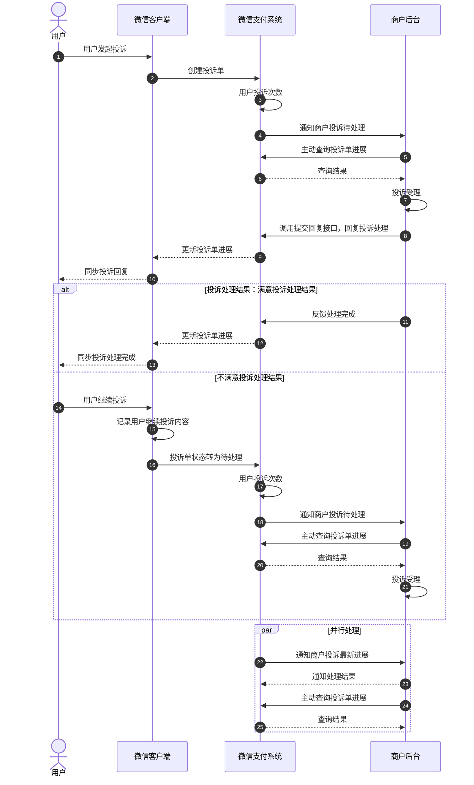

>更新时间：2026.10.20

## 1. 接口规则

为了在保证支付安全的前提下，带给商户简单、一致且易用的开发体验，我们推出了全新的微信支付APIv3接口。该版本API的具体规则请参考[APIv3接口规则](https://pay.weixin.qq.com/doc/v3/merchant/4012081606.md)。

## 2. 开发准备

### 2.1. 搭建和配置开发环境

开发者应当依据自身的编程语言来构建并配置相应的开发环境。

## 3. 快速接入

### 3.1. 业务流程图



重点步骤说明：

步骤1.4： 用户发起投诉后，微信支付通过[投诉通知回调](https://pay.weixin.qq.com/doc/v3/merchant/4012289719.md)通知商户投诉单需处理。

步骤1.7： 商户接收投诉后，可通过[回复用户API](https://pay.weixin.qq.com/doc/v3/merchant/4012467254.md)接口向微信支付提交投诉处理回复。

步骤1.8： 与用户协商一致后，商户通过[反馈处理完成API](https://pay.weixin.qq.com/doc/v3/merchant/4012467255.md)反馈投诉单处理完成。

步骤3.1： 商户在没有接收到微信投诉通知的情况下可主动调用[查询投诉单详情](https://pay.weixin.qq.com/doc/v3/merchant/4012533436.md)查询投诉单处理结果。

### 3.2. API接入（含示例代码）

文档展示了如何使用微信支付服务端 SDK 快速接入消费者投诉2.0，完成与微信支付对接的部分。

注意

- 文档中的代码示例是用来阐述 API 基本使用方法，代码中的示例参数需替换成商户自己账号及请求参数才能跑通。

- 以下接入步骤仅提供参考，请商户结合自身业务需求进行评估、修改。


#### 3.2.1. 【服务端】查询投诉单列表

步骤说明：商户可通过调用此接口，查询指定时间段的所有用户投诉信息，以分页输出查询结果。

示例代码

JAVA

```
public void GetComplaintsList() throws Exception{
    //请求URL
    HttpGet httpGet = new HttpGet("https://api.mch.weixin.qq.com/v3/merchant-service/complaints-v2?limit=5&offset=10&begin_date=2019-01-01&end_date=2019-01-01&complainted_mchid=190000XXXX");
    httpGet.setHeader("Accept", "application/json");

    //完成签名并执行请求
    CloseableHttpResponse response = httpClient.execute(httpGet);

    try {
        int statusCode = response.getStatusLine().getStatusCode();
        if (statusCode == 200) { //处理成功
            System.out.println("success,return body = " + EntityUtils.toString(response.getEntity()));
        } else if (statusCode == 204) { //处理成功，无返回Body
            System.out.println("success");
        } else {
            System.out.println("failed,resp code = " + statusCode+ ",return body = " + EntityUtils.toString(response.getEntity()));
            throw new IOException("request failed");
        }
    } finally {
        response.close();
    }
}
```

PHP

```
try {
    $resp = $client->request(
        'GET',
        'https://api.mch.weixin.qq.com/v3/merchant-service/complaints-v2?limit=5&offset=10&begin_date=2019-01-01&end_date=2019-01-01&complainted_mchid=190000XXXX', //请求URL
        [
            'headers' => [ 'Accept' => 'application/json']
        ]
    );
    $statusCode = $resp->getStatusCode();
    if ($statusCode == 200) { //处理成功
        echo "success,return body = " . $resp->getBody()->getContents()."\n";
    } else if ($statusCode == 204) { //处理成功，无返回Body
        echo "success";
    }
} catch (RequestException $e) {
    // 进行错误处理
    echo $e->getMessage()."\n";
    if ($e->hasResponse()) {
        echo "failed,resp code = " . $e->getResponse()->getStatusCode() . " return body = " . $e->getResponse()->getBody() . "\n";
    }
    return;
}
```

重要入参说明：

- begin\_date： 开始日期，投诉发生的开始日期，格式为yyyy-MM-dd。注意，查询日期跨度不超过30天。

- end\_date： 结束日期，投诉发生的结束日期，格式为yyyy-MM-dd。注意，查询日期跨度不超过30天。


更多参数、响应详情及错误码请参见[查询投诉单列表](https://pay.weixin.qq.com/doc/v3/merchant/4012533431.md)接口文档。

注意

- 如果查询时分页数据量过大，系统将返回报错{"code":"INVALID\_REQUEST","message":"当前查询结果数据量过大，请缩小limit后重试"}，请调整查询参数，​​缩小 limit 的值​​后重新发起查询。


#### 3.2.2.【服务端】查询投诉单详情

步骤说明：商户可通过调用此接口，查询指定投诉单的用户投诉详情，包含投诉内容、投诉关联订单、投诉人联系方式等信息，方便商户处理投诉。

示例代码

JAVA

```
public void GetComplaintsInfo() throws Exception{
    //请求URL
    HttpGet httpGet = new HttpGet("https://api.mch.weixin.qq.com/v3/merchant-service/complaints-v2/200201820200101080076610000");
    httpGet.setHeader("Accept", "application/json");

    //完成签名并执行请求
    CloseableHttpResponse response = httpClient.execute(httpGet);

    try {
        int statusCode = response.getStatusLine().getStatusCode();
        if (statusCode == 200) { //处理成功
            System.out.println("success,return body = " + EntityUtils.toString(response.getEntity()));
        } else if (statusCode == 204) { //处理成功，无返回Body
            System.out.println("success");
        } else {
            System.out.println("failed,resp code = " + statusCode+ ",return body = " + EntityUtils.toString(response.getEntity()));
            throw new IOException("request failed");
        }
    } finally {
        response.close();
    }
}
```

PHP

```
try {
    $resp = $client->request(
        'GET',
        'https://api.mch.weixin.qq.com/v3/merchant-service/complaints-v2/200201820200101080076610000', //请求URL
        [
            'headers' => [ 'Accept' => 'application/json']
        ]
    );
    $statusCode = $resp->getStatusCode();
    if ($statusCode == 200) { //处理成功
        echo "success,return body = " . $resp->getBody()->getContents()."\n";
    } else if ($statusCode == 204) { //处理成功，无返回Body
        echo "success";
    }
} catch (RequestException $e) {
    // 进行错误处理
    echo $e->getMessage()."\n";
    if ($e->hasResponse()) {
        echo "failed,resp code = " . $e->getResponse()->getStatusCode() . " return body = " . $e->getResponse()->getBody() . "\n";
    }
    return;
}
```

重要入参说明：

- complaint\_id： 投诉单对应的投诉单号，在投诉通知回调中会返回这个参数。


更多参数、响应详情及错误码请参见[查询投诉单详情](https://pay.weixin.qq.com/doc/v3/merchant/4012533436.md)接口文档。

#### 3.2.3. 【服务端】查询投诉协商历史

步骤说明： 商户可通过调用此接口，查询指定投诉的用户商户协商历史，以分页输出查询结果，方便商户根据处理历史来制定后续处理方案。

示例代码

JAVA

```
public void GetComplaintsHis() throws Exception{
    //请求URL
    HttpGet httpGet = new HttpGet("https://api.mch.weixin.qq.com/v3/merchant-service/complaints-v2/200201820200101080076610000/negotiation-historys?limit=50&offset=10");
    httpGet.setHeader("Accept", "application/json");

    //完成签名并执行请求
    CloseableHttpResponse response = httpClient.execute(httpGet);

    try {
        int statusCode = response.getStatusLine().getStatusCode();
        if (statusCode == 200) { //处理成功
            System.out.println("success,return body = " + EntityUtils.toString(response.getEntity()));
        } else if (statusCode == 204) { //处理成功，无返回Body
            System.out.println("success");
        } else {
            System.out.println("failed,resp code = " + statusCode+ ",return body = " + EntityUtils.toString(response.getEntity()));
            throw new IOException("request failed");
        }
    } finally {
        response.close();
    }
}
```

PHP

```
try {
    $resp = $client->request(
        'GET',
        'https://api.mch.weixin.qq.com/v3/merchant-service/complaints-v2/200201820200101080076610000/negotiation-historys?limit=50&offset=10', //请求URL
        [
            'headers' => [ 'Accept' => 'application/json']
        ]
    );
    $statusCode = $resp->getStatusCode();
    if ($statusCode == 200) { //处理成功
        echo "success,return body = " . $resp->getBody()->getContents()."\n";
    } else if ($statusCode == 204) { //处理成功，无返回Body
        echo "success";
    }
} catch (RequestException $e) {
    // 进行错误处理
    echo $e->getMessage()."\n";
    if ($e->hasResponse()) {
        echo "failed,resp code = " . $e->getResponse()->getStatusCode() . " return body = " . $e->getResponse()->getBody() . "\n";
    }
    return;
}
```

重要入参说明：

- complaint\_id： 投诉单对应的投诉单号，在投诉通知回调中会返回这个参数。


更多参数、响应详情及错误码请参见[查询投诉协商历史](https://pay.weixin.qq.com/doc/v3/merchant/4012533439.md)接口文档。

#### 3.2.4. 【服务端】投诉通知回调

步骤说明： 商户创建投诉通知回调URL 后，当有新的投诉事件发生、投诉状态发生变化时，商户会收到通知回调。商户需要接收处理，并按文档规范返回应答。

注意

- 投诉通知是以POST 方法访问商户设置的通知URL，通知的数据以JSON 格式通过请求主体（BODY）传输。通知的数据包括了加密的支付结果详情。

- 加密不能保证通知请求来自微信。微信会对发送给商户的通知进行签名，并将签名值放在通知的HTTP头Wechatpay-Signature。商户应当验证签名，以确认请求来自微信，而不是其他的第三方。签名验证的算法请参考 [《微信支付API v3签名验证》](https://pay.weixin.qq.com/doc/v3/merchant/4012365342.md#%E9%AA%8C%E8%AF%81%E7%AD%BE%E5%90%8D)。

- 投诉通知HTTP应答码为200或204才会当作正常接收，当回调处理异常时，应答的HTTP状态码应为500，或者4xx。

- 商户成功接收到回调通知后应返回成功的HTTP应答码为200或204。

- 同样的通知可能会多次发送给商户系统。商户系统必须能够正确处理重复的通知。 推荐的做法是，当商户系统收到通知进行处理时，先检查对应业务数据的状态，并判断该通知是否已经处理。如果未处理，则再进行处理；如果已处理，则直接返回结果成功。在对业务数据进行状态检查和处理之前，要采用数据锁进行并发控制，以避免函数重入造成的数据混乱。


更多参数、响应详情及错误码请参见[投诉通知回调](https://pay.weixin.qq.com/doc/v3/merchant/4012289719.md)接口文档。

#### 3.2.5. 【服务端】创建投诉通知回调地址

步骤说明： 商户通过调用此接口创建投诉通知回调URL，当用户产生新投诉且投诉状态已变更时，微信支付会通过回调URL通知商户。

示例代码

JAVA

```
public void CreateComplaintsNotify() throws Exception{
    //请求URL
    HttpPost httpPost = new HttpPost("https://api.mch.weixin.qq.com/v3/merchant-service/complaint-notifications");
    // 请求body参数
    String reqdata = "{"
            + "\"url\":\"https://www.weixin.qq.com/notify\""
            + "}";
    StringEntity entity = new StringEntity(reqdata,"utf-8");
    entity.setContentType("application/json");
    httpPost.setEntity(entity);
    httpPost.setHeader("Accept", "application/json");

    //完成签名并执行请求
    CloseableHttpResponse response = httpClient.execute(httpPost);

    try {
        int statusCode = response.getStatusLine().getStatusCode();
        if (statusCode == 200) { //处理成功
            System.out.println("success,return body = " + EntityUtils.toString(response.getEntity()));
        } else if (statusCode == 204) { //处理成功，无返回Body
            System.out.println("success");
        } else {
            System.out.println("failed,resp code = " + statusCode+ ",return body = " + EntityUtils.toString(response.getEntity()));
            throw new IOException("request failed");
        }
    } finally {
        response.close();
    }
}
```

PHP

```
try {
    $resp = $client->request(
        'POST',
        'https://api.mch.weixin.qq.com/v3/merchant-service/complaint-notifications', //请求URL
        [
            // JSON请求体
            'json' => [
                "url" => "https://www.weixin.qq.com/notify",
            ],
            'headers' => [ 'Accept' => 'application/json' ]
        ]
    );
    $statusCode = $resp->getStatusCode();
    if ($statusCode == 200) { //处理成功
        echo "success,return body = " . $resp->getBody()->getContents()."\n";
    } else if ($statusCode == 204) { //处理成功，无返回Body
        echo "success";
    }
} catch (RequestException $e) {
    // 进行错误处理
    echo $e->getMessage()."\n";
    if ($e->hasResponse()) {
        echo "failed,resp code = " . $e->getResponse()->getStatusCode() . " return body = " . $e->getResponse()->getBody() . "\n";
    }
    return;
}
```

重要入参说明：

- URL: 通知地址，通知地址，仅支持HTTPS。


更多参数、响应详情及错误码请参见[创建投诉通知回调地址](https://pay.weixin.qq.com/doc/v3/merchant/4012458679.md)接口文档。

#### 3.2.6.【服务端】查询投诉通知回调地址

步骤说明： 商户通过调用此接口查询投诉通知的回调URL。

示例代码

JAVA

```
public void GetComplaintsNotify() throws Exception{
    //请求URL
    HttpGet httpGet = new HttpGet("https://api.mch.weixin.qq.com/v3/merchant-service/complaint-notifications");
    httpGet.setHeader("Accept", "application/json");

    //完成签名并执行请求
    CloseableHttpResponse response = httpClient.execute(httpGet);

    try {
        int statusCode = response.getStatusLine().getStatusCode();
        if (statusCode == 200) { //处理成功
            System.out.println("success,return body = " + EntityUtils.toString(response.getEntity()));
        } else if (statusCode == 204) { //处理成功，无返回Body
            System.out.println("success");
        } else {
            System.out.println("failed,resp code = " + statusCode+ ",return body = " + EntityUtils.toString(response.getEntity()));
            throw new IOException("request failed");
        }
    } finally {
        response.close();
    }
}
```

PHP

```
try {
    $resp = $client->request(
        'GET',
        'https://api.mch.weixin.qq.com/v3/merchant-service/complaint-notifications', //请求URL
        [
            'headers' => [ 'Accept' => 'application/json']
        ]
    );
    $statusCode = $resp->getStatusCode();
    if ($statusCode == 200) { //处理成功
        echo "success,return body = " . $resp->getBody()->getContents()."\n";
    } else if ($statusCode == 204) { //处理成功，无返回Body
        echo "success";
    }
} catch (RequestException $e) {
    // 进行错误处理
    echo $e->getMessage()."\n";
    if ($e->hasResponse()) {
        echo "failed,resp code = " . $e->getResponse()->getStatusCode() . " return body = " . $e->getResponse()->getBody() . "\n";
    }
    return;
}
```

更多参数、响应详情及错误码请参见[查询投诉通知回调地址](https://pay.weixin.qq.com/doc/v3/merchant/4012459014.md)接口文档。

#### 3.2.7. 【服务端】更新投诉通知回调地址

步骤说明：商户通过调用此接口更新投诉通知的回调URL。当用户产生新投诉或投诉状态已变更时，微信支付会通过回调URL通知商户。

示例代码

JAVA

```
public void UpdateComplaintsNotify() throws Exception{
    //请求URL
    HttpPut httpPut = new HttpPut("https://api.mch.weixin.qq.com/v3/merchant-service/complaint-notifications");
    // 请求body参数
    String reqdata = "{"
            + "\"url\":\"https://www.123.com/notify\""
            + "}";
    StringEntity entity = new StringEntity(reqdata,"utf-8");
    entity.setContentType("application/json");
    httpPut.setEntity(entity);
    httpPut.setHeader("Accept", "application/json");

    //完成签名并执行请求
    CloseableHttpResponse response = httpClient.execute(httpPut);

    try {
        int statusCode = response.getStatusLine().getStatusCode();
        if (statusCode == 200) { //处理成功
            System.out.println("success,return body = " + EntityUtils.toString(response.getEntity()));
        } else if (statusCode == 204) { //处理成功，无返回Body
            System.out.println("success");
        } else {
            System.out.println("failed,resp code = " + statusCode+ ",return body = " + EntityUtils.toString(response.getEntity()));
            throw new IOException("request failed");
        }
    } finally {
        response.close();
    }
}
```

PHP

```
try {
    $resp = $client->request(
        'PUT',
        'https://api.mch.weixin.qq.com/v3/merchant-service/complaint-notifications', //请求URL
        [
            // JSON请求体
            'json' => [
                "url" => "https://www.123.com/notify",
            ],
            'headers' => [ 'Accept' => 'application/json' ]
        ]
    );
    $statusCode = $resp->getStatusCode();
    if ($statusCode == 200) { //处理成功
        echo "success,return body = " . $resp->getBody()->getContents()."\n";
    } else if ($statusCode == 204) { //处理成功，无返回Body
        echo "success";
    }
} catch (RequestException $e) {
    // 进行错误处理
    echo $e->getMessage()."\n";
    if ($e->hasResponse()) {
        echo "failed,resp code = " . $e->getResponse()->getStatusCode() . " return body = " . $e->getResponse()->getBody() . "\n";
    }
    return;
}
```

重要入参说明：

- URL: 通知地址，通知地址，仅支持HTTPS。


更多参数、响应详情及错误码请参见[更新投诉通知回调地址](https://pay.weixin.qq.com/doc/v3/merchant/4012459282.md)接口文档。

#### 3.2.8. 【服务端】删除投诉通知回调地址

步骤说明： 当商户不再需要推送通知时，可通过调用此接口删除投诉通知的回调URL，取消通知回调。

示例代码

JAVA

```
public void DelComplaintsNotify() throws Exception{
    //请求URL
    HttpDelete httpDel = new HttpDelete("https://api.mch.weixin.qq.com/v3/merchant-service/complaint-notifications");
    httpDel.setHeader("Accept", "application/json");

    //完成签名并执行请求
    CloseableHttpResponse response = httpClient.execute(httpDel);

    try {
        int statusCode = response.getStatusLine().getStatusCode();
        if (statusCode == 200) { //处理成功
            System.out.println("success,return body = " + EntityUtils.toString(response.getEntity()));
        } else if (statusCode == 204) { //处理成功，无返回Body
            System.out.println("success");
        } else {
            System.out.println("failed,resp code = " + statusCode+ ",return body = " + EntityUtils.toString(response.getEntity()));
            throw new IOException("request failed");
        }
    } finally {
        response.close();
    }
}
```

PHP

```
try {
    $resp = $client->request(
        'DELETE',
        'https://api.mch.weixin.qq.com/v3/merchant-service/complaint-notifications', //请求URL
        [
            'headers' => [ 'Accept' => 'application/json']
        ]
    );
    $statusCode = $resp->getStatusCode();
    if ($statusCode == 200) { //处理成功
        echo "success,return body = " . $resp->getBody()->getContents()."\n";
    } else if ($statusCode == 204) { //处理成功，无返回Body
        echo "success";
    }
} catch (RequestException $e) {
    // 进行错误处理
    echo $e->getMessage()."\n";
    if ($e->hasResponse()) {
        echo "failed,resp code = " . $e->getResponse()->getStatusCode() . " return body = " . $e->getResponse()->getBody() . "\n";
    }
    return;
}
```

更多参数、响应详情及错误码请参见[删除投诉通知回调地址](https://pay.weixin.qq.com/doc/v3/merchant/4012460452.md)接口文档。

#### 3.2.9. 【服务端】提交回复

步骤说明：商户可调用此接口回复用户。其中上传图片凭证需首先调用[商户上传反馈图片](https://pay.weixin.qq.com/doc/v3/merchant/4012467250.md)接口，得到图片ID，再将ID填入请求。

示例代码

JAVA

```
public void ReplyInfo() throws Exception{
    //请求URL
    HttpPost httpPost = new HttpPost("https://api.mch.weixin.qq.com/v3/merchant-service/complaints-v2/200201820200101080076610000/response");
    // 请求body参数
    String reqdata = "{"
            + "\"complainted_mchid\":190001XXX,"
            + "\"response_content\":\"已与用户沟通解决\","
            + "\"response_images\": ["
            + "\"0\":\"8692450418652C00E4E623AF421E00B5.png\""
            + "]"
            + "}";
    StringEntity entity = new StringEntity(reqdata,"utf-8");
    entity.setContentType("application/json");
    httpPost.setEntity(entity);
    httpPost.setHeader("Accept", "application/json");

    //完成签名并执行请求
    CloseableHttpResponse response = httpClient.execute(httpPost);

    try {
        int statusCode = response.getStatusLine().getStatusCode();
        if (statusCode == 200) { //处理成功
            System.out.println("success,return body = " + EntityUtils.toString(response.getEntity()));
        } else if (statusCode == 204) { //处理成功，无返回Body
            System.out.println("success");
        } else {
            System.out.println("failed,resp code = " + statusCode+ ",return body = " + EntityUtils.toString(response.getEntity()));
            throw new IOException("request failed");
        }
    } finally {
        response.close();
    }
}
```

PHP

```
try {
    $resp = $client->request(
        'POST',
        'https://api.mch.weixin.qq.com/v3/merchant-service/complaints-v2/200201820200101080076610000/response', //请求URL
        [
            // JSON请求体
            'json' => [
                "complainted_mchid" => 190001XXX,
                "response_content" => "已与用户沟通解决",
                "response_images" => [
                    "0" => "8692450418652C00E4E623AF421E00B5.png",
                ]
            ],
            'headers' => [ 'Accept' => 'application/json' ]
        ]
    );
    $statusCode = $resp->getStatusCode();
    if ($statusCode == 200) { //处理成功
        echo "success,return body = " . $resp->getBody()->getContents()."\n";
    } else if ($statusCode == 204) { //处理成功，无返回Body
        echo "success";
    }
} catch (RequestException $e) {
    // 进行错误处理
    echo $e->getMessage()."\n";
    if ($e->hasResponse()) {
        echo "failed,resp code = " . $e->getResponse()->getStatusCode() . " return body = " . $e->getResponse()->getBody() . "\n";
    }
    return;
}
```

重要入参说明：

- complaint\_id： 投诉单对应的投诉单号。

- complainted\_mchid： 被诉商户号，投诉单对应的被诉商户号。

- response\_content： 回复内容，具体的投诉处理方案，限制200个字符以内。


更多参数、响应详情及错误码请参见[提交回复](https://pay.weixin.qq.com/doc/v3/merchant/4012467254.md)接口文档。

#### 3.2.10. 【服务端】反馈处理完成

步骤说明： 商户可通过调用此接口，反馈投诉单已处理完成。

示例代码

JAVA

```
public void CompleteComplaints() throws Exception{
    //请求URL
    HttpPost httpPost = new HttpPost("https://api.mch.weixin.qq.com/v3/merchant-service/complaints-v2/200201820200101080076610000/complete");
    // 请求body参数
    String reqdata = "{"
            + "\"complainted_mchid\":190001XXX"
            + "}";
    StringEntity entity = new StringEntity(reqdata,"utf-8");
    entity.setContentType("application/json");
    httpPost.setEntity(entity);
    httpPost.setHeader("Accept", "application/json");

    //完成签名并执行请求
    CloseableHttpResponse response = httpClient.execute(httpPost);

    try {
        int statusCode = response.getStatusLine().getStatusCode();
        if (statusCode == 200) { //处理成功
            System.out.println("success,return body = " + EntityUtils.toString(response.getEntity()));
        } else if (statusCode == 204) { //处理成功，无返回Body
            System.out.println("success");
        } else {
            System.out.println("failed,resp code = " + statusCode+ ",return body = " + EntityUtils.toString(response.getEntity()));
            throw new IOException("request failed");
        }
    } finally {
        response.close();
    }
}
```

PHP

```
try {
    $resp = $client->request(
        'POST',
        'https://api.mch.weixin.qq.com/v3/merchant-service/complaints-v2/200201820200101080076610000/complete', //请求URL
        [
            // JSON请求体
            'json' => [
                "complainted_mchid" => 190001XXX,
            ],
            'headers' => [ 'Accept' => 'application/json' ]
        ]
    );
    $statusCode = $resp->getStatusCode();
    if ($statusCode == 200) { //处理成功
        echo "success,return body = " . $resp->getBody()->getContents()."\n";
    } else if ($statusCode == 204) { //处理成功，无返回Body
        echo "success";
    }
} catch (RequestException $e) {
    // 进行错误处理
    echo $e->getMessage()."\n";
    if ($e->hasResponse()) {
        echo "failed,resp code = " . $e->getResponse()->getStatusCode() . " return body = " . $e->getResponse()->getBody() . "\n";
    }
    return;
}
```

重要入参说明：

- complaint\_id： 投诉单对应的投诉单号，在投诉通知回调中会返回这个参数。

- complainted\_mchid： 被诉商户号，投诉单对应的被诉商户号。


更多参数、响应详情及错误码请参见[反馈处理完成](https://pay.weixin.qq.com/doc/v3/merchant/4012467255.md)接口文档。

#### 3.2.11. 【服务端】商户上传反馈图片

步骤说明： 商户上传反馈图片的接口。 将媒体图片进行二进制转换，得到的媒体图片二进制内容，在请求body中上传此二进制内容。 媒体图片只支持jpg、png、bmp格式，文件大小不能超过2M。

示例代码

JAVA

```
String filePath = "/your/home/hellokitty.png";
URI uri = new URI("https://api.mch.weixin.qq.com/v3/merchant-service/images/upload");
File file = new File(filePath);

try (FileInputStream ins1 = new FileInputStream(file)) {
  String sha256 = DigestUtils.sha256Hex(ins1);
  try (InputStream ins2 = new FileInputStream(file)) {
    HttpPost request = new WechatPayUploadHttpPost.Builder(uri)
        .withImage(file.getName(), sha256, ins2)
        .build();
    CloseableHttpResponse response1 = httpClient.execute(request);
  }
}
```

PHP

```
try {
    $resp = $client->request('POST', 'https://api.mch.weixin.qq.com/v3/merchant-service/images/upload', [
        'body'    => $media->getStream(),
        'headers' => [
            'Accept'       => 'application/json',
            'content-type' => $media->getContentType(),
        ]
    ]);
    // POST 语法糖
    $resp = $client->post('merchant-service/images/upload', [
        'body'    => $media->getStream(),
        'headers' => [
            'Accept'       => 'application/json',
            'content-type' => $media->getContentType(),
        ]
    ]);
    echo $resp->getStatusCode().' '.$resp->getReasonPhrase()."\n";
    echo $resp->getBody()."\n";
} catch (Exception $e) {
    echo $e->getMessage()."\n";
    if ($e->hasResponse()) {
        echo $e->getResponse()->getStatusCode().' '.$e->getResponse()->getReasonPhrase()."\n";
        echo $e->getResponse()->getBody();
    }
    return;
}
```

重要入参说明：

- file： 图片文件，将媒体图片进行二进制转换，得到的媒体图片二进制内容，在请求body中上传此二进制内容。媒体图片只支持jpg、png、bmp格式，文件大小不能超过2M。


更多参数、响应详情及错误码请参见[商户上传反馈图片](https://pay.weixin.qq.com/doc/v3/merchant/4012467250.md)接口文档。

## 4. 常见问题

### Q：商户反馈API，查询投诉单列表 API频率是多少？

A：商户反馈API每分钟60次，查询投诉单列表 API频率是每分钟200次。

### Q：商户反馈API，商户传给微信侧的反馈和留言是同步实时处理的吗？

A：是实时的，会直接展示给用户。

### Q：投诉通知回调API中的通知ID，在重复通知的情况下，ID是一致的吗？

A：微信存在重复通知的情况，关于重复通知的客户投诉，通知ID是一致的。

### Q：设置了投诉通知URL，存在用户投诉，但收不到投诉通知的情况，如何解决？

A：请按照以下几点进行排查：

1. 请检查回调URL是否能正常公网访问，不能是中文域名，不能是HTTP，必须是HTTPS；

2. 请注意回调URL不能携带参数；

3. 请检查是否开启了防火墙，如果开启了防火墙，请添加[微信支付回调IP](https://pay.weixin.qq.com/doc/v3/merchant/4012076543.md)；

4. 请检查设置通知URL的商户号与投诉订单的商户号是否为同一个；

5. APIv3密钥没有设置，设置路径：【[微信商户平台](https://pay.wechatpay.cn/)—>账户设置—>API安全—>设置APIv3密钥】。