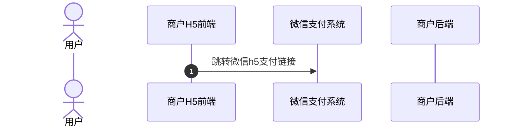
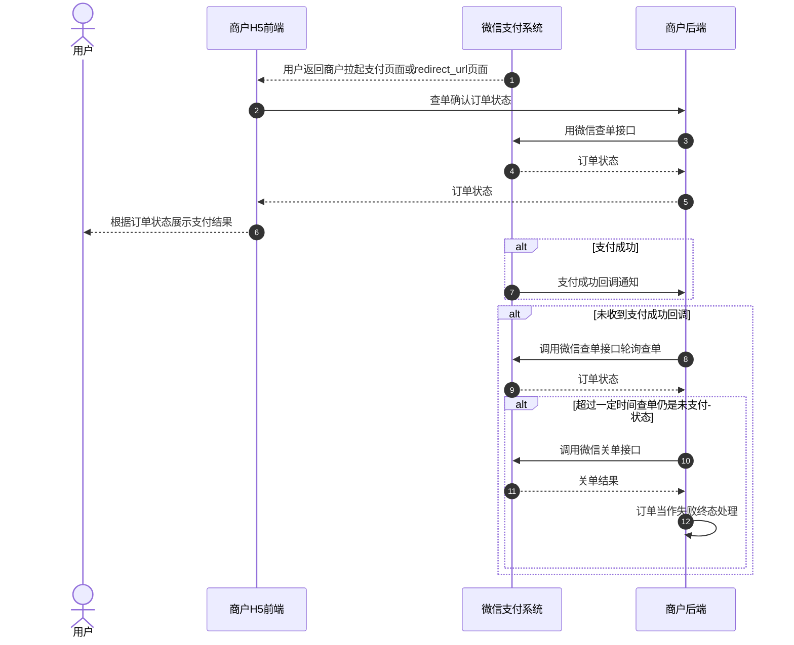
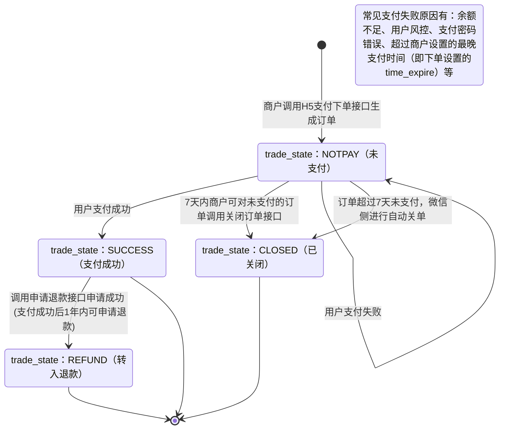

>更新时间：2026.06.09

## 1、整体业务开发流程概览

- 商户通过调用[H5支付下单](https://pay.weixin.qq.com/doc/v3/merchant/4012791834.md)接口获取H5支付链接（h5\_url），然后商户在已配置H5支付域名的前端网页跳转该支付链接（如需支付后返回指定页面，可在H5支付链接后拼接redirect\_url参数），并唤起微信支付收银台。

- 当用户在收银台完成支付后点击完成按钮，或中途取消支付，页面会从收银台返回到拉起支付前的H5页面（若拉起收银台时有拼接redirect\_url参数将返回指定页面），此时商户后端需调用[查询订单API](https://pay.weixin.qq.com/doc/v3/merchant/4012791838.md)接口确认订单状态，并根据订单状态进行相应的业务逻辑处理（在商户页面向用户展示查询到的订单支付状态、在商户内部系统更新订单状态等）。如果订单支付成功，微信支付系统还会发送[支付成功回调通知](https://pay.weixin.qq.com/doc/v3/merchant/4012791836.md)给商户。具体的支付回调和查单的实现方案，商户可以参考[支付回调和查单实现指引](https://pay.weixin.qq.com/doc/v3/merchant/4012075249.md)。

- 最后商户可通过[下载交易账单](https://pay.weixin.qq.com/doc/v3/merchant/4012810606.md)进行对账。需要退款的订单，也可调用[退款接口](https://pay.weixin.qq.com/doc/v3/merchant/4012810597.md)完成退款。


## 2、详细步骤说明

### 2.1、商户下单

用户在商户H5页面操作下单后，商户需要通过调用[H5支付下单API](https://pay.weixin.qq.com/doc/v3/merchant/4012791834.md)接口生成订单并获取微信H5支付链接（h5\_url）。在这个过程中，商户必须做好安全校验，防止本次交易被不法分子利用。

- 当跨域请求不是[简单请求](https://developer.mozilla.org/zh-CN/docs/Web/HTTP/CORS#%E7%AE%80%E5%8D%95%E8%AF%B7%E6%B1%82)时，浏览器会发起Options[预检请求](https://developer.mozilla.org/zh-CN/docs/Web/HTTP/CORS#%E9%A2%84%E6%A3%80%E8%AF%B7%E6%B1%82)，此时商户后台需要支持Options请求且校验Origin头部，如果不在允许的白名单列表内，则返回403且不返回"Access-Control-Allow-\*"相关头部。

- 针对GET/POST的跨域下单请求，商户后台需要校验Origin头部是否合法且用户Cookie是否完备（若用户未登陆则先引导登陆商户站点），否则返回403且不返回"Access-Control-Allow-\*"相关头部。


安全标准规范流程图：

```mermaid
sequenceDiagram
  autonumber
  actor p0 as 用户
  participant p1 as 商户H5前端
  participant p2 as 商户后端
  participant p3 as 微信支付系统
  p0->>p1: 用户操作下单
  p1->>p2: 请求下单
  alt 浏览器 preflight 请求
    p1->>p2: options请求
    p2->>p2: 判断Origin头部是否合法
    Note over p0: OPTIONS /api HTTP/1.1
Access-control-request-headers: x-A,x-B
Access-control-request-method: POST
Origin: https://api.third.com
Referer: https://api.third.com/
    alt 判断Origin头部是否合法：是
      p2-->>p1: ：options请求正常响应
      Note over p2: HTTP/1.1 200 OK
Access-control-allow-credentials: true
Access-control-allow-headers: x-A,x-B
Access-control-allow-methods: POST, GET
Access-control-allow-origin: https://api.third.com
    else 否
      p2-->>p1: ：options请求异常响应
    end
    Note over p0: HTTP/1.1 403 Forbidden
（no access-control-allow header）

报错信息
  end
  p1->>p2: get/post请求
  p2->>p2: 判断Origin头部是否合法
  Note over p2: GET /api HTTP/1.1
Host: api.shanghu.com
Referer: https://api.third.com/1/2.html
Origin: https://api.third.com
Cookie: shanghu_uid=xxx;...
  p2->>p2: 判断Cookie是否关联到商户站点已注册用户
  alt api.third.com合法且用户登录态有效：是
    p2->>p2: 保存订单
    p2->>p3: 用微信支付接口下单
    p3-->>p2: 跳转URL
    p2-->>p1: ：请求下单正常响应
  else 否
    Note over p2: Access-Control-Allow-Origin: https://api.third.com
Access-Control-Allow-Credentials: true
    p2-->>p1: ：请求下单异常响应
  end
  Note over p2: HTTP/1.1 403 Forbidden
（no access-control-allow header）

报错信息
```

注意：

- 商户需按照安全规范进行接入，若因未遵循规范接入而出现安全问题，财付通将根据[《微信支付服务协议》](https://pay.wechatpay.cn/index.php/public/apply_sign/protocol_dev)条款处理。

- 以上图示，仅为示例，只供参考。请商户自行确认是否实现了跨域访问白名单限制和用户登录态校验。


下单接口关键参数说明：

`time_expire`：支付结束时间。若传递该参数，则用户只能在订单设置的支付结束时间 `time_expire` 之前进行支付，超过支付结束时间后，用户支付将收到："订单已超过商户设置的最晚支付成功时间，请重新发起支付"的提示，商户需对订单进行关单处理。若不传该参数，默认订单支付有效期为7天，用户可在7天内进行支付，超出7天，订单将被关闭。

`h5_url`：支付跳转链接。调起支付时需要使用的参数， `h5_url` 有效期为5分钟，超过5分钟，商户需要使用原下单参数重新请求下单接口，获取新的 `h5_url`。

### 2.2、商户调起支付

商户调起支付前，请确保已在[商户平台](https://pay.weixin.qq.com/)配置好H5支付域名，只有[配置了H5支付域名](https://pay.weixin.qq.com/doc/v3/merchant/4013287193.md)的网页才能跳转H5支付链接（如需在支付后返回至指定页面，可在h5支付链接后面拼接上redirect\_url参数），调起微信支付页面。



### 2.3、用户支付

用户在微信收银台完成支付/取消支付，会返回商户调起支付时的页面，若调起支付时拼接了redirect\_url，则会返回指定的页面，此时商户需要调用[查询订单API](https://pay.weixin.qq.com/doc/v3/merchant/4012791838.md)接口确认订单状态，并根据订单状态展示支付结果。

如果用户支付成功，微信支付系统会向商户发送[支付成功回调](https://pay.weixin.qq.com/doc/v3/merchant/4012791836.md)，未收到回调时，商户可调用[查询订单API](https://pay.weixin.qq.com/doc/v3/merchant/4012791838.md)接口确认订单状态。具体实现方案商户可以参考[支付回调和查单实现指引](https://pay.weixin.qq.com/doc/v3/merchant/4012075249.md)。

若商户需要限制用户支付的时间，有以下两种方式：

1、下单时通过 `time_expire` 参数，设置订单的支付结束时间，超过设置的结束时间后，商户进行关单处理。

2、商户在自己的系统内进行倒计时，超过有效期，进行关单处理。

若因特殊原因需在用户可支付时间范围内关闭订单，商户可通过调用[查询订单API](https://pay.weixin.qq.com/doc/v3/merchant/4012791838.md)接口确认订单状态，若订单仍是未支付状态，商户可以调用[关闭订单API](https://pay.weixin.qq.com/doc/v3/merchant/4012791839.md)接口关单，关单后可以将订单当作失败终态处理。



### 2.4、商户对账

详细参考：[账单产品介绍](https://pay.weixin.qq.com/doc/v3/merchant/4013071215.md)

### 2.5、订单退款

详细参考：[退款产品介绍](https://pay.weixin.qq.com/doc/v3/merchant/4013071001.md)

## 3、普通支付订单状态流转图



1、商户调用[H5支付下单](https://pay.weixin.qq.com/doc/v3/merchant/4012791834.md)接口下单成功后，商户可以调用[查询订单](https://pay.weixin.qq.com/doc/v3/merchant/4012791838.md)接口来确认订单状态，详情请参考[支付回调和查单实现指引](https://pay.weixin.qq.com/doc/v3/merchant/4012075249.md)。

2、当订单状态处于未支付(trade\_state：NOTPAY)时，用户可对订单进行支付，若用户支付失败，订单状态不变。

3、7天内商户可对无需继续支付的订单（例如用户超过商户系统内部规定的支付时间，或超过商户下单设置的最晚支付时间（time\_expire）的订单）调用[关单接口](https://pay.weixin.qq.com/doc/v3/merchant/4012791839.md)，使订单关闭，或超过7天后由微信侧自动关单。关单后，订单状态会从未支付(trade\_state：NOTPAY)流转为已关闭(trade\_state：CLOSED)。

4、当用户成功支付订单时，订单状态会从未支付(trade\_state：NOTPAY)流转为支付成功(trade\_state：SUCCESS)。

5、当订单状态为支付成功(trade\_state：SUCCESS)时，如果用户需要退款，商户可调用[申请退款接口](https://pay.weixin.qq.com/doc/v3/merchant/4012810597.md)(仅支持支付成功后1年内的订单)，退款申请成功后，订单状态会从支付成功(trade\_state：SUCCESS)流转为转入退款(trade\_state：REFUND)，退款状态可通过[查询退款单接口](https://pay.weixin.qq.com/doc/v3/merchant/4012810601.md)进行确认。

6、以下三个状态为终态

- trade\_state：CLOSED

- trade\_state：SUCCESS

- trade\_state：REFUND