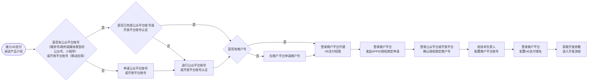

>更新时间：2026.10.22

流程说明

1、阅读[产品介绍文档](https://pay.weixin.qq.com/doc/v3/merchant/4012791832.md)，了解H5支付产品特性；

2、H5支付可以使用以下任意一种公众账号类型来申请权限，请参考指引注册账号：

2.1、服务号、政府或媒体类型的公众号：参考指引[注册服务号/公众号](https://kf.qq.com/product/weixinmp.html#hid=87)类型的公众平台账号；

2.2、小程序：参考指引[注册小程序](https://kf.qq.com/faq/170109iQBJ3Q170109JbQfiu.html)类型的公众平台账号；

2.3、移动应用：先参考指引[注册开放平台账号](https://kf.qq.com/faq/170811QrE3En170811bUNRJb.html)，再参考指引[创建移动应用](https://developers.weixin.qq.com/doc/oplatform/Mobile_App/guideline/create.html)；

3、公众账号认证（未认证的账号无法绑定商户号）：

3.1、服务号、政府或媒体类型的公众号：参考[服务号/公众号认证指引](https://kf.qq.com/product/weixinmp.html#hid=99)完成公众平台账号认证；

3.2、小程序：参考[小程序认证指引](https://kf.qq.com/faq/170109by2mQB170109zUFfqe.html)完成公众平台账号认证；

3.3、移动应用：参考[开放平台账号认证指引](https://kf.qq.com/faq/170824URbmau170824r2uY7j.html)完成开放平台账号认证；

4、申请H5支付权限：

4.1、如果已有商户号，请超级管理员登录[商户平台](https://pay.weixin.qq.com/)，按照[申请H5支付产品权限](https://pay.weixin.qq.com/doc/v3/merchant/4012791841.md#1%E3%80%81%E7%94%B3%E8%AF%B7H5%E6%94%AF%E4%BB%98%E4%BA%A7%E5%93%81%E6%9D%83%E9%99%90)申请权限，并[发起与APPID授权绑定](https://pay.weixin.qq.com/doc/v3/merchant/4013287174.md#2.2%E3%80%81%E7%99%BB%E5%BD%95%E5%95%86%E6%88%B7%E5%B9%B3%E5%8F%B0%E5%8F%91%E8%B5%B7APPID%E7%9A%84%E6%8E%88%E6%9D%83%E7%BB%91%E5%AE%9A%E7%94%B3%E8%AF%B7)申请；支持绑定的APPID类型：服务号、政府或媒体类型的公众号，小程序，移动应用；

4.2、如果还没有商户号，请参考[微信支付商户入驻详细流程](https://kf.qq.com/faq/180910eUfeyu180910BFZNJN.html)指引先申请商户号，再按照上方4.1流程申请H5支付权限，支持申请H5支付权限的主体类型有：企业、事业单位、政府机关、社会组织，​​详见​​：[主体类型](https://kf.qq.com/faq/180910IBZVnQ180910naQ77b.html)介绍与[各主体权限对照说明](https://pay.weixin.qq.com/doc/v3/merchant/4015616699.md)；

5、登录[公众平台](https://mp.weixin.qq.com/)或[开放平台](https://open.weixin.qq.com/)，[确认授权绑定的商户号](https://pay.weixin.qq.com/doc/v3/merchant/4013287174.md#2.3%E3%80%81%E7%99%BB%E5%BD%95%E5%AF%B9%E5%BA%94%E5%B9%B3%E5%8F%B0%E7%A1%AE%E8%AE%A4%E6%8E%88%E6%9D%83%E7%BB%91%E5%AE%9A%E7%9A%84%E5%95%86%E6%88%B7%E5%8F%B7)，完成商户号与APPID的绑定；

6、超级管理员登录[商户平台](https://pay.weixin.qq.com/)，为技术负责人配置商户平台登录账号并设置为安全联系人，详见[配置技术负责人账号操作指引](https://pay.weixin.qq.com/doc/v3/merchant/4015423618.md)；

7、超级管理员登录[商户平台](https://pay.weixin.qq.com/)，[配置H5支付域名](https://pay.weixin.qq.com/doc/v3/merchant/4013287193.md)，配置的内容请和技术负责人确认；

8、获取[开发参数](https://pay.weixin.qq.com/doc/v3/merchant/4013070756.md)，进入[开发流程](https://pay.weixin.qq.com/doc/v3/merchant/4012791831.md)（特别说明：在开发的过程中，请将应答的HTTP头Request-ID值打印到日志中。Request-ID作为[请求的唯一标识](https://pay.weixin.qq.com/doc/v3/merchant/4012081709.md#%E8%AF%B7%E6%B1%82%E7%9A%84%E5%94%AF%E4%B8%80%E6%A0%87%E8%AF%86)，在调用接口遇到问题时，可向微信侧提供该值用于快速定位到请求记录，协助排查问题原因）。