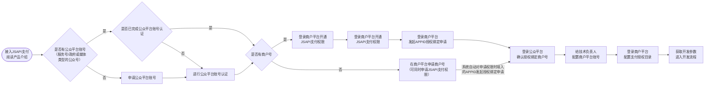

>更新时间：2026.10.22

开发参数

通用开发参数： `mchid`、 `appid`、证书和密钥的获取，见[开发必要参数说明](https://pay.weixin.qq.com/doc/v3/merchant/4013070756.md)。

业务开发参数：见下表

| 参数名 | 用途 | 获取角色 | 获取方式 |
| --- | --- | --- | --- |
| appid | JSAPI 支付下单与调起支付的开发者 ID。须为已认证的服务号，或已认证的政府或媒体类型公众号，且已与商户号绑定 | 超级管理员、[技术负责人](https://pay.weixin.qq.com/doc/v3/merchant/4015423618.md) | 若绑定服务号/公众号类型的APPID，商户登录[公众平台](https://mp.weixin.qq.com/) ，通过路径【设置与开发 -> 开发接口管理 -> 基本配置 -\> 开发者ID(AppID)】查看。 |
| 回调域名 | 微信支付向商户发送支付成功通知和退款结果通知时的域名 | 商户备案域名，开发人员传入地址 | 商户自行准备公网域名，不由微信支付分配。国内服务器须先完成 ICP 备案，省管局审核时限 20 个工作日内，开发准备开始就提交；在工信部备案系统能查到已备案后使用。 准备完成后，由商户将该域名写入 `notify_url`。见[回调通知注意事项](https://pay.weixin.qq.com/doc/v3/merchant/4012075420.md) |

产品权限

| 需要准备 | 用途 | 办理方式 |
| --- | --- | --- |
| JSAPI 支付权限 | 授权该商户号受理 JSAPI 支付，用于在微信内置浏览器中下单并调起收银台 | 已有商户号：商户平台「产品中心 → JSAPI支付 → 申请开通」，审核 7 个工作日内。 尚无商户号：入驻时一并申请。开通结果在同一页面查看。见[申请JSAPI支付权限指引](https://pay.weixin.qq.com/doc/v3/merchant/4012791854.md) |
| `mchid` 与 `appid` 绑定 | 授权指定 appid 使用该商户号收款，并作为下单时的应用标识 | 超级管理员在「产品中心 → appid授权管理 → 关联appid」提交，再登录公众平台或开放平台确认。入驻时填写的 appid 由系统自动发起绑定。特殊行业费率审核 1–3 个工作日。已绑定账号在「产品中心 → appid账号管理 → 我关联的appid账号」查看。见[管理商户号绑定的APPID账号](https://pay.weixin.qq.com/doc/v3/merchant/4013287010.md) |
| 支付授权目录 | 登记可调起收银台的页面目录。调起支付时，微信支付校验当前页面 URL 是否与已登记目录一致 | 仅超级管理员可配置。域名备案后，在「产品中心 → 开发配置 → 支付授权目录」添加，一般 5 分钟内生效。已添加目录须与实际支付页面目录一致。见[配置JSAPI支付授权目录](https://pay.weixin.qq.com/doc/v3/merchant/4013287088.md) |