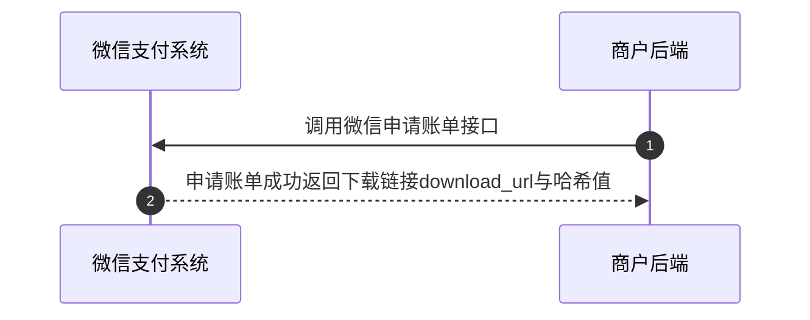
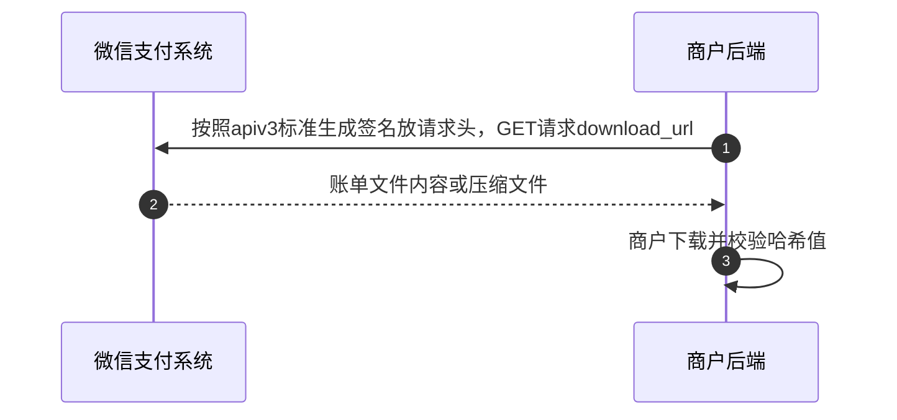

>更新时间：2026.10.13

## 1、整体业务开发流程概览

商户如有对账需求，可在上午十点后可调用申请账单接口（[交易账单](https://pay.weixin.qq.com/doc/v3/merchant/4013071227.md)或[资金账单](https://pay.weixin.qq.com/doc/v3/merchant/4013071235.md)），获取前三个月内任一天的账单下载链接（download\_url），并通过该链接下载获取账单文件。

商户也可登录[商户平台](https://pay.weixin.qq.com/)，在【交易中心 -\> 账单管理】手动下载账单，参考：[商户平台下载账单操作指引](https://pay.weixin.qq.com/doc/v3/merchant/4013071252.md)。

注意事项：

- 当日账单不可下载，需至次日上午十点生成后方可进行下载。

- 指定日期若无交易或退款，将不生成交易账单；若资金未变动，则不生成资金账单。申请账单将返回"账单不存在"。

## 2、详细步骤说明

### 2.1、申请账单下载链接

商户调用申请账单API（[申请交易账单](https://pay.weixin.qq.com/doc/v3/merchant/4013071227.md)/[申请资金账单](https://pay.weixin.qq.com/doc/v3/merchant/4013071235.md)）获取账单文件下载链接download\_url(5分钟内有效)。

申请账单关键参数说明：

`bill_date`：账单日期，格式yyyy-MM-DD，需要是3个月以内的，不能为请求接口当天的日期

`tar_type(非必填)`：传固定值“GZIP”则在通过下载链接下载文件时，返回的是压缩文件流，不填则默认是返回账单文件的字符串流

### 2.2、下载账单文件

商户获得5分钟有效期的下载链接（download\_url）后，需通过GET方式请求并按[apiv3标准生成签名](https://pay.weixin.qq.com/doc/v3/merchant/4012365342.md)来获取账单文件，不得直接在浏览器中访问。默认返回账单文件内容，商户需用utf-8编码读取；若申请账单时tar\_type指定了GZIP压缩类型，则返回.gzip格式压缩文件，需先解压再读取账单内容。账单文件下载后商户应计算哈希值，并与申请账单返回的哈希值对比，以确保账单完整性。

## 3、单业务注意事项

| 事项 | 说明 |
| --- | --- |
| 对账须先申请账单再下载，并核验 `hash_value` | 申请交易账单、申请资金账单只返回 `download_url`，不返回账单数据。下载后将文件摘要与 `hash_value` 比对。见 [申请交易账单](https://pay.weixin.qq.com/doc/v3/merchant/4012791866.md) |
| 交易账单须与本地订单逐笔核对 | 下载并核验 `hash_value` 后，按订单与本地逐笔比对。微信支付成功但本地未成功的差异须有处理，不能只下载不核对。见 [下载账单](https://pay.weixin.qq.com/doc/v3/merchant/4012791868.md) |