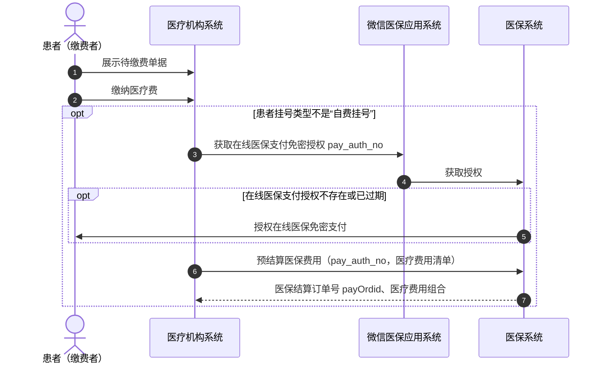
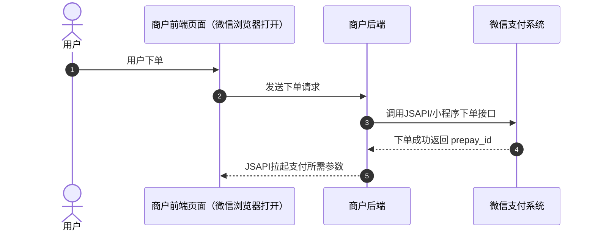
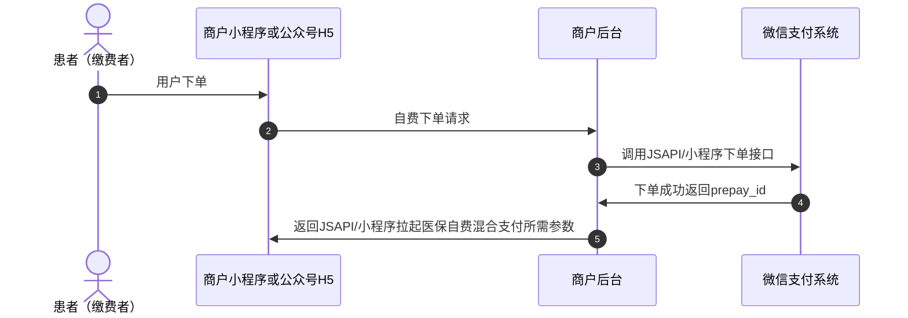
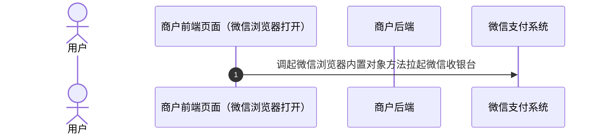
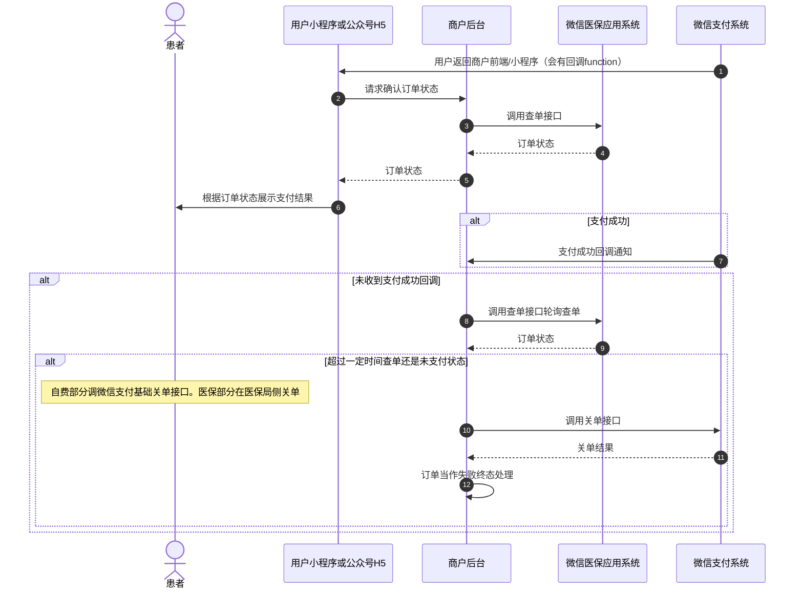
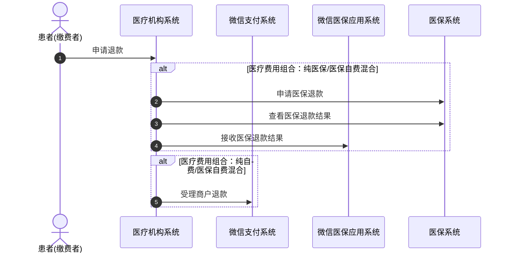
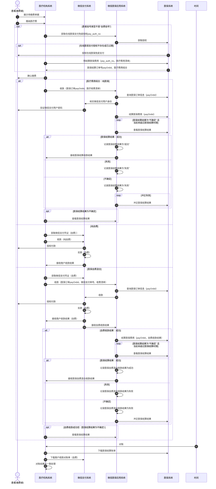

>更新时间：2026.10.22

微信支付为接入移动医保支付的合作伙伴及商户提供专属技术支持，涵盖全流程接入指引与报错协助排查。

注意

- 开发前，请确保已完成【[开发接入准备](https://pay.weixin.qq.com/doc/v3/merchant/4016824684.md)】中的权限申请、医院立项、前置接口对接等准备工作;

- 如需申请技术支持，请通过微信搜索添加「微信支付医疗健康助手」（微信号：Wechatpay\_BDzhushou），申请通过后将邀请您加入技术支持微信群，获取官方协助。

## 1、整体业务开发流程概览

完整业务流程时序图详见本文「3、整体流程时序图」章节。

### 1.1、缴费授权

用户先进入缴费流程，完成缴费授权后，系统返回医保局支付授权码（ `pay_auth_no`）及医保局订单（ `pay_order_id`）。其中 `pay_auth_no`、 `pay_order_id` 将作为后续非纯自费场景下商户下单的重要入参。

### 1.2、下单

- 医保自费混合：先调用[JSAPI/小程序下单](https://pay.weixin.qq.com/doc/v3/merchant/4012791856.md)获取预支付ID（prepay\_id）等微信支付下单信息；再携带医保局支付授权码（pay\_auth\_no）、医保局订单（pay\_order\_id）等调用[医保自费混合收款下单](https://pay.weixin.qq.com/doc/v3/merchant/4016781466.md)接口，下单成功后返回医保自费混合订单号（ `mix_trade_no`）等订单信息。

- 纯医保：直接调用医保自费混合收款下单接口

- 纯自费：直接调用微信支付基础支付接口（如JSAPI下单）完成收款即可。或先调用[JSAPI/小程序下单](https://pay.weixin.qq.com/doc/v3/merchant/4012791856.md)获取预支付ID（prepay\_id）等微信支付下单信息，再调用[医保自费混合收款下单](https://pay.weixin.qq.com/doc/v3/merchant/4016781466.md)接口。两种方式均可。

### 1.3、拉起收银台

商户在获取预支付ID（ `prepay_id`）、应用ID（ `appid`）、签名（ `paySign`）等参数后，由小程序或公众号H5拉起医保支付流程。

### 1.4、支付与结算

用户完成自费支付（含自费场景下），自费支付成功后系统自动触发医保结算。

若医保结算超时，微信医保应用系统会自动触发冲正，撤销已完成的医保结算并释放冻结资金。冲正成功后该笔订单不可再发起支付。

### 1.5、支付结果获取

商户调用[使用医保自费混合订单号查看下单结果](https://pay.weixin.qq.com/doc/v3/merchant/4016781479.md)接口确认订单最终状态，可根据查询结果展示支付状态并更新内部订单状态。

医保混合收款成功后，微信支付还会向商户发送[医保混合收款成功通知](https://pay.weixin.qq.com/doc/v3/merchant/4016781554.md)。

### 1.6、对账

自费部分可在商户平台[申请交易账单](https://pay.weixin.qq.com/doc/v3/merchant/4012791866.md)，医保部分可在医保局侧下载医保结算账单。

### 1.7、退款

退款处理分为自费退款和医保退款两类：自费退款由商户调用微信支付标准退款申请完成处理；医保退款由医保侧退款成功后，商户调用[医保退款通知](https://pay.weixin.qq.com/doc/v3/merchant/4016781561.md)接口进行退款结果同步，最终完成医保退款通知。

## 2、详细步骤说明

### 2.1、医院发起缴费

用户在医疗机构系统确认缴费金额后进入缴费流程。

- 非纯自费场景下，医疗机构系统需要先向微信医保应用系统获取在线医保支付授权，并由微信医保应用系统进一步向医保系统获取授权结果。若授权不存在或已过期，需引导用户重新完成授权后再继续。

- 拿到有效的 `pay_auth_no` 后，医疗机构系统向医保系统发起医保费用预结算，请求中携带 `pay_auth_no` 和医疗费用清单。

- 医保系统完成处理后，返回医保结算订单号 `pay_order_id` 以及本次医疗费用组合结果。

- 随后医院完成费用明细上传，并将 `pay_auth_no`、 `pay_order_id` 及医疗费用组合同步至商户后台，作为后续"下单"环节的重要输入。

医保侧返回参数说明

- `pay_order_id`：医保局返回的支付单 ID。

- `pay_auth_no`：医保局返回的支付授权码。

关键说明

- 纯自费场景不依赖医保授权与医保费用确认流程，可直接进入自费下单链路。

- 非纯自费场景下， `pay_auth_no` 和 `pay_order_id` 是后续混合支付下单的关键入参，必须确保来源于同一笔有效的医保缴费上下文。

- 若授权失效或授权状态不明确，应先重新完成授权，再继续医保费用确认，避免出现后续下单失败或医保结算不一致的问题。

### 2.2、商户下单

#### 2.2.1、自费下单

商户通过调用[JSAPI/小程序下单](https://pay.weixin.qq.com/doc/v3/merchant/4012791856.md)接口生成订单并获取预支付ID。

下单接口关键参数说明：

`openid`：用户在商户下单的appid下唯一标识，获取方式详见[参数说明](https://pay.weixin.qq.com/doc/v3/merchant/4012068676.md)。

`time_expire`：支付结束时间。若传递该参数，则用户只能在订单设置的支付结束时间 `time_expire` 之前进行支付，超过支付结束时间后，用户支付将收到："订单已超过商户设置的最晚支付成功时间，请重新发起支付"的提示，商户需对订单进行关单处理。若不传该参数，默认订单支付有效期为7天，用户可在7天内进行支付，超出7天，订单将被关闭。

`prepay_id`：预支付交易会话标识。调起支付时需要使用的参数， `prepay_id` 有效期为2小时，超过2小时，商户需要使用原下单参数重新请求下单接口，获取新的 `prepay_id`。

#### 2.2.2、医保自费混合收款下单

完整业务流程时序图详见本文「3、整体流程时序图」章节。

商户通过调用[医保自费混合收款下单](https://pay.weixin.qq.com/doc/v3/merchant/4016781466.md)接口，创建医保自费混合支付订单。该接口支持纯自费、纯医保和医保自费混合三种支付类型。下单成功后，接口返回 `mix_trade_no`（医保自费混合订单号）及调起支付所需的参数。

下单接口关键参数说明：

`mix_pay_type`：混合支付类型。枚举值： `CASH_ONLY`（纯自费支付）、 `INSURANCE_ONLY`（纯医保支付）、 `CASH_AND_INSURANCE`（医保自费混合支付）。

`appid`：医疗机构的公众号/小程序ID。

`openid`：用户在appid下的唯一标识。

`out_trade_no`：商户订单号。含自费场景下，商户需先调用微信支付下单接口（带上 `out_trade_no`），再调用本接口（也带上 `out_trade_no`），两次请求中的 out\_trade\_no 应保持一致。纯医保下单时，沿用医院传过来的 `out_trade_no` 即可。

`serial_no`：医疗机构订单号（如医院 HIS 系统订单号）。需与【6201】费用明细上传中 medOrgOrd 字段值一致，局端会校验，不一致将导致支付失败。

`pay_order_id`：医保局返回的支付单 ID。纯医保支付或医保自费混合支付时必填，纯自费支付时禁止填写。

`pay_auth_no`：医保局返回的支付授权码。纯医保支付或医保自费混合支付时必填，纯自费支付时禁止填写。

`total_fee`：使用该接口下单的总金额，单位分。total\_fee = med\_ins\_gov\_fee + med\_ins\_self\_fee + med\_ins\_other\_fee + wechat\_pay\_cash\_fee + cash\_reduce\_detail。

`wechat_pay_cash_fee`：实际需要用户微信支付的金额，单位分。纯自费支付或医保自费混合支付时必填，纯医保支付时禁止填写。

`prepay_id`：微信支付预支付交易会话标识，来源于自费下单接口，有效期 2 小时。纯自费支付或医保自费混合支付时必填，纯医保支付时禁止填写。

`callback_url`：回调通知 URL，必须为 HTTPS 地址，不允许携带查询串。

关键返回参数说明：

`mix_trade_no`：医保自费混合订单号，后续查单时优先使用该字段。

### 2.3、商户调起医保支付

商户在下单成功后，根据前端载体不同，分为 [JSAPI调起医保自费混合支付](https://pay.weixin.qq.com/doc/v3/merchant/4016781549.md)和[小程序调起医保自费混合支付](https://pay.weixin.qq.com/doc/v3/merchant/4016781545.md)两种方式。

调起支付关键参数说明：

`mixTradeNo`：混合收款单 ID，来源于医保自费混合收款下单接口返回的 `mix_trade_no`。

### 2.4、用户支付

用户在微信收银台完成支付或取消支付后，返回商家前端/小程序页面。此时微信浏览器内置对象/小程序会向前端返回支付流程结果回调，商家需调用查询订单 API 接口确认订单状态，并根据查单结果向用户展示支付结果。查单方式：[使用医保自费混合订单号查看下单结果](https://pay.weixin.qq.com/doc/v3/merchant/4016781479.md)

如果用户支付成功，微信支付系统还会异步向商户发送[医保混合收款成功通知](https://pay.weixin.qq.com/doc/v3/merchant/4016781554.md)。若商户在 30 秒内未收到回调，应主动调用查单接口确认订单状态。具体实现方案商户可以参考[支付回调和查单实现指引](https://pay.weixin.qq.com/doc/v3/merchant/4012075249.md)。

按 `mix_trade_no` 查单关键请求参数：

`mix_trade_no`：医保自费混合订单号，下单成功时返回。优先使用该字段查单。

按 `out_trade_no` 查单关键请求参数：

`out_trade_no`：商户系统内部订单号。

关键返回参数说明：

`mix_pay_status`：医保自费混合订单支付状态。枚举值： `MIX_PAY_CREATED`（等待支付）、 `MIX_PAY_SUCCESS`（支付成功）、 `MIX_PAY_REFUND`（自费和医保均已退款）、 `MIX_PAY_FAIL`（支付失败）。

`self_pay_status`：混合订单中自费部分的支付状态。枚举值： `SELF_PAY_CREATED`（等待支付）、 `SELF_PAY_SUCCESS`（支付成功）、 `SELF_PAY_REFUND`（已退款）、 `SELF_PAY_FAIL`（支付失败）、 `NO_SELF_PAY`（订单不含自费部分）。

`med_ins_pay_status`：混合订单中医保部分的支付状态。枚举值： `MED_INS_PAY_CREATED`（等待支付）、 `MED_INS_PAY_SUCCESS`（支付成功）、 `MED_INS_PAY_REFUND`（已退款）、 `MED_INS_PAY_FAIL`（支付失败）、 `NO_MED_INS_PAY`（订单不含医保部分）。

若因特殊原因需在用户可支付时间范围内关闭订单，自费部分可调用[关闭订单](https://pay.weixin.qq.com/doc/v3/merchant/4012791860.md)接口，医保部分需要在医保局侧进行关单处理。

### 2.5、冲正

详细参考：[冲正流程与处理机制](https://doc.weixin.qq.com/slide/p3_AOYAowZ1ACcLnji5ylzSte9DUI2un?scode=AJEAIQdfAAo8BorZ4SAOYAowZ1ACc)

### 2.6、对账

自费部分可在商户平台[申请交易账单](https://pay.weixin.qq.com/doc/v3/merchant/4012791866.md)，医保部分可在医保局侧下载医保结算账单。

### 2.7、退款

退款处理分为自费退款和医保退款两类，需分别处理。

自费退款： 商户调用微信支付[退款申请](https://pay.weixin.qq.com/doc/v3/merchant/4012791862.md)接口发起自费部分的退款。退款成功后，退款金额将原路返回至用户支付账户。

医保退款： 医保部分的退款由医保侧处理完成后，商户调用[医保退款通知](https://pay.weixin.qq.com/doc/v3/merchant/4016781561.md)接口接收医保退款结果，完成退款闭环。需要注意的是，医保退款除线上流程外，医院也可通过线下窗口直接办理，线下退款流程不经过微信支付系统。

医保退款通知接口关键参数说明：

`mix_trade_no`：医保自费混合订单号。

`out_refund_no`：商户退款单号。有自费单时，应填与[退款申请](https://pay.weixin.qq.com/doc/v3/merchant/4012791862.md)处一致的 `out_refund_no`；否则透传医疗机构退款单号即可。

`med_refund_total_fee`：医保退款的总金额，单位分。

`med_refund_gov_fee`：医保统筹退款金额，单位分。

`med_refund_self_fee`：医保个账退款金额，单位分。

`med_refund_other_fee`：医保其他退款金额，单位分。

`refund_time`：医保退款成功时间，格式为 `yyyy-MM-DDTHH:mm:ss+TIMEZONE`。

## 3、整体流程时序图

注意

商户接入时，查询混合支付结果要通过微信的查单接口，而不是通过中台的接口，否则可能会导致资损。

## 4、测试及环境切换（重要，请医院相关人员一定查看）

测试环境联调完成后，需整理相关材料，通过国家医疗保障局线上平台申请正式环境权限及在联调群通知微信联调人员进行同步验收。具体流程与材料要求可参考[测试及环境切换](https://pay.weixin.qq.com/doc/v3/merchant/4021773498.md)。